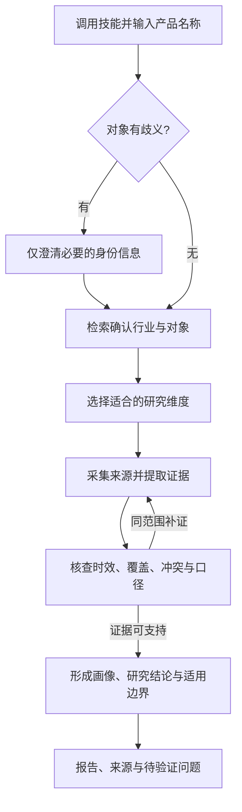

# Steal Her Heart

> **开发预览：Python 当前仅支持初始化与工程验证，研究执行链路未就绪，不能自动产出完整、有证据支撑的竞品报告。** 独立搜索、抓取和摘录绑定用于工程诊断。Codex 宿主工具辅助研究是另一条试验路径，需实际联网和逐条核查，结果以完成的取证为限。

An industry-agnostic competitor research prototype for Python and Codex. The Python research-to-report pipeline is not ready; Codex-assisted research depends on available host tools and source checks.

面向软件、硬件、消费品牌、工业品、本地生活或专业服务。选择 Codex 辅助路径时，先输入想研究的名称，再按需要问答和查证；无需先介绍“我们的产品”、创建项目或填写背景长表。该入口不承诺问答结束后自动生成报告。

Python 已实现无项目入口、离线识别、路由、状态机、本地存储、可选项目的本地终端确认与最终锁定，以及独立公开搜索、静态抓取、来源快照与显式摘录候选绑定。搜索实测遇到 HTTP 202 验证码后已停止，真实命中尚未验收；单个公开示例页抓取已验收。自动语义提取、实质核查、分析和报告仍未接通。

[开始使用](#开始使用) · [当前能力](#当前能力) · [工作流](#工作流) · [可选项目模式](#可选项目模式) · [开发路线](#开发路线)

## 开始使用

### 先选路径，明确做到哪一步

| 路径 | 适合做什么 | 目前怎样算完成 | 不会自动发生的事 |
|---|---|---|---|
| Codex 宿主辅助研究（试验） | 希望现在按名称问答、借助当前可用工具查资料，并人工核查结果 | 实际来源被读取、逐条注明证据与限制；证据不足时只交付有限结果或提纲 | 不保证完整报告，不自动创建 Python 任务、导入资产或写最终锁 |
| Python CLI 初始化与工程验证 | 开发、保存可选项目档案、本地交互锁定已准备的项目范围、检查识别／路由／独立工具 | 当前命令所述操作成功，例如档案保存、范围锁定或快照校验通过 | 不自动推荐维度、发现候选、采集、核查、分析或生成报告 |

**需要现在辅助查证，选 Codex；要验证工程或管理档案，选 Python。** 需要自动完成整份报告时，当前版本尚无可执行路径。两者不会自动同步，聊天分批问答也不是 Python 逐字段访谈的另一种界面。默认单对象请求不要求先初始化项目。

### 安装一次

在 Codex 中发送：

```text
$skill-installer 安装 https://github.com/sakura1412/steal-her-heart/tree/main/codex-skills/steal-her-heart
```

安装的是 [Steal Her Heart 运行技能](codex-skills/steal-her-heart/SKILL.md)，自带研究规则和维度资源。日常使用无需先克隆本仓库、读取文件或安装 Python；仓库中的 `skills/steal-her-heart/` 是开发规范，不是这里要安装的运行包。

安装完成后可在下一轮调用。如果技能选择入口尚未刷新，重启 Codex 后再试。技能的发现与显式调用方式见 [OpenAI 官方说明](https://learn.chatgpt.com/docs/build-skills)。

可独立安装的资源检查、实际安装校验与问答场景试用见 [直接调用验收](validation/direct-skill-installation.json)。

### 直接输入产品名称

一次发送技能名和对象：

```text
$steal-her-heart Notion
```

也可以从 Codex 的技能选择入口选用 **Steal Her Heart（开发预览）**，再输入产品名称。首次会先简短说明当前能力与路径：没有名称才问“你想分析哪个产品？”，已经给了名称就复用，不再增加“是否继续”确认。

如果希望先调用、再由 Agent 引导，只发送技能名：

```text
$steal-her-heart
```

接下来直接聊天即可，例如：

```text
用户：$steal-her-heart
Agent：这是开发预览，Python 自动研究与报告尚未就绪；本次使用 Codex 可用工具辅助查证。你想分析哪个产品、品牌或服务？
用户：Notion
Agent：这次想先看整体概览、产品能力，还是定价？也可以说“按默认开始”。
用户：整体概览，重点讲商业模式。
```

这是交互示例。重点问答可以跳过，用户说“默认”“开始”就继续；用户已附带的重点直接采用，只有确实影响识别的名称歧义才需要先澄清。在同一次研究对话中，可以继续追问“再展开定价”或“把结论整理成表格”，无需重复提供文件路径。

**产品名称就是辅助研究的起点。** 行业、我方产品、市场、目的、读者和项目名均不必先填写。没有额外要求时以通用概览为目标，并注明实际覆盖的地区、版本、日期和资料边界；未完成的取证保持缺口。

技能使用当前 Codex 环境实际提供的工具。不要求先执行 `/init-project` 或候选名单确认；宿主没有联网工具时只说明缺口、给待取证提纲或整理用户已提供材料，不把模型记忆当成本次事实。原仓库的 [分析指令](commands/analyze.md) 保留兼容路由，Codex 辅助查证以安装后的技能为入口；这不代表 Python 路由已开始研究。

### Python 工程原型（开发者）

运行 `steal-her-heart --help` 或具体研究子命令的 `--help`，会先看到“初始化与工程验证／研究执行链路未就绪”的说明。

需要 Python **3.9+**，建议开发使用 **3.11+**。以下适用于 macOS／Linux：

```bash
git clone https://github.com/sakura1412/steal-her-heart.git
cd steal-her-heart
python3 -m venv .venv
source .venv/bin/activate
python -m pip install -e .

steal-her-heart hello
steal-her-heart /analyze Notion
steal-her-heart recognize-brief "比较 Notion、飞书、Confluence 的价格与部署方式"
```

Windows PowerShell 可用 `.venv\Scripts\Activate.ps1` 激活环境，再运行相同的 Python 和 CLI 命令。

`hello` 返回 `Hello, Agent!`；`/analyze Notion` 无需项目即可解析，当前返回 `pending_module`，不创建报告。`recognize-brief` 返回离线规则识别的对象、维度、目的与假设，不联网或验证事实；`ready` 仅表示识别得到可用结果。

### 公开搜索诊断（开发者）

`search` 是独立的工具诊断入口，通过 Registry 调用无需密钥的 DuckDuckGo HTML 公开搜索。它不会启动 `/analyze`，也不生成竞品事实、档案或报告。以下是命令示例，结果取决于当前网络与提供方访问策略：

```bash
steal-her-heart search "Python official documentation" --max-results 5
```

标准输出为完整的 JSON `ToolResult`；标准错误输出 `search_task_id=<UUID>` 和 `search_request_id=<UUID>`，失败时也保留这两个标识，便于之后传入相同参数重放本地记录。`--max-results` 接受 1～10，默认 5，只解析首个结果页，不自动翻页。成功数据中的 `evidence_eligible` 固定为 `false`：标题、链接和摘要仅是后续取证线索，落地网页尚未抓取或核验。

默认账本为 `.steal-her-heart/search-calls.sqlite3`，每个 `task_id` 最多预留 30 次搜索。通过 `--task-id <UUID>` 复用同一任务的额度，通过 `--request-id <UUID>` 标识一次调用，`--search-ledger <路径>` 可指定账本。相同任务、请求和参数的已完成调用可重放本地结果或安全错误，不重复计数或联网；请求标识改参会被拒绝。执行前先持久预留额度，失败同样计数，进程中断留下的未完成调用不会自动重发。搜索与下面的独立抓取分别计数，跨工具调度、模型、轮次和活动时间的全局预算仍待实现。

每次最多尝试一次。验证码、HTTP 403／429 或其他访问限制返回 `SEARCH_ACCESS_RESTRICTED` 并停止，不换入口、不绕验证、不自动重试，也不把失败写成“零结果”或“未找到”。此前真实探测已遇到 HTTP 202 验证页，因此尚未验收真实命中；解析、权限、额度和恢复边界由受控离线测试验证。`search` 成功退出 0，执行或访问受限退出 1，参数无效退出 2。

### 静态网页与来源快照（开发者）

```bash
steal-her-heart fetch "https://example.com/"
```

这是独立的 `web_fetch` 工具诊断，只获取用户给定的公开 HTTP(S) 页面，不自动跟进搜索结果或启动 `/analyze`。当前支持静态 HTML、XHTML 和纯文本；不执行 JavaScript、不跟随重定向、不自动重试。响应最多 1 MiB，CLI 请求超时 15 秒；私网、环回、链路本地地址及混合 DNS 结果会被拒绝。验证码、访问限制或代理认证限制明确返回 `FETCH_ACCESS_RESTRICTED`，不会生成成功来源。

成功后，`.steal-her-heart/sources/` 保存不可变快照，包含原始 bytes、规范化 UTF-8 正文与 manifest。`Source.content_sha256` 对应原始 bytes；manifest 另存正文散列、稳定行数、解析器版本与获取时间。加载时重新核对完整性，缺失或被修改的快照不能作为成功缓存重放。`published_at` 保持未知，不把获取时间或 HTTP 头当成发布日期。

stdout 为 JSON `ToolResult`，包含来源收据和最多 12,000 字符的 `text_preview`；`text_truncated` 表示是否截断，完整正文保存在快照中，`facts_validated` 固定为 `false`。stderr 始终输出 `fetch_task_id` 与 `fetch_request_id`。`--task-id`、`--request-id` 支持同调用本地重放，`--fetch-ledger` 和 `--sources-root` 可覆盖默认位置；抓取账本默认 `.steal-her-heart/fetch-calls.sqlite3`，每任务上限 60 次，错误也计数。搜索和抓取账本有不同数据库标识，不能混用。退出码同样为成功 0、参数错误 2、执行错误 1。

来源快照目前依赖 POSIX 目录能力，支持 macOS／Linux；能力缺失时在预留抓取额度和联网前返回 `FETCH_SNAPSHOT_UNAVAILABLE`。此前已通过实际 CLI 单次获取 `https://example.com/`，验证快照重开、散列与同请求本地重放，账本仍为一次调用；没有再次请求受限的搜索服务。这个结果只验收公开示例页抓取路径，不能证明任意站点、搜索命中或完整竞品研究可用。

这一模块提供后续取证可检查的原文。页面内的指令仍是不可信数据；保存 Source 不证明某条主张成立，也不创建 Evidence、Validator 的 PASS 或可读研究报告。确定性测试与真实网络验收分别记录在 [validation/](validation/)。

### 显式摘录与候选定位（开发者）

```bash
steal-her-heart extract-candidates "sha256:<manifest-digest>" \
  --text-sha256 "<text-sha256>" \
  --competitor "产品名" --dimension "研究维度" --span 0:20
```

将占位符替换成 `fetch` 返回的 `document.source.snapshot_ref` 和 `document.text_sha256`，按该版本的完整规范正文选择 `--span`，可重复指定。索引按 Unicode 码点计算，从 0 开始、包含 start、不包含 end；每段最多 4,000 字符，每次 1～20 段。行号从 1 开始。`--sources-root` 默认 `.steal-her-heart/sources`，快照缺失、被修改或正文散列不匹配时明确失败。

此命令在本地只读执行，通过 Registry 要求 `evidence_extraction` 能力，5 秒超时。stdout 是 JSON `ToolResult`，stderr 输出 `extraction_task_id`；成功退出 0、参数错误 2、其他执行错误 1。没有网络、模型调用、调用账本、任务存储或文件写入。

输出为 `status=candidates_only`，每个候选保留精确 `quote`、相同的 `fact`、来源快照及正文散列、字符范围、行号和确定性 ID，`support_status=unvalidated`、`facts_validated=false`。这里只绑定调用者明确选中的片段，不自动挑选或改写事实，不判断它是否支持该对象／维度的主张，也不生成现有 `Evidence`、Validator PASS 或报告。原获取日期保持不变，候选的可定位性不代表时效或跨任务复用已经通过。

### SaaS／工具类推荐配置（可选）

在用户明确选择该研究方式，或实际资料确认适用时，可使用 [SaaS 采集指南](codex-skills/steal-her-heart/references/saas.md) 和 [推荐配置](src/steal_her_heart/presets/saas.json)。它在通用库之上选择15个核心字段并加入10个专项字段，每个字段给出优先级、采集问题、比较条件和源提示，保留所有行业的原有默认入口。

```bash
steal-her-heart preset saas
```

| 顺序 | 推荐重点 |
|---|---|
| P0：先确认可比性 | 定位与任务、核心供给及交付、版本价格计费、功能广度／深度、免费／试用与升级路径 |
| P1：解释落地与持续使用边界 | API／集成生态、迁移和数据锁定、近期迭代、G2／Capterra评价样本及其上下文 |
| P2：按研究目的补充 | 代表客户、安全、治理及相关要求 |

源清单给出官网、定价、产品／API文档、集成目录、导入导出和删除文档、Changelog、状态页、相关公开仓库发行页及评价平台的查找方向。产品具体 URL 必须发现后核对；G2／Capterra 入口没有被接成自动采集器。G2 合作伙伴评论 API 需要专用密钥，配置不会把它当作免密服务。[G2 官方说明](https://documentation.g2.com/partners/docs/get-started-with-g2-review-syndication/)

可进一步对用户提供的评价样本做机械检查：

```bash
steal-her-heart preset saas --review-sample reviews.json --as-of 2026-11-04
```

默认建议近365天、每个平台每个低／中／高评分段目标3条，并保留日期、评分、公开角色／规模、激励和验证标签、链接及原文。缺失、未知、重复、访问受限和采样不足明确列为缺口；分层主动选样不代表总体分布，不能用其均值或少量抱怨推算总体评分和投诉率。激励标签需要保留，Capterra 说明其收集激励和非激励评论。[Capterra 官方说明](https://www.capterra.com/resources/how-we-verify-reviews/)

`preset` 只读推荐配置；带样本时只评估所提供元信息与采样覆盖，不访问平台、不核验链接原文、不判断主张语义。配置和样本检查都不创建项目、批准、锁或报告，`facts_validated=false`，不产生 Validator 的 PASS。项目若采用预设，仍须走现有正式提案和锁定流程。详见 [SaaS 配置验收](validation/saas-preset.json)。

## 当前能力

| 能力 | 状态 | 现在的实际行为 |
|---|---|---|
| 直接调用 Codex 技能 | 安装包已提供 | 一次安装后使用 `$steal-her-heart 产品名`，或选技能后输入名称 |
| 仅产品名进入辅助研究 | Codex 试验指令可用、Python 路由已实现 | 不要求我方产品或项目初始化；不表示自动报告链已就绪 |
| ResearchBrief 识别 | 已实现，离线规则 | 明确句式识别对象、维度和目的，歧义返回问题 |
| 无项目任务与恢复 | 已实现基础 | 保存 `project_context=None` 的任务，当前停在 `UNDERSTANDING` |
| 命令与自然语言路由 | 已实现 | 解析三类任务，缺对象或周期时澄清，完整请求返回待接入状态 |
| 状态机、工具 Registry、SQLite | 已实现基础 | 校验迁移、输入输出和权限，保存快照及事件 |
| 通用维度与读者结构 | 资源／契约就绪 | 21 个核心字段、15 个可选扩展，读者可省略或自定义 |
| 可选 SaaS／工具推荐配置 | 配置与采样覆盖检查可用 | 25个推荐字段含优先级、问题和源提示；只检查提供的样本，不执行研究或语义核查 |
| 可选项目访谈与档案 | 已实现 | 逐题收集背景，保存 Markdown，兼容旧档案并支持续接 |
| 项目评审与锁定 | 本地终端交互入口已接入 | 两次审阅确认、名单批准持久化与最终锁回读；不认证 Codex 聊天回复，不启动研究 |
| Python 公开搜索诊断 | 独立模块已接入，真实命中未验证 | 单次无密钥搜索、持久搜索额度；当前实测验证码后停止，命中仅作线索 |
| Python 静态抓取与来源快照 | 独立模块已接入，单个公开示例页已实测 | 原文／正文／manifest 可保存重读，校验散列；不表示事实已核验 |
| 显式摘录候选绑定 | 独立只读模块已实现 | 原文精确片段绑定散列、范围与行号；未核验，不自动语义提取 |
| Python 自动语义提取、实质核查、分析、报告 | 待接入 | 没有自动运行完整研究的执行器；`/analyze` 不调用独立工具 |
| 跨任务研究资产复用 | 未实现 | 当前快照、事件、来源存盘和调用重放不提供增量证据更新 |
| 模型与运行时 Prompt | 未接入 | ResearchBrief 仍为离线规则；六份 Prompt 尚未作为真实运行组件落地 |

## 工作流

下图是目标研究工作方式。Codex宿主辅助试验可按实际可用工具逐步执行并人工核查；Python取证到报告链路仍在开发，两条路径不自动衔接。



用户点名的对象就是本次范围，不自动扩大为多竞品采集，不额外设置“维度确认＋候选确认”初始化门槛。需要增加其他对象或实质改变范围时，再请用户选择。

研究重点可通过少量问答逐步明确，也可以直接采用默认概览。名称和重点已经给出时，不重复访谈；问答不会变成必须先填完的项目表格。

辅助研究以定位与客群、核心产品／服务、交付方式、价格与商业模式、价值主张、口碑、近期动态和适用边界为候选内容，只交付本次证据可支持的部分；按行业调整，不强制每个对象都有AI、API、移动端或软件版本。

**没有我方背景时，报告不会编造我方优势、领先／落后或赢输判断。** 输出研究结论、通用学习点和建议验证的问题。用户要求“与我们相比怎么样”或销售 Battlecard 时，只补问该对比需要的产品与场景信息，不要求先答完十一题。

## 命令与当前行为

| 输入 | 目标用途 | 当前 Python 行为 |
|---|---|---|
| `/analyze 竞品名` | 分析单个对象并更新档案 | 无需项目，完整请求返回 `pending_module` |
| `/battlecard 竞品名` | 复用竞品画像形成销售卡 | 返回 `pending_module`；生成我方回应和优势前需相关我方背景 |
| `/brief 周报` 或 `/brief 月报` | 汇总已有研究资产 | 返回 `pending_module`；后续需明确周期与资产范围，无需我方产品 |
| `/init-project` | 可选长期研究或我方对照配置 | Python 支持逐题访谈，聊天支持分批引导 |

```bash
steal-her-heart request "/analyze Notion"
steal-her-heart request "帮我分析海底捞"
steal-her-heart request "/battlecard 任意品牌"
steal-her-heart /brief 月报
```

Python 路由支持明确命令与已有自然语言句式，不能把任意文本都猜成竞品名称。Codex 加载 Skill 后可以根据上下文处理裸名称。`recognize-brief` 是离线需求识别，`/brief` 是周期报告意图；旧命令 `brief` 仅是前者的兼容别名。

`run`／`resume` 当前保存任务并停在 `UNDERSTANDING`。默认状态库为 `.steal-her-heart/memory.sqlite3`，可用 `--db` 指定；无项目任务不创建 `projects/default/`。绑定项目的任务恢复仍须使用一致的背景，不能把无项目与有项目上下文混用。

CLI 退出码：`0` 为本次操作成功，`1` 为执行或存储错误，`2` 为输入无效，`3` 为需要澄清、等待后续模块等未完成状态。返回 `3` 不等于已生成报告。详细入口见 [命令规范](skills/steal-her-heart/references/commands.md)。

`/analyze`、`/battlecard`、`/brief` 的完整请求仍返回 `pending_module`，同时提供结构化 `guidance`：缺少的能力 `missing_modules`、可执行的下一步 `next_steps`，以及适用时可复制到 Codex 的 `codex_prompt`。终端提示写到 stderr，stdout 保持一份 JSON，方便脚本读取。下一步会按请求区分：单对象可转到 Codex 辅助查证；Battlecard 的我方回应需双方材料；周／月报需指定对象、起止日期与来源材料，不能从尚无资产查询的库中自动取数。重新初始化或重复调用不会补齐模块，也没有隐藏的“继续生成”命令。

## 可选项目模式

这是克隆并打开本仓库后的高级工程功能，适用于长期跟踪一组对象、保存特定读者与关注点，或反复做我方产品对比。普通技能调用不需要它。

在仓库上下文中，可以让 Codex 按 [可选初始化指令](commands/init-project.md) 创建项目：

```text
按 commands/init-project.md，为我的长期研究创建 my-product 项目。
```

聊天按 [可选初始化指令](commands/init-project.md) 每轮问 2～3 题；Python 终端仍一次一题：

```bash
steal-her-heart --project-name my-product /init-project --interactive
steal-her-heart --project-name my-product project-status
steal-her-heart --project-name my-product /analyze Notion
```

项目使用 `projects/<项目名>/profile.md`、dimensions.md 和独立 `.state/`，标准 [profile 模板](templates/profile.md) 继续保留。只有显式选择项目时才读取这些文件；项目不存在或档案未完成会提示处理该项目，不影响独立单对象入口。

**Python 访谈结束的 `ready`／退出0，只表示 profile 已保存且满足当前字段检查。** 它不会自动进入维度推荐、候选发现、名单确认、最终锁定或采集；CLI 会提示这个完成边界与下一步。`project-status` 同样只是档案状态。

在 Codex 宿主辅助路径中，可另按指令推荐维度、发现并确认直接竞品、替代品、潜在进入者与标杆，仍须实际工具和来源。聊天中的确认不会自动调用 Python review API，不能把预确认草案冒充正式锁，也不能为运行默认分析伪造项目背景。详见 [项目文件说明](projects/README.md) 和 [研究工作流](skills/steal-her-heart/references/research-workflow.md)。

### 本地终端确认与最终锁定

已有项目档案、候选提案和维度选择后，可在自己的交互终端执行：

```bash
steal-her-heart --project-name my-product review-project --review-file /path/to/review.json
```

`review.json` 是按 [ProjectReviewRequest](src/steal_her_heart/project_review.py) 准备的提案输入：包含发现提案、预选候选 ID、版本化维度库、核心与扩展字段选择、选择依据，以及必要时的读者配置。输入只表达“建议研究这些对象和字段”，不能携带批准、回复或自填的用户同意；候选来源和配置也不会因导入而成为已核验事实。

这个命令会依次：

1. 读取当前项目背景，展示候选、预选名单、分类缺口、依据与来源，请本地用户输入当次确认 token。
2. 同意后保存名单提案和批准记录，生成绑定这次名单的最终 `dimensions.md` 与提案。
3. 展示最终维度和新的确认 token，再次读取本地用户的明确选择。
4. 同意后写锁，并回读名单、提案、Markdown 与锁，核对完整绑定链；成功才返回 `status="locked"`、`scope_locked=true` 和按对象准备的 jobs。

`research_ready` 始终为 `false`：jobs 是后续执行的输入，命令不会启动采集、子代理、分析或报告。拒绝、旧 token、项目或文件改动、写入或回读失败都不能被报告为锁定成功。已有评审和锁不自动覆盖；中断或失败后应先检查记录与文件，不能把重复运行当作已实现的恢复流程。存储失败时 `record_path` 只是预期位置，不保证记录文件已经写成。检查记录见 [项目评审验收](validation/project-review.json)。

命令要求 stdin 和 stderr 都是交互终端，拒绝管道式自动确认，也没有 `--yes`。TTY 只是本地交互边界，不能认证人类身份或 Codex 聊天消息来源；模型和脚本不得通过 PTY 代替用户输入 token。**这轮接通的是本地终端确认到最终锁定，Codex 聊天的可信回复自动桥接仍未实现。** 默认只输入产品名的使用方式不增加这两次项目确认。

## 如何扩展

一个 Orchestrator 协调 Planner、Research、Validator、Analysis、Reporter 与 Memory。模块通过 Pydantic Schema 传递数据，Python 工具经过统一 Registry，状态变化由显式状态机约束。当前尚未接入真实模型提供方。

新增行业可从 [维度库](library/dimensions.md) 选择或定义字段，不必修改行业白名单。扩展读者视图共用证据；用户未选读者时保留通用报告。模型或工具适配通过模块端口接入，不让主控直接承担网页解析或事实推理。

```text
steal-her-heart/
├── AGENTS.md                  仓库规则
├── codex-skills/
│   └── steal-her-heart/       可独立安装的 Codex 运行技能
│       ├── SKILL.md           直接调用与问答规则
│       ├── agents/            技能显示与默认调用提示
│       └── references/        随技能提供的维度资源
├── commands/analyze.md        仓库兼容分析入口
├── commands/init-project.md   可选项目初始化
├── library/                   全行业维度推荐库
├── templates/profile.md       可选项目背景模板
├── skills/                    仓库兼容入口与 Agent 开发规范
├── src/steal_her_heart/        Python CLI、Schema 和基础实现
├── research/                  Codex 实际研究后保存的本地报告与来源
├── projects/                  可选业务项目及上下文
├── tests/                     确定性离线测试与组件集成
│   └── acceptance/            受控参考工作流及边界验收，不是生产研究执行器
├── docs/acceptance.md         验收分层、场景矩阵和仍未验证的范围
├── docs/roadmap.md            P0／P1／P2 优先级、实际状态和模块依赖
└── validation/                分阶段本地验收记录
```

`research/` 仅在实际生成产物后创建；Python 当前不生成这些报告。它与业务项目数据一样留在本地，不默认上传。

## 研究质量约束

- 事实来自本次检索，附来源链接和获取日期；训练记忆只提供查询线索。
- 官方宣称、第三方资料、用户反馈和分析判断分开，冲突明确展示。
- “未采集”“查找后未找到”“有理由不适用”分别记录；未知价格、能力和效果不推测补全。
- 价格、版本、规模与动态保留地区、单位、日期等适用条件。
- 无我方背景时不给虚构的我方对照；同一研究的不同读者视图共用事实。

这些规则需要实际取证与核查落实。Schema 只检查部分结构和引用关系，不能证明来源支持、语义正确或 Battlecard 已排成一页。完整约束见 [AGENTS.md](AGENTS.md)、[读者视图](skills/steal-her-heart/references/audience-views.md) 和开发规范。

目前已落到代码的约束与未完成部分分开看：

| 范围 | 当前真正检查什么 | 仍不能据此声称什么 |
|---|---|---|
| 独立工具 | 参数、能力、公开地址、大小／超时与受限停止；快照散列和精确摘录定位 | 网站当前事实正确、页面原文支持任意改写主张 |
| 采集对象 Schema | 每条信息的来源／日期／证据ID等字段结构；未找到与访问失败的状态约束 | 链接已访问、证据ID真实存在且语义充分 |
| SaaS 配置与评论样本检查 | 推荐定义、来源引用和优先级完整；提供的样本元信息、时间窗、重复和分层覆盖 | 评论采集已执行、评价代表总体、实质 Validator 已通过 |
| 后续 Research／Validator | 尚待实现实际工具结果对账、主张支持、按维度时效、覆盖与冲突核查 | 不能以规则写入文档、结构合法或样本数达标取代这层执行 |

## 开发路线

按用户提出的 P0／P1／P2 推进；逐项现状、依赖和完成标准见 [优先级路线图](docs/roadmap.md)。本轮只交付 P0 范围桥接的本地终端子模块，保留 Codex 回复认证缺口。

- [x] Schema、状态机、Registry、SQLite 与 Orchestrator 基础。
- [x] 无项目单对象入口、离线需求识别与命令路由。
- [x] 开发预览状态披露、两路径完成边界与未就绪请求的下一步指引。
- [x] 可独立安装的 Codex 技能，直接输入名称与按需问答。
- [x] 可选项目档案、十一题访谈、中断续接与旧格式兼容。
- [x] 单对象 Codex 分析指令、通用维度库与项目评审 API。
- [x] 可选项目的本地终端两次确认、名单批准持久化及最终锁回读；不自动启动研究。
- [x] 可选 SaaS 推荐组合、优先级、源提示和提供样本的机械覆盖检查；不改全行业默认。
- [x] 独立公开搜索工具、CLI 诊断与跨重启搜索计数；受控测试覆盖访问受限等分支。
- [x] 独立静态网页抓取、不可变来源快照与跨重启抓取计数。
- [ ] 验证公开搜索的真实命中路径（当前真实探测遇到验证页，已停止）。
- [x] 对显式选择的原文片段生成未核验候选，绑定散列、字符范围与行号。
- [x] 受控的测试专用参考工作流与“未找到／不适用／显式冲突”边界验收；替身范围单独披露。
- [ ] 真实生产入口从 brief 到联网采集、实质核查和报告的端到端验收。
- [ ] 接入自动语义候选提取与实质 Validator，核查来源支持、时效、覆盖和冲突。
- [ ] 接入 Python Planner 与实际研究调度、全局预算和无进展终止。
- [ ] 实现有预算和恢复能力的研究执行、核查与补证。
- [ ] 实现分析、Battlecard、通用／配置读者报告与版式验收。
- [ ] 完成 Codex 可信聊天回复到最终锁的自动衔接、真实模型与运行时 Prompt、批量子代理调度和跨任务资产复用。

后续模块各自验收，不能以 Schema 合法或生成了一份示例文件代替：

| 模块 | 仍需实现的行为与完成标准 |
|---|---|
| Evidence 与 Validator | 当前只绑定显式摘录；仍需自动语义提取、检查主张是否被来源支持、时效、必需单元覆盖与冲突；不足返回具体补证项，不发出假 PASS |
| Analysis | 仅依据通过核查的共享 Evidence 做横向比较、差异和机会／威胁判断，逐条引用并披露推断及限制 |
| Reporter | 实际生成可读通用报告、Battlecard、周报／月报及所选读者视图，来源可对账，并验收一页卡片的版式 |
| 聊天确认到最终锁 | 本地终端链已接入；仍需验证 Codex 可信用户消息来源，并将回复绑定本次提案与锁定流程；不能用 JSON 中的 user 标签或 PTY 输入代替用户同意 |
| 真实 LLM 与 Prompt | 接入实际提供方、受约束结构化输出和预算；落地非空运行时 Prompt，并用多行业、否定、歧义和提示注入夹具评测 |
| 跨任务资产复用 | 按实体、维度、地区／版本和时效策略检索可用资产；保留来源与提取版本、原获取时间及更新链，过期或变化时刷新，不能给旧证据重贴本次日期或复制旧 PASS |

当前 Memory 支持同一任务的快照恢复和状态事件。`revision` 用于并发提交检查，提交会覆盖该任务的当前快照；事件只记录状态信息，不能重建历史 Evidence。`active/archived` 和 `memory_reference` 也只是字段。来源文件可按明确引用重读、调用可按同任务／请求重放，都不等于“上次采过的证据这次增量更新”。

后续复用须保留 `origin_task`、来源／正文／提取器／Schema 版本、原证据与 `supersedes` 更新链，历史报告继续引用旧版。即使仍在 TTL 内，也不能直接标为本次已核验：保留原 `fetched_at`，另记本次 `revalidated_at` 及核验依据。过期、来源内容或比较口径变化需重新采集／核查；预算不足或刷新受限时保留旧版并明确未更新，不污染其他项目，也不自动继续联网。

## 测试与验收

验收分为真实组件检查、受控参考工作流和真实生产端到端三个层次，详见 [验收说明与场景矩阵](docs/acceptance.md)。`tests/acceptance/` 会把 brief、工具调用、来源快照和摘录候选等已有组件连起来；尚未实现的计划、实质核查、分析与报告步骤由明确的测试替身或夹具承担。它可以生成标为 `SIMULATION` 的临时参考报告，用于检查数据传递、来源引用和失败分支，不能证明这些生产模块已实现。

```bash
.venv/bin/python -m pytest tests/acceptance -q
```

上述验收使用合成页面和预先声明的场景，不需要密钥，报告只写到 pytest 的 `tmp_path`，不会进入业务 `research/` 或 `projects/`。HTTP I/O 替换与已知 socket／subprocess 入口的 monkeypatch guard 用于阻止误联网，属于测试内检查，不是操作系统沙箱。交付故障注入检查临时报告部分写入失败、拒绝覆盖与最终 Memory 提交失败后的清理，不把失败任务标为完成。边界矩阵直接调用真实 Schema 和状态 guard，检查“未采集／访问失败”不能冒充“未找到”、不适用需字段许可与理由，以及显式冲突不能被包装成 PASS 或越过分析闸门。这里测试的是已给出的冲突及其阻断行为，自动发现语义冲突仍未实现。

**当前没有通过生产 Orchestrator／CLI 跑通的真实研究到报告端到端测试。** 参考工作流通过后，`/analyze`、`/battlecard`、`/brief` 仍为 `pending_module`，`run/resume` 仍停在 `UNDERSTANDING`。测试替身的 PASS、模拟状态推进或临时报告都不能改写这个能力边界。

## 参与开发

先读 [开发 SKILL.md](skills/steal-her-heart/SKILL.md)、[RULES.md](skills/steal-her-heart/RULES.md) 与 [TASK_SPEC.md](skills/steal-her-heart/TASK_SPEC.md)。按模块实现并完成对应检查，再推进下一模块；不要把指令、Schema 或离线测试当成端到端研究已经完成。

```bash
python -m pip install -e ".[dev]"
python -m pytest -q
python -m ruff check .
python -m ruff format --check .
```

[requirements-dev.lock](requirements-dev.lock) 是 Python 3.9／macOS 的精确依赖快照，不是带哈希的跨平台锁。在匹配环境可先安装该文件，再用 `--no-deps --no-build-isolation` 安装项目；其他环境应验证依赖兼容性。

[项目评审验收](validation/project-review.json) 记录本地终端确认、范围绑定、落盘与最终锁回读；[参考工作流与边界验收](validation/workflow-acceptance.json) 记录受控模拟、真实 guard 和未实现模块的替身范围；[SaaS 配置验收](validation/saas-preset.json) 记录推荐定义、两端资源一致性和样本覆盖检查；[入口就绪说明验收](validation/entry-readiness.json) 记录帮助、下一步指引和技能边界；[显式候选绑定验收](validation/evidence-candidates.json) 记录只读摘录与定位检查；[静态抓取与快照验收](validation/web-fetch.json) 记录受控测试和单个公开示例页的实际执行；[公开搜索模块验收](validation/web-search.json) 记录离线测试与真实访问限制，明确区分二者；[单对象入口验收](validation/standalone-entry.json) 记录入口调整。[validation/](validation/) 保留分阶段历史记录，包含初始化、配置、离线需求识别和框架校验。历史记录对应当时版本，不能替代当前代码回归或证明真实网页与模型研究已经跑通。默认忽略本地报告、业务项目、环境变量、数据库与输出。

## 许可证

本仓库暂未指定开源许可证。
