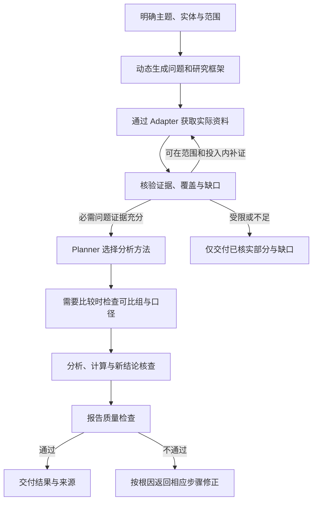

# steal her heart

**在 Codex 中使用的全行业竞争情报研究 Agent。**

给出一个产品、企业、品牌，或直接提出定价、渠道、市场、行业与客户选择问题。steal her heart 根据目标设计研究框架，获取和核查证据，判断对象是否可比，再选择适合的分析方法，输出带来源、条件和限制的研究结果。

默认无需介绍我方产品，也无需先创建项目或填写背景问卷。名称或主题明确就开始；真正影响判断的歧义，才按需追问。

> 当前仓库交付一个自包含的 Codex 指令技能包，包含研究规则、方法目录和扩展契约。实际检索、浏览、文件读取与计算依赖当前 Codex 环境提供的工具和授权。规范定义不代表所有平台、行业包或分析方法都已通过真实任务验证。

## 快速开始

### 1. 安装技能

在 Codex 对话中输入：

```text
使用 $skill-installer 安装这个仓库中的技能：
https://github.com/sakura1412/steal-her-heart/tree/main/codex-skills/steal-her-heart
```

也可以将完整的 `codex-skills/steal-her-heart/` 文件夹放入当前项目的 `.agents/skills/` 或个人技能目录 `~/.agents/skills/`。保留 `RULES.md`、`TASK_SPEC.md`、`agents/` 和 `references/`，不要只复制入口文件。安装或更新后如果技能没有出现，重新启动 Codex。安装与发现机制参见 [OpenAI 官方技能说明](https://learn.chatgpt.com/docs/build-skills)。

已有旧版本时更新整个技能目录；保留自己的定制，不在多个位置安装内容不同的同名副本。仓库更新不会自动替换你的本地安装。

### 2. 直接调用

```text
$steal-her-heart Notion
```

或选择 **steal her heart** 技能后，直接说出研究请求：

```text
分析这家制造企业的竞争优势，区分公司与产品层面的证据。
比较两个品牌的高端产品，重点看价格、配置和售后。
研究某个行业在中国市场的竞争格局，标清市场规模的数据来源。
分析这个产品的定价策略，分别核对 Web、App 和桌面端。
```

无须记忆一套命令，也不必手动阅读开发规范。用户没有指定研究深度时按 Standard 规划；明确要求快速了解或深入研究时相应调整投入，事实标准不降低。

### 3. 继续追问

```text
再加入一个对象，只补它的渠道和口碑。
把价格比较限定为相同地区、配置和一年使用周期。
用已有证据改成销售一页纸，缺少我方信息的部分先列出来。
把这份研究分别整理成产品经理与运营关心的简报。
```

Agent 先判断变化影响，再复用、重核或补充资料。旧成果保留，读取旧报告不冒充当前更新。“生成周报／月报”是本次输出请求，不自动创建定时任务。

## 可以研究什么

核心对象称为 **Competitive Intelligence Subject**。它可以是一个现实对象，也可以是围绕对象或市场提出的决策问题。

| 任务类型 | 研究重点 |
|---|---|
| Product Intelligence | 产品价值、能力与适用边界 |
| Company Intelligence | 企业业务与竞争优势 |
| Brand Intelligence | 品牌定位与竞争关系 |
| Service Intelligence | 服务内容、交付与体验 |
| Technology Intelligence | 技术路线、能力和约束 |
| Pricing Intelligence | 价格、收费结构与策略 |
| Channel Intelligence | 销售、分发路径与覆盖 |
| Market Intelligence | 市场结构、规模、格局与机会 |
| Industry Intelligence | 行业环境、产业链与变化 |
| Customer Intelligence | 客户选择与需求变化 |

这些类型可以组合，共享同一套研究流程和事实资料，不拆成十个独立 Agent。单个产品分析不会自动扩大成全市场研究。详见 [研究对象与任务路由](codex-skills/steal-her-heart/references/subjects.md)。

## 研究如何进行



研究框架根据对象的实际属性、行业背景和用户目标生成，维度分必选、推荐与可选。Agent 要说明为什么研究这些问题；不能因为某个模板里有一项，就要求每个对象都填写。

采集完成不等于证据充分，排好表格也不等于分析完成。输出可以是事实画像、对比矩阵、市场研究、销售一页纸或即时简报；具体内容取决于问题与已核实材料。

## 三项最高级架构原则

1. **核心引擎永远不绑定行业。** 行业知识通过 IndustryPack 扩展，核心 Prompt 不写死行业字段、流程和专业方法。
2. **数据采集永远不绑定平台。** 平台数据通过 Connector Adapter 接入，Research 不直接依赖网站结构或专有字段。
3. **分析方法永远不绑定研究流程。** Research QA 后，由 Planner 根据目的、实际数据和决策问题选择方法，不固定执行 SWOT 或其他模型。

前期可以提出候选方法以规划取证，最终方法选择仍取决于实际证据。扩展不得改变用户范围、工具权限或证据要求。见 [最高级架构规范](codex-skills/steal-her-heart/references/architecture.md)。

## 四个避免误判的设计

### 分清实体，不只记录一个竞品名

公司、品牌、产品、版本、服务、SKU、平台、组织、人物、市场、行业和渠道分别识别。同名、别名与多语言名称先消歧，所有权、运营、供应、合作与竞争关系保留证据和有效时间。

同一产品在不同市场、版本或渠道的价格分别记录；品牌数据不自动归给旗下全部产品。合并、拆分或纠错保留历史，并重新核查受影响结论。见 [实体管理](codex-skills/steal-her-heart/references/entities.md)。

### 先确定可比对象，再给排名

Comparison Engine 将 **Comparable Group（可比对象组）** 作为直接比较的前置条件。核对目标客户、产品定位、市场区域、配置／服务范围、计价周期，以及实体层级和使用端。

月付、年付、用量费、按件和按项目报价，需要明确共同情景与实际条款才可换算。年费月均摊不等于允许月付；未知不能填零，不适用项不评分，不对每个对象单独删掉缺项后制造可比总分。不符合条件的对象可以作为市场参考，但不能直接参与排名。见 [Comparison Engine](codex-skills/steal-her-heart/references/comparison.md)。

### 市场数据必须说明是谁给出的、怎么算的

Market Intelligence 按需研究概况、细分、规模、增长、份额、格局、进入壁垒、产业链、区域差异和新兴竞争者。

市场数字分别标为**官方披露、第三方估算、Agent 推算、无法核实**。没有同口径总体分母，不输出市场份额；样本内占比不是全市场份额。TAM／SAM／SOM 必须交代输入、方案、期限、公式和假设，不能凭空取一个百分比。见 [市场研究规则](codex-skills/steal-her-heart/references/market-intelligence.md)。

### 读者改变分析重点，不改变事实

产品经理看能力差距与机会，销售领导看竞争场景与价格条件，一线销售看可使用的回应与边界，运营看渠道和增长假设。角色可自定义，不强制输出四份报告。

各视图共用事实版本；新问题用已有证据能回答就重新分析，需要新事实才补证。没有我方背景时，不编“我们的优势”或赢输策略。见 [读者与交付](codex-skills/steal-her-heart/references/audiences.md)。

## 扩展方式

| 扩展 | 负责什么 | 管理与边界 |
|---|---|---|
| **IndustryPack** | 行业定义、候选维度、指标字典、来源推荐、分析方法与报告模板 | 版本、校验、兼容、依赖和定制；按任务选择，不自动套清单 |
| **Data Source Connector Registry** | 来源类别、连接模式、能力声明与实际工具绑定 | 可调用、获授权和实际验证分开；保留原文、标准化过程及失败状态 |
| **Analysis Method Registry** | 方法的触发问题、输入、执行规则、输出与完成条件 | 按证据选择；专业变体有版本与命名空间，不改核心流程 |

**数据源体系**覆盖企业官方、应用与软件、电商与零售、社交与内容、新闻媒体、研究知识、公共数据、评价社区八类来源。连接模式包括 Public Web、Official API、Authorized Account 和 User Upload。搜索、正文抓取、浏览器、文档解析或专用连接器由当前 Codex 环境提供，不绕过登录、付费、地域和访问限制。

**方法目录**包含 SWOT、PESTLE、五力模型、Benchmarking、Feature Matrix、Price Analysis、Positioning Map、Value Chain Analysis、Business Model Canvas、Customer Journey、Market Segmentation、Trend Analysis、Capability Gap Analysis、Competitive Response Analysis，以及 TAM／SAM／SOM 三项规模方法。方法不是每次研究的必跑清单。

详细契约：[行业包](codex-skills/steal-her-heart/references/industry-packs.md) · [连接器](codex-skills/steal-her-heart/references/connectors.md) · [分析方法](codex-skills/steal-her-heart/references/analysis-methods.md)。

## 八条证据铁律

1. 每条事实来自本次实际工具核查，附来源链接和获取日期，禁止记忆冒充当前事实。
2. 区分官方宣称、第三方、用户反馈和分析判断。
3. 价格、版本、评分标明地区、版本、时间及必要条件。
4. 「未采集」「查找后未找到」「不适用」分别记录。
5. 冲突不得静默消除，处理依据和未决部分明确呈现。
6. 无我方背景时，不编我方优势或赢输建议。
7. Web、App、小程序、桌面、线下在本次范围内分别取证、分别标注。
8. 工具失败或无法访问时，只输出已核实部分，并明确列出缺口。

完整规则见 [RULES.md](codex-skills/steal-her-heart/RULES.md)。报告还要检查维度覆盖、重复、前后矛盾、时效、数字依据、目的回应和措辞强度；未解决的必需缺口不能包装成完整报告。

## 当前交付状态

| 内容 | 当前状态 |
|---|---|
| Codex 技能入口、规则、任务说明与参考资料 | 已提供，可作为完整技能目录安装 |
| 实体管理、动态框架、可比性和市场研究 | 已提供执行契约；实际结果须逐任务验证 |
| 分析方法目录 | 已定义 17 个方法契约，尚未标为真实案例验证通过 |
| 行业包与连接器目录 | 已定义管理契约，实例列表为空；不宣称已覆盖全部行业或平台 |
| 实际资料获取与数值计算 | 依赖本次 Codex 可用工具、权限与证据，并记录结果和限制 |
| IndustryPack Marketplace | 长期规划，当前未提供市场服务 |

目录校验、技能可加载与研究能力验证是不同层次。仓库中的 YAML 是可读契约，不是自动安装器或执行服务。当前没有全平台覆盖率或全行业准确率承诺。

## 文件与成果

```text
codex-skills/steal-her-heart/
├── SKILL.md                 调用入口与工作流程
├── RULES.md                 证据、权限与质量规则
├── TASK_SPEC.md             职责与验收场景
├── agents/openai.yaml       技能展示信息
└── references/              架构、研究方法及扩展目录
AGENTS.md                    仓库维护约定
projects/README.md           可选长期项目说明
templates/profile.md         按需填写的背景模板
```

默认在 Codex 对话中交付。需要保存且工作区可写时，研究成果写入 `research/<安全标识>/<版本>/`；用户明确选择长期项目时，再使用 `projects/` 保存背景、范围和版本。已有业务资料不自动覆盖，业务项目与研究成果不默认提交到仓库。

长期项目流程见 [项目说明](codex-skills/steal-her-heart/references/projects.md)。研究请求不自动授权发布、发送、付费或定时监测。

## 参与维护

维护时遵循 [AGENTS.md](AGENTS.md)，保持技能包自包含和三项架构原则。新增行业扩展 IndustryPack，新增平台扩展 Adapter，新增方法扩展 Method Registry，并补充适用性、缺失、冲突及失败场景。

验收要求见 [TASK_SPEC.md](codex-skills/steal-her-heart/TASK_SPEC.md)。提交时区分格式／引用检查、受控案例和真实研究验证，说明实际工具、证据、产物及未完成项；不能用旧测试记录或合成报告证明新能力已经可用。
