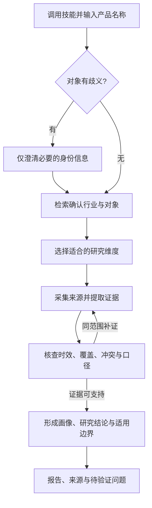

# Steal Her Heart

**在 Codex 中直接调用，输入产品名称，再通过问答完成有来源的竞品研究。**

An industry-agnostic competitor research agent for Python and Codex. Start with a competitor's name; your own product or project context is optional.

你可以研究软件、硬件、消费品牌、工业品、本地生活或专业服务。先输入想分析的名称，Agent 再按需要询问重点、识别行业、选择适合的维度，并围绕实际来源形成画像与结论。无需先介绍“我们的产品”、创建项目，或填写一整份背景表。

> **项目状态：Codex 运行技能与开发中的 Python 工程原型。** 可独立安装的 Codex Skill 已提供，实际研究依赖宿主可用的联网与文件工具。Python 已实现无项目入口、离线需求识别、命令路由、状态机和本地存储；真实搜索、抓取、实质核查、分析与报告生成仍待接通。Python 返回 `pending_module` 不代表已经完成研究。

[开始使用](#开始使用) · [当前能力](#当前能力) · [工作流](#工作流) · [可选项目模式](#可选项目模式) · [开发路线](#开发路线)

## 开始使用

### 安装一次

在 Codex 中发送：

```text
$skill-installer 安装 https://github.com/sakura1412/steal-her-heart/tree/main/codex-skills/steal-her-heart
```

安装的是 [Steal Her Heart 运行技能](codex-skills/steal-her-heart/SKILL.md)，自带研究规则和维度资源。日常使用无需先克隆本仓库、读取文件或安装 Python；仓库中的 `skills/steal-her-heart/` 是开发规范，不是这里要安装的运行包。

安装完成后可在下一轮调用。如果技能选择入口尚未刷新，重启 Codex 后再试。技能的发现与显式调用方式见 [OpenAI 官方说明](https://learn.chatgpt.com/docs/build-skills)。

可独立安装的资源检查、实际安装校验与问答场景试用见 [直接调用验收](validation/direct-skill-installation.json)。

### 直接输入产品名称

一次发送技能名和对象：

```text
$steal-her-heart Notion
```

也可以从 Codex 的技能选择入口选用 **Steal Her Heart**，再输入产品名称。没有提供名称时，Agent 只先问“你想分析哪个产品？”；已经给了名称，就不会重复询问。

后续按聊天补充重点，例如：

```text
用户：Notion
Agent：这次想先看整体概览、产品能力，还是定价？也可以说“按默认开始”。
用户：整体概览，重点讲商业模式。
```

这是交互示例。重点问答可以跳过，用户说“默认”“开始”就继续；用户已附带的重点直接采用，只有确实影响识别的名称歧义才需要先澄清。在同一次研究对话中，可以继续追问“再展开定价”或“把结论整理成表格”，无需重复提供文件路径。

**产品名称就是起点。** 行业、我方产品、市场、目的、读者和项目名均不必先填写。没有额外要求时，输出通用竞品概览，并注明实际覆盖的地区、版本、日期和资料边界。

技能使用当前 Codex 环境实际提供的工具。不要求先执行 `/init-project` 或候选名单确认；宿主没有联网工具时会说明缺口，不把模型记忆当成本次事实。原仓库的 [分析指令](commands/analyze.md) 保留兼容路由，正常使用以安装后的技能为入口。

### Python 工程原型（开发者）

需要 Python **3.9+**，建议开发使用 **3.11+**。以下适用于 macOS／Linux：

```bash
git clone https://github.com/sakura1412/steal-her-heart.git
cd steal-her-heart
python3 -m venv .venv
source .venv/bin/activate
python -m pip install -e .

steal-her-heart hello
steal-her-heart /analyze Notion
steal-her-heart recognize-brief "比较 Notion、飞书、Confluence 的价格与部署方式"
```

Windows PowerShell 可用 `.venv\Scripts\Activate.ps1` 激活环境，再运行相同的 Python 和 CLI 命令。

`hello` 返回 `Hello, Agent!`；`/analyze Notion` 无需项目即可解析，当前返回 `pending_module`，不创建报告。`recognize-brief` 返回离线规则识别的对象、维度、目的与假设，不联网或验证事实；`ready` 仅表示识别得到可用结果。

## 当前能力

| 能力 | 状态 | 现在的实际行为 |
|---|---|---|
| 直接调用 Codex 技能 | 安装包已提供 | 一次安装后使用 `$steal-her-heart 产品名`，或选技能后输入名称 |
| 仅产品名开始分析 | Codex 指令就绪、Python 路由已实现 | 不要求我方产品或项目初始化，按需问答且可采用默认重点 |
| ResearchBrief 识别 | 已实现，离线规则 | 明确句式识别对象、维度和目的，歧义返回问题 |
| 无项目任务与恢复 | 已实现基础 | 保存 `project_context=None` 的任务，当前停在 `UNDERSTANDING` |
| 命令与自然语言路由 | 已实现 | 解析三类任务，缺对象或周期时澄清，完整请求返回待接入状态 |
| 状态机、工具 Registry、SQLite | 已实现基础 | 校验迁移、输入输出和权限，保存快照及事件 |
| 通用维度与读者结构 | 资源／契约就绪 | 21 个核心字段、15 个可选扩展，读者可省略或自定义 |
| 可选项目访谈与档案 | 已实现 | 逐题收集背景，保存 Markdown，兼容旧档案并支持续接 |
| 项目评审与锁定 | 离线 API 就绪 | 校验名单、维度、背景和摘要，尚无完整聊天执行衔接 |
| Python 搜索、采集、核查、分析、报告 | 待接入 | 没有自动运行完整研究的执行器 |

## 工作流

默认单对象研究采用下面的工作方式。Codex 可依据指令使用实际可用的宿主工具；Python 的取证到报告链路仍在开发。



用户点名的对象就是本次范围，不自动扩大为多竞品采集，不额外设置“维度确认＋候选确认”初始化门槛。需要增加其他对象或实质改变范围时，再请用户选择。

研究重点可通过少量问答逐步明确，也可以直接采用默认概览。名称和重点已经给出时，不重复访谈；问答不会变成必须先填完的项目表格。

默认报告可覆盖定位与客群、核心产品／服务、交付方式、价格与商业模式、价值主张、口碑、近期动态和适用边界；Agent 按行业调整，不强制每个对象都有 AI、API、移动端或软件版本。

**没有我方背景时，报告不会编造我方优势、领先／落后或赢输判断。** 输出研究结论、通用学习点和建议验证的问题。用户要求“与我们相比怎么样”或销售 Battlecard 时，只补问该对比需要的产品与场景信息，不要求先答完十一题。

## 命令与当前行为

| 输入 | 目标用途 | 当前 Python 行为 |
|---|---|---|
| `/analyze 竞品名` | 分析单个对象并更新档案 | 无需项目，完整请求返回 `pending_module` |
| `/battlecard 竞品名` | 复用竞品画像形成销售卡 | 返回 `pending_module`；生成我方回应和优势前需相关我方背景 |
| `/brief 周报` 或 `/brief 月报` | 汇总已有研究资产 | 返回 `pending_module`；后续需明确周期与资产范围，无需我方产品 |
| `/init-project` | 可选长期研究或我方对照配置 | Python 支持逐题访谈，聊天支持分批引导 |

```bash
steal-her-heart request "/analyze Notion"
steal-her-heart request "帮我分析海底捞"
steal-her-heart request "/battlecard 任意品牌"
steal-her-heart /brief 月报
```

Python 路由支持明确命令与已有自然语言句式，不能把任意文本都猜成竞品名称。Codex 加载 Skill 后可以根据上下文处理裸名称。`recognize-brief` 是离线需求识别，`/brief` 是周期报告意图；旧命令 `brief` 仅是前者的兼容别名。

`run`／`resume` 当前保存任务并停在 `UNDERSTANDING`。默认状态库为 `.steal-her-heart/memory.sqlite3`，可用 `--db` 指定；无项目任务不创建 `projects/default/`。绑定项目的任务恢复仍须使用一致的背景，不能把无项目与有项目上下文混用。

CLI 退出码：`0` 为本次操作成功，`1` 为执行或存储错误，`2` 为输入无效，`3` 为需要澄清、等待后续模块等未完成状态。返回 `3` 不等于已生成报告。详细入口见 [命令规范](skills/steal-her-heart/references/commands.md)。

## 可选项目模式

这是克隆并打开本仓库后的高级工程功能，适用于长期跟踪一组对象、保存特定读者与关注点，或反复做我方产品对比。普通技能调用不需要它。

在仓库上下文中，可以让 Codex 按 [可选初始化指令](commands/init-project.md) 创建项目：

```text
按 commands/init-project.md，为我的长期研究创建 my-product 项目。
```

聊天按 [可选初始化指令](commands/init-project.md) 每轮问 2～3 题；Python 终端仍一次一题：

```bash
steal-her-heart --project-name my-product /init-project --interactive
steal-her-heart --project-name my-product project-status
steal-her-heart --project-name my-product /analyze Notion
```

项目使用 `projects/<项目名>/profile.md`、dimensions.md 和独立 `.state/`，标准 [profile 模板](templates/profile.md) 继续保留。只有显式选择项目时才读取这些文件；项目不存在或档案未完成会提示处理该项目，不影响独立单对象入口。

可选项目模式可推荐并确认维度，再发现并确认直接竞品、替代品、潜在进入者与标杆。其 Python review API 仍要求名单批准后生成最终提案和锁，不能把预确认草案冒充正式锁，也不能为运行默认分析伪造项目背景。详见 [项目文件说明](projects/README.md) 和 [研究工作流](skills/steal-her-heart/references/research-workflow.md)。

## 如何扩展

一个 Orchestrator 协调 Planner、Research、Validator、Analysis、Reporter 与 Memory。模块通过 Pydantic Schema 传递数据，Python 工具经过统一 Registry，状态变化由显式状态机约束。当前尚未接入真实模型提供方。

新增行业可从 [维度库](library/dimensions.md) 选择或定义字段，不必修改行业白名单。扩展读者视图共用证据；用户未选读者时保留通用报告。模型或工具适配通过模块端口接入，不让主控直接承担网页解析或事实推理。

```text
steal-her-heart/
├── AGENTS.md                  仓库规则
├── codex-skills/
│   └── steal-her-heart/       可独立安装的 Codex 运行技能
│       ├── SKILL.md           直接调用与问答规则
│       ├── agents/            技能显示与默认调用提示
│       └── references/        随技能提供的维度资源
├── commands/analyze.md        仓库兼容分析入口
├── commands/init-project.md   可选项目初始化
├── library/                   全行业维度推荐库
├── templates/profile.md       可选项目背景模板
├── skills/                    仓库兼容入口与 Agent 开发规范
├── src/steal_her_heart/        Python CLI、Schema 和基础实现
├── research/                  Codex 实际研究后保存的本地报告与来源
├── projects/                  可选业务项目及上下文
├── tests/                     确定性离线测试
└── validation/                分阶段本地验收记录
```

`research/` 仅在实际生成产物后创建；Python 当前不生成这些报告。它与业务项目数据一样留在本地，不默认上传。

## 研究质量约束

- 事实来自本次检索，附来源链接和获取日期；训练记忆只提供查询线索。
- 官方宣称、第三方资料、用户反馈和分析判断分开，冲突明确展示。
- “未采集”“查找后未找到”“有理由不适用”分别记录；未知价格、能力和效果不推测补全。
- 价格、版本、规模与动态保留地区、单位、日期等适用条件。
- 无我方背景时不给虚构的我方对照；同一研究的不同读者视图共用事实。

这些规则需要实际取证与核查落实。Schema 只检查部分结构和引用关系，不能证明来源支持、语义正确或 Battlecard 已排成一页。完整约束见 [AGENTS.md](AGENTS.md)、[读者视图](skills/steal-her-heart/references/audience-views.md) 和开发规范。

## 开发路线

- [x] Schema、状态机、Registry、SQLite 与 Orchestrator 基础。
- [x] 无项目单对象入口、离线需求识别与命令路由。
- [x] 可独立安装的 Codex 技能，直接输入名称与按需问答。
- [x] 可选项目档案、十一题访谈、中断续接与旧格式兼容。
- [x] 单对象 Codex 分析指令、通用维度库与项目评审 API。
- [ ] 接入 Python Planner 与真实搜索、抓取、证据提取。
- [ ] 实现有预算和恢复能力的研究执行、核查与补证。
- [ ] 实现分析、Battlecard、通用／配置读者报告与版式验收。
- [ ] 完成可选项目确认桥接、批量子代理调度和跨任务资产复用。

## 参与开发

先读 [开发 SKILL.md](skills/steal-her-heart/SKILL.md)、[RULES.md](skills/steal-her-heart/RULES.md) 与 [TASK_SPEC.md](skills/steal-her-heart/TASK_SPEC.md)。按模块实现并完成对应检查，再推进下一模块；不要把指令、Schema 或离线测试当成端到端研究已经完成。

```bash
python -m pip install -e ".[dev]"
python -m pytest -q
python -m ruff check .
python -m ruff format --check .
```

[requirements-dev.lock](requirements-dev.lock) 是 Python 3.9／macOS 的精确依赖快照，不是带哈希的跨平台锁。在匹配环境可先安装该文件，再用 `--no-deps --no-build-isolation` 安装项目；其他环境应验证依赖兼容性。

[单对象入口验收](validation/standalone-entry.json) 记录当前入口调整；[validation/](validation/) 保留分阶段历史记录，包含初始化、配置、离线需求识别和框架校验。历史记录对应当时版本，不能替代当前代码回归或证明真实网页与模型研究已经跑通。默认忽略本地报告、业务项目、环境变量、数据库与输出。

## 许可证

本仓库暂未指定开源许可证。
