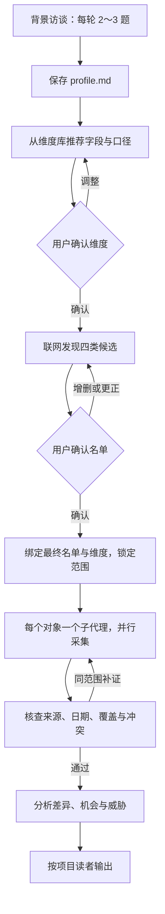

# Steal Her Heart

**一个面向全行业的竞品研究 Agent 项目：先问清楚问题，再设计研究，最后用证据支持决策。**

An industry-agnostic competitor research agent built with Python and Codex skills. Interview first, confirm the scope, and keep facts separate from analysis.

Steal Her Heart 把竞品研究拆成可以检查、确认和复用的步骤：了解项目背景、确定分析维度、发现竞争对象、采集证据、核查信息，再面向不同读者输出结论。它可以服务于软件、硬件、消费品牌、工业品、本地生活或专业服务；行业、研究维度和读者都来自项目配置。

> **项目状态：开发中的工程原型。** Python 已实现项目访谈、离线需求识别、命令路由、状态机和本地存储；Codex 初始化指令与维度库已就绪。Python 的真实搜索、网页采集、并行研究、分析和报告生成尚未接通。

[快速开始](#快速开始) · [创建项目](#创建第一个项目) · [工作流](#工作流) · [命令](#命令与当前行为) · [开发路线](#开发路线) · [参与开发](#参与开发)

## 它解决什么问题

竞品研究容易出现三种情况：一开始就搜资料，却没明确决策目的；每个竞品使用不同字段，最后无法横向比较；报告有结论，却无法追溯来源。

本项目围绕这些问题组织研究：

- **先明确项目。** 产品是什么、卖给谁、研究哪个市场、支持什么决策，由谁阅读。
- **先确认范围。** 维度和对象清单分别经过用户确认，再进行大规模采集。
- **同时看替代方案。** 对手可以是另一家产品，也可以是人工、自建、外包，以及客户继续沿用现状。
- **共用事实，按读者输出。** 产品、销售、运营、投资人或其他角色使用同一份研究资产，各自看到相关的重点。
- **保留证据边界。** 用户自述、官方宣称、第三方报道、用户反馈和分析判断分开记录。

它适合希望用 Codex 协作开发研究 Agent 的开发者，也适合想把竞品分析方法沉淀为项目配置的产品、销售、运营与研究人员。当前版本适合体验初始化、研究需求识别和工程基础；完整自动研究仍在开发中。

## 当前能做什么

| 能力 | 状态 | 现在的实际行为 |
|---|---|---|
| 项目访谈与独立工作区 | 已实现 | Python 逐题收集背景，保存 Markdown 配置和 SQLite 进度，中断后续接 |
| ResearchBrief 识别 | 已实现，离线规则 | 从明确句式识别对象、维度和目的；歧义时返回澄清问题，不验证事实 |
| 命令与自然语言路由 | 已实现 | 识别 `/analyze`、`/battlecard`、`/brief` 及部分等价句式，检查项目是否初始化 |
| 状态机、工具注册与本地存储 | 已实现基础 | 校验状态迁移、工具参数和权限，保存任务快照及事件 |
| Codex 分批初始化 | 指令就绪 | 每轮问 2～3 题，推荐维度并等待确认，再使用宿主可用的联网工具发现候选 |
| 全行业维度库与读者配置 | 资源／契约就绪 | 21 个核心字段、15 个可选扩展模块，自定义行业、读者和输出格式 |
| 名单批准、维度提案与锁定 | 离线 API 就绪 | 校验范围和内容摘要；尚未接入真实聊天确认及完整业务调度 |
| 搜索、抓取、子代理采集与实质核查 | 待接入 | 尚无 Python 研究执行器 |
| 分析、Battlecard、周报／月报生成 | 待接入 | 已有部分数据契约，尚不生成实际报告 |

## 快速开始

需要 Python **3.9+**，建议开发使用 **3.11+**。下面命令适用于 macOS／Linux；已有仓库时跳过前两行。

```bash
git clone https://github.com/sakura1412/steal-her-heart.git
cd steal-her-heart
python3 -m venv .venv
source .venv/bin/activate
python -m pip install -e .

steal-her-heart hello
steal-her-heart recognize-brief "比较 Notion、飞书、Confluence 的价格与部署方式"
```

Windows PowerShell 可使用 `.venv\Scripts\Activate.ps1` 激活环境，再运行相同的 Python 和 CLI 命令。

第一条诊断命令会返回 `Hello, Agent!`。第二条返回结构化研究需求，例如：

```json
{
  "status": "ready",
  "brief": {
    "competitors": ["Notion", "飞书", "Confluence"],
    "dimensions": ["收费模式", "部署方式"]
  }
}
```

上面是完整 JSON 响应中几个字段的摘示。两条命令都不需要 API Key、不联网，也不创建研究项目。`ready` 表示需求识别得到可用结果，不表示竞品身份已核验、计划已批准或研究已完成；词表推断会保存在 `assumptions` 中。

## 创建第一个项目

### 方式一：在 Codex 聊天中引导创建

在 Codex 中打开本仓库，发送：

```text
读取当前仓库的 skills/competitor-research/SKILL.md，
按其中流程执行 /init-project my-product。
```

将 `my-product` 换成实际项目名。Agent 会每轮提问 2～3 项，已回答的内容直接复用；答不上来时提供建议选项，由你选择。背景补齐后，先推荐并确认维度，再联网寻找并确认四类候选。

这是仓库中的 Codex 指令入口，尚未注册为宿主内置 `/init-project` 快捷命令。候选发现依赖当前 Codex 环境实际提供的联网工具；工具不可用时应停止并说明，不能用模型记忆填名单。完整步骤见 [初始化指令](commands/init-project.md)。

### 方式二：使用 Python 终端访谈

激活虚拟环境后运行：

```bash
steal-her-heart --project-name my-product /init-project --interactive
steal-her-heart --project-name my-product project-status
```

Python 当前**一次问一题**，覆盖名称描述、行业／业态、目标客群、市场、优势短板、价格、分析目的、读者及其关注点和期望格式、已知竞品、特别说明，共 11 项。价格、已知竞品和特别说明可留空；优势短板未知可明确写“待确认”。

读者回答可以写成 `采购委员会 | 成本与供应风险 | 对比表`，多位读者可以分行或用分号分隔。角色没有白名单，不必选固定的四类人。

Ctrl-C／EOF 会保留已提交答案；再次运行初始化命令继续。访谈完成会保存背景，**不会自动进行维度推荐、联网发现或研究**。也可手工填写 [profile 模板](templates/profile.md)；空稿不算完成，已有手工内容不会被初始化覆盖。详见 [项目初始化规范](skills/steal-her-heart/references/project-initialization.md)。

项目按产品隔离，文件位于：

```text
projects/my-product/
├── profile.md                 产品、市场、目的、读者和约束
├── dimensions.md              初始化维度草稿；最终绑定范围后才锁定
└── .state/
    ├── project.sqlite3        访谈进度
    └── memory.sqlite3         研究任务运行后创建的本地任务库
```

聊天候选发现后还会保存 `competitors.md`。这些是项目运行时产物，完整文件说明见 [projects/README.md](projects/README.md)。

## 工作流

下面展示目标业务流程。初始化由 Codex 指令引导；从最终范围绑定到报告的 Python 自动执行链路仍待接通。



四类候选是：**直接竞品、替代品、潜在进入者、行业标杆**。某一层没有找到合适对象时保留缺口，不凑数。所有对象采用同一组已确认字段。

维度预确认只确认初步设计。Python 现有评审 API 仍要求在名单批准后生成绑定名单的最终维度提案和锁，聊天预确认到这些 API 的自动桥接尚未实现。不能把草案或一句“已确认”写成正式锁；范围或字段变化时，重新审阅受影响内容。完整规则见 [研究工作流](skills/steal-her-heart/references/research-workflow.md)。

## 命令与当前行为

下面三条是目标产品入口，当前只完成意图路由和初始化检查：

| 输入 | 目标用途 | 当前行为 |
|---|---|---|
| `/analyze 竞品名` | 采集并更新单个竞品档案 | 已初始化后返回 `pending_module`，尚不采集 |
| `/battlecard 竞品名` | 生成销售一页纸 | 已初始化后返回 `pending_module`，尚不生成卡片 |
| `/brief 周报` 或 `/brief 月报` | 为配置读者生成周期简报 | 已初始化后返回 `pending_module`，尚不生成简报 |

通过 Python CLI 传入原始请求：

```bash
steal-her-heart --project-name my-product request "/analyze 任意品牌"
steal-her-heart --project-name my-product request "生成任意品牌的销售一页纸"
steal-her-heart --project-name my-product request "/brief 月报"
```

未初始化时返回 `initialization_required`，缺少对象或周期时返回澄清问题。`recognize-brief` 是离线研究需求识别，`/brief` 是周报／月报意图；旧命令 `brief` 只是前者的兼容别名。周期简报请求不会创建定时任务。

`run`／`resume` 目前只运行工程骨架，初始化完成后停在 `UNDERSTANDING` 并返回 `pending_module`。CLI 退出码 `0` 表示本次操作成功，`1` 表示执行或存储错误，`2` 表示输入无效，`3` 表示需要补充信息、等待确认或后续模块。因此返回 `3` 不等于研究已经失败。详见 [命令规范](skills/steal-her-heart/references/commands.md)。

## 如何扩展

项目采用一个 Orchestrator 协调多个能力模块。各模块通过 Pydantic Schema 传递数据，工具调用经过统一 Registry，状态变化由显式状态机约束。

| 模块 | 职责 |
|---|---|
| Planner | 理解请求、设计研究计划和补证任务 |
| Research | 获取来源并提取证据 |
| Validator | 检查来源支持、时效、覆盖和冲突 |
| Analysis | 依据核查后的证据形成比较与判断 |
| Reporter | 按读者组织已有结论，不创造新事实 |
| Memory | 保存任务、来源、证据和历史资产；当前只实现基础快照与事件存储 |

新增行业时，从 [维度库](library/dimensions.md) 选择或定义字段，无需把行业名称写进内核白名单。维度库中的组合是推荐起点，不代表每个项目必须采集全部字段。新增模型或工具时，应通过模块端口和 Registry 接入，保持主控职责集中。当前尚未接入真实模型提供方。

主要目录：

```text
steal-her-heart/
├── AGENTS.md                   仓库工作规则
├── commands/                   Codex 可读取的项目指令
├── library/                    全行业维度推荐库
├── templates/profile.md        指向包内同一份标准模板
├── skills/
│   ├── competitor-research/    聊天初始化入口
│   └── steal-her-heart/        Agent 开发规范及模块参考
├── src/steal_her_heart/         Python CLI、Schema 和基础实现
├── projects/                   独立业务项目的运行目录
├── tests/                      确定性离线测试
└── validation/                 分阶段本地验收记录
```

## 研究质量约束

- 事实必须来自本次检索，附来源链接和获取日期；训练记忆只可提供查询线索。
- 官方宣称、第三方资料和用户反馈分别标注；冲突不静默消除。
- “未采集”“查找后未找到”“有理由不适用”分别记录；未知价格、能力和效果不推测补全。
- 分析必须回应项目目的，说明“对我们意味着什么、建议怎么做”；推断标明依据和不确定性。
- 多个读者视图共用事实资产，不分别采集出不同版本的事实。

这些是实现与验收必须遵守的规则。当前 Schema 只能检查部分结构和引用关系；来源是否支持主张、语义是否正确、Battlecard 是否真正排成一页，还需要后续执行模块和真实验收。详细规则见 [AGENTS.md](AGENTS.md) 与 [读者视图规范](skills/steal-her-heart/references/audience-views.md)。

## 开发路线

- [x] 工程基础：Schema、状态机、Registry、SQLite 存储和 Orchestrator 骨架。
- [x] 项目背景：可读 Markdown 配置、十一题访谈、中断续接及旧档案兼容。
- [x] 离线需求识别、命令路由、通用采集字段和读者数据契约。
- [x] Codex 初始化指令、维度推荐库、离线评审与锁定 API。
- [ ] 完成 Planner、真实用户确认通道及初始化预确认到最终锁的衔接。
- [ ] 接入搜索、网页抓取、证据提取、每对象子代理调度和累计预算控制。
- [ ] 实现实质核查与有边界的自动补证。
- [ ] 实现横向分析、Battlecard、配置读者报告及可读性验收。
- [ ] 实现带版本与时效检查的跨任务研究资产复用。

## 参与开发

先阅读 [开发入口 SKILL.md](skills/steal-her-heart/SKILL.md)、[RULES.md](skills/steal-her-heart/RULES.md) 和 [TASK_SPEC.md](skills/steal-her-heart/TASK_SPEC.md)。按模块提交改动，说明解决的问题、可观察行为和验证方式；完成本模块检查后再推进下一模块。

安装开发依赖并检查：

```bash
python -m pip install -e ".[dev]"
python -m pytest -q
python -m ruff check .
python -m ruff format --check .
```

[requirements-dev.lock](requirements-dev.lock) 保存了本机 Python 3.9／macOS 的精确依赖快照；它不是带哈希的跨平台锁文件。在匹配环境中可先安装该文件，再以 `--no-deps --no-build-isolation` 安装本项目。其他 Python 版本应验证其依赖兼容性。

当前已记录的本地回归为 **317 项测试通过**。验收记录覆盖结构、闸门、存储、兼容读取及指令资源一致性，真实网页与模型的端到端研究尚未运行。可查看 [初始化指令验收](validation/init-project-flow.json)、[项目配置验收](validation/profile-configuration.json) 和 [ResearchBrief 验收](validation/phase2-brief.json)；更多记录位于 [validation/](validation/)。

业务项目可能包含内部产品信息、价格和用户反馈。提交代码或公开演示前，请检查自己的 `projects/`、数据库、输出及来源快照，避免把内部资料或凭据加入仓库。

## 许可证

本仓库暂未指定开源许可证。
