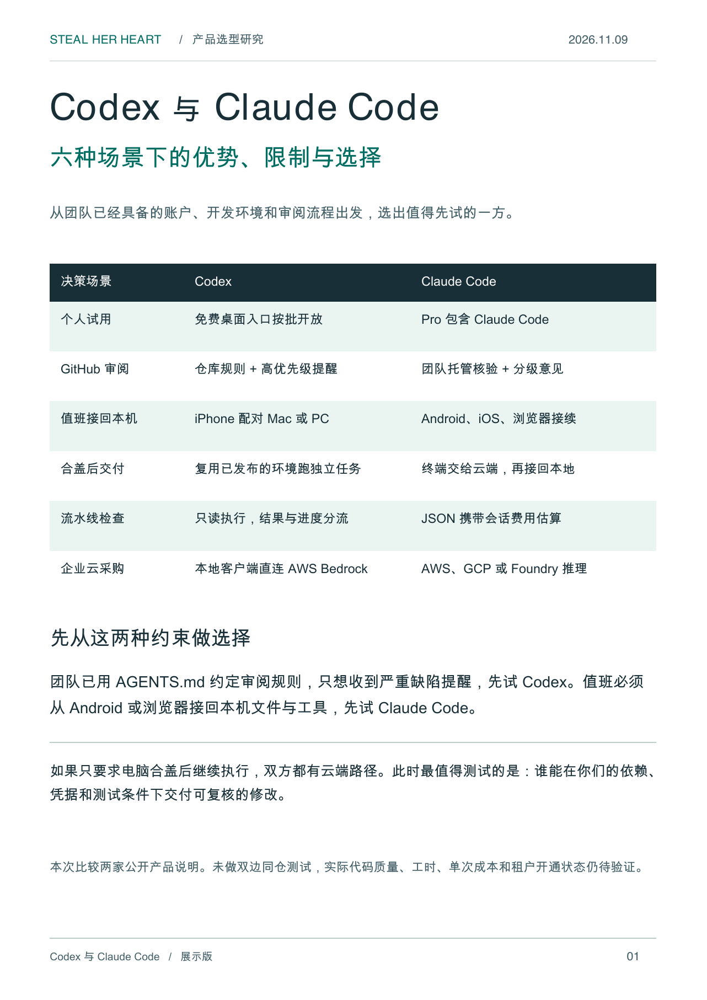
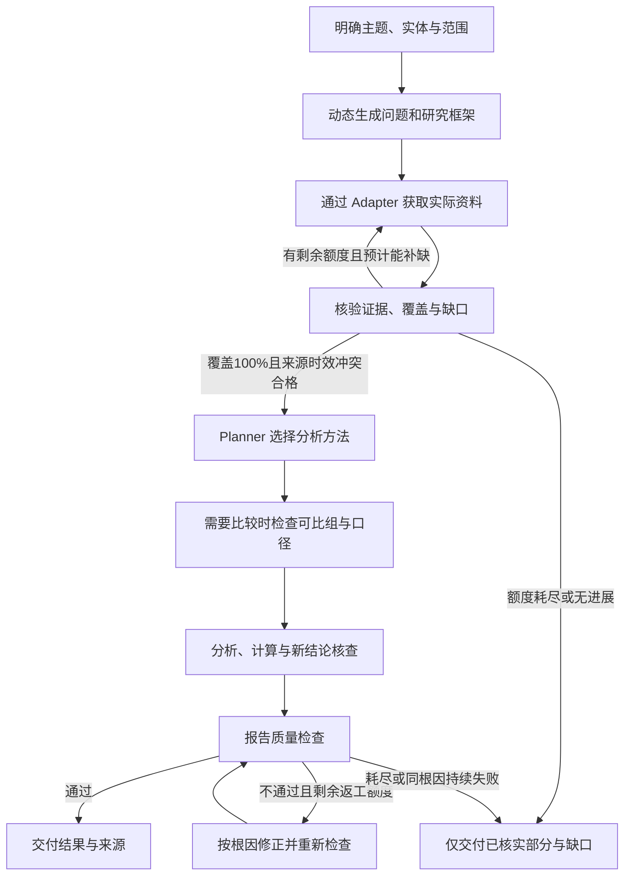

# steal her heart

**在 Codex 中输入一个产品名，获得一份有依据的竞品分析报告。**

这套竞品分析方法从一个决定开始：你想选择供应商、调整定价，还是决定下一项产品投入？给出产品名也能开始。Agent 按业务特征选择维度，把研究时间优先用在可能改变选择的差异上。每项竞争判断都能回查原始材料，最终 PDF 说明建议采取什么行动、依据是什么、还需验证什么。

[开始使用](#开始使用) · [更多用法](#更多可以直接复制的用法) · [实际报告 Demo](#实际报告-demo) · [常见问题](#常见问题)

一份综合报告回答五个问题：**市场上有什么？竞品解决什么问题？竞品是怎么解决问题的？竞品做得怎么样？我们应该怎么做？** 你可以只问其中一个。若要据此决定自己的产品下一步做什么，附上目标用户和当前约束，报告就能把竞品的差异转成可执行、可验证的建议。

## 开始使用

**从六层看竞争。** 市场层看客户有哪些选择，战略层看各家服务谁、靠什么获利，产品层看实际交付什么，体验层看用户经历了什么，能力层看交付靠哪些条件，决策层把差异转成可执行的产品竞争策略。[六大分析层与交付示例](codex-skills/steal-her-heart/references/dimensions.md#六大分析层)

只关心售后体验时，可以直接问：“比较两家的报修流程、人工介入和故障恢复，用实际案例核对服务承诺。”需要全面评审时，也可以明确要求逐项分析全部 [12 个核心维度](codex-skills/steal-her-heart/references/core-dimensions.md)。

也可以直接指定交付物，例如：“比较两家的夜间报修，画一张从报修到恢复的流程图，列出必须人工交接的节点，再用客户反馈说明哪里最容易卡住。”更多选项见[八类报告产物与示例用途](codex-skills/steal-her-heart/references/report-artifacts.md)。

想先看成稿会怎样组织，可以浏览[竞品分析报告标准目录](codex-skills/steal-her-heart/references/report-outline.md)。执行摘要先给结论，正文展开比较，最后把竞争机会落实为建议，并在附录提供核验材料。

### 第一步：安装到 Codex

在 Codex 对话中粘贴：

```text
使用 $skill-installer 安装这个仓库中的技能：
https://github.com/sakura1412/steal-her-heart/tree/main/codex-skills/steal-her-heart
```

安装完成后，在技能列表中找到 **steal her heart**。如果没有出现，重新启动 Codex 后再检查。

<details>
<summary>手动安装与更新</summary>

下载仓库后，把完整的 `codex-skills/steal-her-heart/` 文件夹复制到以下任一位置：

- 所有个人项目共用：`~/.agents/skills/steal-her-heart/`
- 只用于当前项目：`<项目目录>/.agents/skills/steal-her-heart/`

保留目录内的 `RULES.md`、`TASK_SPEC.md`、`agents/`、`references/` 等文件，不要只复制 `SKILL.md`。更新时替换整个技能包并保留自己的定制，避免多个位置存在内容不同的同名副本。GitHub 仓库更新不会自动更新本地安装。

安装、发现与调用机制见 [OpenAI 官方技能说明](https://learn.chatgpt.com/docs/build-skills)。

</details>

### 第二步：输入你想研究的对象

最简单的调用：

```text
$steal-her-heart Notion
```

也可以在技能选择器中选择 **steal her heart**，然后用自然语言输入：

```text
分析 Notion 的竞争优势。
```

提供一个名称或明确主题即可开始。需要分析同名产品时，附上官网链接；已经有重点、地区或读者要求时，直接写在同一条消息里。

```text
$steal-her-heart 比较戴森和追觅在中国市场的家用洗地机。
重点看同价位产品的功能、渠道和售后，给产品经理看，生成一般版 PDF。
```

### 第三步：看初步发现，按需补充重点

Agent 会说明当前理解的对象和范围，先做实体消歧与轻量扫描，再组织取证和分析。未指定偏好时使用**通用读者＋一般版**；可选偏好提示不阻塞研究。你可以随时回复：

```text
给管理层看，做简单版，重点回答值不值得进一步投入。
```

已给出的信息不会重复询问；遇到同名歧义、研究目标缺失，或需要扩大到新对象时，才补问具体事项。完整交互规则统一维护在 [报告交互与交付](codex-skills/steal-her-heart/references/report-delivery.md)。

### 第四步：打开 PDF，继续追问

完成后，Codex 会提供简短结论和 **PDF 文件链接**。研究成果保存在当前工作目录的 `research/<对象标识>/<版本>/` 下，以对话返回的实际路径为准。

你可以在同一对话中继续输入：

```text
把这份报告压缩成一页纸，保留关键限制。
```

```text
基于同一份研究结果生成 PPT，给管理层汇报。
```

```text
再加入 Obsidian，只补充它在已有比较维度上的资料，保留旧报告。
```

仅调整读者、详略或格式时复用已核验资料；新增问题会评估需要补充的证据。PDF 与 PPT 共用同一版事实数据。导出失败时会明确说明，不把聊天正文当成已生成文件。

## 更多可以直接复制的用法

| 想做什么 | 在选择技能后输入 |
|---|---|
| 快速了解产品 | `快速分析 Notion，给通用读者看，输出简单版。` |
| 找产品机会 | `比较 Notion 和 Obsidian 的个人知识管理体验，给产品经理看，重点找差异和待验证机会。` |
| 看各家分别强在哪 | `比较 Notion、Obsidian 和 Logseq。围绕个人离线写作和团队协作做一张横向表，说明每个场景哪款相对哪款更合适、理由是什么、要接受什么限制。证据不足的地方单列。` |
| 分析企业 | `分析比亚迪的业务结构和竞争优势，区分公司、品牌和车型，不把集团数据归到单一车型。` |
| 核对价格 | `比较 Figma 和 Sketch 的团队收费方式，统一人数、地区和一年使用周期；不能直接比较的部分单列。` |
| 研究消费品 | `分析戴森家用吸尘器在中国市场的产品定位、渠道和售后，生成一般版。` |
| 做销售一页纸 | `基于已有报告生成销售 Battlecard。我方产品资料在附件中；没有依据的优势不要补写。` |
| 更新旧报告 | `更新上次报告中的价格和近期变化，保留旧版本，列出哪些结论发生了变化。` |

报告详略可选简单、一般、详细；“快速了解”与“深入研究”控制研究投入，和报告篇幅分别处理。角色可以自定义。行业、对象和问题不同，研究维度也随之变化。

**差异化对比会写到什么程度？** 以一个虚构的设备租赁决策为例。假设三家提供同规格设备，税费、配送及其他条件一致。甲按天收 100 元，乙按整周收 500 元，丙需询价。

| 使用场景 | 甲 · 按天 | 乙 · 整周起付 | 丙 · 询价 | 选择依据 |
|---|---:|---:|---|---|
| 临时用 2 天 | 200 元 | 500 元 | 总价待核实 | 甲比乙少付 300 元，短租能按实际天数付费。 |
| 连续用 7 天 | 700 元 | 500 元 | 总价待核实 | 乙比甲少付 200 元，适合已确定用满一周的团队。 |

同一份报价会随使用场景得出不同结论。丙的竞争力需要拿到相同条件的报价后才能判断。

## 实际报告 Demo

**Codex 与 Claude Code：六种工作场景下的优势与限制**

团队已经在 `AGENTS.md` 里写了审阅规则，想让 GitHub 只提醒严重缺陷，可以先试 Codex。值班工程师必须从 Android 或浏览器接回办公室的本地会话，可以先试 Claude Code。若唯一要求是合上电脑后任务继续，两家都有云端路径，下一步该验证谁能跑通团队自己的依赖和测试。

[**阅读 8 页 PDF 案例**](examples/codex-vs-claude-code/report.pdf) · [**直接下载 PDF**](https://raw.githubusercontent.com/sakura1412/steal-her-heart/main/examples/codex-vs-claude-code/report.pdf)

[](examples/codex-vs-claude-code/report.pdf)

首页是六个场景的横向对照，后续每页给出双方的工作方式、选它要接受的限制和一个可执行的验证动作。末页提供同仓库试点方案。本版于 **2026-11-09** 重新核对双方产品说明，实际代码质量、速度与单位任务成本仍待同条件实测。

在 Codex 中生成类似对比，可以输入：

```text
$steal-her-heart 比较 Codex 和 Claude Code，给通用读者一份详细 PDF。
按场景写明哪一方有优势、相对另一方差在哪里、选它要接受什么限制。
两者都能满足的需求也请指出，并给出我能自己验证的办法。
```

## 常见问题

**需要编程、配置 API Key 或运行 Python 命令吗？**

使用本技能只需在 Codex 中安装并对话。实际搜索、网页读取、文件生成依赖当前 Codex 可用工具；某个外部服务要求账号或授权时，会说明具体需求。仓库本身不附带全平台爬虫或独立研究服务。

**为什么只输入名字后还会被提问？**

名称可能对应不同公司或产品，需要先确认身份。读者和详略有默认值，可以直接说“按默认继续”；不需要先填写我方产品、项目名或完整问卷。

**为什么报告有“未找到”或“无法访问”？**

资料缺失、访问受限和工具失败会分别记录。Agent 只报告可支撑的部分，并列出缺口；不会为了填满表格编数据，也不会绕过登录或付费限制。

**可以用我自己的资料吗？**

可以附上文件或明确提供可访问的链接，并说明希望回答的问题。涉及我方优势、赢输场景或销售话术时，提供我方背景有助于形成可靠对照；普通竞品研究不要求这些信息。

**研究结果会自动上传到 GitHub 吗？**

不会。业务资料与研究产物默认保存在工作目录，不自动公开。本页 Demo 是经用户明确授权公开的案例副本。

## 能力与验证范围

本仓库提供自包含的 Codex 技能包：入口、研究规则、任务职责、方法目录与扩展契约。实际研究质量取决于本次可用工具、访问权限及证据。

| 内容 | 当前状态 |
|---|---|
| 技能安装、研究交互与报告规范 | 已提供；本页附实际 PDF 案例 |
| 问题拆解、动态维度、实体管理、可比性与市场研究 | 已提供执行契约，具体结果逐任务核查 |
| 21 个分析方法 | 已按合成案例检查适用条件及边界，真实业务成效仍待独立验证 |
| 连接器与行业包实例 | 内置 1 个[产品类型研究重点包](codex-skills/steal-her-heart/references/packs/product-types.md)，含七种可组合视角，已做结构检查。连接器注册实例为 0，实际采集依赖宿主工具 |
| 证据与报告质量 | 保留来源、时间、条件、冲突和缺口；结构检查不代替事实核验 |

详细状态见 [验证记录](codex-skills/steal-her-heart/validation/README.md)。

## 设计与维护文档

<details open>
<summary>研究流程、证据规则、架构与扩展方式</summary>

## 可以研究什么

核心对象称为 **Competitive Intelligence Subject**。它可以是一个现实对象，也可以是围绕对象或市场提出的决策问题。

| 任务类型 | 研究重点 |
|---|---|
| Product Intelligence | 产品价值、能力与适用边界 |
| Company Intelligence | 企业业务与竞争优势 |
| Brand Intelligence | 品牌定位与竞争关系 |
| Service Intelligence | 服务内容、交付与体验 |
| Technology Intelligence | 技术路线、能力和约束 |
| Pricing Intelligence | 价格、收费结构与策略 |
| Channel Intelligence | 销售、分发路径与覆盖 |
| Market Intelligence | 市场结构、规模、格局与机会 |
| Industry Intelligence | 行业环境、产业链与变化 |
| Customer Intelligence | 客户选择与需求变化 |

这些类型可以组合，共享同一套研究流程和事实资料，不拆成十个独立 Agent。单个产品分析不会自动扩大成全市场研究。详见 [研究对象与任务路由](codex-skills/steal-her-heart/references/subjects.md)。

## 研究如何进行

八阶段为 Interview → Plan → Collect → Validate → Analyze → Report → ReportQA → Delivered，守卫与有界回退见 [状态迁移单源](codex-skills/steal-her-heart/references/workflow.md)。Interview 的交互仍由报告交互单源定义；Delivered 是交付阶段，实际文件检查通过才标任务完成。



研究框架根据对象的实际属性、行业背景和用户目标生成，维度分必选、推荐与可选。Agent 要说明为什么研究这些问题；不能因为某个模板里有一项，就要求每个对象都填写。

采集完成不等于证据充分，排好表格也不等于分析完成。输出可以是事实画像、对比矩阵、市场研究、销售一页纸或即时简报；具体内容取决于问题与已核实材料。

## 围绕问题设计研究

Planner 内部包含两项明确职责，仍共用同一个通用研究引擎：

| 职责 | 负责的工作 | 落盘产物 |
|---|---|---|
| Research Question & Hypothesis Agent | 拆解问题，提出可证伪假设与替代解释，定义支持／反证要求，记录当前结论、置信依据和验证状态 | `questions.jsonl` |
| Research Framework Agent | 识别可重叠的业务属性，按问题设计维度、证据条件与研究优先级，根据采集结果修订框架 | `framework.json`；需要时输出可读的 `dimensions.md` |

业务类别是开放多标签，一个对象可同时涉及软件、服务、内容或实体交付；标签不触发固定行业字段表。必选性表示必须回答什么，P0／P1／P2 表示先做什么，二者分开记录。所有维度必须关联具体问题，框架调整保留原因、反证、受影响结论与旧版本。

例如“分析 Notion 的竞争优势”可拆成用户是谁、为什么选择、差异是否可替代、是否可持续、什么会推翻优势判断等问题；这些只是待验证问题，不是对 Notion 的事实断言。假设被推翻也可以是完成的验证，预算耗尽或找不到反证则不能算验证成功。

详细执行规则见 [问题与假设](codex-skills/steal-her-heart/references/questions-hypotheses.md) 和 [动态研究框架](codex-skills/steal-her-heart/references/dimensions.md)。数据契约与受控结构检查不等于已部署独立 Agent 服务或完成真实研究验收。

## 怎样判定“证据充分”

必选维度按“对象 × 必需维度 × 实际市场／使用端条件”逐格核查，**适用必选单元覆盖率须达到 100%**。未采集、未找到、受限或只有推测不算覆盖；不适用须有依据。覆盖达标还须关键结论、时效、比较口径和冲突检查通过。

关键分析结论至少需要 **两个独立来源组**支持；同一新闻稿的转载不算多个独立来源。官方价格等明确归因的一手披露可用一个原始来源，但不能据此直接证明“最便宜”或“效果最好”。默认当前价格窗口为 24 小时、评分为 7 天、现行功能／版本为 30 天；成立时间等稳定历史事实保留事件日期，本次核原始记录，不能用获取日期刷新事实。

| 全任务上限 | Quick | Standard（默认） | Deep |
|---|---:|---:|---:|
| 外部研究操作 | 12 | 40 | 100 |
| 读取的文档版本 | 6 | 20 | 50 |
| 补研轮次 | 1 | 2 | 3 |
| 报告修正轮次 | 1 | 2 | 3 |
| 跨步骤返工累计 | 2 | 4 | 6 |

这些是项目默认上限，包含轻量扫描、失败、重试和子任务；不是必须用满或保证能完成的数量。达到任一适用上限、一轮补研无进展或同根因修正持续失败时停止。结果区分“充分”“受限”“不足”，只交付能够支撑的结论及具体缺口。完整计算口径、事实时效表和终止条件见 [研究质量策略](codex-skills/steal-her-heart/references/research-quality.md)。

## 长任务如何保存与复用

研究以 `manifest.json` 检查点和 JSONL 台账持久化：来源、实体与时间关系、证据、结论、冲突、覆盖率、任务及预算事件都有明确格式。每条重要报告内容可追到 **Claim → Evidence → 原文片段、URL 与获取时间**，反向也能定位受影响的报告位置。

PDF 与 PPT **分别从同一版台账生成**，不互相转写。输入快照和文件记录保留哈希；修订不覆盖旧版本。长任务按 ID 分批加载有关记录，恢复先核文件完整性、任务结果与预算，避免重采或重复执行。详见 [台账与恢复协议](codex-skills/steal-her-heart/references/research-ledger.md)、[记录 Schema](codex-skills/steal-her-heart/schemas/ledger-record.schema.json) 和 [检查点 Schema](codex-skills/steal-her-heart/schemas/research-manifest.schema.json)。

这些是 Codex 必须执行并留痕的规则与数据契约；仓库未提供独立数据库、自动限流器或跨记录语义校验服务。结构校验通过不代表真实研究、来源核验或恢复行为已经通过验收。

## 三项最高级架构原则

1. **核心引擎永远不绑定行业。** 行业知识通过 IndustryPack 扩展，核心 Prompt 不写死行业字段、流程和专业方法。
2. **数据采集永远不绑定平台。** 平台数据通过 Connector Adapter 接入，Research 不直接依赖网站结构或专有字段。
3. **分析方法永远不绑定研究流程。** Research QA 后，由 Planner 根据目的、实际数据和决策问题选择方法，不固定执行 SWOT 或其他模型。

前期可以提出候选方法以规划取证，最终方法选择仍取决于实际证据。扩展不得改变用户范围、工具权限或证据要求。见 [最高级架构规范](codex-skills/steal-her-heart/references/architecture.md)。

## 四个避免误判的设计

### 分清实体，不只记录一个竞品名

公司、品牌、产品、版本、服务、SKU、平台、组织、人物、市场、行业和渠道分别识别。同名、别名与多语言名称先消歧，所有权、运营、供应、合作与竞争关系保留证据和有效时间。

同一产品在不同市场、版本或渠道的价格分别记录；品牌数据不自动归给旗下全部产品。合并、拆分或纠错保留历史，并重新核查受影响结论。见 [实体管理](codex-skills/steal-her-heart/references/entities.md)。

### 先确定可比对象，再给排名

Comparison Engine 将 **Comparable Group（可比对象组）** 作为直接比较的前置条件。核对目标客户、产品定位、市场区域、配置／服务范围、计价周期，以及实体层级和使用端。

月付、年付、用量费、按件和按项目报价，需要明确共同情景与实际条款才可换算。年费月均摊不等于允许月付；未知不能填零，不适用项不评分，不对每个对象单独删掉缺项后制造可比总分。不符合条件的对象可以作为市场参考，但不能直接参与排名。见 [Comparison Engine](codex-skills/steal-her-heart/references/comparison.md)。

### 市场数据必须说明是谁给出的、怎么算的

Market Intelligence 按需研究概况、细分、规模、增长、份额、格局、进入壁垒、产业链、区域差异和新兴竞争者。

市场数字分别标为**官方披露、第三方估算、Agent 推算、无法核实**。没有同口径总体分母，不输出市场份额；样本内占比不是全市场份额。TAM／SAM／SOM 必须交代输入、方案、期限、公式和假设，不能凭空取一个百分比。见 [市场研究规则](codex-skills/steal-her-heart/references/market-intelligence.md)。

### 读者改变分析重点，不改变事实

产品经理看能力差距与机会，销售领导看竞争场景与价格条件，一线销售看可使用的回应与边界，运营看渠道和增长假设。角色可自定义，不强制输出四份报告。

各视图共用事实版本；新问题用已有证据能回答就重新分析，需要新事实才补证。没有我方背景时，不编“我们的优势”或赢输策略。见 [读者与交付](codex-skills/steal-her-heart/references/audiences.md)。

## 扩展方式

| 扩展 | 负责什么 | 管理与边界 |
|---|---|---|
| **IndustryPack** | 行业定义、候选维度、指标字典、来源推荐、分析方法与报告模板 | 版本、校验、兼容、依赖和定制；按任务选择，不自动套清单 |
| **Data Source Connector Registry** | 来源类别、连接模式、能力声明与实际工具绑定 | 可调用、获授权和实际验证分开；保留原文、标准化过程及失败状态 |
| **Analysis Method Registry** | 方法的触发问题、输入、执行规则、输出与完成条件 | 按证据选择；专业变体有版本与命名空间，不改核心流程 |

**数据源体系**覆盖企业官方、应用与软件、电商与零售、社交与内容、新闻媒体、研究知识、公共数据、评价社区八类来源。连接模式包括 Public Web、Official API、Authorized Account 和 User Upload。搜索、正文抓取、浏览器、文档解析或专用连接器由当前 Codex 环境提供，不绕过登录、付费、地域和访问限制。

**分析方法按研究问题选择。** 常用方法包括 SWOT、PEST、波特五力、用户旅程地图、功能对比矩阵和 GAP 分析。需要分析产品组合、需求优先级、投入顺序或商业模式时，可分别选用波士顿矩阵、Kano、RICE 或商业模式画布。见[方法选择指南](codex-skills/steal-her-heart/references/analysis-methods.md#从研究问题选方法)。

详细契约：[行业包](codex-skills/steal-her-heart/references/industry-packs.md) · [连接器](codex-skills/steal-her-heart/references/connectors.md) · [分析方法](codex-skills/steal-her-heart/references/analysis-methods.md)。

## 八条证据铁律

1. 每条事实来自本次实际工具核查，附来源链接和获取日期，禁止记忆冒充当前事实。
2. 区分官方宣称、第三方、用户反馈和分析判断。
3. 价格、版本、评分标明地区、版本、时间及必要条件。
4. 「未采集」「查找后未找到」「不适用」分别记录。
5. 冲突不得静默消除，处理依据和未决部分明确呈现。
6. 无我方背景时，不编我方优势或赢输建议。
7. Web、App、小程序、桌面、线下在本次范围内分别取证、分别标注。
8. 工具失败或无法访问时，只输出已核实部分，并明确列出缺口。

完整规则见 [RULES.md](codex-skills/steal-her-heart/RULES.md)。报告还要检查维度覆盖、重复、前后矛盾、时效、数字依据、目的回应和措辞强度；未解决的必需缺口不能包装成完整报告。

## 执行示范与来源判断

例如，你问“竞品的自动审批值得我们借鉴吗？”，报告会分开写规则能处理哪些申请、哪些效率收益还只是推测，以及如何用自己的审批记录决定是否试点。只有厂商手册时，实际节省了多少时间会保留为未知。见[分析原则与自动审批示例](codex-skills/steal-her-heart/RULES.md#专业分析的五项原则)。

[五个正反示范](codex-skills/steal-her-heart/references/worked-examples.md) 展示价格冲突、缺分母的份额请求、工具失败、缺失值比较及缺对象时的处理。示范均为教学材料，不是实际产品事实。

来源等级、置信理由和允许使用的“背景知识”见 [来源质量规则](codex-skills/steal-her-heart/references/source-quality.md)。一般术语和方法解释可标为背景知识；当前竞品事实仍需本次证据，背景知识不计入事实覆盖。评论研究按 [采样与口碑规范](codex-skills/steal-her-heart/references/review-method.md) 记录窗口、样本、重复／疑似操纵信号和评分口径，不用跨平台星级直接排名。

[验证记录](codex-skills/steal-her-heart/validation/README.md) 分别列结构检查、受控案例、真实工具调用和未完成项。方法的合成案例、行业包的结构校验和连接器的实际可用性分别记录。

## 文件与成果

```text
codex-skills/steal-her-heart/
├── SKILL.md                 调用入口与工作流程
├── RULES.md                 证据、权限与质量规则
├── TASK_SPEC.md             运行职责、交接与任务管理
├── agents/openai.yaml       技能展示信息
├── references/              架构、研究方法、质量及台账协议
├── schemas/                 台账、背景知识与检查点 JSON Schema
├── tests/                   维护者验收表，运行时不加载
└── validation/              历史验证材料，按维护／能力审查请求读取
AGENTS.md                    仓库维护约定
projects/README.md           可选长期项目说明
templates/profile.md         按需填写的背景模板
```

默认生成 PDF，在 Codex 对话中提供摘要和文件链接，并询问是否加做 PPT。研究成果写入 `research/<安全标识>/<版本>/`；用户明确选择长期项目时，再使用 `projects/` 保存背景、范围和版本。已有业务资料不自动覆盖，业务项目与研究成果不默认提交到仓库。

长期项目流程见 [项目说明](codex-skills/steal-her-heart/references/projects.md)。研究请求不自动授权发布、发送、付费或定时监测。

## 参与维护

维护时遵循 [AGENTS.md](AGENTS.md)，保持技能包自包含和三项架构原则。新增行业扩展 IndustryPack，新增平台扩展 Adapter，新增方法扩展 Method Registry，并补充适用性、缺失、冲突及失败场景。

运行职责见 [TASK_SPEC.md](codex-skills/steal-her-heart/TASK_SPEC.md)，维护者验收要求见 [tests/acceptance.md](codex-skills/steal-her-heart/tests/acceptance.md)。提交时区分格式／引用检查、受控案例和真实研究验证，说明实际工具、证据、产物及未完成项；不能用旧测试记录或合成报告证明新能力已经可用。

</details>
