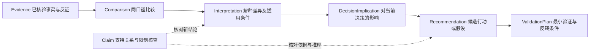

# 竞品分析引擎：从证据到产品决策

版本：0.30.0；2026-11-04。本文定义待实现的 Analysis 能力、数据边界和验收标准。本轮未新增分析执行器、模型调用、价格算法或业务报告，现有 Schema 版本不变。当前生产研究链仍未接通，实际模块边界见 [模块契约](module-contracts.md)，依赖顺序见 [路线图](roadmap.md)。

状态目标以 [状态机 v2](state-machine-v2.md) 及其迁移目录为准：独立缺口／补研／报告 QA、两个确认等待及 CANCELLED 替代此前内部阶段安排。本文标为当前或迁移前的 v1 边界继续描述未变更源码；新状态与恢复须先实现迁移和守卫后启用。

## 行业方法与读者决策补充（0.30 目标）

按 [产品规则](product-design.md) 读取当前锁定的行业分析规则与 ReaderDecisionSpec。行业方法声明所需事实、可比条件、推理或计算及核查标准，不能用行业假设填事实。角色改变分析问题及决策产物，不改事实；只改排版可沿用分析，新决策问题不能直接复用旧总体结论。行业 Schema 和规则升级按依赖影响评估，软件与消费品不各建独立 Analysis Agent。

## 目标与职责

Analysis 的交付目标是回答“这些竞争信息对当前产品决策意味着什么”。资料列表和功能矩阵是依据，不是分析完成的充分条件；输出还应说明差异的重要性、影响机制、适用条件、可选行动及下一步验证。

这是一个共享证据和方法的分析能力，不是十个自由协商的 Agent，也不增加第二个主控。Planner 确定研究问题、必需项和完成条件；Research 取得材料；Validator 完成 Research QA；Analysis 组织比较、解释与决策判断；Reporter 组织已核对的结果，不在写报告时新增建议。

Orchestrator 负责调用、预算、状态和终止。Analysis 不直接搜索，不自改范围或核查标准，不将自己的自评分数当作完成依据。确定性计算与模型判断分别保留方法和输入；每个重要判断通过 Claim 关联具体 Evidence 版本。

同一轮分析复用同一份经过 QA 的事实集合及 [证据管理](evidence-management.md) 关系，不为不同读者重新收集一套事实。分析中使用的反证、限制和未决事项不能在报告转述时丢失。

## 十类能力与证据边界

以下是能力目录，按问题选择，不要求每次填满十类。适用行业、研究对象、必需性与比较标准由当前计划定义；软件、硬件、消费品牌和服务都使用同一决策链，具体维度不同。

| 能力 | 需要的输入依据 | 分析处理与产物 | 必须保留的边界 |
|---|---|---|---|
| 产品定位分析 | 定位表述、解决方案、适用场景及可核查客户材料 | 区分所面向市场、客户、使用任务与价值承诺，形成定位画像及场景适配判断 | 官方目标定位不等于实际客户构成；不能从宣传语直接证明效果 |
| 功能对比分析 | 同一维度定义、产品版本、能力条件及使用／测试依据 | 比较功能有无、深度、广度、限制及工作流完成度，形成可追溯矩阵 | 未找到不等于不支持；拥有功能不等于领先；名称相同不保证能力等价 |
| 定价分析 | 版本、标价、计费模式、地区、币种、周期、数量、税费及折扣条件 | 比较收费结构、已核验版本的价格区间、版本差异和给定场景下的可比费用，保留计算过程 | 公开价格不是成交价；月付与年付、按席位与按量不能直接排序；未知费用不当零，有限版本不外推全产品区间 |
| 客户分析 | 有出处的案例、客户样本、行业标签及适当的总体统计 | 区分宣称客群、观察到的样本及有代表性依据支持的分布，说明应用场景 | 客户 Logo 墙和主动选取案例不能推出行业占比或总体客户画像 |
| 商业模式分析 | 收费规则、销售渠道、服务交付、合作关系及财务披露 | 解释价值交付、获客／销售方式和收费机制，区分已知模式与待证收入构成 | 有订阅版不等于全部收入来自订阅；有代理渠道不证明代理贡献率 |
| 竞争优势分析 | 双方或明确比较基准的证据、目标场景和评价标准 | 说明谁在何种条件下有何优势、影响哪项客户任务，以及优势持续条件 | 不凭功能数量或知名度判总体领先；无我方材料不能改写成“我们更强” |
| 竞争劣势分析 | 已核查限制、可比测试、反馈样本与替代基准 | 形成具体场景中的不足、代价和适用边界，区分产品限制与样本体验 | 资料缺失不是缺陷；单条差评不是普遍问题；不能预设客户不会接受取舍 |
| 市场机会分析 | 需求／任务依据、现有解法及其成本或限制、替代路径 | 提出可能未充分满足的任务与可服务人群，给出机会假设及验证问题 | 功能空白不证明需求存在；需求存在不证明付费、规模或我方可获利 |
| 威胁分析 | 已发生动作或可核查能力、受影响场景、替代路径及反证 | 描述竞争压力如何发生、影响谁、何时可能显现及触发／解除条件 | 动态不自动成为威胁；没有依据不填发生概率、损失金额或市场份额预测 |
| 差异化建议 | 已核查竞争判断及用户提供的目标、能力与资源约束 | 提出可选择的价值主张、客群／场景聚焦、产品或交付策略，比较取舍并设计验证 | 不把抄齐竞品功能当差异化；用户配置前提不等于实测优势，未来效果不当已证明 |

比较的基本单位是“对象 × 问题 × 场景／口径”，而不是整个品牌的一项总分。一个对象可以在某场景领先、在另一场景不适用；结论不得丢掉限定条件。

单对象任务可以完成定位、定价结构、能力限制及条件性启示；没有第二对象或有效比较基准时，不生成虚构横向排名。需要新增对象才能回答的问题交由范围流程处理，不自动扩展名单。

## 从证据到决策的分析链

图中名称表示目标概念，不是现有 Python 类、枚举或新的状态。每一步都保留前一步引用；事实、计算结果、解释和建议分别标明，不能把模型生成的解释写回 Evidence 当作新事实。

| 层次 | 必须回答的问题 | 可核查记录 |
|---|---|---|
| Evidence | 本次实际确认了什么，原文在哪，是否仍适用？ | 证据／来源版本、定位、核查与时效记录 |
| Comparison | 差异发生在哪个同口径问题上？ | 对象、条件、方法版本、输入和结果 |
| Interpretation | 为什么这个差异对某类客户或场景重要？ | 支持与反证、逻辑依据、替代解释和限制 |
| DecisionImplication | 它改变了哪个待决问题或取舍？ | 决策问题、受影响目标、成立前提和未决事项 |
| Recommendation／hypothesis | 有哪些可选动作，为什么值得考虑？ | 候选动作、暂不行动选项、预期机制、代价与风险 |
| ValidationPlan | 做最小什么验证，什么结果会改变判断？ | 待验证假设、观察指标、阈值依据、停止／反转条件 |

结论可以有不确定性，但必须明确不确定来自哪里。核查建议是核对事实、推理、限制和验证方案是否合理，不是证明行动一定有效。机会和威胁作为有依据的假设交付时，必须符合原问题的完成条件，不能用于绕过必需事实缺口。

## 威胁分析：明确机制，而非给动态贴标签

每个威胁判断至少说明：可核查变化／能力、暴露的客户任务或市场、影响传导机制、相关时间窗、支持与反证、触发信号、减弱或不成立条件。涉及我方时还需说明对哪项我方目标产生影响，不能仅因竞品发布功能就建议跟进。

例如“新增免费功能”可能影响获客、试用或付费理由，但是否形成威胁取决于功能适配、目标客群重合、切换成本与实际购买动机。没有这些依据，只能保留待验证的机制，不能报告“将导致流失”。

时间窗可以来自明确发布日期、产品生效时间或用户决策周期；缺少依据则标未知。触发信号是建议观察的事件或指标，不表示已经部署监控。分析报告不自动创建定时任务或持续采集。

严重程度和行动优先级可以按明确规则讨论，但须记录评价维度、依据和未知项，不凭模型给出精确概率。威胁强度、证据充分程度、我方暴露程度和采取行动的可行性分开，不压成无法解释的“竞争力总分”。

## 差异化建议与决策卡

差异化建议应说明某种选择为何可能为指定客户创造不同价值，以及我方是否有条件兑现。候选方向可包括细分客群、任务完成深度、交付或服务、价格结构、渠道及切换体验；具体方向由证据与目标决定，不固定为功能开发清单。

每条重要威胁或差异化判断输出一张结构化决策卡，目标字段如下：

| 字段组 | 需要表达的内容 |
|---|---|
| 身份与问题 | decision_id／version、所回答问题、决策类型、对象与场景、当前范围／背景版本 |
| 判断及依据 | Claim 版本、支持／反证关系、比较结果、影响机制、适用条件和替代解释 |
| 目标与影响 | 影响的用户目标、潜在收益或损害方向、时间窗；未经测算的量值保持未知 |
| 行动选项 | 至少说明所推荐选项与合理替代项；适用时包括维持现状、暂不行动或先收集资料 |
| 取舍与可行性 | 前提能力、资源约束、投入与机会成本、执行风险；区分已知、自述和待估算 |
| 最小验证 | 待验证假设、受众／场景、最小实验或研究动作、指标、阈值及来源 |
| 触发与反转 | 何时值得行动，什么证据会推翻判断，何时停止投入或重新评估 |
| 限制与状态 | 缺失信息、适用范围、未决假设、支持核查结果；不能只用 confidence 数字代替 |

指标阈值可来自用户目标、实际基线或明确标为“建议待定”的实验设计，分别记录来源。没有基线时不得编造测得的转化率、成本、收益或承诺；提出验证目标不等于已经获得验证结果。

优先级解释应连接目标影响、证据充分程度、投入及可逆性。缺少可靠投入估算时可提供情景比较或待估项，不能用虚构数字计算 ROI／RICE 等分数。建议仍是待用户选择的行动，不是已批准需求或已启动的实施任务。

## 默认单对象与可选我方背景

直接输入竞品名仍可开始，不强制填写 profile、项目名或我方背景。无背景时输出对象画像、研究结论、条件性行业启示与建议验证的问题；明确哪些启示取决于用户目标，不使用“我们一定应该”或虚构赢输场景。

用户明确要求“对我们的路线图／定价／竞争策略意味着什么”时，先复用已有背景；仍缺少必要信息才在分析输入准备阶段按每轮 2～3 个问题补充，例如目标客户与待决问题、已知能力与主要约束。不为此自动创建项目、增加研究对象或绕过可选项目的有效锁。

用户提供的目标、能力和预算记录为 user_provided 前提，保留 as_of、context_version 和未核验说明；条件性建议可以基于这些明确前提，不要求全部先联网核实。若结论宣称我方真实能力优于竞品或解释实际赢输，则仍需相应双方证据，不能把自述直接升级为已验证优势。

缺少背景时不填猜测值。若本次目标允许条件性建议，可列出成立条件与待答问题；若用户要求确定的我方行动选择而必要前提不足，必须记录目标尚未满足，不能删掉这一必需目标后宣称完成。

背景变化只使受影响的建议、优先级与核查绑定待重评；未变化且仍适用的竞品事实不会因此全部失效。若背景变化同时改变研究问题、范围或充分标准，再按现有版本与确认规则重新处理。

补问与背景绑定需要未来受控输入契约；当前 Analysis 端口没有该能力。进入 ANALYZING 后发现必需背景或证据缺口，不隐式增加 WAIT_CONFIRM 或回到 VALIDATING 的状态边。

## 输入、输出与计算契约

目标分析请求必须明确 scope／plan／question 引用、完整 Research QA 收据、Evidence／Source 版本、比较方法及其版本、as_of，以及可选用户背景及版本。项目模式附有效范围锁；非项目任务使用真实范围快照，不伪造项目上下文。

请求列出选用能力、必需／可选项与适用性依据、各问题的完成条件和允许的输出类型。是否需要机会、威胁或差异化，由用户目标和计划决定；没有请求的深度分析不自动扩大研究范围。

目标结果按所选问题提供画像、可比矩阵或结构化比较，并包含版本化 Claim、决策影响与适用的决策卡、方法／计算记录、限制及问题完成状态，关联证据和关系核查收据。只有定位任务时不强造多对象矩阵；全部仅复述原文或十个标题非空，均不满足分析完成标准。

规则计算只处理有定义且可重算的转换。价格保留原币、原单位和计费条件；归一化需同时保存公式、输入、数量／周期假设、舍入方式和计算结果。例如年付总价除以 12 只能标为“月均折算”，不能写成真实按月付款价格。

跨币换算必须有本次可核查汇率来源和时间，作为单独计算依据；缺少时保留原币，不用训练记忆换算。总拥有成本必须列明所含项目与时间跨度，未知实施、维护或用量成本不能置零；不同成本范围不可直接比较。

语义模型提出有引用的解释和建议候选；确定性代码校验字段、版本、引用和可重算计算；Validator 核对新 Claim 的支持范围、反证与推理。三者各自保留结果，结构合法和模型自评均不替代语义验收。

Reporter 仅呈现已核对的 Analysis，绑定报告片段与 Claim 版本，不在写摘要时补充新判断或去掉限定。多读者视图共享这些分析资产；跨任务自动检索、刷新及增量复用仍属于 Phase 6，不由 Analysis 偷接历史结论。

## QA、缺口与终止

Research QA 必须在进入 Analysis 前完成，收据与当前范围、计划、证据、策略及时间基准匹配。必需项缺乏证据时应在上游形成缺口并按预算补证，不能先进入 Analysis 再让模型补齐空格。

Analysis 对每个问题区分已回答、有明确条件的假设、非必需未完成、有依据不适用和阻断缺口；这些是待实现的结果语义，不是新增 TaskResult 成功状态。必需项不能因难以回答临时改为可选或不适用，SWOT 也不要求机械填满四象限。

Research QA 的 PASS 不能证明后来生成的 Claim。Orchestrator 安排当前模块内有界支持核查；纯格式或引用拼写问题可以修正后重查，不能用措辞调整掩盖逻辑与证据缺陷。需要新增证据或必需前提的晚期缺口仍走现有 FAILED 出口，保存诊断、不登记最终 report_path。

报告阶段发现问题后的目标返工见 [Report QA](report-qa.md)：未来由受控 REPORTING 回边返回对应模块，升级前仍按本节现有失败限制处理。本扩展不授权 ANALYZING 任意回退。

有条件的机会／威胁建议可以是合格分析结果，前提是原研究目标允许这种假设、其事实和推理依据通过核查、条件与未知充分披露。用户要求的必需事实没有查到时，不能改叫“机会假设”绕过 PASS 的覆盖及无缺口要求。

## 合成示例：判断必须落到决策

以下两例完全是规范用合成情景，不代表真实产品、真实来源或已执行研究。E、C 等符号只是示意引用，不能进入生产证据库冒充实际取证。

**威胁示例：免费能力与获客决策。** 假设合成证据 E-A@1 表明，产品 A 在指定地区的新免费版包含一项小团队任务能力；E-B@1 表明该能力有明确使用上限。用户提供前提为“我们服务该类小团队，正在决定是否优先投入同类独立功能”，尚无真实客户迁移数据。

分析应把威胁写为：若目标客户的核心任务落在免费版上限内，A 可能降低其试用另一款独立产品的动机；使用上限与任务差异可能削弱这一机制。该判断是有条件的获客风险，不是“我们将失去客户”或一个虚构流失概率。

决策卡比较“立即补齐功能”“先验证目标客户任务覆盖”“暂不调整路线图”。可建议先核对目标客户任务与免费上限、测试其选择理由；指标为任务完成和选择变化，阈值来源标为用户目标或建议待定。若多数目标任务实际超出上限或独立价值仍明确，原威胁需减弱；本文没有给出任何实测比例。

**差异化示例：本地服务的可预约时段。** 假设合成证据 E-S@1 只证明某服务商公布工作日预约时段，另一条证据 E-T@1 记录一份有限反馈样本提出周末需求；这不足以证明竞品从不接受周末预约，也不足以证明整个市场存在需求。

用户提供前提为“我们考虑服务周末有空的客户，团队可做一次有限排班试验”，预算和规模尚未评估。可形成条件性建议：验证周末预约是否能成为该细分客群的价值主张，而非直接宣布竞品有短板或建议全面扩招。

决策卡比较小范围预约试验、与现有服务合作以及暂不扩展。验证实际预约、履约成本和复购意愿，预算／阈值待用户给定或明确作为建议；若需求不足、成本不可接受或竞品已有同等服务，重新评估差异化。研究建议不自动预约、联系客户或执行试验。

## 当前代码、迁移与分批实现

| 当前结构 | 已有能力与未来差距 |
|---|---|
| AnalysisEngine.analyze(EvidenceBundle) | 只有 [接口协议](../src/steal_her_heart/interfaces.py)，没有真实分析器；尚无目的／计划／QA／方法／背景输入 |
| Analysis.facts／claims | [Schema](../src/steal_her_heart/schemas.py) 检查事实 ID 唯一及引用存在，不生成比较表、决策卡、核查关系或结论 |
| AnalysisClaim | kind 仅 comparison／swot／difference／opportunity，另有 statement、evidence_ids、limitations；不具备独立威胁或决策建议契约 |
| ReaderViewSpec／Battlecard | 栏目配置及部分对象内引用约束，不是分析执行器；Battlecard 的我方背景／ready 条件不能强加到通用 Analysis |

本文的新概念须在实际开发时设计有类型的输入输出、兼容层和版本迁移，不能把 threat、recommendation 等字符串塞进现有 kind，或用一个空实现宣称十项能力可用。保留旧事实、引用、日期和限制，不因迁移自动赋予语义核验结果。

Evidence 的 11 个标准字段、Source／Evidence／Claim 精确版本及多对多关系遵循证据管理设计；Analysis 不另建一套可独立改变事实的副本，不覆盖原文或把建议保存成已确认事实。

按依赖分批实现，每次只交付一个模块及对应验收：

1. 比较基础：输入绑定、问题／口径、方法版本、结构化比较结果与引用，拒绝过期 QA；不可比条件明确保留，禁止据此直接排序。
2. 逐项接定位、功能、定价、客户、商业模式及相对优劣势分析；每个子能力先验证正确与拒绝案例，再继续下一项。
3. 接机会、威胁与决策影响，再接背景条件下的差异化建议和验证计划；各自验证事实、推理、条件与反转依据。
4. 与 Validator 新 Claim 核查、Reporter 片段映射和实际交付集成，保留单模块测试及真实语义评测的区别。

实际运行依赖采集、证据管理、模型、计划与 Research QA 的对应能力；尚未接通的依赖须明确标注。受控测试可验证规则和边界，但不能把合成建议、固定话术或模型自评当作真实竞争分析验收。

## 后续验收场景

以下是待实现标准，本轮未新增或运行这些测试。语义评测需独立参考判断与人工抽核，记录错误通过、错误拒绝和不确定，不仅检查输出结构。

| 场景 | 应观察到的行为 | 必须拒绝的行为 |
|---|---|---|
| 未知与功能深度 | 未找到、明确不支持、有条件支持和不适用分别呈现，比较保留任务及版本 | 把空字段当缺陷，按功能数宣布总体领先 |
| 价格口径与计算 | 同条件可复算；年价月均保留付款条件，原币与换算依据可追溯 | 混地区／税费／周期排序，未知成本置零，虚构汇率 |
| 客户与商业模式 | 案例只说明样本，订阅价只说明收费机制，分布与收入占比须有额外证据 | Logo 墙推行业份额，有订阅版推全部收入结构 |
| 机会与威胁 | 空白与需求分开；威胁有传导机制、时间窗、反证和触发条件 | 功能缺失就是市场机会，新发版就是高概率流失 |
| 背景与差异化 | 无背景仍可做画像；有自述前提可给条件性建议，资源未知明确保留 | 强制项目初始化，虚构我方优势、预算、收益或确定路线图 |
| 单对象与行业适配 | 单对象不造排名；本地服务或硬件按其交付／任务维度分析 | 为凑比较擅增对象，把所有产品套为软件订阅 |
| 版本与支持核查 | 旧 QA 拒绝消费；新 Claim 检查支持，背景变化只重评受影响建议 | 输入通过 QA 自动批准所有推断，背景变化静默沿用旧建议 |
| 必需缺口与状态 | 上游缺口补证；晚期未解语义缺口按现有 FAILED 出口保存诊断 | 改必需项为可选凑完整，暗加回退边或失败最终报告 |
| 决策可验证性 | 建议列取舍、替代项、最小验证与反转条件，阈值说明来源或待定 | 只输出“加强功能／降价／关注趋势”，用虚构 ROI 或精确概率排序 |
| 追溯与报告 | 重要判断关联确切 Claim／Evidence 版本，反证和限制进入读者视图 | 只附来源列表、转述去掉条件、Reporter 新增无依据建议 |
