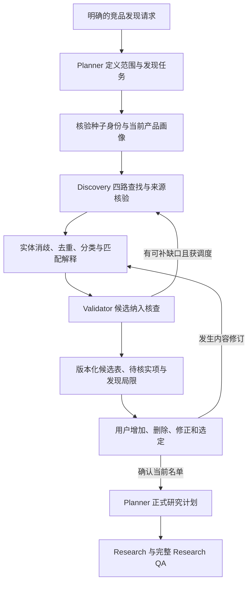

# Competitor Discovery Agent：竞品候选发现与审阅

版本：0.30.0；2026-11-04。本文定义待实现的发现能力、输入输出语义和验收；本轮未新增执行器、命令、模型 Prompt 文件或联网研究。已有能力边界见 [路线图](roadmap.md)，研究质量关卡见 [模块契约](module-contracts.md)。

## 目标与触发范围

Competitor Discovery Agent 建立有身份依据、竞争关系解释和可修改记录的候选名单，回答“哪些对象值得纳入、为什么、哪些关系尚不确定”。搜索结果中的品牌名只是线索，不直接成为已确认竞品。

用户明确要求寻找竞品、替代方案、市场格局，或在可选项目流程中授权发现时，才启动此能力。默认输入一个产品名仍研究该对象，不自动扩成竞品发现；未来无项目发现也不要求我方产品、profile 或初始化访谈。种子产品就是研究参照物，不自动当作用户自己的产品。

发现请求授权在约定范围内做有限候选筛选与来源核验，允许为判断相关性读取候选页面。它不授权提前为每个候选采集完整研究维度；用户审阅并选定当前名单后，才进入正式多对象 Research。未确认的候选可作为明确标注的发现提案展示，不能混入正式分析。

## 模块职责与目标流程

| 模块 | 在发现阶段负责什么 | 不负责什么 |
|---|---|---|
| Planner | 定义发现目的、种子对象、市场／时间边界、四路查询任务及预算建议；接收缺口后修订任务 | 不直接搜索，不替用户批准名单 |
| Orchestrator | 检查授权范围、分配预算、调用 Discovery 及核查模块、挂起审阅、记录修订与终止 | 不另写候选判断逻辑，不把推荐自动变成选定 |
| Competitor Discovery | 执行限定任务，构建候选、消歧去重、提出类别和匹配解释；处理候选修订 | 不控制全局状态，不批准范围，不生成完整竞品结论 |
| Validator | 核查候选身份、关系依据、分类和评分分项的支持情况及发现缺口 | 不以候选筛选通过签发完整研究 PASS |
| Research | 名单选定后按正式计划采集完整维度，继续经过 Research QA | 不因候选已通过筛选跳过证据核查 |

Discovery 复用 Registry 的搜索、抓取、快照与摘录能力；查询调整必须在分配任务和额度内。它不是自由漫游的第二主控，不另建不受账本约束的抓取器。

下面是目标协作关系，不是已有状态迁移图，也不代表 Python 已实现该流程。调用、恢复及状态落点须在接入时按现有状态机单独验收，不隐式增加 DISCOVERING 等状态。

## 从种子画像到四路发现

先核对种子名称指向的实体，再从本次读取的来源整理定位、目标客群、核心场景和功能／交付方式。每条画像保留原文依据、链接、获取日期及适用条件，区分官方宣称、第三方反馈和用户自述；未知字段保持未知。种子关键身份有歧义时先澄清，不沿错误对象扩展整张名单。

| 发现路径 | 查询所依据的问题 | 应检查的关系与常见误判 |
|---|---|---|
| 产品定位 | 什么产品或服务承诺解决相同问题、提供相近价值？ | 核查具体定位与交付结果，不能只按行业标签或营销词归同类 |
| 目标客群 | 同一类购买者、使用者或预算负责人还会选择什么？ | 区分买方、用户、公司规模与市场；共享一个客户案例不等于整体客群重合 |
| 核心场景 | 客户还可用什么办法完成相同任务或维持现状？ | 主动检查人工、自建、外包、流程调整、不买／不换；不能只搜索同类品牌 |
| 功能与能力 | 哪些对象提供相似能力、工作流或关键环节？ | 功能相似是线索，仍须核对场景、客群、范围和替代关系 |

四路是互补的发现方向，不要求每路产生固定数量。记录实际查询、来源、候选命中路径以及未执行／无合格结果／受限原因；单个候选可以命中多路，不能因此生成多个研究对象。某一路依赖尚未核实的种子信息时，先补核或标该路待执行，不能把猜测当确定画像继续扩展。

搜索摘要、目录榜单和“alternatives”页面可以发现线索，但需读取可用原始页面核验身份和关系依据。归类理由引用种子与候选双方的当前材料，说明适用场景、相似处和不相似处；不能仅因被同一榜单收录就断言存在竞争。

## 四类归属与纳入理由

| 关系标签 | 纳入需要说明的关系 | 排除或保留为不确定的情况 |
|---|---|---|
| 直接竞品 direct | 在明确客群、场景与市场中提供可替换的核心价值，争夺同类选择或预算 | 只有功能词相同；客群或交付目标不重合；无法证明共同选择场景 |
| 替代品 alternative | 采用不同产品、服务、流程或现状完成相同任务，或使客户不购买／不切换 | 只因成本低或普遍存在就推定可替代；与所问任务无关 |
| 潜在进入者 potential_entrant | 有可核验的近期进入动作，如相关产品发布、试点、合作或渠道进入，且与目标范围有关 | 只有相邻能力、传闻或“可能会做”的推测，保留假设而非已证实进入者 |
| 行业标杆 benchmark | 对本次明确的学习问题有可验证参考价值，如交付、体验或商业模式 | 仅因知名、融资多或规模大而入选；不是直接竞争也要明确说明 |

目标使用 labels[] 记录多种关系，每标签有种子对象、场景／客户／地区／时点、依据及核验状态；primary_label 仅可用于展示，不作互斥分类。同一规范实体只生成一个后续研究对象，四类覆盖按有效标签并集计算，现状路径保留 alternative。当前代码仍为单 tier，迁移只保留已知标签、不补猜其他关系，改标签须更新提案及批准绑定；详见 [产品规则](product-design.md)。不同类别的判断标准不同，不能把所有对象都塞进“直接竞品”。没有合格候选的类别保留缺口，不能为了凑四类编造对象。

非品牌替代方案使用可描述的方案标识、任务边界和依据，不强迫填写官网。用户描述的“目前靠人工处理”可以作为带归属的输入；它不自动证明整个市场都以人工为主。不买／不换等现状必须归为替代关系；缺乏适用证据时明确为待核实假设。

## 实体消歧与去重

发现前定义对象粒度：公司、产品、产品线或具体服务。套件和子产品是否分开取决于研究问题；不能既按套件完整计一次，又把相同内容拆成多个候选重复计分。

身份核对组合使用可得的官方产品 URL、运营主体、产品线、市场／地区和别名等线索。名字相同不代表同一实体，同域名也可能承载多个产品；地区页面不同不自动代表不同产品。URL 规范化用于整理线索，不独自决定实体合并。

经证据确认的中英文名、旧名、品牌改名或域名迁移可归入同一规范实体，保留别名、来源和合并历史。公司收购不自动把旗下产品合并；“替代某产品”页面也不是别名证据。种子自身及其已确认别名从竞品候选中排除并记录原因。

候选使用稳定 candidate_id；实体确认后绑定 canonical_entity_id。未能确认两个线索是否同一对象时，保留独立临时标识和可能重复关系，不静默合并。候选身份未解决时单列待核实，可由用户补 URL 或选择具体对象；在身份明确前不能成为正式研究对象，不要求用户替系统核验全部候选。

## 匹配评分：可解释、可复算、保留未知

匹配分表示某候选与本次研究目的的关系强弱，不是竞争概率、证据准确率、质量 PASS 或用户批准。证据充分性和身份核查状态另外展示。必要纳入条件不满足的对象不能靠其他高分补偿；排除依据与待核实状态优先于排名。

评分策略按类别和目的版本化，在评分前确定指标、权重、适用条件及分档依据。可选指标包括场景／结果替代程度、客群重合、能力重合、可服务市场及购买选择关联；替代方案重点看任务替代，标杆重点看学习问题，不强迫它们使用直接竞品的功能权重。策略由 Planner 结合范围提出并记录，不要求用户手工配置一套权重。

每个分项 x_i 取有依据的 [0,1] 值或 unknown，权重 w_i 非负且和为 1；分档定义须固定并可复核。支持与反证都要引用，已确认不匹配可记 0，未找到材料必须记 unknown。不得删掉未知项的权重后重新归一，也不得把搜索排名、品牌热度或模型自评当分项依据。

全部分项已核实且必要条件满足时，点分 S=100×Σ(w_i×x_i)。存在未知项时点分为空，可报告区间：下界 L=100×Σ已知(w_i×x_i)，上界 U=L+100×Σ未知(w_i)。这些是给定策略下的数学边界，不是置信区间；区间不能消除证据缺口。

合成算例：权重为 0.4、0.3、0.2、0.1，分项为 1、0.5、unknown、1，则范围为 [65,85]，不能报“匹配度 81%”。这一组权重仅解释算法，不是所有行业的默认配置。未知过多或没有有效策略时标待评分，避免用 [0,100] 充当有价值的排序。

仅在相同类别、范围和策略版本内比较分数；区间重叠时不声称有确定先后，可并列并说明待核实项。跨类别分别展示，不用统一总榜淘汰非品牌替代。用户可覆盖建议选择，但选择变化不修改证据、分数或核查结论。

## 候选表、用户修订与名单确认

候选审阅表至少呈现以下信息；下列是未来数据语义，不是现有 API 的新增字段。

| 信息组 | 审阅时应看到什么 |
|---|---|
| 身份 | 稳定 ID、规范名称、对象类型／粒度、官网或身份线索、别名及消歧状态 |
| 关系 | 多关系标签及逐标签情境／依据、可选展示主类、命中发现路径、为什么纳入、排除条件与不确定边界 |
| 依据 | 对应双方材料、来源链接、获取日期及适用条件；用户输入和待核实假设分开 |
| 匹配 | 策略版本、分项与理由、点分或区间、未知项；证据核查状态独立展示 |
| 选择 | 建议纳入／待核实／排除、用户当前选择、修订版本与待确认状态 |

用户可以增加候选、删除候选、纠正实体／类别／理由，或调整选中集合。新增名称与 URL 首先作为用户提供线索，进入身份和关系核查；用户选择也不能把尚未核验的事实变真。高匹配候选不自动入选，低匹配但用户明确需要的标杆可以保留，并展示选择依据。

每次修订记录操作者来源、原版本、变更内容、理由与新版本；可选理由不能变成强制访谈。删除保留排除记录，避免同轮通过别名重新加入；发现新依据时可提出恢复建议，但不能静默恢复。纠正或合并只重做受影响的身份、分类、来源绑定和评分，保留未变项及历史。

审阅确认绑定当前完整候选提案及选中集合摘要。增加、删除、改名指向不同实体、重分类、修改依据或评分策略后，须生成新版本并核对受影响的批准与研究范围；不能沿用与新内容不符的旧批准。选中名单变更后，后续计划及适用的维度提案／锁也需重建并重新审阅；不覆盖或伪装续签旧锁。

“加入候选”不是“批准开始研究”。编辑后呈现当前名单、实际变更和待核实项，用户对当前版本的明确选择由可信交互层记录；不能用模型推断、JSON role 字段或旧确认消息代替有效批准。全部删除时保留空选择和结束／继续发现的明确结果，不捏造一个对象以满足旧结构。

## 与 Research QA、预算和停止条件的衔接

候选纳入核查只检查身份、竞争关系和分类依据、去重、评分分项的来源支持、四路发现的执行记录及类别缺口。它可指出需要补核的单元，并由 Orchestrator 在预算内安排；核查不足的候选单列待核实，不混入确定性推荐。

发现阶段的质量结果与正式研究 QA 使用不同的目的与输入版本绑定。筛选推荐不表示该候选的价格、功能等完整维度已经充分，更不能复用为 `ValidationResult.PASS` 进入 Analysis。名单确认后的 Research 仍走证据验证、覆盖评估、缺口分析及必要补证闭环。

发现、核验和补充发现的工具调用统一计入当前任务预算，重启或改提案版本不重置额度。公开搜索遇访问限制立即停止，不换入口、代理或重试绕过；未执行、无合格结果、工具失败和受限分别记录。预算耗尽或继续一轮没有新增有效实体／关系依据时停止扩展，披露剩余缺口；新增重复 URL 不构成进展。

报告候选覆盖的查询方向、市场／时间范围与局限，不宣称找到了整个市场。零候选可以是诚实发现结果；搜索不可用则是未完成，不能改写成市场没有竞品。四类都有对象也不证明发现完整。

## 当前代码与未来契约的边界

现有 [research_workflow.py](../src/steal_her_heart/research_workflow.py) 的 `DiscoveryCandidate` 仅有 id、name、tier、solution_type、rationale、basis、sources；online_source 须带 Source，status_quo 只能归 alternative。候选 ID 唯一性由 `DiscoveryProposal` 检查；当前没有实体消歧、语义去重、四路查询或匹配评分。

`DiscoveryProposal` 必填 project_id、project_context_digest，要求非空 search_call_ids 和非空 candidates；四类各有候选或 TierGap。`confirm_competitors` 仅能选择该提案已有的非空、唯一 ID 集合并核对摘要；不支持添加或纠正候选，也不认证聊天用户来源。

现有 [project_review.py](../src/steal_her_heart/project_review.py) 从导入文件取得 selected_ids，不提供现场候选编辑器。提案内容变动会使旧批准摘要失配，选择变动会影响下游维度批准；已有产物拒绝覆盖，尚无自动修订、重审或旧锁迁移流程。

后续需单独设计非项目发现请求、种子画像与实体引用、查询路径记录、候选实体与关系、评分策略及分项、用户修订日志、版本化审阅结果和下游范围引用。还须合法表达零候选、全部删除、纯用户线索且尚未搜索等结果，不能伪造项目、search_call_id、来源或候选填旧结构。这些概念需接口、持久化、版本迁移与状态集成验收后才可调用。

## 后续验收场景

以下是未来模块及集成验收要求，本轮未新增或执行测试；合成材料用于验算法和分支，真实发现质量另需当前来源及人工抽核。

| 场景 | 必须观察到的结果 | 必须阻止的行为 |
|---|---|---|
| 多行业与默认入口 | 软件与非软件夹具均按四路发现；单产品请求不启动发现，明确发现请求才执行 | 固定 CRM 字段、无请求扩成多竞品或强制创建我方项目 |
| 同名、别名与产品粒度 | 同名不同主体保留不同实体；有证据别名合并；同域子产品按研究粒度处理 | 按名字／域名一键合并，种子别名作为竞品重复研究 |
| 类别与非品牌替代 | 人工／自建／不换可作为有边界的替代；潜在进入者需动作依据，标杆需学习问题 | 没官网即删替代项，传闻当已进入，知名品牌自动算直接竞品 |
| 相似功能但不同客群 | 分别核查场景、客群与市场，解释直接竞争不成立或仅部分成立 | 单个功能相似就断言竞争；只引用候选材料、不核对种子 |
| 评分与未知 | 分项可复算，未知保留权重、输出区间／待评分；相同政策内按类比较 | 未知记0、删权重、填伪精确总分、用高分绕过身份或证据不足 |
| 用户增删修正 | 增加后核身份，删除保留排除，纠正产生新版本；旧批准及相关锁失效可观察 | 用户提供即当已核实，别名重加已删对象，复用旧批准或覆盖旧锁 |
| 空名单与访问限制 | 零候选、全删除、尚未搜索、受限和无结果分别表达，保留真实调用状态 | 虚构调用ID／候选凑非空，受限称无竞品，绕限制继续查 |
| 交接与完整 QA | 当前名单被有效选定后才采完整维度；正式 QA 核对新的研究材料 | 候选推荐自动扩大范围，候选筛选结果被当完整研究 PASS |
