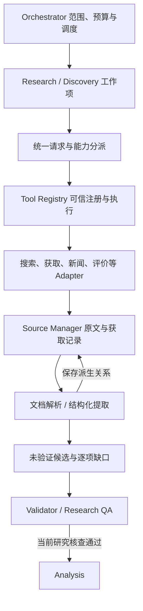

# 统一资料采集接口与 Adapter 设计

版本：0.26.0；2026-11-04。本文定义待实现的采集层，未新增工具、Adapter、爬虫、解析依赖或模型调用。当前生产研究链仍未接通；实现状态见 [路线图](roadmap.md)，研究准入要求见 [模块契约](module-contracts.md)。

## 目标与职责

Research 与 Competitor Discovery 共用稳定、类型明确的采集入口，数据源和页面结构由 Adapter 隔离。站点改版应定位到对应 Adapter 的解析或能力错误，不要求 Orchestrator 改写业务流程。统一入口不把搜索线索、原文、评价记录和已验证事实混成一个任意字典列表。

Orchestrator 控制范围、调度、预算、恢复和终止；Research／Discovery 在分配的工作项内调用采集能力。Adapter 负责协议或来源格式，Document Parser 与 Structured Extractor 处理已取得的材料；Source Manager 管理来源及其关联，Validator 判断主张是否受到支持。八类能力不是八个独立主控 Agent。

## 八类能力与当前基线

| 能力 | 目标输入与产出 | 当前实际边界 |
|---|---|---|
| Web Search | 查询与明确支持的条件 → 可追溯搜索线索 | 已有独立免密 DDG 首结果页搜索，最多10条，无日期过滤／分页；真实探测受限后停止，线索不能直接作为 Evidence |
| Web Fetch | 一个公开 URL → 原始内容、规范正文与来源快照 | 已有静态 HTML／XHTML／纯文本，单响应最多1MiB、预览最多12000字符；无 JS、重定向或自动重试，不支持 PDF |
| Website Crawler | 已确认官网入口与有限遍历策略 → 多页获取结果及遗漏记录 | 未实现；先做有界官网遍历，复用 Fetch，不先建设全网或大量站点爬虫 |
| Structured Extractor | 已获取文档、对象和研究字段 → 可定位的待验证主张 | 当前只绑定调用者给定的精确 spans，不能自动挑选、解释或改写事实；真正语义提取未接模型 |
| News Search | 查询与时间目标 → 新闻线索、事件候选及日期依据 | 未实现；新闻检索条件须由实际 Adapter 支持，搜索命中仍需获取和核查原文 |
| Review Collector | 公开评价来源或授权导出 → 有出处的评价记录和样本范围 | 未实现采集器；现有 review_sampling 只检查调用者输入的元信息、重复与采样覆盖 |
| Document Parser | 授权文档引用或已取得文件 → 带页／块／表格定位的解析文档 | 未实现 PDF／白皮书／手册解析或 OCR；现有 Fetch 不能直接承担 PDF 下载 |
| Source Manager | 获取与处理结果 → 来源、版本、调用和证据关联 | 已有 SnapshotStore 保存／校验原文、正文和 manifest；完整来源目录、派生关系和跨任务资产复用未实现 |

站点名称或 URL 提示不是支持承诺。G2、Capterra、Product Hunt 等来源仍要分别验证访问方式、实际正文和提取质量；通用 Fetch 存在不表示这些平台均可采集。

## 统一入口与能力分派

下面是目标数据流，不是现有状态迁移图，也不表示已有可调用的统一 Collector。来源管理贯穿各阶段；正式研究仍必须通过完整 Research QA。

Crawler 是有限任务组合器，每个子页面仍经 Registry 获取。解析器和提取器也经受控能力入口执行，但读取已授权文档，不因文中出现 URL 而自行联网。Source Manager 不自行搜索、刷新或给证据签发 PASS。

图中 QA → Analysis 仅适用于正式研究。Discovery 取得的候选资料先走候选纳入核查，其结果不能作为完整研究 PASS 消费；名单选定后仍需按正式计划采集并经过完整 Research QA。

### 版本化请求与结果

下列名称和字段仅描述未来契约，不是当前 Python API。实现时应采用 Pydantic 严格模型和按 capability 区分的载荷，再确定字段版本及兼容策略；不新增无约束 `collect(dict) -> dict` 通道。

| 请求部分 | 要表达的内容 |
|---|---|
| 共同上下文 | task_id、request_id、可选 parent_request_id、范围摘要、计划版本、工作项／研究单元引用，绑定可信执行上下文 |
| 能力与分派 | capability、可信选择的 adapter_id／version、实际支持的参数；不能由网页指定实现路径或代码 |
| 输入载荷 | 搜索用 query；获取用 url；解析／提取用 document_ref；来源管理用来源引用及明确操作。按能力选择互斥输入，拒绝无关参数 |
| 执行约束 | 适用市场／时间目标、允许来源范围、每次大小与超时、页数／深度上限、父级预算引用；声明目标不等于提供方原生支持过滤 |

统一结果保留请求与 Adapter 版本、真实工具调用引用、逐项 outcome、产生的来源／工件引用、实际覆盖和缺口、停止原因。载荷按能力区分：搜索线索、已获取文档、新闻／评价记录、解析文档、待验证主张及来源操作收据；不把它们统一改名为 Evidence。

Registry 的 ToolResult.call_id 与搜索／抓取账本的持久 request_id 是不同标识；统一层须保存关联，不能互相替代。超时取当前工具上下文、能力限制及剩余任务时间的有效上限，不能把某一 CLI 入口的超时推广为所有 Adapter 的固定值。

搜索结果要追溯查询与结果页；文档要追溯原 URL、获取动作及原始 bytes；记录和候选要追溯正文版本及定位。批处理外层状态从子项结果汇总，保留每个失败项，不能只返回成功子集。来源绑定不完整的内容不能晋升为可交给 QA 的事实候选。

先用兼容 Adapter 包装已有工具与结果，保留现有 CLI、账本和快照语义。当前 `ResearchEngine.collect()` 只声明返回 EvidenceBundle，不能容纳上述全部结果；真正集成必须更新端口、存储、版本和测试，不能把未来信封直接塞入旧字段。

### Adapter 注册、隔离与替换

Adapter 声明支持的能力、媒体类型、静态正文／分页／日期过滤等参数以及输入输出版本。由可信应用代码注册并按明确策略选择；未知能力、参数不兼容或媒体类型不支持，在实际执行前返回 unsupported，不暗中丢弃条件或降为普通搜索。

提供方协议、站点选择器、导出格式和字段映射留在 Adapter 内。缺少预期结构、正文空壳、字段类型变化或解析器不能识别页面时，返回可定位的解析／Schema 错误并保留安全诊断；只有确认成功完成查找且确实无结果，才可报告 no_results。

替换 Adapter 须通过相同的请求、结果、来源、失败和预算契约检查；语义提取与真实来源质量仍另验。故障隔离表示核心无需依赖网站字段，不表示可以绕过访问限制切换提供方、代理或入口。发生失败后是否还有合法独立工作由 Orchestrator 按既有停止策略决定，Adapter 不自行续跑。

## 有界官网采集

首个 Crawler 只处理已核对的官网种子和明确允许的 host／path 范围。每次任务显式配置有限的页面数、深度、并发、速率、大小和活动时间上限，实际可用额度取本地限制与任务剩余预算的较小者；不从网页建议自动扩大这些值。

队列记录 URL、发现父页、深度、选择理由、请求 ID 和状态；先去重再派发，循环链接、重复分页和同页锚点不能无限扩展。URL 整理保留有业务意义的 query 参数，不能把地区、版本或分页条件删掉后误合并。canonical 提示可保留作线索，不能独自证明同一内容或授权跨域抓取。

每个实际 HTTP 子请求都经 Registry 和现有获取限制执行，关联 parent_request_id，并消耗同一任务的抓取额度；不能把遍历100页只计作一次调用。复合调用日志与子请求资源计数分别记录，避免漏记或将同一请求重复计入额度；分页、站点策略文件和相关元请求同样需计入适用的网络预算。

外链、重定向和第三方资源不自动进入队列；当前 Fetch 的重定向上限仍为0。遵循已配置的访问及 robots 策略，访问限制立即按现有规则停止，不把受限页当无内容。页面／深度／预算到限时明确未遍历范围及未完成子项，不声称抓完官网或产品没有相应能力。

## 文档解析与结构化提取

Document Parser 接收经授权且可回读的本地工件／文档引用。远程 PDF 需要先实现受控下载链：验证公开目标、媒体类型、大小及来源记录后保存原始 bytes，再解析；不能因为 URL 以 .pdf 结尾就假定现有 Web Fetch 已支持，也不能让解析器自行下载文中的附件或远程资源。

解析结果保留原文件散列、解析器及版本、页码、文本块／表格位置和读取顺序；提取结果必须能回到对应文档版本。页数、输入大小、展开数据量、处理时间与输出长度有界，不执行文档宏、脚本或嵌入程序。扫描件需要 OCR 时报告实际能力；未接 OCR 返回 unsupported 或可解释的未解析页，不制造正文。

Structured Extractor 从解析正文或已取得网页中，按当前对象和维度生成主张、精确原文摘录与 locator；价格保留币种、地区、产品版本、周期、计费单位和限定条件，功能／客户／部署也保留主张范围。定位、字段和适用条件缺失须列缺口，不能通过改写摘录补齐。

语义选择与主张生成依赖真实模型提供方、非空运行 Prompt、结构化输出解析和模型预算；这些能力须先独立验收。模型输出只成为待验证候选，来源身份、语义支持、时效、覆盖与冲突继续由 QA 核查。当前显式 spans 工具只验证摘录机械绑定，不能替代这个执行器。

解析失败与“文档未提到该字段”不同；未提到也不能推出该能力不存在。所有分块和模型子调用保留原文映射、调用标识和计数，截断内容及未处理页显式披露，不能将一段有界预览冒充完整文档。

## 新闻与评价

News Search 分开记录 published_at、updated_at、event_at 和 fetched_at，日期无法核实继续未知。发布时间可以证明文章何时发表，不能自动证明事件发生时间；HTTP Date、抓取时间或旧页面最近修改时间不能代替“近期动态”的证据。请求要求原生日期过滤而 Adapter 不支持时，执行前返回 unsupported；只有计划明确选择“普通检索＋逐篇日期核查”且 Adapter 声明支持该方式时才可执行，并披露覆盖局限，不能自动丢弃过滤参数回退。

新闻结果保留原始公告／报道关系与转载线索。同一新闻稿的多域名转载不算多个独立支持；标题和搜索摘要用于发现，事件主张须有实际可读原文支持。事件日期不足时标待核实，不填入确定的近期事件清单。

Review Collector 首先接实际可访问的公开记录或用户授权提供的导出文件，保留原文、记录／来源链接、发布日期与获取日期、原评分尺度、产品版本、样本范围和可得的激励／验证标签。缺失标签保持未知；导出文件保留原工件和导出／导入时间，导入时间不伪装为对网站的本次访问。

评论去重、分层与采样窗口应可追溯。单条评价只支持该样本的体验，不从主动选样推断总体满意度或投诉率；分页未完成、平台受限及采样不足均留下缺口。现有 [review_sampling.py](../src/steal_her_heart/review_sampling.py) 仅检查传入记录，不证明已访问评价站或验证原文；新 Collector 不能把它的通过结果当语义 PASS。

## Source Manager 与来源谱系

Source Manager 的目标关联为：工具调用 → 获取观察及来源 → 原始／解析文档版本 → 候选主张 → 经 QA 的证据。每段关联保留 ID、散列、Adapter／解析器／提取器版本和上游引用；来源管理负责保存和对账，不自行判定主张真实。

Source Manager 是来源获取与处理谱系的写入入口；[独立证据服务](evidence-management.md) 管理 Source／Evidence／Claim 的统一版本、关系、核验与冲突记录及报告反向索引。两者共享一份来源权威数据，不能各自维护可变的来源日期或评级副本。采集层提交实际原文及观察，Validator 给支持与冲突判断，证据服务保存判定历史；证据服务不自行联网或代替 Validator。原子 Evidence 绑定单一来源版本，多来源综合进入 Claim 的多对多关联。

| 必须分开的信息 | 管理要求 |
|---|---|
| 原 URL、规范 URL、内容身份 | 保留实际获取地址；规范化仅辅助去重，不独自认定实体相同或来源独立 |
| 原文与派生正文 | 原始 bytes 和规范正文分别散列，保存解析配置、定位与派生关系，回读可核对 |
| 获取、发布、事件与再核验时间 | 保留原获取时间；未知发布／事件时间不补造，再核验须有本次动作及依据 |
| 内容变化与重复材料 | 同 URL 内容变化产生新版本，不覆盖历史引用；同文不同 URL 保留各次观察但不增加独立证据数量 |
| 处理成功与证据状态 | 文档保存／解析成功、候选提取成功和核查通过分别记录，不互相替代 |

已有 [SnapshotStore](../src/steal_her_heart/source_snapshots.py) 可保存并校验 raw、text 和 manifest。`Source.content_sha256` 对应原始 bytes；snapshot_ref 对应含来源、时间等元信息的 manifest 散列，不是相同正文跨 URL 自动合并的索引。当前快照格式服务于现有静态正文，不能原样宣称支持 PDF；二进制工件及其解析版本仍需设计持久化格式。完整来源目录、上述关联及去重决策也待实现。

同任务重放已记录的获取结果保留原时间并重新检查快照，不算再次联网；损坏快照不得静默补抓。当前任务的证据版本、时效状态与更新关联按证据管理设计逐步实现；跨任务检索、实体／口径兼容、自动再核验和增量刷新属于后续资产复用能力，不能因来源可读取就宣称增量研究已实现。

## 执行结果、缺口和停止

下表是采集视图的语义标签，不再作为单一执行枚举；以 [统一失败恢复协议](failure-recovery.md) 的 execution／discovery 双轴及 FailureRecord 为准。当前枚举仍不接受这些新增字段。

| 结果 | 允许表达的含义 |
|---|---|
| success | 本次约定的工具操作成功，仍需检查内容与业务单元是否充分 |
| no_results | execution=succeeded、discovery=empty；成功完成明确范围的查找，无命中不证明该事实不存在 |
| partial | 部分子项完成，附成功工件、未完成项和原因；不能省略失败项后伪装 success |
| unsupported | 当前 Adapter 不支持所需能力／格式／参数，执行前已知时零网络调用 |
| restricted / failed | 执行失败及具体原因分类，discovery=not_evaluated；附安全错误和实际已用额度，不当零结果 |
| deferred / unknown | 等待可执行条件或远端结果不明，discovery=not_evaluated；保留恢复条件或对账要求 |

工具成功、字段 found 与事实已验证是三个层次。404、解析错误或缺少链接不能自动使业务字段 not_applicable；业务适用性由计划与 QA 判断。CollectionResult 的部分材料可保留作诊断，但现有 TaskResult 没有部分成功类型，未完成任务不得因此登记最终 report_path 或 COMPLETED。

所有搜索、页面获取、文档下载、解析及模型子调用按实际资源归属累计；联网前预留额度，失败也消耗已发起调用的额度。恢复保留任务与调用标识，已完成结果可重放，结果不明的预留调用不盲目重发。当前搜索30次与抓取60次是分开的独立账本，尚不是这套跨工具全局预算。

受限时按既有策略停止，不换 Adapter 绕限制；解析失败、unsupported、预算耗尽和无有效进展须形成可定位的缺口。是否需要补证由 QA 指出、Planner 规划、Orchestrator 调度，不能靠 Adapter 自行重试、改任务 ID 或删掉难采字段获得完成。

## 最小实施顺序与验收

先完成统一信封、能力声明和 Registry 适配，复用现有 Search／Fetch／快照；再完成最小 Source／Evidence／Claim 对象、版本及关系存储，然后接真实模型、Planner 与语义 Extractor，最后接 Research 执行及 QA 补证闭环。核验记录和实际语义判断分别验收，报告追溯随 Analysis／Reporter 接入；每个模块实现并通过对应测试后再继续，不把八类能力全部完成作为单产品最小研究链的前提。

有限官网 Crawler 随实际需求优先扩展；Document Parser、News Search 和 Review Collector 再逐项接入，并分别验收来源及格式。先证明通用接口和少量实际 Adapter 可工作，不预建大量网站选择器，也不提交空类／空 Prompt 表示已支持。

现有可复用边界为 [Tool.run 与 ToolRegistry.invoke](../src/steal_her_heart/tools.py)、[SearchProvider](../src/steal_her_heart/web_search.py) 的 search → SearchPage、[FetchProvider](../src/steal_her_heart/web_fetch.py) 的 fetch → FetchedPage，以及 SnapshotStore.save／load。外层 SearchResponse 保持 evidence_eligible=false，FetchResponse 保持 facts_validated=false，现有抓取构建的 Source.published_at 固定为 None；未来适配不能悄悄改变这些语义。

以下是后续模块及集成的验收要求，本轮未新增或执行这些测试。离线契约和合成场景不证明真实网站、模型或研究质量已可用；真实服务受限时如实记录未通过或未执行，不重试绕过。

| 场景 | 必须观察到的结果 | 必须阻止的行为 |
|---|---|---|
| Adapter 替换 | 不改 Orchestrator 的站点逻辑即可切换兼容 Adapter；结果及来源语义一致 | 传入任意代码路径、静默忽略不支持参数、将线索升级为 Evidence |
| 网站结构改变 | 返回可诊断的解析／Schema 错误及来源上下文，失败项留在结果中 | 空壳当无结果、只保留成功项、换入口绕访问限制 |
| Crawler 范围与预算 | 循环、跨域、页数／深度到限均有记录，实际子请求累计同任务额度 | 一次外层调用隐藏多页请求、canonical 扩范围、删除业务 query 误去重 |
| 结构化提取 | 价格及功能主张能回到对应正文、单位和限定条件，未知保持缺口 | 改写 quote、用预览冒充全文、将高 confidence 当核验通过 |
| PDF 与解析定位 | 页／块／表格定位绑定原文件及解析版本；扫描件明确 OCR 能力或缺口 | 现有 Fetch 假装支持 PDF、未做 OCR 生成正文、截断后声称全页完成 |
| 新闻时间与转载 | 发布、更新、事件、获取时间分开，同源新闻保留依赖关系 | 旧事件重发当近期动态、多站转载当多个独立来源 |
| 评价采集与样本 | 来源／原文／评分尺度及采样范围可对账，受限与无评价分别表达 | 元信息检查当真实采集、缺标签当否、少量分层样本推总体满意度 |
| 来源版本与 QA 隔离 | 内容变更保留新旧版本，重放不改获取时间，候选仍进入当前 QA | 同文多 URL 增加独立支持、快照存在冒充资产复用、partial 工件交付最终报告 |
