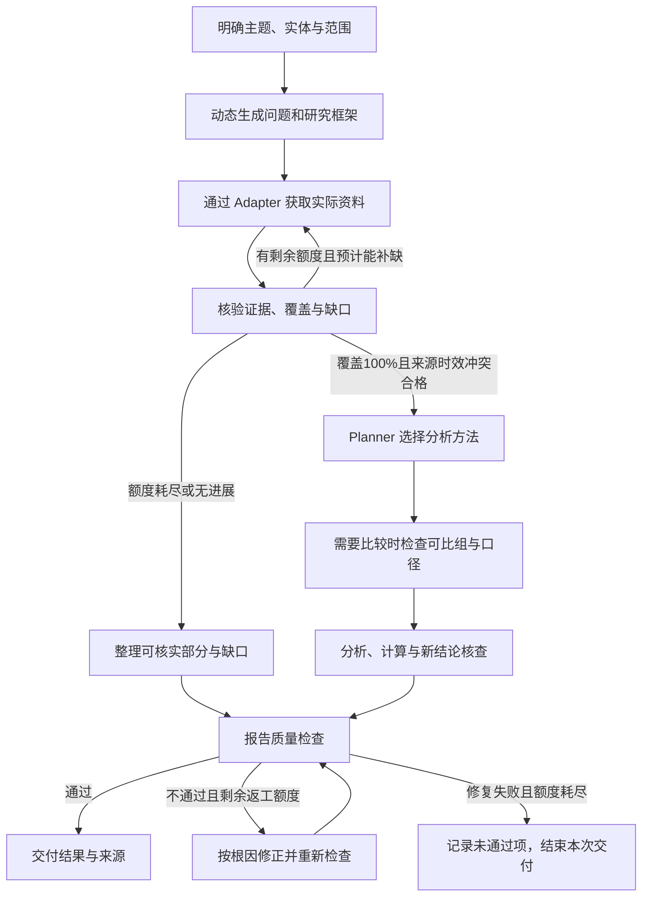

# 研究设计与维护指南

## 可以研究什么

核心对象称为 **Competitive Intelligence Subject**。它可以是一个现实对象，也可以是围绕对象或市场提出的决策问题。

| 任务类型 | 研究重点 |
|---|---|
| Product Intelligence | 产品价值、能力与适用边界 |
| Company Intelligence | 企业业务与竞争优势 |
| Brand Intelligence | 品牌定位与竞争关系 |
| Service Intelligence | 服务内容、交付与体验 |
| Technology Intelligence | 技术路线、能力和约束 |
| Pricing Intelligence | 价格、收费结构与策略 |
| Channel Intelligence | 销售、分发路径与覆盖 |
| Market Intelligence | 市场结构、规模、格局与机会 |
| Industry Intelligence | 行业环境、产业链与变化 |
| Customer Intelligence | 客户选择与需求变化 |

这些类型可以组合，共享同一套研究流程和事实资料，不拆成十个独立 Agent。单个产品分析不会自动扩大成全市场研究。详见 [研究对象与任务路由](../codex-skills/steal-her-heart/references/subjects.md)。

## 研究如何进行

八阶段为 Intake → Plan → Collect → Validate → Analyze → Report → ReportQA → Delivered，守卫与有界回退见 [状态迁移单源](../codex-skills/steal-her-heart/references/workflow.md)。Intake 的交互仍由报告交互单源定义；Delivered 是交付阶段，实际文件检查通过才标任务完成。



研究框架根据对象的实际属性、行业背景和用户目标生成，维度分必选、推荐与可选。Agent 要说明为什么研究这些问题；不能因为某个模板里有一项，就要求每个对象都填写。

采集完成不等于证据充分，排好表格也不等于分析完成。输出可以是事实画像、对比矩阵、市场研究、销售一页纸或即时简报；具体内容取决于问题与已核实材料。

## 围绕问题设计研究

Planner 内部包含两项明确职责，仍共用同一个通用研究引擎：

| 职责 | 负责的工作 | 落盘产物 |
|---|---|---|
| Research Question & Hypothesis Agent | 拆解问题，提出可证伪假设与替代解释，定义支持／反证要求，记录当前结论、置信依据和验证状态 | `questions.jsonl` |
| Research Framework Agent | 识别可重叠的业务属性，按问题设计维度、证据条件与研究优先级，根据采集结果修订框架 | `framework.json`；需要时输出可读的 `dimensions.md` |

业务类别是开放多标签，一个对象可同时涉及软件、服务、内容或实体交付；标签不触发固定行业字段表。必选性表示必须回答什么，P0／P1／P2 表示先做什么，二者分开记录。所有维度必须关联具体问题，框架调整保留原因、反证、受影响结论与旧版本。

例如“分析 Notion 的竞争优势”可拆成用户是谁、为什么选择、差异是否可替代、是否可持续、什么会推翻优势判断等问题；这些只是待验证问题，不是对 Notion 的事实断言。假设被推翻也可以是完成的验证，预算耗尽或找不到反证则不能算验证成功。

详细执行规则见 [问题与假设](../codex-skills/steal-her-heart/references/questions-hypotheses.md) 和 [动态研究框架](../codex-skills/steal-her-heart/references/dimensions.md)。数据契约与受控结构检查不等于已部署独立 Agent 服务或完成真实研究验收。

## 怎样判定“证据充分”

必选维度按“对象 × 必需维度 × 实际市场／使用端条件”逐格核查，**适用必选单元覆盖率须达到 100%**。未采集、未找到、受限或只有推测不算覆盖；不适用须有依据。覆盖达标还须关键结论、时效、比较口径和冲突检查通过。

关键分析结论至少需要 **两个独立来源组**支持；同一新闻稿的转载不算多个独立来源。官方价格等明确归因的一手披露可用一个原始来源，但不能据此直接证明“最便宜”或“效果最好”。默认当前价格窗口为 24 小时、评分为 7 天、现行功能／版本为 30 天；成立时间等稳定历史事实保留事件日期，本次核原始记录，不能用获取日期刷新事实。

| 全任务上限 | Quick | Standard（默认） | Deep |
|---|---:|---:|---:|
| 外部研究操作 | 12 | 40 | 100 |
| 读取的文档版本 | 6 | 20 | 50 |
| 补研轮次 | 1 | 2 | 3 |
| 报告修正轮次 | 1 | 2 | 3 |
| 跨步骤返工累计 | 2 | 4 | 6 |

**先估范围，再大规模采集。** 假设比较戴森与追觅各一个型号的洗地机，功能按型号核一次，销售条件和售后条款各按三个电商渠道核查，共有 **14 个必选单元**（每款 1＋3＋3）。一份说明书可以支持多个问题，一项售后结论也可能需要多份材料。假设初扫已用 4 次，后续预计要做 12 次搜索、18 次页面读取、8～12 次交叉核查，全程约 **42～46 次**，超过 Standard 的 40 次。Agent 会在正式采集前提示：可以先选一个渠道，把范围缩至 6 个单元后重估；也可以保留三个渠道，选择 Deep。这里的数字是规划示例，实际按资料可复用程度估算，文档额度另算。

**“受限”和“不足”取决于证据能回答什么。** 到达停止条件时，如果已按同一使用场景核实两款型号的功能差异，但部分渠道售后条款仍无法确认，交付**受限结果**，列出已核实差异和具体缺口。如果只有品牌介绍，连一项影响选择的差异也无法核实，则为**证据不足**，只说明阻碍和下一步所需材料。预计超预算本身不决定最终状态。[质量阈值、时效与预算规则](../codex-skills/steal-her-heart/references/research-quality.md)

## 长任务如何保存与复用

研究以 `manifest.json` 检查点和 JSONL 台账持久化：来源、实体与时间关系、证据、结论、冲突、覆盖率、任务及预算事件都有明确格式。每条重要报告内容可追到 **Claim → Evidence → 原文片段、URL 与获取时间**，反向也能定位受影响的报告位置。

PDF 与 PPT **分别从同一版台账生成**，不互相转写。输入快照和文件记录保留哈希；修订不覆盖旧版本。长任务按 ID 分批加载有关记录，恢复先核文件完整性、任务结果与预算，避免重采或重复执行。详见 [台账与恢复协议](../codex-skills/steal-her-heart/references/research-ledger.md)、[记录 Schema](../codex-skills/steal-her-heart/schemas/ledger-record.schema.json) 和 [检查点 Schema](../codex-skills/steal-her-heart/schemas/research-manifest.schema.json)。

## 执行示范与来源判断

例如，你问“竞品的自动审批值得我们借鉴吗？”，报告会分开写规则能处理哪些申请、哪些效率收益还只是推测，以及如何用自己的审批记录决定是否试点。只有厂商手册时，实际节省了多少时间会保留为未知。见[分析原则与自动审批示例](../codex-skills/steal-her-heart/RULES.md#专业分析的五项原则)。

[五个正反示范](../codex-skills/steal-her-heart/references/worked-examples.md) 展示价格冲突、缺分母的份额请求、工具失败、缺失值比较及缺对象时的处理。示范均为教学材料，不是实际产品事实。

来源等级、置信理由和允许使用的“背景知识”见 [来源质量规则](../codex-skills/steal-her-heart/references/source-quality.md)。一般术语和方法解释可标为背景知识；当前竞品事实仍需本次证据，背景知识不计入事实覆盖。评论研究按 [采样与口碑规范](../codex-skills/steal-her-heart/references/review-method.md) 记录窗口、样本、重复／疑似操纵信号和评分口径，不用跨平台星级直接排名。

[验证记录](../codex-skills/steal-her-heart/validation/README.md) 分别列结构检查、受控案例、真实工具调用和未完成项。方法的合成案例、行业包的结构校验和连接器的实际可用性分别记录。

## 文件与成果

```text
codex-skills/steal-her-heart/
├── SKILL.md                 调用入口与工作流程
├── RULES.md                 证据、权限与质量规则
├── TASK_SPEC.md             运行职责、交接与任务管理
├── agents/openai.yaml       技能展示信息
├── references/              架构、研究方法、质量及台账协议
├── schemas/                 台账、背景知识与检查点 JSON Schema
├── scripts/                 交付前完整性检查
├── tests/                   维护者验收表，运行时不加载
└── validation/              历史验证材料，按维护／能力审查请求读取
AGENTS.md                    仓库维护约定
projects/README.md           可选长期项目说明
templates/profile.md         按需填写的背景模板
```

默认生成 PDF，在 Codex 对话中提供摘要和文件链接，并询问是否加做 PPT。研究成果写入 `research/<安全标识>/<版本>/`；用户明确选择长期项目时，再使用 `projects/` 保存背景、范围和版本。已有业务资料不自动覆盖，业务项目与研究成果不默认提交到仓库。

长期项目流程见 [项目说明](../codex-skills/steal-her-heart/references/projects.md)。研究请求不自动授权发布、发送、付费或定时监测。

## 参与维护

维护时遵循 [AGENTS.md](../AGENTS.md)，保持技能包自包含和三项架构原则。新增行业扩展 IndustryPack，新增平台扩展 Adapter，新增方法扩展 Method Registry，并补充适用性、缺失、冲突及失败场景。

运行职责见 [TASK_SPEC.md](../codex-skills/steal-her-heart/TASK_SPEC.md)，维护者验收要求见 [tests/acceptance.md](../codex-skills/steal-her-heart/tests/acceptance.md)。提交时区分格式／引用检查、受控案例和真实研究验证，说明实际工具、证据、产物及未完成项；不能用旧测试记录或合成报告证明新能力已经可用。

## 扩展与合规入口

研究框架按任务选择 [IndustryPack](../codex-skills/steal-her-heart/references/industry-packs.md)、[数据源 Adapter](../codex-skills/steal-her-heart/references/connectors.md) 和[分析方法](../codex-skills/steal-her-heart/references/analysis-methods.md)。新增集成的维护者先核对[架构约束](../codex-skills/steal-her-heart/references/architecture.md)，涉及公开人物时查阅[实体隐私规则](../codex-skills/steal-her-heart/references/entities.md#人物实体与个人信息)。

交付前校验的安装、Quick 精简格式和运行方法见[台账协议](../codex-skills/steal-her-heart/references/research-ledger.md#交付前校验)。
