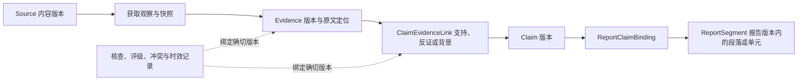

# 标准化证据管理：Source、Evidence 与 Claim

版本：0.29.0；2026-11-04。本文是独立证据数据能力的目标设计；本轮未新增存储服务、语义核查器、迁移或后台任务，现有 Schema 版本不变。研究执行边界见 [模块契约](module-contracts.md)，采集及来源获取设计见 [资料采集层](data-collection.md)。

状态目标以 [状态机 v2](state-machine-v2.md) 及其迁移目录为准：独立缺口／补研／报告 QA、两个确认等待及 CANCELLED 替代此前内部阶段安排。本文标为当前或迁移前的 v1 边界继续描述未变更源码；新状态与恢复须先实现迁移和守卫后启用。

## 独立数据能力与职责

证据管理服务保存可版本化的 Source、Evidence、Claim 及其关系，提供查询、状态记录和影响追溯。它是供研究模块共享的数据能力，不是另一个自主 Agent，也不要求引入图数据库。

| 责任方 | 负责的内容 | 不能代替的判断 |
|---|---|---|
| Source Manager | 获取观察、原始文件／页面快照、解析工件和来源元信息 | 原文存在不证明其中的产品事实正确 |
| 证据管理服务 | 三对象的版本引用、多对多关系、核查／冲突／时效记录及报告引用索引 | 存储成功、外键完整不等于语义支持或 QA 通过 |
| Research／Extractor | 从已取得材料生成原子事实候选与精确原文定位 | 不给自己的候选签发 verified 或研究 PASS |
| Validator | 核查原文支持、来源适用性、时效、冲突及具体支持关系，记录依据 | 不以评级、引用数量或模型置信分数代替实际核查 |
| Analysis | 基于当前核验事实形成有范围和限制的 Claim | 研究输入通过 QA 不自动证明新生成的 Claim |
| Reporter | 绑定段落／表格／要点与 Claim，核对转述和实际交付 | 报告末尾有来源列表不等于逐条结论有依据 |

Source Manager 与证据服务可共享存储，但来源身份、内容版本和获取记录只有一个权威记录；证据服务按版本引用，不另存一套可独立改写的 Source。Orchestrator 仍负责调度和终止，数据服务不自行联网、补证或修改任务状态。

## 三个核心对象与版本

| 对象 | 表达什么 | 最小边界 |
|---|---|---|
| Source | 原始资料来源及可回读的内容版本，例如官方定价页面 | 逻辑 source_id、不可变 source_version、获取观察及原始材料分别保留 |
| Evidence | 从确定来源版本提取的原子事实表述及其核查记录 | evidence_id／version 绑定对象、维度、内容、原文与定位，保留未知和限定 |
| Claim | 分析或报告需要证明的具体结论 | claim_id／version、结论类型、范围、限定条件和支持／反证关系 |

逻辑 ID 标识持续管理的对象；版本标识某次不可变内容。引用必须包含明确版本，不能在报告生成后把同一个 ID 自动解析为“最新”。更新文本、口径或来源绑定时产生新版本，并保留原版本及变更原因。

Source 记录逻辑来源、原始 URL／可验证资料位置、发布者身份、来源类型和内容版本。每次实际取得资料形成获取观察，包含观察 ID、工具调用、方法、时间及内容散列；重复获取相同内容也不能重写历史观察。相同正文在不同 URL 出现可关联转载或重复关系，但不能据此增加独立支持。

来源身份归一须有依据；URL 规范化、域名相同或内容散列一致都不能单独证明发布者身份相同。上传文档应保留实际工件及取得方式，未来协议不得为适配当前 HttpUrl 字段而编造网页地址。资料变更产生新内容版本，不说明旧版在其历史时点必然错误。

Evidence 的 content 是要核查的事实表述，quote 是原文摘录，两者职责不同；即使文字恰好相同也分别保存。一条 Evidence 锚定一个来源版本中的原子事实，跨来源综合放在 Claim 层。拆分事实时保留原文上下文，不能丢失否定、地区、版本、计费周期或其他限定。

Claim 可以是事实归纳、比较、差异或机会判断，但类型和限制必须明确；机会仍是待验证假设。Claim 不通过复制一个高 confidence 值获得成立资格，也不能把研究对象的官方宣称改写成经过独立验证的实际效果。

这是目标数据关系图，不是状态机迁移图；关系表和索引应支持沿两端查询。

## Evidence 必备字段与附加取证信息

以下字段是待实现的标准视图，不是当前 Python Evidence 已有字段。未知值必须有明确语义，不能靠虚构默认值使记录看似完整。

| 字段 | 语义与约束 |
|---|---|
| evidence_id | 稳定逻辑标识；结合 evidence_version 精确引用，不能只按事实文字散列认定同一证据 |
| competitor_id | 当前核对过的对象实体标识；旧 competitor 名称需要显式映射，同名未消歧不能假装已有可信实体 ID |
| dimension | 当前研究维度／字段的稳定引用，绑定相应模板或需求版本 |
| content | 原子事实表述及必要限定；不混入无依据推断，不替代原文 quote |
| source_id | 来源逻辑标识；同时必须引用 source_version 和 acquisition_id，不能漂移到最新页面 |
| source_type | 官方材料、独立报道／研究、用户反馈、用户提供材料或未知等类型；从版本化来源分类投影，不是可信度等级 |
| published_at | 对应来源版本可核实的发布时间；未知为 null，不能用获取或导入时间补造 |
| collected_at | 对应 acquisition_id 的实际取得时间；新采集记录必须有真实依据，重放不更新，不等于提取／核查时间 |
| valid_until | 当前使用的到期／复核上限，可为 null；必须另记依据与策略版本，null 不表示永久有效 |
| confidence | 未校准的质量信号，可为 null；附理由、生成方法和版本，不能当准确率或核查通过条件 |
| verification_status | 指定证据／来源／范围下最近有效核查结果的投影；初始为 unverified，必须指向核查记录，不由模型自行升级 |

published_at、collected_at 和 source_type 从引用的来源版本／获取观察派生，或在写入时严格校验一致；不能保留两处独立可变副本。导入资料要记录取得方式，导入时间不能冒充对原网站的访问。旧记录缺少真实时间时保留缺口，不能用迁移时间填补。

除上述字段，还需 evidence_version、quote、结构化 locator、source_version、acquisition_id、原文／正文散列、解析器／提取器版本、origin_task_id、scope 引用、比较条件及核查记录引用。网页定位绑定正文版本和字符／行范围；PDF 定位绑定文件版本及页／块／表格位置。没有可回查定位的内容不能仅凭字段齐全成为合格 Evidence。

valid_until 必须说明来自来源明确的有效期，还是工程复核策略。来源业务生效／失效区间与系统 freshness 截止应分别记录；合并为使用上限时保留各项依据。不能把复核期限描述成来源承诺的价格有效期，也不为所有行业硬编码同一个 TTL。

## 核查、时效、生命周期和冲突分开记录

| 维度 | 目标状态语义 | 重要区别 |
|---|---|---|
| verification_status | unverified／supported／unsupported／inconclusive | supported 表示该原文在限定范围内支持该事实表述，不是绝对真理 |
| freshness_status | current／stale／unknown，按 as_of 与策略计算 | 曾被支持的证据仍可能过期；未知期限不自动算 current |
| lifecycle_status | active／superseded／retracted | 替代或撤回保留历史版本和原因，不物理删除引用链 |
| conflict relation | open／resolved／not_comparable 等记录状态 | 冲突不会覆盖原核查结果；同一证据可同时“原文支持”且“与另一来源有冲突” |

这些名称是概念状态，不是现有枚举。核查记录至少绑定 Evidence／Source 版本、快照散列、研究范围、策略版本、as_of、评估时间、评估者来源、结论与理由。数据服务保存记录；实际原文支持判断由 Validator 完成，模型自评和字段存在检查不能直接产生可信 supported。

当前使用或 QA 的 as_of 达到 valid_until 时，按适用策略标 stale 并要求复核；null 则按未知期限与维度策略处理，不放任永久复用。时效结果针对请求时点：过期材料仍可解释过去的报告，但不能未经新核查支持当前价格等事实。本轮没有实现定时扫描、自动刷新或后台失效传播。

Evidence 的核查、Claim 的支持关系核查和完整 Research QA 是不同层次。当前材料存在 supported 记录，也仍需检查本次范围、版本、时效、必需覆盖与冲突，才能形成本次 QA 结果；不能在数据服务中直接产生或复用全局 PASS。

## Claim 与 Evidence 的多对多关系

目标 ClaimEvidenceLink 使用 claim_id／claim_version 与 evidence_id／evidence_version 建立关系，另存 relation（supports／contradicts／context_only）、适用条件、支持或反证理由及关系核查记录。一个 Claim 可引用多条 Evidence，一条 Evidence 也可支持多个 Claim；关系类型不能仅靠 ID 存在推断。

同一版本对和同一关系不重复建边以凑证据数量；相同事实的转载也不形成多个独立支持。反证必须留在关系与冲突记录中，不能只向分析端传支持材料。仅作背景的 evidence 不计作证明结论成立。

一条合格 Evidence 不一定支持任何更宽的 Claim；多条 Evidence 各自有效也不保证它们合起来能证明结论。跨对象比较需要双方材料，跨地区／版本／时期推断需相应范围依据。关系核查应验证结论的量词、比较条件和逻辑，而不是只验证引用非空。

以下沿用用户给出的合成示例，不指向真实产品或真实网页：

| 对象 | 示例内容 | 支持边界 |
|---|---|---|
| Source | 示例产品某版官方定价页面 | 保留该页面的实际版本、取得时间和原文定位；“官方”标签不单独证明内容 |
| Evidence | 专业版按年订阅 | 限定到该专业版、地区和页面所述时期，不自动扩展到其他版本 |
| Claim | 该产品提供订阅制收费的专业版 | 可由上述证据支持；“该产品所有版本都只支持订阅、不提供买断”则超出证据 |

同一 Evidence 还可支持“专业版存在按年计费选项”等受限结论；其他独立材料可共同支持第一个 Claim，但都要核查具体关系。不能通过换一种表述把不充分证据包装成更强结论。

Research QA 只核对进入 Analysis 的研究材料；Analysis 后生成的 Claim 必须另行核查 Claim↔Evidence 的支持关系并绑定版本，Reporter 再核对段落转述。可在当前模块调用内进行有界核查；发现需要新增证据的晚期语义缺口时遵循现有 FAILED 出口，不能暗加 ANALYZING／REPORTING→VALIDATING 回边或沿用先前 PASS。

报告阶段的独立全文评估、受控返工及完成守卫见 [Report QA](report-qa.md)。上述晚期失败边界适用于迁移前；v2 的 REPORT_QA 根因回边必须连同版本、票据、预算和恢复一起实现，不是证据服务自行修改状态。

## 冲突记录与来源可信度评级

ConflictRecord 至少保存 conflict_id、涉及的 Evidence／Claim 版本、对象与维度、可比条件、不一致点、发现记录、处理状态、处理理由及历史。比较条件包括地区、产品版本、币种、计费单位／周期、税费与适用时期；先解释差异再判断是否矛盾。

同一产品提供月付和年付两个选项，不自动构成冲突；旧版价格与新版价格也应先按生效时期区分。确实同口径相矛盾时保留 open，不按“官方优先”、来源多数、较高 confidence 或较新日期静默选边。not_comparable 只能在有依据的口径核对后记录，不能用于隐藏尚未解释的矛盾。

冲突解决须记录新增证据或明确的口径解释，生成新的核查版本，并重评受影响 Claim。保留旧冲突及处理过程；不能删除冲突记录使 PASS 成立。当前 ValidationResult.conflicts 仅为文本列表，PASS 仍要求 coverage=1 且 gaps/conflicts 均为空，结构化冲突记录和映射需后续实现。

来源评级使用带理由的 high／medium／low／unrated 等分级，依据可核验身份、一手程度、方法透明度、独立性及对当前问题的适用性。评级记录绑定 source_version、问题范围、策略版本、评估时间与评估者；材料不足则 unrated，不能用固定域名榜单替代评估。

官方定价材料可能适合支持“其公布价格”，但官方宣传不能据此证明实际效果；独立测试也需看方法与适用条件。source_type、来源评级、Evidence confidence 和核查状态分别保存。高评级不能让不支持主张的原文通过，也不能消除反证；来源访问失败本身不等于来源不可信。

## 报告段落双向追溯与变更影响

ReportSegment 表示一份明确 report_version 内的段落、表格单元或要点，保存稳定 segment_id、类型、结构位置和 text_hash。ReportClaimBinding 将该段的具体表述绑定到一个或多个 Claim 版本；段内多个重要主张分别有映射，不以一个引用覆盖不相关句子。

方法说明和纯格式文本可以明确标为非业务主张。稳定标识与内容散列共同校验，不能只靠 Markdown 行号或关键词定位；重排、重写、合并段落或更新数值后须重建或核对映射，产生新的报告版本，不能沿用失配的引用收据。

正向查询：report_version／segment_id → Claim 版本 → 支持及反证关系 → Evidence 版本 → Source 版本、获取观察和原文定位。反向查询：Source／Evidence 版本 → 受影响 Claim 版本 → 引用了它们的报告版本与段落。两种查询来自同一关系记录与索引，不维护两套可能漂移的引用清单。

撤回、过期、冲突变化或来源新版出现时，数据服务应记录变更及受影响关系，并使当前使用中的相关 Claim 待复核。需要重新判断剩余证据是否仍充分；不能仅因还剩一条引用就维持旧支持结论。对历史报告保留原文件、当时依据和 as_of，通过当前使用提示或新版本披露影响，不静默修改历史报告。

变化提示不是对历史结论自动判假：新的价格或条款可能只影响新的时间范围。影响传播、复核和重新出报告仍由明确工作流触发；本轮没有后台服务，也不自动替用户重采或重发报告。

## 持久化、兼容与实现顺序

可先沿用 SQLite 作为轻量存储基础，设计独立的来源／获取观察、对象版本、关系、核查事件、冲突、评级和报告映射记录。关系表使用明确版本的外键、唯一约束和正反查询索引；事务拒绝孤儿引用、版本不匹配及范围外或未获授权的跨任务引用。原始材料与已发布版本不可变，新记录保留起源任务和范围关联。

数据服务的逻辑独立不要求重复写两套数据库。关系记录是唯一关联事实，正向与反向查询都从它得到；若使用派生索引，必须可重建并校验一致。当前 Memory 仍是任务快照设施，本轮不改它；当前任务内证据基础可先实现，跨任务自动发现、复用、刷新和 TTL 调度继续属于 Phase 6 的 Memory 能力。

下列操作是未来服务契约的职责划分，不代表已有 Python API：

| 操作 | 输入与可观察结果 |
|---|---|
| 登记来源观察 | Source Manager 提交来源身份依据、内容版本及获取记录；返回固定引用，保留重复获取历史 |
| 追加 Evidence／Claim 版本 | 提交内容、限定及起源范围；返回不可变版本，不自动签发 supported |
| 关联结论与证据 | 提交双方确切版本、关系类型和依据；保证边唯一且引用有效，等待语义核查 |
| 记录核查与变更 | 接收有评估者、政策、时点及理由的结果；保留历史事件并计算当前投影 |
| 双向追溯 | 输入段落或来源／证据版本；返回完整版本链、支持与反证及可回读定位 |
| 查询变更影响 | 返回待复核 Claim 和受影响报告段落；不自动重采、重写报告或变更任务状态 |

写操作必须同时记录所属任务、范围及操作来源；查询按明确范围返回结果，不能把“能查到历史材料”解释成“已获准在本次任务复用”。幂等重试可以避免重复写入同一操作，但不能抹掉不同时间的真实获取观察。

| 当前实现 | 与目标的差距／迁移注意 |
|---|---|
| Source：id、source_name、url、published_at、fetched_at、content_sha256、snapshot_ref | 没有独立的逻辑来源／内容版本／获取观察模型；未来不能以改名覆盖旧快照 |
| Evidence：id、嵌套 source、competitor 文本、dimension、fact、quote、字符串 locator、confidence／reason | 没有稳定 competitor_id、valid_until、verification_status 或独立证据生命周期；fact 可映射到 content，但含义与原始值须保留 |
| EvidenceCandidate：精确摘录与结构化 QuoteLocator，固定 unvalidated | 不因迁移而自动变为已核验 Evidence；不能把它的结构化定位说成现有 Evidence 已具备 |
| AnalysisClaim：id、kind、statement、evidence_ids、limitations | 引用形状允许多对多，但没有独立 Claim 存储、版本边、反向索引或语义关系核查；当前 kind 仅 comparison／swot／difference／opportunity |
| Analysis／ReportDraft | Analysis 检查 facts 的 ID 唯一与引用存在，不普遍保证 Claim ID 唯一；ReportDraft 仅 markdown／source_ids，尚无段落映射或来源目录存在校验 |
| MemoryStore 快照与事件 | 保存当前任务状态，不是证据资产目录或历史对象版本库 |

当前字段定义见 [schemas.py](../src/steal_her_heart/schemas.py)，候选定位见 [evidence_candidates.py](../src/steal_her_heart/evidence_candidates.py)。旧对象进入新结构须有显式 schema 迁移、ID 映射、嵌套 Source 提取及一致性校验；保留旧值、原获取日期和来源快照。缺失新字段标未知／未验证，旧 confidence 数字保留其 legacy 方法与理由，不补造实体、期限、评级或 supported。

本轮不改变 schema_version，不覆盖旧快照或历史报告。正式实现时需验旧数据读取、迁移失败回滚、引用版本一致性及旧消费端兼容边界；未知版本必须明确拒绝，不能靠宽松解析静默丢字段。

按单模块推进：①对象与版本引用、关系存储及正反查询；②核查、冲突、时效和评级记录与准入校验；③报告段落绑定与影响追溯。每步通过对应验收后继续；语义判定与实际报告生成另依赖 Validator／Analysis／Reporter，不能以建表和 Schema 通过宣布证据已被真实支持。

## 后续验收场景

以下是待实现模块的验收标准，本轮未新增或执行这些测试。算法与关系测试可使用明确合成材料，真实语义支持仍需独立参考结论与抽核。

| 场景 | 正例与可观察结果 | 必须拒绝或披露的行为 |
|---|---|---|
| 多对多与反证 | 两个 Claim 共用一条 Evidence，一个 Claim 关联多条证据及反证，正反查询一致 | 重复建边凑数量、忽略 contradicts、引用存在即判结论成立 |
| 版本与孤儿 | 段落能一路回到确切内容及观察版本，事务拒绝缺失或错版本引用 | 自动解析到最新来源、跨范围混用、部分提交留下孤儿边 |
| 示例过度归纳 | 专业版年订阅支持该版订阅选项；新 Claim 单独核查支持关系 | 推成所有版本只订阅、用输入 QA PASS 批准新 Claim |
| 冲突与口径 | 年付／月付选项先区分，真同口径冲突保留并阻断准入，解决留历史 | 按评级／多数／新日期静默选边，把未解矛盾改名为不可比 |
| 时效与未知 | 到期后当前用途要求复核，null 保留未知，历史报告仍按当时范围解释 | null 等于永久有效、重放改日期、把复核期限冒充来源业务有效期 |
| 来源评级 | 评级有范围、政策和理由，高评级仍需原文支持，未知可 unrated | 官方自动可信、受限自动低可信、评级或 confidence 当核验概率 |
| 段落追溯与影响 | 证据变更定位到相关 Claim／段落；重述后重验映射，历史文件保持不变 | 只保留末尾 source_ids、改文字不改绑定、剩一条引用就保留旧支持状态 |
| 旧数据迁移 | 保存旧 Source／Evidence 原值和时间，明确名称映射及缺失字段，失败可回滚 | 凭旧引用结构自动标 supported、用迁移时间补采集时间、覆盖旧快照 |
