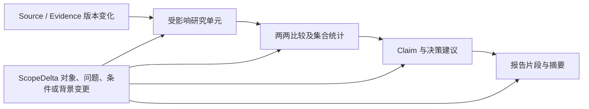

# 多轮研究与增量修订

版本：0.30.0；2026-11-04。本文定义待实现的多轮研究任务管理，未新增修订执行器、资产复用、报告版本库或聊天桥接，持久化 Schema 不变。生产研究链仍未接通；模块职责见 [模块契约](module-contracts.md)，数据版本与追溯遵循 [证据管理设计](evidence-management.md)。

状态目标以 [状态机 v2](state-machine-v2.md) 及其迁移目录为准：独立缺口／补研／报告 QA、两个确认等待及 CANCELLED 替代此前内部阶段安排。本文标为当前或迁移前的 v1 边界继续描述未变更源码；新状态与恢复须先实现迁移和守卫后启用。

## 目标与职责

用户增加竞品、修改维度或调整问题时，保存原研究成果，以明确的变更计算需要新增、复核或重算的工作。新一轮只执行有依据的受影响任务，重新核对当前完整结果，再生成新报告及更新说明。修改一个维度不默认重查全部竞品。

多轮协调仍由单一 Orchestrator 执行：Planner 识别变更、比较范围并形成影响计划；证据服务保存不可变版本与依赖；Research 执行选定任务；Validator 核对复用条件及当前 QA；Analysis 更新受影响判断；Reporter 生成新版本。这里不增加另一个主控 Agent。

“多轮研究”既包括未完成研究中的追加需求，也包括已完成报告的后续更新。它不等于模型聊天轮数、QA 补证轮数或一次任务恢复；新会话也不强制创建业务项目。

## 身份与版本分别管理

| 标识或版本 | 目标含义 | 不应混为 |
|---|---|---|
| research_id／ResearchSession | 一项逻辑研究及其多次修订的关联身份，可无业务项目 | CLI task_id、聊天 ID 或 projects/ 项目名 |
| research_revision_id | 一次有明确基线、范围、计划、输入选择和输出引用的研究修订 | MemoryStore 的并发 revision |
| task_id | 一次执行及其状态、调用和结果；后续修订可以使用关联的新任务 | 通过换 ID 重置全部约束的许可 |
| scope／plan 版本 | 当前对象、问题、维度、口径、完成条件与执行工作项 | 单纯更改显示名称或覆盖原计划 |
| Source／Evidence／Claim 版本 | 原始资料、事实与结论的确切内容和关系 | 每次修订都复制一份并重贴日期 |
| analysis／report 版本 | 当前分析及报告的不可变产物、引用和核对记录 | 自动指向最新证据的动态正文 |
| Memory revision | 当前任务快照写入时的并发检查计数 | 可重建业务修订历史的版本链 |

研究修订保留 base_revision_id、变更请求、当前范围与计划引用、采用的资产版本、核查及输出引用。执行前冻结输入基线，运行记录追加保存，交付时封存结果 manifest；旧修订不被原地改写。同一证据可被多个修订显式采用，保留原始归属。

分别管理 active_revision（当前准备／执行的修订）与 published_report（最近成功发布的报告版本）。接受新需求可以推进前者；只有新产物完成 QA、支持核查及写入回读后才能推进后者。新修订失败时，旧报告仍可读取，但必须说明它未包含本次变更。

## 变更识别、范围与授权

ChangeRequest 保存请求 ID、可信用户消息引用、原文、base_revision／expected_head、解析出的差异、未决歧义及授权依据；ScopeDelta 描述具体变化，不只保存一段“继续研究”的文本。两者是未来概念契约，不是当前 CLI 参数。

| 变化类型 | 需要识别与保留的内容 | 默认影响 |
|---|---|---|
| 新增／删除对象 | 实体身份、原名称、纳入或移除原因、适用问题 | 新对象单元及相关比较；删除不删除历史证据 |
| 替换／身份修正 | 旧实体与新实体、消歧依据、是否真为别名 | 真正换对象不能沿用旧事实；别名合并须核查映射 |
| 新增维度／加深问题 | 稳定维度 ID、定义版本、目标对象、子问题与充分条件 | 仅指定对象或明确要求的全体适用单元 |
| 维度语义／优先级变化 | 定义变化与仅调度权重变化分别记录 | 语义变化复核相关事实；优先级变化不自动重采 |
| 时间、地区、产品版本或比较口径 | 新旧条件及适用窗口 | 受影响单元、计算、冲突与结论 |
| 我方背景或决策目标 | 用户提供前提、背景版本、目标与约束 | 依赖该前提的建议及优先级；事实是否重采另判断 |
| 读者、篇幅或格式 | 呈现变化是否带来新的问题或事实需求 | 纯呈现沿用研究修订；新决策问题用已有事实也需新修订／分析和 Claim 核查，可零新增采集；缺事实才补证 |

“再加一个竞品”没有对象名时先补必要信息；同名产品未消歧不能创建确定实体。已有名称与明确条件直接使用，不重复访谈。新增名称不触发完整竞品发现，除非用户同时要求找候选。

维度同义表达需映射到稳定定义，不能每次换说法就重复建维度。“私有化部署”“私有云”“专属租户”“本地安装”不默认等价；是否客户自管基础设施、支持何种环境、数据控制边界、版本和服务条件须按本次问题明确，不能由存在安装包推断完整私有化能力。

来自可信用户、对象与范围完整的明确变更请求，可以作为该确切变更的授权依据，不再泛泛追问是否继续；模型自行推断的额外对象、全体扩维或不明条件仍需澄清并绑定当前差异。网页、模型总结、自填 role=user 或 approved_by 不能充当授权。当前 Codex 用户消息认证与自动桥接尚未实现。

项目模式仍需新版名单、维度提案及最终锁与当前范围一致。旧批准不能批准新名单；不得删除旧锁或覆盖旧文件来让原 API 通过。未来须提供按修订隔离的评审工作区、批准与锁引用协议；现有 review-project 拒绝已有工件或非 draft 输入，不具备修订换锁能力。非项目研究不伪造项目背景或锁。

## 影响分析与依赖传播

每个研究单元有稳定身份及定义版本，并记录来源／证据输入、适用对象、问题、比较条件、方法和充分标准。影响计划输出每项动作、原因、上游变更及所需预算，不只列“重跑某个 Agent”。

这是未来依赖图，不是技术状态图。影响集合取依赖的传递闭包，包含输入版本、方法和集合成员变化；新增材料还须检查与保留证据的交叉冲突，不能只核查新增部分的内部一致性。

新增 C 可能不改变 A、B 的原始事实或 A—B 的局部比较，却会改变三者排名、集合均值、覆盖分母、摘要和机会判断。上述汇总应重算或重新核查，不因此对 A、B 全量联网。涉及全体对象的“最低价”等 Claim 依赖集合成员，不只是它曾引用的最低价证据。

删除对象仅从新修订范围和比较集合移除，保留旧报告及引用历史；修正实体身份则使相关旧证据待核对，不能按同名直接复用。背景变更只使依赖它的建议待重评；纯格式变更不制造研究任务，但转述改变语义仍须核查 Claim 支持。

依赖记录缺失时不得断言“其他部分完全不受影响”。先保守扩大分析／核查范围并说明原因，检查原材料与引用是否足够；只有确有取证缺口才扩为联网任务，不以依赖不明为由直接全量重搜。

## 任务选择与旧成果采用

| 动作 | 适用条件与执行内容 | 不代表什么 |
|---|---|---|
| 采用已有版本 | 实体、维度定义、地区／产品版本、时间、策略及引用均适用，记录本修订采用依据 | 复制旧全局 PASS 或宣称本次重新抓取 |
| 复核已有材料 | 原文可用，需重新检查支持、条件、时效规则或关系 | 无联网就证明网页当前未变 |
| 从旧原文重提取 | 所需内容已在可用快照，原摘录未覆盖或提取方法变化 | 自动获得新来源或新的获取日期 |
| 刷新来源 | 当前性要求、过期、已知变更或内容缺失要求重新取得 | 覆盖旧快照、刷新失败后沿用旧日期冒充当前 |
| 新增采集 | 新对象或问题缺少符合要求的来源 | 默认研究全部旧对象及无关维度 |
| 重算分析 | 比较集合、公式输入、判断前提或相关证据变化 | 必须重新采集未变事实 |
| 重渲染报告 | 受影响内容或呈现要求变化，保留核对后的 Claim 映射 | Reporter 可以新增事实或建议 |

采用前检查资产 Schema、实体身份、问题定义、范围授权、地区／版本／计费等口径、as_of、有效期、来源和提取器版本、核查策略、反证与已知冲突。满足 TTL 只提供时效线索，不直接证明仍真实、仍适用或本轮通过 QA；当前性必须联网验证的问题仍要刷新。

采用记录保留 origin_task_id、原 collected_at／fetched_at、资产版本和旧核查记录，并新增 adopted_in_revision、适用性检查、实际 revalidated_at、动作及理由。只做本地检查时写明检查类型，不把它描述成本次访问了原站；未执行核验不得填核验时间。

刷新受限、失败或预算不足时保留旧版和未更新说明，不给它重贴当前日期，也不自动将未更新单元判为合格。历史结论可用于解释旧报告；是否满足新问题由当前标准判断。项目或范围隔离仍有效，能查询到其他资产不代表获准采用。

## 示例：新增 C，并重点研究其私有化部署

以下是完全合成的规划示例，不是实际产品事实或已执行研究。假定修订 r1 已研究 A、B 的价格、功能和基础部署方式，有报告 v1；旧证据经本次适用性检查仍满足新修订所需条件。

用户指定增加已识别的 C，并要求在同一比较范围内重点看 C 的私有化部署。r2 保留原共同问题，给 C 追加明确的部署深度问题；不暗中把同样的深度要求扩给 A、B。

| 单元或产物 | r2 处理 | 原因 |
|---|---|---|
| A、B 的价格与功能 | 采用符合要求的原证据版本，无新增搜索／抓取 | 问题、条件与证据适用性未变 |
| A、B 的基础部署方式 | 先检查原材料；满足对比口径则采用，仅缺失单元补证 | 不能因为 C 新增就全量重采 A、B |
| C 的共同基础问题 | 复用可合法采用的既有材料，否则新增采集 | C 进入同一比较需满足明确的共同问题，不伪造空值 |
| C 的私有化部署深度 | 研究实际支持环境、客户自管边界、版本与条件等已选子问题 | 这是用户点名的新增重点 |
| A、B 的同等深度问题 | 本轮未请求，不自动派发 | 不写成“不适用”或“不支持”；若后续要求深度横比，再明确扩展 |
| A—B 局部比较 | 输入与方法未变时采用原结论并核对绑定 | 新增 C 不必使所有局部结论失效 |
| 含 C 的对比、集合结论与摘要 | 重算、核对新 Claim，更新相关报告片段 | 比较对象集合和结论适用范围变化 |
| 报告 | 保留 v1，生成 v2 及 v1→v2 更新说明 | 新版必须绑定 r2 真实完成的输入与核查 |

若原来完全没有部署维度，须区分“只研究 C 的部署”与“全体增加部署对比”。前者可在非项目模式形成明确的 C 专项范围，A、B 不进入该专项覆盖分母；后者把 A、B、C 的相关适用单元纳入新计划，逐格采用或补证。不能将“未请求”标成业务“不适用”来凑覆盖。

显式项目仍遵循同一锁定模板的字段定义。共同基础字段对全部对象保持一致，C 的研究深度以明确的专项子问题和对象范围表达；如果字段或适用性结构要改变，必须先设计并批准新版模板与锁。不能直接给各对象塞不同字段绕过现有 CollectionJob／CollectionTemplate 的同模板约束。

“重点”本身不自动删掉原必需问题，也不等于给新对象无限研究深度。仅调整优先级而不改变问题／标准时更新调度即可；范围未明确之处只补必要澄清。实际任务数取决于证据可用性，不承诺新增对象必定只需若干次调用。

## 局部复核与完整 QA

增量执行减少重复工作，但每个新修订仍需产生完整 QA 收据。先重核受影响证据与关系；未变化的原核查若输入、方法、策略、时效与问题含义仍兼容，可以作为依据引用，同时记录它为何适用于新修订，不能搬用绑定旧 scope 的收据冒充新核验。

按 r2 当前计划固定全部必需且未被有效判为不适用的单元集合，重新计算有效覆盖、适用性和冲突。将采用项与新增项合并检查，包含跨新旧来源的矛盾及集合变化影响；旧全局 PASS 不能整份复制。局部不联网不等于跳过新修订的完整准入。

QA 收据绑定当前 research_revision、scope、plan、采用的 Evidence 版本集合、policy 与 as_of。新增材料导致旧 Claim 支持不足时，应通过依赖关系重评；新 Claim 仍按 [分析引擎设计](analysis-engine.md) 单独核查，不继承输入 PASS。

必需缺口、受限或未解冲突按既有规则补证或停止；不能把失败修订包装成部分成功报告。当前 TaskResult 无 partial 成功类型，失败只保留诊断，不登记最终 report_path。

## 执行中变更、迟到结果与并发

收到变更后先保存请求及其基线，停止派发已确定不再需要的工作，并在受控边界处理已开始调用。计划与输入清单不原地变更；是否取消、等待或归档某调用由未来执行协议明确，已消费预算及不确定完成状态不能丢失。当前尚无这套执行协调器。

| 收到变更时的位置 | 目标处理与现有状态边界 |
|---|---|
| UNDERSTANDING／PLANNING | 先完成必要识别与授权，再生成新范围／计划版本；UNDERSTANDING 的 WAIT_CONFIRM 仅接受实体歧义，范围确认在合法 PLANNING 边处理，不靠状态自循环隐式重置执行 |
| RESEARCHING | 不直接跳 PLANNING／WAIT_CONFIRM。停止新派发并处理在途结果后，若仍可合法结束本批则进入 VALIDATING，再按实际变更转规划；无法安全衔接时停止旧执行并另建关联任务 |
| VALIDATING | 使用合法的 PLANNING 边；仍需确认的范围走 WAIT_CONFIRM 后 PLANNING。修订原因是真实需求变化，不伪造 RESEARCH_MORE 或清空缺口 |
| ANALYZING／REPORTING | 无返回规划／核查的合法边。未交付内容保存为旧修订诊断或草稿；替代当前执行需安全停止，再由关联任务处理新修订 |
| COMPLETED／FAILED | 终态不可重开；建立关联的新执行并采用合格旧资产，不把 resume 当作修改原请求 |

安全停止与替代执行的持久协议仍需实现。在现有技术状态内，提前停止只可用 FAILED 并记录真实原因，不假装 COMPLETED，也不新增隐式 CANCELLED／SUPERSEDED 状态。原执行若按原授权自然完成可归档原版本，但不能覆盖新需求的 active_revision 或冒充其最终报告。合法迁移详见 [state_machine.py](../src/steal_her_heart/state_machine.py)。

[Report QA](report-qa.md) 的返工按 v2 从独立 REPORT_QA 发起，须与新状态迁移及守卫一起验收后启用；它不允许任意用户变更绕过授权、重开终态或原地改冻结清单。上述表格描述现有状态边界。

每份结果带 origin_revision、task_id、work_item_id、调用标识和实际输入版本。迟到的旧调用可保存为关联原修订的调用／工件记录，不修改已封存 manifest，也不能写进新修订单元、计入新覆盖或推进新报告；新修订若需要它，须经过正常兼容检查与显式采用。不能仅因 URL 或对象名一致就混用结果。

接受变更及切换 active_revision 使用 expected_base／expected_head 的比较交换。两条基于同一旧版的请求不能最后写入者静默覆盖前者；后到请求须重新基于当前头计算差异，保留冲突与用户意图，必要时澄清。相同请求 ID 与内容重放不重复创建修订，同 ID 不同内容明确拒绝。

每个请求保留实际授权对象和差异，重新计算后不能把额外范围自动算作已批准。恢复时读取修订、计划、调用和采用记录，完成未知的调用不盲目重发；现有工具调用重放不等于已经具备跨修订 exactly-once。

[模式切换](research-modes.md) 也是策略修订：即使维度名称未变，更严格的独立验证或时效要求也会影响单元准入。保存新 policy_hash，按影响采用／重核／补采，旧全局 PASS 不复制；只压缩为一页纸不自动降级研究模式。新模式不重置历史预算，降级不自动取消用户明确问题。

工具暂不可执行与子代理失联的细粒度恢复另遵循 [失败恢复协议](failure-recovery.md)：保存当前修订的操作／尝试、租约与检查点，先核远端结果再决定重派；恢复不等于用户发起新范围修订。未来 deferred／needs_input 需显式迁移，现有 resume 仍不具备这些语义。

## 预算与停止条件沿研究关联保留

修订和关联 task_id 保留预算谱系、已消费额度、失败／受限记录、尝试历史及无进展依据。相同未完成研究不因改版本、重启或换任务 ID 获得新额度，也不因添加相同材料恢复补证资格。

用户明确新增研究工作时，可以为其分配有依据的有限增量预算；须记录新增工作、额度来源及授权范围，与已消费部分分别核算，不能默认发放一整套无限重置的预算。原访问限制继续有效，不通过换 Adapter、任务或修订绕过限制。

无进展判断针对实际研究问题及历史尝试。真正新增问题可有自己的有界尝试计划，旧问题的无进展状态不能被全局清零。费用和调用分别统计新增、刷新、重提取、核查、分析与渲染，采用旧资产不伪装成新联网。

## 报告版本与更新说明

新报告使用独立版本目录，manifest 绑定 research_revision、父报告、范围／计划、Source／Evidence／Claim／analysis 版本、QA／关系核查、as_of、文件散列及生成记录。文件和引用均不可变；v2 不覆盖 v1，旧报告仍能回到当时的材料与条件。

发布前必须取得绑定完整候选及依赖的 Report QA PASS；纯呈现更新也需要新报告版本的质量收据，旧研究 QA 不能替代。发布时先写确切已审版本工件与 manifest，回读并核对内容、引用和散列，再以 expected_active_revision 及 expected_published_report 检查更新发布指针。并发变更使基线过期时，候选工件可留作未发布版本，但不能成为当前报告。数据库事务与工件提交／恢复协议需单独实现，不宣称当前已有跨资源原子事务。

写入、回读、QA 或发布检查失败时 published_report 保持 v1；清理仅限本次未发布工件并保留诊断，不删除旧成果。当前需求包含未完成变更时，不能把 v1 路径当作本次成功 report_path；展示历史报告时同时注明 v1 的时点、适用范围与本次更新失败／未完成状态，不能暗示它仍满足当前需求。

UpdateNote 同时提供机器可比差异和可读说明，至少包含：

| 信息 | 说明要求 |
|---|---|
| 基线与请求 | 从哪版到哪版、用户要求、实际采用的范围变化与授权引用 |
| 新增／修改／移除 | 对象、维度／子问题、口径、比较结果、Claim 与建议的具体差异及原因 |
| 采用／刷新 | 哪些资产沿用原版、做了何种复核、哪些重新取证，保留原获取时间 |
| 未更新与缺口 | 非必需未完成、受限、失败及其影响；必需缺口不能在成功报告中被隐藏 |
| 结论与报告影响 | 哪些判断改变、保持或撤回，相关证据与片段版本，不能只输出行级文本差异 |
| 执行账目 | 实际新增调用、预算消耗、采用的资产及未执行动作，不编造节省比例 |

报告生成时间、研究 as_of、来源发布时间和各条获取日期分别呈现。新报告可以包含经检查适用的不同获取日期材料，但不能写成“全部于今天重新采集”；过期材料是否可用于历史问题另按明确时间范围判断。

只改读者或格式且未改变问题、事实和语义时，变更记录指向原 research_revision，生成新的 report_version；报告 manifest 引用原研究清单，不修改封存的修订，也不把旧 QA 重新标为另一个研究修订的 PASS。沿用原 analysis、事实 as_of 和仍匹配的验证依据，核对转述及映射；报告今天生成不把旧事实变成截至今天的事实。用户另要求“更新到现在”或新增实质问题时，创建研究修订并计算影响；新问题若已有事实足够，可零新增采集，但仍记录本轮采用依据、重做相关分析与新 Claim 核查。需新事实才补证；细分规则见 [产品规则](product-design.md)。

## 当前代码差距与分批实现

| 当前实现 | 尚缺的能力 |
|---|---|
| TaskRequest 仅 user_input；run_task 创建新 task_id | 无 research_id、parent／base_revision、ChangeRequest、ScopeDelta 或自动关联历史 |
| Orchestrator.resume 只读取原任务，CREATED 可到 UNDERSTANDING | 不接新请求、不执行差异规划；要求原 project_context 完全一致 |
| MemoryStore 最新快照与状态事件 | revision 只作 CAS，旧快照被更新；不能重建修订、资产或报告历史 |
| ResearchPlan.version 与工作项 depends_on | 仅基础版本字段及任务依赖校验，没有业务修订链、语义影响图或单调版本管理 |
| 项目评审与锁 | 已有锁定及拒绝覆盖边界，无修订工作区、换锁协议或聊天用户认证 |
| 工具账本与快照 | 只支持既有同任务调用恢复／来源回读，无跨任务预算谱系、自动采用或增量报告 |

实际任务存储见 [memory.py](../src/steal_her_heart/memory.py)。未来须显式迁移关联表、修订 manifest、依赖／采用关系、授权引用、预算谱系与报告索引；保留原 task_id、日期和快照，不由名称猜测关联，也不把现有 revision 重命名为研究历史版本。

按 [开发路线](roadmap.md) 的 Phase 6 推进，每次完成一个模块及验收后再继续：先定义逻辑研究／修订与变更识别；再做影响计算及资产采用；再接增量调度、当前 QA 与预算；最后接分析更新、报告版本及更新说明。最小身份／版本契约可先设计，但真实运行依赖证据存储、研究链及语义核查，不以空接口宣布已实现。

## 后续验收场景

以下是未来验收要求，本轮没有新增或执行这些测试。使用明确合成材料验证差异与调用计数；真实来源和语义质量仍须独立验收。

| 场景 | 必须观察到的结果 | 必须阻止的行为 |
|---|---|---|
| 新增 C 与定向部署 | A／B 合格旧单元无新增联网，C 新问题执行，相关比较与摘要更新 | 因加 C 全量重搜所有对象，或漏掉原必需共同问题 |
| 局部与全局维度 | C 专项与全体扩维形成不同的明确单元集合，共同模板保持一致 | 把未请求标不适用，静默让项目对象使用不同模板 |
| 身份与定义修正 | 名称消歧、实体更换、部署词义变化使相关输入待核对 | 同名复用错误事实，把专属租户直接认作私有化 |
| 采用与时效 | 保存原日期，新版记录实际检查，过期按当前问题刷新或保留缺口 | TTL 当 PASS，重贴日期，刷新失败仍称最新 |
| 依赖与集合 | 新对象触发排名／摘要重算，未变局部比较可采用 | 只检查曾引用证据而忽略集合成员、分母或权重变化 |
| 完整 QA | 采用与新增材料合并重算必需覆盖，发现跨新旧来源冲突 | 整份复制旧 PASS、仅验证 C 后直接发布完整新版 |
| 并发与幂等 | 旧 head 请求拒绝覆盖，重复请求不重复执行，同 ID 改内容拒绝 | 丢掉并行修改、把重算后新增范围当原授权 |
| 在途与迟到 | 旧结果归原修订，经显式采用才可进新修订；按合法边处理变更 | 迟到结果推进新覆盖，暗加状态回边或假装旧执行成功 |
| 预算与限制 | 新旧成本可对账，新增工作有限预算明确，原限制／失败历史保留 | 换 task_id 清额度或重试受限来源，清空无进展记录 |
| 删除与呈现变化 | 删除保留历史，纯读者／格式调整不新增研究调用 | 删除原证据／报告，改排版触发全量研究 |
| 发布失败与历史 | v2 回读／CAS 失败时 v1 保持，失败结果不登记最终报告 | 覆盖 v1、过期工件成为最新、历史报告冒充本次完成 |
| 更新说明 | 可追溯新增、变化、沿用、未更新及结论影响，保留混合日期 | 只写“已更新”、只给文本 diff 或声称所有材料重新采集 |
