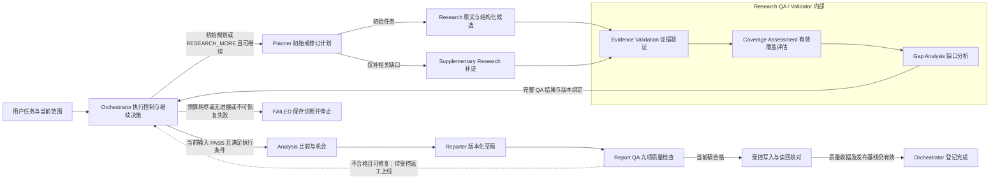

# 模块职责、接口缺口与验收设计

版本：0.30.0；2026-11-04。本文是后续实现依据，本轮只更新规范；下述状态机 v2、独立任务调度、Agent 标准信封／权限、失败恢复协议、研究模式策略、Report QA、受控报告返工、多轮增量研究、分析引擎、独立证据管理与 Research QA 尚未成为可调用的 Python API，当前状态机没有新增回边。

当前 [Orchestrator](../src/steal_her_heart/orchestrator.py) 只创建／读取任务并停在 `UNDERSTANDING`；[模块端口](../src/steal_her_heart/interfaces.py) 大多仍为 Protocol。已有独立搜索、抓取、快照和精确摘录候选，本地项目确认能准备 `CollectionJob`，生产入口尚未串联真实研究、语义验证、分析和报告。具体状态见 [路线图](roadmap.md)，测试证明范围见 [验收说明](acceptance.md)。

## 状态与迁移目标单源

[分层状态机 v2](state-machine-v2.md) 采用独立 GAP_ANALYSIS、SUPPLEMENTING、GENERATING_REPORT、REPORT_QA、两个确认等待和 CANCELLED，替代旧目标的内部阶段安排。完整允许边与守卫见 [状态目录](state-machine-v2.yaml)。任务、子任务和单次调用分层；本文标为当前代码的 v1 约束在迁移前继续有效，不表示新边已经实现。

## Research Task 与 Worker（待实现）

[独立任务调度](task-scheduling.md) 将派发单元从整份竞品研究改为有界问题任务：Planner 生成任务规格，Orchestrator 选择就绪任务并分配 Worker，Worker 执行 ResearchAgent 契约并返回结果，主控检查版本／租约／工件后送 Validator。竞品可分组，但不固定绑定 Worker；不同对象重点可不同，已有必需比较范围仍保留。

WorkerAssignment 限输入、能力、预算和写入范围；结果按任务追加，不直接改对象总档案。当前 ResearchWorkItem／CollectionJob 仅提供部分动作／对象快照基础，尚无队列与 Worker pool。初版沿阶段屏障收集后验证，只有当前完整 Research QA 才准入分析；局部检查不能新增隐式状态迁移。

## Agent 十项定义与调用准入（待实现）

本页维护模块交互，八个 Agent 的逐项定义以 [YAML 契约目录](agent-contracts.yaml) 为单源，解释见 [Agent 标准契约](agent-contracts.md)。每个条目同时说明目标、输入、输出、工具、规则、自主决策、限制、故障处置与完成标准，不能只列 Prompt 或角色名称。

共同信封绑定当前角色、版本、输入及权限／预算；输出需消费者验收，不能从 producer 自报 success 推导下游准入。Research 返回未验证候选，Validator 核证据充分性，Analysis 新 Claim 另核查，Reporter 返回草稿，Report QA 与交付守卫另行批准。工具列表为设计上限，不授予本次权限；调用须与可信授权、已实现能力、工作项范围及预算取交集。当前端口和 Registry 尚无完整 Agent 级控制，目录不作为运行配置加载。

## 研究模式的共同输入（待实现）

[三种研究模式](research-modes.md) 将 Quick Scan、Standard Research、Deep Research 作为版本化策略传递给全链路，不新增主控或状态。默认 Standard，显式轻量／深度意图优先；不强制模式访谈，也不因 Deep 扩对象。Planner 根据模式安排问题、来源、证据与交叉验证要求、补研预留和报告深度，Orchestrator 核对有效上限并统一预占／记账。

目标输入保存 ModeSelection、ResearchPolicySnapshot 与 ResearchBudgetAllocation；计划、工作项、核查和报告均绑定确切策略。Quick 减少的是规划范围，不是事实真实性或九项 Report QA。维度数量参考不删除明确要求，预算不足不静默降级。模式切换按依赖创建新修订，旧全局 PASS 不适用，历史消耗及访问限制不重置；当前端口与快照还没有这些契约。

## 统一故障语义与控制（待实现）

[失败恢复协议](failure-recovery.md) 分开记录尝试结果、操作执行／资料发现、单元缺口及任务处置。搜索接口故障、动态壳、超时结果不明、模型／解析／子代理错误均不能归为无结果。现有 Registry 和账本提供局部基础，尚无统一恢复执行器。

Orchestrator 独占重试／替代／跳可选／延后／人工事项／停止，Planner 负责需要改变业务工作项的重规划；Adapter 和子代理不隐藏重试。现有公开搜索／抓取无自动重试与受限停止不变；未来其他服务的尝试受全局预算、幂等对账、期限和可信策略约束。跳过不删必需 QA 分母，降级不降低证据要求。

目标另存执行处置及检查点，显式迁移 deferred／needs_input 对外结果、Memory 和恢复入口；不新增任意阶段回边，不滥用 WAIT_CONFIRM 或 pending_module。兄弟任务成果保留，迟到结果按版本接纳，未确认远端结束不盲目重派；无法持久化则明确不可保证恢复。

## 行业包与读者决策输入（目标，待实现）

[产品规则修订](product-design.md) 定义一套引擎与可组合的行业维度、工具、分析规则和类型扩展。Planner 解析 IndustryPack 版本、当前目的、字段要求／适用性及 ReaderDecisionSpec；Research 接收已解析任务，Validator 使用当前范围和证据标准，Analysis 消费行业方法及读者决策问题，Reporter 只组织已核对产物。行业包不改变各模块权限、状态机或质量阈值。

ScopeManifest 绑定选中包／字段／方法及决策要求；新增决策问题即使可复用事实也需新分析及相关核查。当前这些类型尚未接通，现有字段子集／SaaS 预设不等于动态解析器。

## 职责分配

Planner 负责“研究什么、怎样补足信息”；Orchestrator 负责“现在执行什么、能否继续、怎样恢复”。Orchestrator 调用 Planner 取得初始或修订计划，检查范围、依赖和资源后执行；不得自行生成第二套业务计划。只有 Orchestrator 更新任务状态和作出继续／等待／停止决策。

新增独立能力 Competitor Discovery Agent，负责在明确的发现范围内建立有依据、可编辑的候选名单。Planner 定发现目的与边界，Orchestrator 调用并控制预算；Discovery 复用检索及来源工具完成四路发现、身份核对、去重、分类和匹配解释，不拥有状态控制或名单批准权。详细流程、评分和修订协议见 [竞品发现设计](competitor-discovery.md)。原有研究与 QA 闭环保留。

| 模块 | 目标职责 | 输入 → 输出（目标语义） | 完成该模块时必须证明 |
|---|---|---|---|
| Orchestrator | 调用规划模块；按依赖和可用槽位调度对象任务；协调全局预算、检查点、恢复、补证轮次与终止 | 用户任务／已有快照、模块结果与执行账本 → 下一动作、持久状态及真实完成／停止原因 | 依赖未满足不派发；重开实例不重复已完成调用或重置额度；异常、无进展、预算耗尽可停止；产物成功回读后才完成 |
| Planner | 按目的和适用维度拆任务；给出优先级、依赖、来源策略与完成条件；依据结构化缺口修订计划 | Brief、当前范围、已有证据摘要、验证缺口与剩余预算 → 有版本的初始／补证计划 | 定价研究与路线图研究产生不同任务；补证定位到具体对象×维度；保留原范围与已有效结果，计划变化可解释 |
| Competitor Discovery | 按定位、客群、场景和功能发现候选，消歧去重、四类归属、可解释匹配及用户修订 | 种子实体、发现目的／范围、来源与用户修订 → 带身份、关系依据、评分分项和缺口的版本化候选提案 | 同名不误合并、别名不重复研究、替代方案不漏；每个纳入理由可追溯；分数不代替证据或批准；增删改使受影响旧批准失效 |
| Research | 按计划经统一采集入口选择能力与 Adapter，执行取证和候选提取；维护原文、来源与逐格结果 | 当前计划中的工作项、范围版本、调用权限与预算 → Source、未验证候选、采集状态和工具调用引用 | 每个候选回到实际页面／文档及定位；来源时间保留；受限和失败不伪装成未找到；对象之间不串写，站点变化不改主控逻辑 |
| Validator | 承担 Research QA：依次执行证据验证、有效覆盖评估和缺口分析；核对来源、语义、时效、独立性及同口径冲突 | 当前计划、候选／证据及来源快照 → 与本次输入绑定的逐条评估、冲突、缺口、覆盖与判定 | 引文存在但不支持主张时拒绝；转载不增加独立支持；采到材料不等于证据充分；旧 PASS 不能验证新数据 |
| Analysis | 按问题执行定位、功能、定价、客户、商业模式、优劣势、机会、威胁与差异化分析，回答产品决策含义 | 已绑定验证收据的证据、目的／计划／比较规则及可选背景版本 → 比较结果、Claim、决策影响、候选行动与验证计划 | 比较口径可复验；每条判断有依据；威胁有机制、条件与反证；建议有取舍和验证，无背景不编我方路线图，资料汇总不算完成 |
| Reporter | 组织可读报告、片段映射和更新说明，执行属于呈现层的修复 | 已核对 Analysis、来源目录、读者需求及修复票据 → 版本化草稿与映射 | 不增事实或推理，不给自己发交付 PASS；修改后重新 Report QA，旧稿和原引用保留 |
| Report QA | 独立评估当前报告，核对九类质量要求并按根因定位返工 | 当前目标／维度、草稿、映射、资产与核查版本 → 检查收据、缺陷及建议责任模块 | 未执行／不确定检查不放行；覆盖全文而非只查已登记 Claim；模型自评或平均分不能掩盖违规；不自改状态或联网 |

默认单对象研究采用用户已指定范围，不增加项目访谈或两道确认。只有显式项目模式才要求有效的项目范围锁；增加对象或实质改变范围仍沿用现有确认规则。一般查询调整和同范围补证不增加批准节点。

显式要求“找竞品／替代方案／市场格局”时才走发现分支，未建项目也可以提出该需求。发现中的有限页面核验用于筛选候选；只有用户选定当前名单后，才对新增对象开展完整维度研究。候选纳入核查只验证身份和竞争关系依据，不能作为下游完整研究 QA 的 PASS。现有项目型 DiscoveryProposal 不是非项目发现入口；未来请求、空名单、编辑、范围确认与版本协议须单独实现，不能伪造项目或旧锁。

## 统一资料采集与 Adapter（待实现）

Research 与 Discovery 共用 [统一采集层](data-collection.md)，由 Registry 执行可信注册的 Adapter。Web Search、Web Fetch、Website Crawler、Structured Extractor、News Search、Review Collector、Document Parser 和 Source Manager 是八类能力，并非八个独立主控 Agent。来源管理贯穿取证、解析和提取；解析器与提取器处理已取得材料，不自行扩范围联网。

统一入口保留任务、范围、计划、研究单元和调用标识，按能力携带严格请求／结果类型；线索、文档、评价记录和未验证候选不能压成一份无类型的事实列表。网站选择器、提供方协议及版式解析在 Adapter 内，Orchestrator 不依赖站点字段。未知能力、结构变化、访问受限、部分完成和明确无结果分别报告，接入新 Adapter 不改变 QA 门槛。

先适配已有搜索、静态抓取和快照，再接最小证据对象／版本／关系存储、模型与自动提取及 Research QA 闭环。有限官网遍历、PDF／文档解析、新闻和评论按需求逐项开发验收，不要求先堆齐平台爬虫。所有子请求与模型调用纳入同一任务的适用预算；站点故障隔离不允许换 Adapter 绕过访问限制。

## 独立证据数据层（待实现）

[证据管理](evidence-management.md) 为各模块共享的数据服务，不是另一个 Agent。Source Manager 写入原文快照、获取观察和处理链；证据服务统一保存 Source、Evidence、Claim 的版本、关系与状态记录，两者使用同一来源权威数据。Validator 生成语义核验、可比性与冲突判定，Analysis 生成 Claim 及其证据关联，Reporter 保存报告片段与 Claim 的映射；存储成功不授权 PASS。

Source 是原始资料，Evidence 是绑定单一来源版本、原文摘录和定位的原子事实主张，Claim 是带范围及限制的分析结论。ClaimEvidenceLink 连接具体版本，表达支持、反驳或仅提供背景；支持多对多和反向查询。来源评级有评价依据和适用问题；核验、时效、生命周期和冲突分别记录。过期或撤回触发受影响 Claim／当前使用报告的复核，保留历史版本与原判定，不静默删改。

现有 AnalysisClaim.evidence_ids 已允许多证据引用及证据复用，但未持久化关系或检查语义；Evidence 仍嵌套 Source，MemoryStore 只存最新任务快照。新增版本库需显式迁移，不能给旧数据补 verified、推测来源类型或未来有效期。先做当前任务的数据基础与关系完整性；跨任务自动资产检索、刷新及复用继续属于 Phase 6。

## 多轮变更与增量执行（待实现）

[多轮研究设计](incremental-research.md) 在同一逻辑研究下保存不可变业务修订，每版绑定基线、用户变更、范围／计划、资产引用、QA 和分析／报告产物。逻辑研究不是强制创建的业务项目；task_id 表示一次执行，Memory revision 仍只负责快照并发控制，不能充当业务版本。

Planner 解释新增／删除／修正对象、维度语义／重点、时间／市场、背景及读者变化，生成有依据的影响计划；Orchestrator 核对授权、当前基线、预算和合法状态后调度。证据服务提供精确版本与依赖，Validator 核对复用适用性及当前完整范围，Analysis 更新相关比较与决策，Reporter 保留历史并生成新版本和更新说明。各模块不自行扩大范围或改写正在执行的计划。

影响集合沿 Source／Evidence、研究单元、比较、Claim、建议、报告片段传播；全局排名、权重和总体摘要显式依赖对象集合。新增对象可能要求重算整体分析，不等于重采所有旧事实。变化只涉及 C 的部署细节时，不把它扩成所有对象的全部维度；全体新增部署维度时计算全部适用单元，复用仍满足条件者。项目模式保持共享字段定义和有效新锁，局部深度须有明确单元范围，不能改坏旧模板或把未研究写成不适用。

执行动作区分保留、复核已有材料、重新提取、联网刷新、新增采集、重算分析和重排报告，均记录理由及上游版本。差量取证后，按新修订全部必需单元及冲突生成完整 QA 收据；有效且匹配的逐条核查可复用，旧全局 PASS 不可复制。晚到结果归属原调用／计划／修订，未经采用核查不能混入当前版。

收到中途变更先记录基线与差异，在合法规划边界应用；RESEARCHING 无直接回 PLANNING 的边，ANALYZING／REPORTING 不允许新增范围回退，终态不重开。无法在原执行合法处理时，安全结束旧执行并创建关联新任务，不能假装完成或清空已耗预算；详细在途处理与发布约束见多轮研究设计，当前尚无这些执行协议。

报告写到新版本位置，带精确资产清单及更新说明；QA、Claim 核查、文件读回和当前基线检查均通过后才切换已发布版本引用。失败保留旧报告和本次诊断，明确旧报告的时点与未更新状态。当前 TaskResult 仍不支持失败任务的最终 report_path。

## 闭环与控制权

下图是目标模块调用与反馈关系，**不是当前状态机可直接采用的迁移图，也不表示执行器已经实现**。模块调用、重试决策和持久状态变化由 Orchestrator 调度；Research 在已分配工作项、权限和预算内经 Registry 执行具体工具，主控不解析网页。模块不能互相绕过调度或扩大执行范围。

图中研究范围来自用户直接指定对象，或发现分支经编辑、确认后的名单；Discovery 候选提案本身不能扩大图中的正式研究范围。发现分支逻辑图及当前接口限制见竞品发现设计，不为它隐式增加 DISCOVERING 等技术状态。

补证反馈至少说明缺口单元、涉及的证据／来源、原因、建议补证动作和比较条件。Validator 指出“企业版年付价格缺少当前地区来源”，Planner 据此修订对应任务，Orchestrator 检查范围和剩余预算后派发。无需重新采集已核验且仍适用于本次任务的其他单元；这不等于已经实现跨任务资产复用。

Orchestrator 的终止条件需要可观测：必需验证与交付已完成、用户取消、不可恢复错误、预算耗尽，或一轮没有增加可用证据／消除有效缺口。发现更多 URL 或重复摘录不能独自算“取得进展”。全局预算要覆盖补证、模型调用和并发任务；现有搜索／抓取账本只分别限制各自调用数。

恢复使用原任务及原调用标识，读取已完成调用的结果；已预留但结果不明的调用不能盲目重发。创建关联任务不获得绕过原预算、无进展终止或访问限制的权限；同一未完成研究若继续，需延续适用的预算约束，有限额度调整须有用户依据。

## Research QA：进入 Analysis 的强制机制（待实现）

Research Quality Assurance / Quality Control 是研究到分析之间的必经核查机制，由现有三个模块协作承担，不增设第二主控，也不要求新建一个 Agent。Validator 给出质量判断与可操作缺口；Planner 决定补什么、如何补；Orchestrator 核对当前输入与剩余预算后决定继续、进入 Analysis 或失败停止。采集完成、生成表格或模型声称“信息足够”均不能替代完整 QA。

Validator 内部按 **Evidence Validation → Coverage Assessment → Gap Analysis** 顺序执行。先逐条检查证据是否有效，再判断每个必需问题是否被充分回答，最后输出缺口、冲突及补证要求；不得先按字段非空算满覆盖，再跳过语义核查。

**研究单元与充分条件。** Planner 在版本化计划中列出必需／可选、适用／待判断的对象×维度问题，每个单元有稳定标识、具体问题、适用条件、比较口径和证据充分标准。充分性至少覆盖主张语义支持、来源是否适合回答该问题、时效、对象及版本／地区／计费等口径，以及该问题所需的独立来源策略。标准不能在看到结果后暗中降低；正式修订须保留版本和原因，并重新 QA。

来源数量、置信分数或“官方”标签均不自动构成充分证据，也不统一要求只能引用官方。官方定价适合核查所公布的价格条件；实际体验可依据有上下文的用户反馈；总体市场结论需要与结论范围匹配的独立材料。官方定位只支持官方宣称的定位，客户案例只能支持已记录的案例，不能推出所有客户的组成；宣传口号不能证明效果或功能可用性。

缩小表述可以纠正某条主张，但不自动满足原研究问题。把“目标客群是什么”改写成“某作者猜测其客群是某类人”，只能保留一条有归属的观点，不能消除目标客群的证据缺口；只有原问题的充分标准已满足，或按规则修订了问题与范围，才能改变该单元判定。

**覆盖分母。** 对每个计划／策略版本，先固定全部必需且未被有效判为不适用的研究单元集合及数量 D。适用性尚未判定的必需单元仍纳入 D 和覆盖检查，记为未决缺口；不能只计已确认适用的单元。覆盖按研究问题计数，不按网页数、任务数、来源数或已经采到的单元重算分母；可选单元的未完成情况另行披露。一个维度含多个必需问题时，问题均满足既定标准才算该维度充分。

| 指标 | 分子与含义 | 不代表什么 |
|---|---|---|
| 采集覆盖 | D 中已取得相关材料的单元数；保留材料及采集状态 | 材料存在不等于主张成立，也不等于适合当前口径 |
| 有效证据覆盖 | D 中通过完整语义、来源、时效、口径和独立性要求的单元数 | 不能用尝试次数、来源数量、未找到或主观推测补足 |

两个比例使用同一版本的 D。`not_found`、访问受限、失败和只有推测的单元均不计入有效证据覆盖；未知继续保留缺口及原因。`not_applicable` 需要可核验的适用性依据和显式版本记录，不能为凑满覆盖临时删格。若适用性判断改变 D，须保留旧分母与处理依据，生成新计划／策略版本并重跑完整 QA；涉及实质范围变化才向用户确认。全为不适用时 D=0，不得把 0/0 当 100% 或 PASS，应记录范围／适用性问题并重规划或停止。

覆盖计数和准入由代码根据当前单元集合、逐格核查结果及版本绑定计算，并核对完整性；模型可协助语义判断，不能以自行填报的 coverage 或 PASS 数字直接授权下一阶段。

**四维示例。** 某对象的四个必需问题为价格、部署、功能和目标客户，采集均有相关材料。前三项已经通过语义核查且满足各自充分条件；“目标客户”只有第三方猜测，尚无足以支持计划所问客群的证据。因此采集覆盖为 4/4，有效证据覆盖为 3/4=75%，完整 QA 返回 `RESEARCH_MORE` 并指出客群缺口，不能进入 Analysis。

该示例的补证建议可以是查找官方定位、解决方案页面、客户案例或适当的独立客户研究；这些是后续查询建议，本文没有执行搜索。即使找到官方页面，也只能验证相应官方宣称；单个案例不证明总体客群。补证是否成功仍由原问题与充分标准判断，不能把“实际客户构成”悄悄改成“官方目标定位”来通过。

**缺口记录与补证。** 以下仅为待设计的概念字段，不是现有可导入类型或 API 参数：

| 概念字段 | 必须表达的信息 |
|---|---|
| cell_id、question、requirement_version | 哪个对象×维度问题、采用哪一版必需性／适用性及充分标准 |
| gap_type、reason、evidence_refs | 缺失、语义不支持、过期、口径不齐、来源不独立或冲突；涉及哪些证据及为何不足 |
| priority、suggested_source_types、query_hints | 对完成目标的影响和补证优先级；建议来源及查询方向，不能冒充已检索结果 |
| acceptance_criteria、previous_attempt_refs | 什么结果可以消除缺口；历史查询、访问限制、调用结果、失败与无进展原因 |

Planner 只为相关单元生成有版本的补证任务，可复用本任务中仍有效的证据；Orchestrator 统一调度并检查全局预算、访问限制和无进展条件。同范围查询与补证不重新询问；增加对象或实质改变范围才沿用已有确认规则。补证执行后必须从 Evidence Validation 开始重新完整 QA，重算所有必需问题的有效覆盖及冲突；未变化的有效单元可以复用核查结果，但必须确认其输入与策略仍匹配。补证不能直接进入 Analysis。

**判定与版本绑定。** 完整 QA 收据须绑定 scope 摘要／版本、plan 版本及内容、evidence 摘要、policy 版本和 as_of 时间基准。Orchestrator 仅在收据匹配当前输入、coverage=1 且 gaps/conflicts 均为空时消费 PASS 并进入 Analysis。计划、证据、适用性或策略变化后，旧 PASS 失效；只重算比例或只核查新页面不能替代本轮完整 QA。

`RESEARCH_MORE` 表示尚缺证据，不保证获准继续执行。Orchestrator 仅在可继续且有预算时调用 Planner；预算耗尽、触发无进展或不可恢复的访问／执行限制时进入 FAILED，保存已知、未知、冲突和停止原因。不能靠更换 task_id、增加重复来源或删掉缺口继续。现有失败结果不得登记最终 report_path；可保留的诊断和缺口摘要不冒充完成报告。

## 待设计实现的跨模块契约

下表的字段是设计要求，不是现有类新增字段，也不能直接作为参数传给当前 API。实现时需确定版本、迁移和兼容策略，并同步接口、存储与测试。[schemas.py](../src/steal_her_heart/schemas.py) 是当前已实现字段的来源。

| 边界 | 当前已实现结构 | 后续必须补足的概念数据 |
|---|---|---|
| 执行范围与计划 | `ResearchPlan` 有 version、brief、tasks；`ResearchWorkItem` 有对象、维度、action、query、depends_on | 可信执行上下文中的 task_id、范围摘要／版本、项目模式锁引用、预算引用；任务优先级和完成条件；fetch／extract 所用的上游 URL、结果及正文版本引用。默认单对象的范围快照不伪造项目锁 |
| 采集结果 | `EvidenceBundle` 仅包含 evidence 元组；显式摘录另有 `EvidenceCandidate` | 统一能力信封与类型化 payload、Adapter 版本、父子调用与逐项状态、对象×维度单元结果、Source／候选 ID、查找记录和失败原因。工具完成与字段状态分层，详见统一采集设计；不能把新增状态直接塞进当前枚举 |
| 核查与收据 | `ValidationResult` 有 verdict、coverage、gaps、conflicts，缺少输入版本绑定和逐条语义依据 | scope_digest、plan_version／内容摘要、evidence_digest、核查策略版本、as_of；固定的必需单元与适用性判定、充分条件、采集与有效覆盖；逐条支持／不支持／不确定的依据、来源依赖分组、比较条件、冲突和补证历史。完整收据与本次输入一致后才能消费 PASS |
| 验证到分析 | `Analysis` 有 facts 和 claims，并检查引用 ID；`AnalysisEngine.analyze()` 只接 EvidenceBundle | 已验证证据集合与收据绑定；比较单元、Claim 版本、支持／反驳／背景关系及限制。Research QA 只验证输入，不能自动证明后生成的 Claim；每条新结论需有绑定版本的语义支持核查 |
| 分析到报告 | `ReportDraft` 只有 markdown 和 source_ids；报告端口只接 Analysis | 报告版本、片段与 Claim 版本映射、来源定位、目标覆盖；Report QA 收据与问题、返工票据、工件读回和发布基线。来源列表不能代替全文检查或质量准入 |

当前 [采集契约](../src/steal_her_heart/collection_template.py) 的字段状态是 `pending / found / not_found / not_applicable`，查找记录另有 `unavailable`。工具执行失败和字段是否找到是不同层次；新的 Research 结果应显式表达它们，保留旧数据含义。空 EvidenceBundle 既不证明完成查找，也不证明没有相关能力。

## Analysis 与产品决策（待实现）

[分析引擎设计](analysis-engine.md) 定义十类能力及其证据条件，属于一个 Analysis 模块的能力集合，不新增十个 Agent。Planner 按用户问题、适用性和完成条件选取必需／可选能力；用户明确要求的目标不能静默降级，不适用需有依据。只有一个研究对象时，不伪造横向排名或自动扩出比较对象；可先做对象内部版本／场景分析和有边界的启示。

分析产物沿“Evidence → 比较与解释 → 决策影响 → 候选行动／假设 → 验证计划”组织。威胁记录动作、受影响市场／客户／场景、作用机制、时间窗、触发信号、反证和应对条件。差异化建议联系我方目标、能力与约束，比较可选行动和暂不行动，说明价值假设、成本／风险及最小验证；无依据不编 ROI、成功概率、客户分布或资源估算。功能空白不等于未满足需求，价格低不等于总成本低。

默认入口不索取我方档案。用户要求我方建议时，优先使用已有背景，必要时在理解／规划中每轮补 2～3 个问题，背景可只服务本次会话；用户自述作为有日期和版本的前提，不自动成为 Evidence。缺少背景时可给条件性启示或说明当前不能支持的建议；必需目标仍未满足则不冒充完整交付，不强制创建项目。显式项目的背景摘要与锁规则照常生效。

目标输入须增加当前 scope／plan／问题、QA 收据、证据及背景版本、比较标准与 as_of；输出增加比较单元、计算记录、决策建议和 Claim 关系。现有 analyze(EvidenceBundle) 与 facts／claims 不足以表达这些数据，须独立迁移；Claim.kind 的四个枚举不是十类分析标签。代码计算、模型解释、Validator 核查及 Reporter 转述各负其责，新建议不得绕过证据与 Claim 核查。核验的是前提、支持关系和推断边界，不是保证未来行动结果。

## 实质核查与报告质量

Validator 先核对实际快照、原文散列、摘录、定位和来源日期，再评估该原文是否支持这个对象、维度和范围下的主张。发布日期未知继续为未知；获取日期不能替代生效日期。官方宣传只支持“官方如此宣称”，单条评价只支持该样本表达过该体验。

交叉验证按独立原始来源判断，多个域名、转载数量或多数票不自动提高可靠性。对价格、能力和版本冲突，先比较地区、产品版本、计费周期／单位、税费和适用时间；不一致的口径应成为不可比说明或补证项。无法解释的关键矛盾必须保留，不能静默采用较新的、较便宜的或模型更相信的一条。非关键冲突若通过缩小主张解决，也须生成新的验证版本并保留旧冲突及处理依据；带有未解决 conflicts 的结果不能标 PASS。

语义模型只能提供有原文依据的判定候选；代码仍需核对引用、输入版本、覆盖与冲突条件。评价 Validator 时使用带人工参考结论的正反例，并分别记录错误通过、错误拒绝和不确定结果；模型自评的 PASS 或置信分数不能作为独立验收。

Analysis 使用同一份验证后的事实版本。能力矩阵区分支持、不支持、未知和不适用；“领先／落后”还需场景与标准。价格表保留计费条件；用户评价主题注明样本、时间窗与来源，不从主动选样推出总体满意度。机会建议说明证据、假设、适用对象和下一步验证，不写成已证明的市场需求。

新生成 Claim 的支持核查由 Validator 的语义能力承担，在 Analysis 交付前由 Orchestrator 安排有界检查；不以先前 Research QA 的 PASS 代替，也不隐式迁移到 VALIDATING。仅有“专业版按年订阅”支持存在该订阅版本，不能推断所有版本都订阅或没有买断版。发现未解语义缺口时沿用下文 FAILED 出口。

Reporter 的目标正文为“一页摘要＋对比表＋机会建议”，来源目录与方法／缺口可作附录。Markdown 的“一页”先按阅读结构和篇幅验收；若承诺打印或 PDF 一页，须在选定输出介质上另验版式。读者视图可配置，并共用同一事实及分析版本。

交付检查既核对引用是否存在，也核对引用是否对应本段主张，检查金额、单位、日期和限定条件是否在转述时变化。模板缺章、链接格式和不改变语义的排版问题可在模块内有界修复；新增事实、无依据建议或篡改比较口径不能靠格式校验通过。

## Report QA 与受控返工（待实现）

[报告质量设计](report-qa.md) 增加独立于 Reporter 生成调用的交付评估，复用 Validator 的证据／语义核查能力，由 Orchestrator 消费检查结果和调度返工；它不是第二个主控。Research QA 检查研究输入，Claim 核查检查分析支持，Report QA 检查完整报告是否忠实、充分地回答目标，文件回读再检查实际交付工件，四者不能相互替代。

九类要求为当前有效维度覆盖、重要事实证据、事实／推断区分、重复内容、前后矛盾、数据时效、数字依据、用户目的回应、确定性措辞。覆盖从原始目的与有效用户修订映射到问题／Claim／报告片段；正文、摘要、表格和脚注全部检查，未登记的重要主张也要被发现。缺少必要回答不能以空标题或“未找到”当作充分覆盖，已明确不适用或非必需项按当前计划处理。

缺陷保存具体位置、规则、相关问题与资产、实际与期望、原因、责任模块及修复验收条件。九项必需检查完成且所有实际违规已解决才可 PASS；严重程度只决定处理顺序，不能以平均分抵消无来源数字或未回答目的。必要摘要重述与纯条目编号不机械判错，但须核对其语义和用途，不能成为漏检依据。

| 根因 | 目标修复责任／路径 | 修复后必须执行 |
|---|---|---|
| 已有合格内容漏写、重复、转述误抄或引用标记错误 | REPORT_QA→GENERATING_REPORT 有界重渲染 | 新草稿／映射及完整 Report QA，确认没有新增或改变事实 |
| 原材料足够，但比较计算、推断、建议或 Claim 自相矛盾 | 受控 REPORT_QA → ANALYZING | 更新受影响 Analysis／Claim，支持核查、重渲染、完整 Report QA |
| 原材料可用，但支持、时效或冲突判定需复核 | 受控 REPORT_QA → VALIDATING | 当前完整 Research QA，必要时沿合法补证流程，再分析、渲染及 Report QA |
| 缺少证据、必须刷新或目的到研究单元漏映射 | 受控 REPORT_QA → PLANNING，由 Planner 安排 Research | 修订计划、定向研究、Research QA、Analysis／Claim 核查、渲染及 Report QA |

上述四类根因路线按 v2 独立 REPORT_QA 发起，当前 v1 均不具备。启用前必须实现 ReworkTicket 与状态／持久化迁移：绑定失败报告及 QA、受影响版本和规则、修复路由、授权范围、预算、轮次、预期当前版与无进展记录，由 Orchestrator 校验并原子记录。不能只修改允许边；v2 有独立 REPORT_QA，呈现返工回 GENERATING_REPORT；不直接跳采集或用状态自循环掩盖无限修稿。

多个缺陷按最前置依赖修复，未解决问题保留；修改产生新版本，失效依赖重新核查。返工不扩大授权范围、不删必需维度、不改用户目的凑通过；轮次上限与全局预算共同约束，无法修复或无进展时停止。目标完成守卫要求当前 Report QA PASS、无未解决违规、精确工件读回及发布基线检查成功；不能凭旧收据、文件存在或模型“已修复”完成。

## 失败回流与现有状态机

[state_machine.py](../src/steal_her_heart/state_machine.py) 允许 `VALIDATING → PLANNING` 补证，进入 `ANALYZING` 时检查 PASS；当前 guard 仅检查提供的 verdict，尚未核对验证收据与计划／证据版本。实际接入时必须补足绑定，不能把旧 PASS 用在修改后的证据上。

当前 REPORTING 仅可转 COMPLETED 或 FAILED，且 COMPLETED 边尚无 Report QA／工件收据守卫。下表描述上述返工扩展上线前的限制；不能将它误读为未来所有可修复问题仍须直接失败。Report QA 的受控回边与完成守卫必须先独立实现并通过迁移、恢复和失败验收，才可采用前节的自动返工路径。

| 发生位置与问题 | 当前状态约束下的目标处理 | 不允许假定的能力 |
|---|---|---|
| 验证缺口或未解冲突 | 保持具体反馈，经 Orchestrator 回到 PLANNING；Planner 在原范围内修订任务 | Validator 自行联网或暗改范围；覆盖率高就忽略冲突 |
| 分析／报告的纯格式或引用拼写问题 | 在当前模块调用内有界修复并重新检查，预算和调用记录继续累计 | 用状态自循环掩盖无限重试；改写事实后沿用旧验证 |
| 分析／报告暴露语义缺口或不可恢复错误 | 保存失败原因及诊断，按现有合法边进入 FAILED；有依据的后续请求可创建关联任务，并重新检查范围和预算 | 直接 `ANALYZING/REPORTING → PLANNING/VALIDATING`，或仅为重置预算自动建新任务 |
| 最终写入或读回失败 | 不登记成功报告，不进入 COMPLETED；保留可诊断的实际结果 | 已存在文件等于成功；任意崩溃下都已实现跨资源事务 |

本轮已设计报告跨阶段返工，尚未实现；有限报告或部分成功仍须另行设计。当前 `TaskResult` 没有 partial 成功类型，失败任务不能暴露最终 report_path；`ValidationResult.PASS` 要求 coverage=1 且没有 gaps/conflicts。Report QA 判定是独立契约，不能把它的 REVISE 塞进 Research 的枚举，不能为输出报告而静默清空缺口、删掉必需维度或放宽 PASS。

## 模块验收场景

下面均为后续实现的验收要求，本轮未新增或执行这些测试。真实生产链验收还需从实际入口运行；已存在的模拟参考工作流只证明其标明的组件与替身行为。

| 模块 | 正例与可观察输出 | 反例与必须阻止的行为 |
|---|---|---|
| Orchestrator | 已保存一次成功抓取，重启后沿用同 task/request ID 和快照继续；预算仅余一次时并发派发仍不超额 | 未知完成状态不重发；无新可用证据的补证轮触发停止；写报告失败无 COMPLETED，不能改 task_id 重新获取额度 |
| Planner | 同一组对象，定价目的优先安排版本／计费条件；路线图目的优先安排能力／使用场景；仅一个价格单元缺证时计划只补相关任务 | 修订计划暗加第三个竞品、丢失原范围或把未知行业假设写成事实时拒绝；未满足依赖的任务不标可执行 |
| Competitor Discovery | 四路发现留下查询与关系依据；同实体别名合并且保留来源，用户增删改生成新提案并重新绑定选择 | 搜索名次充当匹配分、同域产品线误合并、未知指标重归一抬分、自动批准或复用修改前锁；详细场景见发现设计 |
| Research | 实际获取公开正文，保存 URL、原获取日期、散列和精确摘录；每个对象的单元结果能对账真实调用 | 搜索摘要不能直接产证据；HTTP 访问限制不能变成 not_found；坏快照、不匹配正文版本和串对象结果被拒绝 |
| Validator | 原文明确“企业版支持 X”，只支持同范围主张；年付与月付差异先解释比较条件；旧版本与新版本分别保留 | “全部版本支持 X”被判不支持；五次转载不计五个独立来源；同口径未解价格冲突或旧 PASS 配新证据不得通过 |
| Analysis | 同口径证据生成能力／价格矩阵；优势限定到有依据的场景；机会明确列为假设并引用证据 | 缺字段不得写成不支持；币种或席位周期不齐不能排名；无我方背景不得生成我方杀手锏或赢输结论 |
| Reporter | 摘要、表格、建议均可沿 claim→evidence→source 追溯，数字／日期一致，工件读回与草稿匹配 | 新增“市场第一”等无依据说法、丢失价格限定、虚构引用或写入失败时不交付；不能以 source_ids 非空替代质量检查 |

逐模块通过后，再用一个范围有限、来源可访问的实际任务串联入口、动态规划、采集、核查、分析和报告，并验证一次缺口补证及一次失败停止。独立记录真实工具、模型、人工抽核结果和未完成项；一份完整外观的 Markdown 不能独自证明研究质量。

## Research QA 正反例验收（待实现）

这些场景是未来模块及端到端验收要求；本轮没有新增测试、联网搜索或执行补证，也不据此宣称生产链已接通。

| 场景 | 正例与必须观察到的结果 | 反例与必须阻止的行为 |
|---|---|---|
| 四维先缺后齐 | 四格均有材料但客群只有猜测，输出有效覆盖 75% 与具体缺口；仅补该单元，完整 QA 确认原问题充分、全覆盖无冲突后才进入 Analysis | 以采集 4/4 直接通过；补完一页就跳过 QA；用单个案例证明总体客群 |
| 已有证据全部充分 | 完整 QA 核对全部单元及版本后直接 PASS，Planner 不创建无缺口的补证任务 | 为固定轮数或固定来源数量重复搜索；跳过 QA 直接分析 |
| 转载与官方空话 | 识别同源转载，限定官方声明的证明范围；来源策略未满足时明确缺口 | 多域名转载当独立交叉验证；官方宣传无实质内容仍判充分；拒绝所有合法第三方证据 |
| 不适用不作弊 | 以可核验依据记录 N/A；如分母变化则生成新版本、保留旧记录并重验；全部 N/A 不能 PASS | 缺证据即标 N/A；删格使覆盖变成 100%；把 0/0 自动通过 |
| 预算与无进展终止 | QA 提出缺口但预算耗尽或补证无进展，Orchestrator 保存诊断并 FAILED，无最终 report_path | `RESEARCH_MORE` 无限重试；换 task_id 重置预算；失败仍交付完成报告 |
| 新数据与旧 PASS | 改动任一绑定输入后拒收旧 PASS，重新完整 QA 并产生当前收据 | 证据或计划已变但仅凭旧 verdict、相同 ID 或未变的覆盖数字进入 Analysis |
