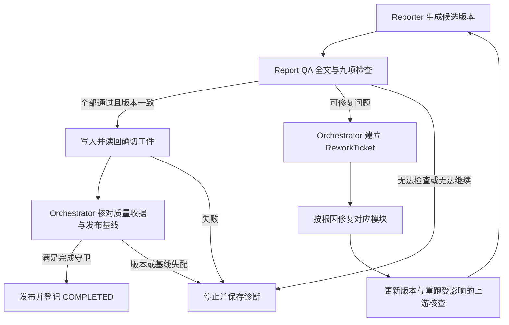

# Report QA：报告质量评估与受控返工

版本：0.30.0；2026-11-04。本文是待实现的报告交付关卡及返工协议。本轮不修改运行代码、持久化 Schema、状态机或历史验收记录；生产 Reporter、Report QA 和返工执行器均未接通。现有能力见 [模块契约](module-contracts.md)。

状态目标以 [状态机 v2](state-machine-v2.md) 及其迁移目录为准：独立缺口／补研／报告 QA、两个确认等待及 CANCELLED 替代此前内部阶段安排。本文标为当前或迁移前的 v1 边界继续描述未变更源码；新状态与恢复须先实现迁移和守卫后启用。

## 职责与交付条件

Reporter 生成报告候选，Report QA 独立检查该候选是否符合当前研究目的、证据和表达要求。未满足要求时形成可定位的问题，交由 Orchestrator 退回负责模块修复；重新核查通过后才进入实际交付，不能以 Markdown 已生成作为完成依据。

Report QA 是独立于生成调用的评估组件，可复用 Validator 的语义能力；不增加第二个主控，也不要求另设自由协商的 Agent。Reporter 不批准自己的草稿，评估器不自行改任务状态、联网、扩大研究范围或发布报告。

| 质量层 | 检查对象 | 不能替代的后续检查 |
|---|---|---|
| Research QA | 原文支持、时效、覆盖、冲突及当前完整研究输入 | 不能证明后来生成的分析或报告正确 |
| Claim 支持核查 | 具体结论与 Evidence 的支持关系、推断范围和限制 | 不能证明 Reporter 没有增写、错抄或删去限定 |
| Report QA | 全部候选内容、目的覆盖、主张映射、数字、表达与内部一致性 | 不能证明文件已正确写入或发布基线仍有效 |
| 交付检查 | 与已审候选一致的工件、读回、散列及当前发布基线 | 不能用文件存在替代语义质量 |

Orchestrator 消费可校验的质量收据和交付收据，决定返工、停止或完成。独立评估调用有助于发现生成问题，但同模型换一个 Prompt 或换模型都不自动保证正确；仍需逐项依据、代码约束和独立参考评测。

[研究模式](research-modes.md) 是质量请求绑定的策略之一。Quick／Standard／Deep 改变当前问题与报告深度，九项检查全部保留；评估按确切 policy_hash 及有效要求进行，不按模式标签豁免事实依据或把篇幅当深度。模式变化使旧质量收据需重新评估适用性，新报告仍须完整核查。

## 九项必检要求

检查基线来自用户原始目的及有效授权修订链，使用当前有效的问题、维度和完成标准；被明确替换的旧要求保留历史，不继续当作当前必需项。默认单对象采用已授权计划范围，不为了 QA 新增维度确认或项目初始化。

| 检查项 | 必须核对的内容 | 不合格例与处理方向 |
|---|---|---|
| 研究维度覆盖 | requirement／question → 研究单元 → Claim → 报告片段；当前全部必需且适用的问题得到实质回答 | 有标题但无答案、漏掉已要求部署维度；已存在合格分析则回 Reporter，输入或分析缺失则退对应上游 |
| 重要事实与结论的证据 | 逐条追到 Claim、Evidence、Source 的确切版本、原文定位及有效核查；反向扫描正文发现未登记主张 | 页脚有来源但段内结论无支持，Reporter 新增“市场第一”；未映射重要主张阻断 |
| 事实与推断区分 | 官方宣称、第三方报道、样本反馈、核验事实、分析推断、机会假设及用户自述前提分别表达 | 宣传承诺写成实测效果，用户预算写成外部核验事实；按产生混淆的模块返工 |
| 重复内容 | 检查语义重复、重复表格、冗余建议及同一事实反复堆砌，兼顾约定的读者结构 | 大段重复挤占必需回答；合理的摘要复述可保留映射与用途，不能仅凭文本相同自动判错 |
| 前后矛盾 | 摘要、正文、表格、脚注及约定读者视图的主张一致；先对齐对象、版本、地区、单位和时期 | 摘要称支持私有化、表格称不支持；来源真冲突不能由 Reporter 静默选边或删掉反证 |
| 数据时效 | 依问题的 as_of、维度策略、适用时间和当前采用记录检查，未知期限保留未知 | 当前价格使用未满足时效要求的旧价；历史问题不按今天一刀切，报告日期不能替代获取日期 |
| 数字来源与计算 | 实际数值有原始依据；派生数有公式、输入来源、单位、条件与舍入；假设和实验目标明确标注 | 无来源客户数、年付月均伪装月付、未知费用填零；章节编号等非业务数字无需虚构来源 |
| 回答研究目的 | 逐个检查当前决策问题的答案、依据、适用条件和必要行动启示；不只匹配关键词 | 用户要定价决策却只得到功能汇总；根据是漏写、漏分析还是漏研究分派返工 |
| 表述强度与证据匹配 | 量词、因果、预测、比较和确定程度不超过证据范围，限定紧邻有关主张 | “未找到”变“不支持”、“案例”变“全部客户”、“可能”被删；不能靠确定性词黑名单代替语义核查 |

覆盖不等于给缺口补一句“未找到”。必需事实未充分回答时，沿用 Research QA 的补证或停止规则；有依据的不适用按当前版本记录，不临时删维度。非必需缺口可以按既定要求披露，不能冒充必需项完成。

检查遍历完整交付内容，包括摘要、表格单元、列表、注释、来源附录和更新说明；不能只遍历已有 Claim 列表。没有对应 Claim 的重要表述或数字必须被发现，不能由 Reporter 将其标成“装饰文字”逃避核查。

选定读者视图仍需覆盖约定必需内容，或按已约定的交付结构明确映射到随附内容。不能为了“一页纸”暗中删除用户所问维度，也不强迫未选择的四类读者各出一份报告。

## 规则检查与语义核查

确定性代码核对版本、散列、引用存在、问题与片段覆盖、数字计算、单位／日期格式及核查项执行记录；重复或矛盾候选可由规则辅助定位。这些检查不独自证明“文字表达了证据支持的意思”。

语义核查结合当前问题、原文、Claim、限定与完整报告，判断是否回答目的、存在推断混淆、矛盾、过度确定或无关重复；结果附具体片段和理由。评估模型只提出受 Schema 约束的判断，不能通过自行填写 PASS 或高 confidence 绕过代码准入。

必检项未执行、无法判断、模型超时或解析失败都不能按通过计算。评测采用独立参考判断与人工抽核，覆盖错误通过、错误拒绝和不确定结果；不能让生成器自评与自己一致就算语义正确。

## 目标输入、问题与结果契约

以下名称和字段是未来设计，不是当前可导入类型或 CLI 参数；须随实现确定 Schema、兼容和迁移。

| 对象 | 必须绑定或记录的数据 |
|---|---|
| ReportQARequest | research_revision、repair_attempt／输入清单、scope／plan／objective／requirements 版本、原用户指令及有效授权变更引用、读者与输出约束、exact draft_version／hash、全部片段及映射、Claim／Evidence／Source 版本、Research QA 与 Claim 核查收据、policy_version、as_of |
| ReportIssue | 稳定 issue_id、规则／要求 ID、片段／Claim／证据引用、实际表述与期望、理由、根因、责任模块、严重程度、修复建议、复检条件及需失效的依赖 |
| ReportQAResult | 逐项执行状态、当前输入指纹、评估者／方法版本及时间、全部问题、PASS／REVISE／STOP、停止或返工依据；不只返回总分 |
| ReworkTicket | ticket_id、问题集合及输入版本、基线与授权、目标模块／路线、影响集合、修复验收条件、依赖失效清单、预算／轮次／无进展记录、检查点和幂等键 |

ReportIssue 可以针对多个片段或多个问题；同一根因的重复表现关联到同一修复任务。原问题及其判定历史保留，修复后通过新核查记录关闭，不能直接删掉失败项让结果变成 PASS。

Report QA 的 PASS／REVISE／STOP 与当前 ValidationResult 的 PASS／RESEARCH_MORE 是不同协议，也不是 TaskResult 的新终态。REVISE 表示存在需要修复的问题，不保证预算、权限或状态允许执行；STOP 表示当前无法完成所需检查或修复，保留原因并拒绝交付。

PASS 必须同时满足：所有必检要求完成且通过、没有未解决的违规、输入与当前版本一致、Research QA 和相关 Claim 支持记录仍适用。代码根据逐项结果、问题集合和版本绑定验证判定，不信任模型一句“总体合格”。

严重程度用于确定修复顺序和根因优先级，不是让低严重度违规直接发布的理由。真实的无源数字、未解矛盾、时效不合格、目的未回答或过度确定表述均阻断。非违规的可选编辑建议可单列，不得把实际失败改标 advisory 以绕过要求；必要摘要重复等合理情况须说明满足规则的依据。

质量分数可用于诊断趋势，不能用平均分抵消任一必检失败。草稿、重要依赖、目的、策略或时点绑定发生变化后，旧 Report QA 不再批准新候选；可以引用仍适用的底层依据，但必须形成当前完整报告的核查结果。

## 返工流程与责任分派

这是目标调用流程，M 不是任意状态跳转。跨阶段路线仅能使用下节的已实现守卫；上线前沿当前失败出口处理。一次评估应收集可识别的问题集合，不能只修首个错误后假定其余内容合格。

| 实际根因 | 首要修复方与动作 | 修复后至少重跑 |
|---|---|---|
| 合格分析已有，但正文漏写、重复、错抄数值或丢了限定 | Reporter 只根据已核对内容重新组织或修正映射 | 新候选的完整 Report QA，再做工件交付检查 |
| Analysis 中的推断不受支持、比较口径错、结论互相矛盾或未回答决策问题 | Analysis 使用仍合格的材料重新比较／推理，不自行加事实 | 新 Claim 支持核查、Reporter、新 Report QA |
| 原核查错误、材料适用性／时效判断不明，已有原文足以重新检查 | Validator 复核证据及冲突，重建当前完整 Research QA | Analysis 及 Claim 核查、Reporter、新 Report QA；新发现补证需求走合法规划边 |
| 证据不足、需要刷新来源、计划漏掉必需研究问题 | Planner 修订相应工作项，Orchestrator 调度 Research 定向取证 | 完整 Research QA、受影响分析与 Claim 核查、Reporter、新 Report QA |

“没有回答目的”按根因分派：答案已在 Analysis 中是漏写；材料齐而没有推理是分析缺失；必需问题从未规划或材料不足是规划／研究缺口。多个问题按依赖从上游到下游修复，避免 Reporter 反复改写一个尚不成立的结论。

修复范围采用 [证据与报告追溯](evidence-management.md) 的依赖集合；不默认全量重采，但必须检查新旧材料的冲突及最终报告整体一致性。将“必然”改成“可能”不能自动消除必需事实缺口，删掉有问题的必需章节也不能算修复。

## 受控状态回边：v2 目标与当前限制

当前代码仍是 REPORTING→COMPLETED／FAILED，没有报告质量、读回和发布守卫。v2 用 GENERATING_REPORT 与 REPORT_QA 两个独立阶段替代旧报告阶段；此前“在 REPORTING 内 QA、增加三条回边”的方案已被 [状态机 v2](state-machine-v2.md) 取代。

| 根因路线 | 守卫与后续路径 |
|---|---|
| REPORT_QA→GENERATING_REPORT | 呈现缺陷票据、有效上游输入及预算；新草稿再 REPORT_QA |
| REPORT_QA→ANALYZING | 根因在分析且 Research QA 仍有效；新 Claim 核查后生成报告并重新 QA |
| REPORT_QA→VALIDATING | 复核已有材料；随后 GAP_ANALYSIS，充分才分析，否则规划补研 |
| REPORT_QA→PLANNING | 缺证据／计划漏项有票据及授权；生成补研计划，经 SUPPLEMENTING→VALIDATING→GAP_ANALYSIS 后再分析／报告 |
| REPORT_QA→COMPLETED | 当前完整 QA、上游收据、确切工件读回、发布基线及无已生效取消的联合守卫 |

每次返工绑定失败稿、问题、输入指纹、范围、预算和有限轮次，主控原子记录票据及迁移，不能只加允许边。已失败问题保留历史，新版本必须重新完整 Report QA。分析阶段发现证据缺陷可凭票据回 VALIDATING；生成阶段发现无效分析／证据可按 v2 回相应阶段，不需要伪造草稿进入 QA，也不允许任意回退。

修复改变已冻结的 plan、Evidence 或 Analysis 输入清单时，追加不可变的 repair_attempt_manifest，保存 base、ticket、当前确切输入及被替代清单；不能原地修改旧清单或封存的研究 manifest。需要改变已封存研究修订时，按多轮协议创建新的候选研究修订。受控返工可由同一仍非终态 task 承载，但所有下游收据须绑定当前修订／attempt 及输入指纹，不能因此复用旧输入的 PASS。

纯 Reporter 呈现修复在原研究和 Analysis 仍适用时只新增 report_version，无需重采或制造研究范围变化；新候选仍必须重新 Report QA。保持范围的质量返工不新增泛泛用户确认，真正扩大范围才沿用授权和项目新版锁规则。

Report QA 不能直接命令 Research 联网，Reporter 不能根据问题文字改状态；缺证必须交 Planner 安排任务。需要实质改变对象、地区、目的或项目维度时，按现有范围授权与新版锁协议处理，同范围纠错不增加泛泛确认。不得为通过 QA 删除必需维度、降低充分标准或改写用户目的。

CANCELLED 与 FAILED 分开，取消撤销发布资格，远端清理不重开终态；与成功提交并发时按主控 revision／发布基线竞争。完整 guard、scope 等待、迁移和恢复以 v2 为准，当前未升级代码不得调用这些新路径。

## 预算、进展与停止

任务启动前给出有限修复轮数与资源上限；可采用 max_report_rework_rounds=3 作为起始工程配置，具体值须显式保存，它不是当前已实现的 guard，也不复用 research_round 字段冒充报告返工计数。

Reporter 内重写、QA 模型调用、复核、补搜和重算均计入原任务及研究关联的适用预算；新票据、候选或关联任务不清零额度、访问限制和失败记录。达到修复轮数、时间或任一资源上限，不能继续生成候选碰碰运气。

有效进展应体现阻断问题经核查解决、缺失依据补齐或实际根因消除；换词、增加字数、质量自评分提高不独自算进展。重复同一问题且没有新依据时停止，保存尝试和未解决项。

评估失败或超时不视为合格：若存在合法、有预算的有界恢复策略可返回 REVISE，否则 STOP。停止或不可恢复失败进入现有 FAILED，保留草稿与问题诊断，不登记最终 report_path；不能交付“看起来完整”的失败稿。

外部页面、报告正文和模型输出都是待核查数据，不能修改质量规则、宣布豁免或提高预算。没有证据时不能靠软化措辞、隐藏反证、改成“建议”或静默删问题来获得 PASS。

## 版本绑定、复检与实际发布

每次修改生成新的候选版本，保存精确正文、片段映射和内容散列。Report QA 输入就是待交付的完整候选，包括来源与更新说明；候选在评估后新增标题、注释、数字或附录，都需要核对新版本，不能继续使用旧草稿的质量收据。

完整复检覆盖全部九项及报告整体。未变且输入一致的机械检查或底层核查记录可以作为依据复用，但仍要验证全部片段、依赖与跨段一致性；只复检被修改的一句不能保证没有引入其他矛盾。

通过 QA 后写入确切已审工件，再读回核对正文和映射散列；若序列化、引用展开或排版步骤改变语义内容，应对最终候选重新 QA。质量 PASS 不等于写入成功，文件存在也不等于内容与已审版本一致。

发布还需核对 expected_active_revision、当前 repair_attempt／候选指纹及 expected_published_report，避免旧候选在并发新需求或新修复后成为当前报告。保留此前成功版本；写入、读回或发布检查失败时，旧版仍可读取，但注明原 as_of 和本次更新失败／未完成，不将旧路径当成本次成功结果。发布引用与完成登记须有明确提交／补偿边界，最后一步提交失败不能留下被当作成功的新报告。数据库与文件提交恢复须单独验收，不宣称已有任意崩溃下的跨资源事务。

只有未改变决策问题、事实和语义的纯呈现调整可以沿用原 research_revision、analysis 和事实 as_of，但会产生新 report_version，必须有该候选的新 Report QA。换读者若改变分析问题，即使事实足够也需新研究修订／分析、采用依据及新 Claim 核查；事实不足才按影响集补证，见 [产品规则](product-design.md)。研究／证据／结论变化则按依赖重做相应上游检查；报告生成日期不能重置数据时效。

## 合成返工示例

以下仅为规范用合成情景，不是实际产品或真实研究结果。

1. 已核查资料为“年付总额 1,200 元”，Analysis 正确保存“月均折算 100 元”，Reporter 写成“每月付 100 元”。根因是转述错误，退 Reporter 恢复付款条件，核对新候选全部数字与表达后重跑 Report QA，无须重新联网。
2. 相同材料被 Analysis 写为“所有版本每月均为 100 元”。若原问题只要求已知版本，可退 Analysis 修正范围并重验 Claim；若评估时判明用户必需问题是所有版本的真实价格，而资料尚不全，票据应直接退 Planner 补足研究，不能只改成“可能都是 100 元”放行，也不能隐式从 ANALYZING 跳回规划；上游缺陷按 v2 票据先回核查。
3. 用户要求当前部署对比，报告只复述去年的部署页面且时效判断缺失。已有材料先交 Validator 检查当前性要求；需要新来源时走合法规划与 Research 路径，更新分析和报告后重新 QA。过期问题不能仅补一个获取日期标签就关闭。

## 当前基线、迁移与实施顺序

| 当前结构或验收 | 实际能力与差距 |
|---|---|
| ReportDraft | [schemas.py](../src/steal_her_heart/schemas.py) 仅定义 markdown 和非空 source_ids，无完整来源目录存在校验、段落映射或质量结果 |
| ReportGenerator.render(Analysis) | 只有协议，没有真实 Reporter 或独立 Report QA 执行器 |
| REPORTING 完成路径 | 没有质量收据／工件读回 guard，也没有v2 目标返工边 |
| 测试参考工作流 | 使用 SIMULATION／固定分析与报告替身；部分来源集合和文件操作检查、成功用例事后读文本，不等于生产前置读回或语义质量评估 |

新契约需显式扩展端口、快照、质量记录、票据与状态事件、版本依赖及发布收据；保留旧内容和原始引用，不能因旧 source_ids 非空就迁移成合格报告。旧 ValidationResult、TaskResult 的含义和失败无最终报告约束不变，未知协议版本应拒绝。

实现按单模块推进，完成相应验收后继续：

1. 质量请求／问题／结果与覆盖、引用、数值、版本等规则检查，明确未实现的语义项不能 PASS。
2. 语义评估器及独立参考评测，按完整九项形成可解释结果；规划 report_qa.md 运行时 Prompt，文件与提供方接入另验收。
3. ReworkTicket、v2 阶段及根因回边和完成联合守卫，验证预算、状态、授权、持久化与恢复。
4. 接通模块修复、依赖失效、完整复检和确切工件发布，验证真实入口中的返工闭环。

这些步骤依赖实际研究、[分析引擎](analysis-engine.md)、证据及 Reporter 能力；结构夹具通过或一份漂亮 Markdown 都不能证明 Report QA 已可用。

## 后续验收场景

以下是待实现的验收要求，本轮未新增或运行这些测试；真实语义质量需独立抽核，错误通过与错误拒绝分别统计。

| 场景 | 应观察到的结果 | 必须阻止的行为 |
|---|---|---|
| 维度与目的覆盖 | 当前必需问题逐一对应实质答案，漏写与漏研究分派到不同模块 | 标题非空即通过、删除必需维度、忽略有效修订或强制重新确认默认范围 |
| 未映射重要主张 | 全文扫描发现 Reporter 新增句子／数字，定位片段并阻断 | 只遍历已登记 Claim，页脚有来源就放行 |
| 事实与推断 | 宣称、反馈、假设和用户自述保留归属，建议不冒充结果 | 宣传变实测、预测变事实、核验输入自动批准新结论 |
| 重复与矛盾 | 不合理重复返工，必要摘要复述有用途；矛盾先对齐口径 | 机械删除摘要、跨时间差异误判、静默选择有利来源 |
| 时效与历史问题 | 当前问题按策略复核，历史范围保留对应版本及日期 | 今日出稿重贴取证日期、历史资料一律按过期拒绝、旧价标日期就通过 |
| 数字与确定性 | 派生值可复算并标条件，措辞不超过证据，非业务编号正确排除 | 年付月均变月付、未知成本置零、样本推总体、仅查禁词 |
| 根因与多问题 | 上游根因优先修复，新问题与旧问题均重检，保留解决依据 | Reporter 用改写掩盖缺证、只修第一个问题或删失败记录 |
| 受控返工状态 | 有效票据才走对应新边，恢复不重复派发，终态不重开 | 未升级先调用回边、伪造判定、Reporter 或模型直接迁移状态 |
| 版本与复检 | 草稿／依赖／策略变更使旧质量收据不可消费，新候选完整复检 | 只检查修改句、旧 PASS 批准新报告、纯格式新版免检 |
| 预算与评估失败 | 轮数和全局预算有限，无进展或模型无法判断时停止 | 换票据重置额度、均分掩盖失败、超时或未知默认为 PASS |
| 确切交付与并发 | QA、读回及当前基线联合通过才完成；v2 失败保留 v1 及旧时点 | 检查后偷偷改稿、陈旧候选发布、失败任务返回最终报告 |
| 多行业与读者 | 依据各行业实际问题核查，所选视图保留必需回答与限制 | 硬套 SaaS 字段、一页摘要删掉关键条件、不同视图相互矛盾 |
