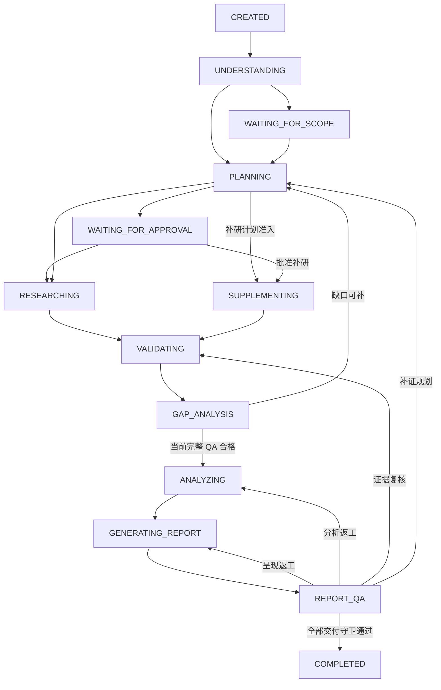

# 分层状态机 v2：研究任务、子任务与调用恢复

版本：0.29.0；2026-11-04。本文及 [状态与迁移目录](state-machine-v2.yaml) 是新的目标协议，状态模型版本为 2，仍为 design_only。当前 Python 保持原有 10 状态、StateContext schema_version=1 与数据库版本，不因文档更新自动迁移。

本设计明确替代此前“GAP_ANALYSIS 位于 VALIDATING 内部”“Report QA 位于 REPORTING 内部”“仅增加 REPORTING 三条回边”的目标安排。它们现在是独立任务阶段；原有质量标准、范围授权、预算和证据版本规则继续有效。旧文档中标为当前／迁移前的限制仍描述现有代码，v2 状态名称、允许边和守卫以本文及 YAML 为单源。

## 三层状态与一个执行处置

| 层级 | 负责表达 | 持久化关联 |
|---|---|---|
| 研究任务 | 正在理解、规划、采集、核查、补研、分析或报告哪一阶段 | 执行 task_id、逻辑 research_id／research_revision、state_model_version、状态与并发 revision |
| Research 子任务 | 某个有界问题能否派发、由哪个 Worker 执行、结果是否接纳 | research_task_id／task_version、parent_task_id、plan／policy、dispatch／worker／lease_epoch |
| 单次工具／模型尝试 | 调用成功、失败、取消或远端结果不明及发现结果 | operation_id／attempt_id、真实调用账本、预占与实耗、结果工件 |

项目只是配置与资产归属，不是唯一状态容器；同一项目可有多个研究执行，每个执行拥有自己的子任务。没有项目也可运行单对象任务。

任务另外保存 execution_disposition=active／deferred／needs_input／reconciling 和恢复条件。API 暂不可用时可处于 RESEARCHING＋deferred；它不应伪装成 WAITING_FOR_SCOPE 或 FAILED。子任务的 DEFERRED 等状态反映该工作项，不能据单个子任务等待就推断全局不能继续。阶段与处置必须组合校验：确认等待阶段不允许派发研究，终态不携带可自动恢复资格。

## 研究任务的 15 个状态与普通迁移

下表是目标允许边与主要触发条件。完整逐边 guard、共享取消／失败／范围等待边及逐状态重试策略保存在 YAML；未列出的边默认拒绝。所有迁移由可信 Orchestrator 执行，Prompt 和 Worker 不能修改状态。

| 当前状态 | 允许的普通后继 | 触发条件与守卫 |
|---|---|---|
| CREATED | UNDERSTANDING | 已保存任务基础上下文及启动意图 |
| UNDERSTANDING | PLANNING | 对象与问题可形成计划，真实用户范围授权有效 |
| WAITING_FOR_SCOPE | UNDERSTANDING、PLANNING | 身份澄清按绑定 return target 回理解；范围授权／修订核验后回规划；不能直接进采集 |
| PLANNING | WAITING_FOR_APPROVAL、RESEARCHING、SUPPLEMENTING | 具体计划需要审阅才等待；初始计划准入走采集，绑定缺口或返工的补研计划走补研 |
| WAITING_FOR_APPROVAL | RESEARCHING、SUPPLEMENTING、PLANNING | 当前计划获真实批准后进入绑定执行阶段；要求修改则回规划、旧批准失效 |
| RESEARCHING | VALIDATING | 本轮分配项状态完整，未决在途已隔离，输入清单冻结；失败项不能丢弃 |
| VALIDATING | GAP_ANALYSIS | 候选支持、时效、独立性及冲突核查形成记录，缺失单元保留；核查器失败不伪装检查完成 |
| GAP_ANALYSIS | ANALYZING、PLANNING | 全部必需单元充分且当前 Research QA 有效才分析；有可行缺口及预算则请求补研计划 |
| SUPPLEMENTING | VALIDATING | 定向任务完成或明确停止，形成包含旧采用资产的当前完整输入清单 |
| ANALYZING | GENERATING_REPORT、VALIDATING | 分析与新 Claim 核查合格才生成报告；证据缺陷有结构化票据才退核查 |
| GENERATING_REPORT | REPORT_QA、ANALYZING、VALIDATING | 完整草稿与映射可核对后进入 QA；分析或证据输入失效时凭上游缺陷票据退相应模块 |
| REPORT_QA | COMPLETED、GENERATING_REPORT、ANALYZING、VALIDATING、PLANNING | 当前 QA、上游依据、文件读回及发布检查均通过才完成；失败按票据根因修稿／重分析／重核／规划补证 |
| COMPLETED | 无 | 成功终态，后续请求采用关联新执行 |
| FAILED | 无 | 不可恢复、预算耗尽或到期停止；保存原因，不能把临时错误直接混成无资料 |
| CANCELLED | 无 | 用户取消终态，独立于失败；保留历史成果、在途调用及费用记录 |

共享边同样是显式允许边：任一非终态可在不可恢复／额度或期限耗尽时转 FAILED；可在真实用户取消生效时转 CANCELLED。除 CREATED 和 WAITING_FOR_SCOPE 外的非终态，可因必要身份／范围待答或用户范围变更进入 WAITING_FOR_SCOPE，前提是停止新派发、保存请求，并隔离旧在途结果。WAITING_FOR_APPROVAL 改范围也使用该边，不能批准已经过期的计划。

没有 GAP_ANALYSIS→SUPPLEMENTING 捷径：补研先由 Planner 生成受限任务，主控校验后执行。VALIDATING 只完成证据层检查；GAP_ANALYSIS 计算当前完整覆盖、缺口及最终 Research QA 判定。缺口分析仍属于 Validator 能力，新增阶段不增加另一个控制 Agent。

图只展示主路径；失败、取消、范围修订及生成阶段输入缺陷的边以上表和 YAML 为准。每次返工／补研记录原因、输入指纹、票据、轮次与预算，不能靠状态循环制造无限尝试。

## 哪些状态需要用户确认

WAITING_FOR_SCOPE 等待必要实体澄清、范围选择或范围变更授权；WAITING_FOR_APPROVAL 等待用户明确要求或项目策略要求的具体计划／最终维度批准。其他阶段不因为名称存在就强制提问。默认已点名对象、无需澄清的任务可以 UNDERSTANDING→PLANNING→RESEARCHING。

确认记录包含 confirmation_id、kind／reason、真实用户消息来源、question／提案展示摘要、scope_hash、plan_hash（若适用）、policy_hash、研究修订、request_revision、resume_target／execution_target 及原始答复。只接受与当前待答项一致的回复；模型生成、沉默、过期 token 或另一任务的答复均无效。

用户修改计划时先产生新版计划再按实际需要审阅；拒绝但愿意修订可回 PLANNING，明确取消才 CANCELLED，拒绝且无可行路径可 FAILED。等待超时不能解释为批准或取消，只记录到期原因并按有限等待策略处理。

可选项目的名单选择通常属于范围确认，最终维度／计划批准属于计划确认，已有项目 API 的绑定及锁规则继续保留。聊天侧真实身份桥接未实现，不能用这些状态名伪造批准。当前模式、明确范围变更已有真实授权时不重复泛泛确认。

## 子任务级状态与证据判定

子任务状态不复制完整研究阶段。其有限状态集与转移独立保存，父任务仅通过明确事件协调：

| 子任务状态 | 允许后继／事件 |
|---|---|
| CREATED | 规格有效后按条件进入 READY 或 BLOCKED |
| BLOCKED | 条件满足才 READY；需明确外部条件或具体人工事项时 DEFERRED／NEEDS_INPUT |
| READY | 原子认领及预算预占后 ASSIGNED；条件失效退 BLOCKED |
| ASSIGNED | 启动回执后 RUNNING；确定未派发可退 READY；状态不明进入 RECONCILING |
| RUNNING | 返回结果进入 RESULT_READY；超时不明进入 RECONCILING；符合恢复策略可 RETRY_WAIT／DEFERRED／NEEDS_INPUT |
| RESULT_READY | 结构／身份／版本／工件接纳后 COLLECTED；不合格按恢复策略处理 |
| RECONCILING | 核对得到结果则 RESULT_READY；明确安全处置后进入相应恢复等待，否则停止 |
| RETRY_WAIT | not_before 到达且重新满足依赖、授权和预算才 READY |
| DEFERRED | 明确外部条件恢复，重新校验后 READY |
| NEEDS_INPUT | 绑定事项得到真实有效答复，重新校验后 READY |
| COLLECTED | 本版本采集结果已接纳，无自动出边；不是证据已充分 |
| FAILED | 本版本不可继续，无自动出边；可恢复的尝试失败应在此前进入恢复等待 |
| CANCELLED | 用户取消适用范围，无自动出边 |
| SUPERSEDED | 明确被新任务版本替代，无自动出边；不作为顶层研究状态 |

所有非终态子任务还可凭具体不可恢复原因、真实取消或明确替代关系进入相应终态。不得将父研究需要补证误记为用户取消。父任务阶段迁移不会把每个子任务批量改成 COMPLETED。

COLLECTED 可包含真实空结果或有明确缺口的部分采集结果；全失败／无可用结果且不可继续按 FAILED 收尾，不能伪称资料已收集。核查单独记录 validation_status=unchecked／checking／supported／insufficient／conflicted／error 及版本化收据，不修改原采集历史。已采集且 insufficient 的问题通过新的关联补研任务解决，不原地抹掉原缺口。

初版 RESEARCHING／SUPPLEMENTING 汇集本轮工作项结果后进入 VALIDATING→GAP_ANALYSIS，避免 Worker 每返回一次就切换父状态。需要已核验事实的下游采集放在后续合法补研计划中，不死等尚未到达的验证阶段。全局 QA 根据必需问题的证据充分性计算，不根据 COLLECTED 比例或 Worker 退出数量计算。

## 中断、恢复和避免重复执行

迁移事件至少包含 event_id／command_id、expected_revision、from／to、触发来源、guard 依据、状态模型版本、研究／计划／策略／输入指纹、关联确认／票据、实际预算及检查点。阶段变更、事件、工作项认领和待派发意图需定义原子提交边界；不能先发请求再假定状态已落库。

恢复先读取完整检查点，再核对授权／锁、当前修订、任务与工件、预算、操作账本、租约和远端结果。相同 command_id 与相同内容重放返回已提交结果；相同 ID 改参数拒绝。状态无变化的心跳／退避更新独立记录，不制造 RESEARCHING→RESEARCHING 等伪业务迁移。

尚未派发的工作可重新评估就绪；已完成且输入未变的调用重放结果；未确认的网络／模型调用先 RECONCILING。超时或租约过期不证明远端停止，不能直接重发。新 attempt 和 epoch 保留旧调用及可能消耗，不重新发整套预算，不承诺跨网络 exactly-once。

进程中断不是 FAILED，也不是 CANCELLED。若检查点完好，可在原阶段恢复相应处置；若损坏或缺少必要记录，先明确恢复阻塞，不能推断已完成动作。没有已授权调度服务则只能由明确恢复入口继续，不承诺自动唤醒或创建后台任务。

## 重试与取消

重试对象是具体模块调用／子任务尝试，不是把整个研究退回 CREATED。UNDERSTANDING、PLANNING、VALIDATING、GAP_ANALYSIS、ANALYZING、GENERATING_REPORT、REPORT_QA 可按各自可信策略有界重做，旧输入不变时才可复用结果；RESEARCHING、SUPPLEMENTING 只恢复受影响工作项。两个确认等待状态不自动重试答案，三个研究终态无重试出边。

所有重试继承 [统一失败恢复](failure-recovery.md) 的次数、期限、预算、结果确定性与访问规则；当前公开搜索／抓取的单次尝试和受限停止保持不变。证据不足是补研流程，报告缺陷是根因返工，不等同于技术重试；它们分别计轮次但共用实际资源预算。

用户取消时主控原子记录取消请求、推进 cancellation_epoch、停止新派发并撤销旧结果的发布资格，再尝试取消在途调用。CANCELLED 表示逻辑研究已取消，不承诺所有远端请求即时终止、费用退回或历史文件删除。清理和费用对账可继续追加记录，但不能重开任务或发布报告。

取消与完成并发使用 expected_revision、当前取消标记及发布基线竞争提交；先持久化成功的决定生效。若 COMPLETED 已提交，随后取消请求返回“任务已完成”，不改终态；若取消先提交，任何旧 QA／Worker 结果不得发布。已存在的旧成功报告保持可读，取消执行无新的最终 report_path。文件与数据库的提交／补偿须独立验收，不声称天然跨资源事务。

## 从当前模型迁移

当前 ResearchState 包含 CREATED、UNDERSTANDING、PLANNING、WAIT_CONFIRM、RESEARCHING、VALIDATING、ANALYZING、REPORTING、COMPLETED、FAILED；当前 StateContext 只允许 WAIT_CONFIRM 携带 confirmation、FAILED 携带 error_code。TaskResult 的非终态默认 pending_module，没有取消或运行中处置。Memory 只有最新 JSON 快照和有限状态事件，没有 v2 迁移账本、子任务状态表或完整历史重建能力。

| 旧数据 | v2 目标处理 |
|---|---|
| 同名阶段 | 保留原阶段含义、原始快照及来源版本；补齐并验证必要上下文前不自动执行 |
| WAIT_CONFIRM：entity_ambiguity／scope_change | 映射 WAITING_FOR_SCOPE，核对实际请求及目标阶段，不能只改字符串 |
| WAIT_CONFIRM：initial_plan | 仅有可核对的具体计划／展示摘要／授权绑定时映射 WAITING_FOR_APPROVAL；旧 scope_hash 不自动证明计划已展示或获批 |
| 确认元信息不足 | 迁移报告缺失项，保留旧记录；不得造批准、直接继续或把旧答复绑定新提案，必要时重新审阅具体内容 |
| REPORTING | 映射 GENERATING_REPORT；可核对的已有草稿可采用，但进入 REPORT_QA 后取得新收据才可交付 |
| VALIDATING 与旧 PASS | 先验证原证据与策略绑定，再进入 GAP_ANALYSIS；不将旧结构 PASS 自动升级为 v2 完整 QA |
| 旧 COMPLETED／FAILED | 保留终态和历史真实性，标 legacy 核查能力，不伪造新 QA；失败描述含“取消”不等于有可信用户取消事件 |
| 旧 completed_tasks／pending_tasks | 仅是标识列表，不能据此虚构 Worker、调用、证据或租约记录；缺失映射明确报告 |

迁移设计先只读盘点与备份，再写显式版本映射和审计记录，原快照不丢失；验证一致性后切换读取版本。未知版本拒绝，失败回滚切换，旧客户端不能静默解析新字段。state_model_version=2 与数据库／Pydantic Schema 的具体升级号分别管理，正式实现时统一明确，不能现在将 schema_version 改成 2 冒充已完成迁移。

对外 TaskResultVNext 需表达 waiting_scope／waiting_approval、实际运行阶段及 deferred／needs_input／reconciling，以及 completed／failed／cancelled；pending_module 保留“能力未实现”含义。各结果必须与持久阶段和处置匹配，失败／取消／等待不能携带本次最终报告。研究修订、计划、子任务和模型调用版本不由状态并发 revision 替代。

## 实施与后续验收

本轮仅更新状态设计。后续按单模块推进：①纯迁移规则与 v2 状态／guard 契约；②持久状态事件、确认绑定、取消与旧快照迁移；③子任务队列、租约和恢复幂等；④各执行器接入明确阶段；⑤真实入口的补研／返工／中断与发布验收。不能只扩枚举而保留旧 TaskResult 映射，也不能接入未实现的允许边。

| 编号 | 可观察验收 |
|---|---|
| STM-01 | 15 个研究状态与子任务状态分层，所有显式边均有触发／guard；未列边拒绝，终态无出边 |
| STM-02 | 名称默认入口可跳过两个等待阶段；需要确认时分别绑定实体／范围和具体计划，沉默／旧 token／跨任务答复不准入 |
| STM-03 | 计划区分 initial／supplement，补研必须绑定缺口及资源；GAP_ANALYSIS 不直接绕过 Planner 派发 |
| STM-04 | VALIDATING 核查与 GAP_ANALYSIS 充分性判定分开，当前完整 PASS 才能分析；空结果、失败或采集数量不凑覆盖 |
| STM-05 | GENERATING_REPORT→REPORT_QA 必经，四类根因返工有票据和有限预算；新稿不能沿用旧 QA |
| STM-06 | 分析／生成阶段输入缺陷按显式边退核查／分析，无假草稿或隐式跳转；范围变更先安全隔离在途 |
| STM-07 | 子任务认领、依赖、租约、结果接纳独立持久化，COLLECTED 与 validation_status 分开，不由单个 Worker 推进整个研究 |
| STM-08 | 技术尝试可恢复时进入等待／对账，不先写 FAILED 再重开；确认等待不自动重试回复，终态只允许关联新执行 |
| STM-09 | 重复命令、进程中断、未知远端结果和旧 epoch 不重复发工具／费用／证据；预算及限制持续累计 |
| STM-10 | 可信用户取消单独 CANCELLED，停止派发与发布；远端未结束如实记录，晚到结果不得重开或发布 |
| STM-11 | 取消与完成并发仅一个持久决定生效，失败提交不留下假成功产物；旧报告保留时点和本次未完成说明 |
| STM-12 | WAIT_CONFIRM／REPORTING 等旧快照显式迁移、缺绑定拒绝自动继续；旧 PASS／终态不追认 v2 质量，失败可回滚 |
| STM-13 | 暂不可用保存原阶段加处置，不当范围确认、取消或无结果；无调度服务不承诺自动恢复 |
| STM-14 | CLI／API 结果匹配新阶段和处置，旧客户端拒绝未知版本；图／YAML 校验或模拟结果不算生产状态机已上线 |
