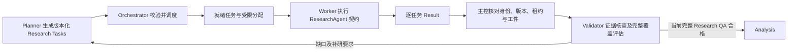

# 按研究任务调度 Worker

版本：0.29.0；2026-11-04。本文把研究派发单元明确为独立 Research Task，保留按竞品分组的并行方式，但不要求竞品与 Worker 固定一一对应。本轮仅修改开发设计，未增加任务队列、Worker 池、租约或生产执行器。契约见 [Agent 定义](agent-contracts.md)，恢复见 [故障协议](failure-recovery.md)。

状态目标以 [状态机 v2](state-machine-v2.md) 及其迁移目录为准：独立缺口／补研／报告 QA、两个确认等待及 CANCELLED 替代此前内部阶段安排。本文标为当前或迁移前的 v1 边界继续描述未变更源码；新状态与恢复须先实现迁移和守卫后启用。

## 调用路径与职责

图表示模块数据流，顶层阶段与合法迁移以状态机 v2 为准，不能由 Worker 随意新增。Planner 拆问题、生成依赖和补研任务；Orchestrator 选择可运行任务并分配 Worker、预算与租约。Worker 返回结果，不自己挑新业务目标、扩大范围、启动其他 Worker 或调用 Validator 放行自己。

Worker 是 ResearchAgent 的一次受限执行实例，不新增第九种自主角色。worker_id 标识执行实例，research_task_id 标识业务任务，两者不能互作主键。一个 Worker 可先后处理 A 的价格、B 的部署；一个竞品也可有多个互不依赖的任务交给不同 Worker。每次分配重建权限与上下文，不能沿用上一竞品的隐式记忆。

按竞品分组仍有价值：同一对象的邻近任务可复用已授权的身份与来源上下文，便于减少重复获取。但分组是调度偏好，不是独占该竞品的终身 Worker。小型单对象研究可顺序执行，不为了“多 Agent”而强制并行。

## 三层任务身份

| 层级 | 标识与含义 | 不能混淆的概念 |
|---|---|---|
| 研究执行 | 当前已有 task_id，以及未来逻辑 research_id／research_revision | task_id 不是一条采集问题，也不等于竞品 ID |
| 独立研究任务 | research_task_id＋task_version，回答一个有界问题或一组紧密相关问题 | 不是只包含名称的“研究竞品 A”，也不是每次网络调用 |
| 调度与尝试 | dispatch_id、worker_id、lease_epoch、attempt_id／operation_id | 重派仍关联原研究任务，不通过新 ID 重置预算；业务问题变化才修订任务 |

现有 ResearchWorkItem 包含 id、competitor、dimension、action、query、depends_on，已具有细粒度任务基础，但动作限 search／fetch／extract，尚无上述独立问题、租约和调度协议。未来 Research Task 可包含一组明确的操作工作项，例如“获取 A 在指定地区的公开价格与年付条件”；任务级结果汇总这些操作，不能省略内部调用账本。

## 任务、分配和结果契约（待实现）

| 对象 | 必需信息与约束 |
|---|---|
| ResearchTaskSpec | research_task_id／task_version、research_revision／plan／scope／policy、对象身份、维度／子问题、目的、必需性、输入资产、来源限制、允许方法、依赖与各依赖就绪条件、优先级及理由、所需能力、预算请求、截止时间、输出类型与完成条件 |
| WorkerAssignment | dispatch_id、research_task_ref／input_hash、worker_id、lease_epoch／到期条件、实际能力和权限交集、父级预算预占与截止时间、只读输入清单、允许追加的产物位置、恢复／幂等关联 |
| ResearchTaskResult | 任务／版本／分配／attempt 引用，执行和发现状态、全部操作／子问题结果、Source 与 unvalidated 候选、覆盖了哪些问题、剩余缺口、实际调用及消耗、工件散列与检查点 |
| TaskAcceptanceRecord | 当前分配与版本校验、结构及工件校验、接纳／拒绝原因、结果摘要、依赖就绪变更；不表示内容已获语义核验 |

每个任务必须回答“为哪个对象、研究什么、使用哪些输入和方法、产出什么、怎样检查”。预算和工具许可不是 Worker 自报值；主控从可信策略与剩余额度计算分配。输入只能来自获授权对象和确切资产版本，输出只能追加到本任务产物范围，不允许直接改竞争对象总档案或已发布报告。

完成条件描述可核对成果，例如“保留公开价格的地区、币种、版本、计费周期、获取日期和原文定位；未公开或访问失败单独记录”。它不保证一定能找到资料。任务返回完整状态清单可供调度收尾，但研究问题是否充分仍由 Validator 判定，不能由 Worker 的 completed 或 confidence 决定。

## A、B、C 的分配示例

以下为合成规划例，不是实际研究结果。假设用户已明确只研究 A 价格、B 部署、C 功能，身份已确认：

| Research Task | 对象与问题 | 主要输入／来源方向 | 所需产物 |
|---|---|---|---|
| rt-a-price | A：目标地区的公开价格、版本和收费条件 | A 身份、地区／币种／时点；官方价格和条款 | 价格事实候选、条件、来源定位及未公开项 |
| rt-b-deployment | B：支持哪些部署方式及运维责任 | B 身份、部署定义；产品／部署文档 | 各方式的官方说明、适用条件、责任边界与缺口 |
| rt-c-features | C：指定场景的功能覆盖与限制 | C 身份、场景和功能清单；功能文档 | 功能主张、限制、原文定位及尚未核实的效果 |

若有两个可用槽位，可先派 Worker 1 执行 A 价格、Worker 2 执行 B 部署；任一槽位释放后领取 C 功能。若 A 价格又拆为有不同能力需求的公开页面和已提供 PDF 条款，可由两个 Worker 并行，但需 Planner 先定义拆分和合并条件；Worker 不自行扩展问题。

“A 重点价格、B 重点部署、C 重点功能”未必表示其他已确认维度取消。若用户仍要求共同维度横比，保留所有必需比较单元，分别提高相应专项的深度和优先级。若授权确实仅为三项专项，报告明确非对称范围，其他单元标本次未研究，不据此声称完整功能／价格横比。

项目模式现有 CollectionJob／CollectionTemplate 仍为同一锁定模板的对象快照，不直接派给 Worker 当全量任务。Planner 从其授权范围拆任务，汇总器再按已锁模板组织结果；每个 Worker 只返回自己的问题子集，不能把部分结果塞入要求完整字段的 CompetitorCollection。共享维度定义保持一致，专项深度不静默改写全体维度或批准文件。

## 就绪、分配和并发限制

调度前验证任务属于当前准入计划、依赖无环且引用存在、对象身份和必要锁有效、能力可用、输入版本匹配，并为本次操作预占预算。执行器只调度已批准任务，不因队列为空自行创造查询；计划有缺口由 Planner 修订。

依赖必须声明需要哪类结果：使用下载原件可要求上游工件已接纳；依赖核验事实则要求相应有效验证收据。不能用“前一个 Worker 已退出”一概满足依赖，也不能让 failed／deferred／unknown 满足需要成功工件的边。依赖未满足就保持阻塞并说明原因。

首次实现采用可解释的有界就绪队列：先筛能力／依赖／权限／预算，再按计划明确的关键依赖、必需性、截止时间及优先级选择；同档按等待时间／稳定序号取任务，保留选择理由，避免某一竞品的可选深挖长期挤占其他必需项。权重和估算未知不伪装精确最优调度。

并发取可用 Worker 槽位、模型／工具限额、提供方／域限额及父预算约束的共同上限。Worker 能力来自可信注册描述和健康状态，不接受模型自称具备 PDF／渲染工具。更换 Worker 不等于允许更换模型提供方或数据传输权限。任务数量不等于并发数，队列中任务不提前耗光全部资源。

分配以持久化比较交换原子认领并建立租约，每个 research_task_version 同时至多一个有效分配；超时、失联和旧 epoch 由恢复协议处理。调用之前预占，真实尝试与内部子调用均入父级账本。子代理不各领完整模式预算，也不叠加 SDK 或自身重试。

相同 URL／原件可能服务多个问题：兼容的获取可以用共享资产依赖减少重复调用，授权、地区／版本、时点、解析方法和来源限制均须一致。正文只获取一次不意味着只判断一次；不同问题各有候选映射和充分性核查，转载不增加独立来源。不得仅按 URL 相同合并不同业务任务或跨项目共享私有资料。

## 结果接纳、Validator 与完整研究关卡

Worker 结果先经主控／汇总服务检查任务身份、当前分配与 epoch、输入指纹、产物类型、来源引用和实际调用账本。无效结果拒绝接纳并保留诊断；合法部分结果保留，不能只接成功子项而隐藏失败。

结果以 research_task_ref＋result_version 存储，汇总到对象×维度／子问题索引；同一对象多个 Worker 不互相覆盖。Worker 不写共享 Markdown 或总档案，避免最后写入者把其他成果抹掉。结果结构接纳不是事实验证。

Validator 可按接纳结果处理证据核查，但完整 Research QA 必须绑定当前范围全部必需单元和新旧冲突。不能因 A 价格先通过，就把整个 A 或整个研究标为完成；所有任务已返回也不代表所有问题已有充分证据。报告与分析仍等待当前完整 Research QA，保留 [既有质量门槛](report-qa.md)。

v2 采用阶段屏障：RESEARCHING／SUPPLEMENTING 汇集本轮全部分配状态，再进入 VALIDATING→GAP_ANALYSIS，由 Validator 核查；不为了每条结果交替切换顶层状态。依赖已核验事实的后续采集放到后续合法计划批次，不能死等当前阶段尚不能签发的 QA。未来若做流式预核查，须独立实现版本化局部收据与并发一致性；局部检查仍不准入 Analysis，也不隐式新增状态边。

Validator 给结构化缺口，Planner 生成有基线和依赖的新补研任务，Orchestrator 沿 GAP_ANALYSIS→PLANNING→SUPPLEMENTING 执行。Worker 不因结果不够就自行生成新任务。补研按缺口定位到相关问题，重新评估完整范围；旧充分材料可按版本采用，不重新研究所有竞品。

## 失败、重派和增量变更

单个 Worker 失败只影响它的分配和依赖闭包，其他独立任务及已接纳资产保留。共享授权、预算或存储故障停止相应全局派发。失败、合法无结果、暂不可执行与远端结果不明分开；没有满足必需标准时不能靠取消任务或改可选凑完成。

租约过期不证明远端工具已经停止。恢复先查调用、结果与预算账本；只有符合幂等／结果确定性和可信恢复策略时才重派。新 assignment／attempt 增加 epoch，旧分配的迟到结果归档但不能直接覆盖新结果；如需采用其工件，须正常版本检查和显式采用。当前公开搜索／抓取仍无自动重试，不以换 Worker 绕过限制。

同一业务任务的安全重试保持 research_task_id／task_version，记录新分配及尝试；问题、范围、策略或输入清单改变则由 Planner 建新版本或任务并保留替代关系。已运行任务不原地修改，用户中途要求增加竞品或加强某维度时按 [多轮修订协议](incremental-research.md) 计算影响，不取消并重建所有任务。

Worker 复用需清理上一次授权、临时上下文和写入范围；只有显式传入且通过采用检查的资产可使用。不能因为进程曾研究 A 就把 A 的内容写入 B 结果。批处理只是传输优化，内部仍逐任务分配、预算、结果和故障，不产生不可拆分的“一竞品一个成功布尔值”。

## 实施与验收

当前 prepare_collection_jobs 仅准备按对象的项目锁快照，ResearchWorkItem 仅有动作级字段；没有 Worker pool、任务认领、结果接纳／汇总或持久租约。不能因已有 depends_on 或本地 jobs 就宣布动态调度可用。

按一个模块一次推进：①任务与结果契约、现有项目快照映射；②Planner 独立任务和依赖；③持久就绪队列、能力匹配、预算及租约；④Worker 执行与结果接纳；⑤Validator 屏障、定向补研及恢复／增量集成。先使用有界顺序／并行执行，不要求先引入分布式队列或常驻服务。

以下为后续验收，本轮未新增或运行这些执行测试：

| 编号 | 可观察验收 |
|---|---|
| SCH-01 | A价格／B部署／C功能生成不同输入、来源策略和完成条件；禁止仅传名称启动无界研究 |
| SCH-02 | 同一 Worker 可按新上下文处理不同对象，同一对象可拆给多个 Worker；不串资料或继承旧权限 |
| SCH-03 | 任务、执行 task_id、worker_id、dispatch／attempt／epoch 分开；重复认领及旧租约结果不覆盖当前版 |
| SCH-04 | 能力、授权、依赖、截止时间及预算准入后才派发；不可用能力不由模型自称，环和缺依赖明确拒绝 |
| SCH-05 | 就绪队列有稳定且可解释顺序，槽位与提供方限制同时生效，可选深挖不饿死必需任务 |
| SCH-06 | 每任务／子操作结果与调用可对账，失败、无结果、延后和 unknown 不混用，不隐藏部分失败 |
| SCH-07 | 兼容原件可共享获取，不混合问题、时点或项目权限；每个问题独立核查，转载不算交叉来源 |
| SCH-08 | 多 Worker 对同对象结果追加汇总，不互覆总档案；项目部分任务不伪装完整 CompetitorCollection |
| SCH-09 | 重点不同不取消原有必需横比；仅专项请求明确非对称范围，未研究不能写成不适用 |
| SCH-10 | v2 按 RESEARCHING／SUPPLEMENTING→VALIDATING→GAP_ANALYSIS 屏障执行，无逐任务状态乱跳或核验依赖死锁；局部 PASS 不准入全局分析 |
| SCH-11 | Worker 失联先核远端记录再安全重派，兄弟成果保留；新 Worker／attempt 不重置预算或绕受限 |
| SCH-12 | 补研只针对缺口／变更依赖，保留旧资产但重新完整 QA；任务都返回不等于研究充分，真实入口需独立集成验收 |
