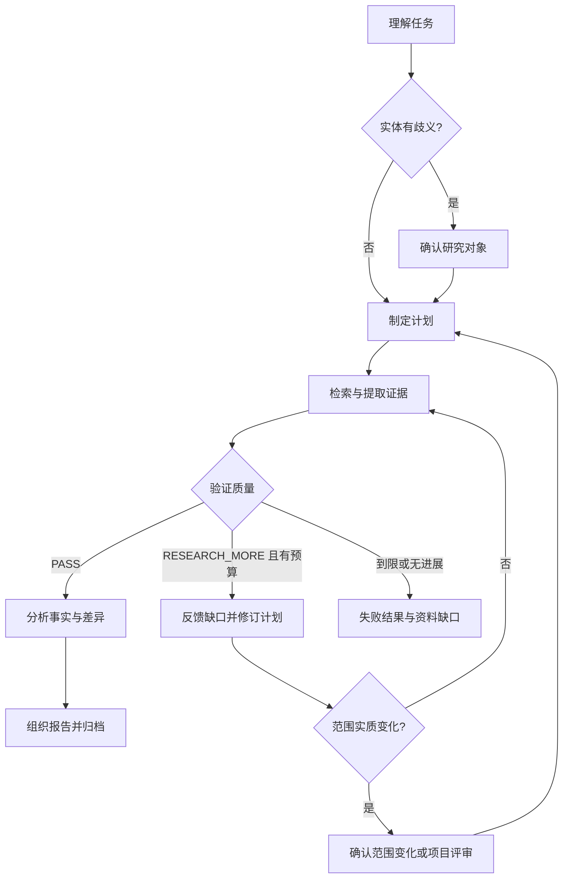

# Steal Her Heart — TASK_SPEC

版本：0.9.0；任务持久化 schema_version：1；采集对象 schema_version：2；Battlecard schema_version：1；日期：2026-11-03。

本次变更：默认 [单对象入口](../../commands/analyze.md) 仅需竞品名，我方背景与项目可选。Python路由不再把所有任务前置拦截到访谈，run/resume允许无项目快照并保持上下文一致。显式项目的11题、旧档案兼容和review API名单／锁约束保留；不接入网络、分析或报告执行。

## 1. 基线与决策来源

用户材料指定产品名称、Python CLI、六个能力模块、Pydantic、状态机、Evidence／Analysis分离与分阶段开发。最新明确修正默认使用方式：只输入想分析的竞品名称，无须知道我方项目。早期“所有分析必须先访谈和两道初始化确认”不再适用于默认单对象；这些约束仅在用户主动选择项目／批量研究时保留。

原文架构图及两处工具／交互表格缺失，状态图混入渲染 CSS；本规范依据文字恢复可实现设计，不宣称复原原图。原文“2天／3天”是用户材料中的建议，未评估工期，不作为交付承诺。

相对通用0.1草案：研究工具由本地文件改为后续网络取证；改用用户指定研究状态集；采用六阶段路线；首阶段只交工程骨架，停止在 UNDERSTANDING；通用草案不再作为该产品验收依据。

## 2. 模块与契约

| 模块 | 输入 → 输出 | 禁止职责 |
|---|---|---|
| Orchestrator | user_input → TaskResult；调度各 Schema | 解析网页、自己写产品结论 |
| Planner | TaskRequest → ResearchBrief → ResearchPlan；验证缺口 → 修订计划 | 搜索或抢先分析 |
| Research Engine | ResearchPlan → Source／Evidence | 产品判断与策略建议 |
| Validator | Plan＋Evidence → ValidationResult | 单靠模型自评批准完成 |
| Analysis Engine | 已验证 Evidence → Analysis | 增造事实或直接联网 |
| Report Generator | Analysis＋来源目录 → Markdown | 新分析、新事实 |
| Memory | StateContext＋ResearchMemory ↔ SQLite | 将历史结论默认为当前事实 |

通用 Pydantic 定义以 [schemas.py](../../src/steal_her_heart/schemas.py) 为字段源；识别结果及别名提示契约在 [brief_recognition.py](../../src/steal_her_heart/brief_recognition.py)；模块端口在 [interfaces.py](../../src/steal_her_heart/interfaces.py)。字段变更须同步版本与测试。

ResearchPlan 含 version、brief、tasks。brief 含 topic/industry/objective/competitors/dimensions/assumptions；task 含 id/competitor/dimension/action/query/depends_on，依赖先于使用、不允许重复 ID 或越界竞品／维度。

StateContext 包括 task_id/current_state/revision/completed_tasks/pending_tasks/search_count/llm_count/research_round/current_competitor/current_dimension/memory_reference/confirmation/error_code。只用明确允许的迁移函数改变状态；持久化 Schema 不接受额外字段。

ValidationResult 为 PASS／RESEARCH_MORE、coverage、gaps、conflicts。首阶段只提供结构 guard，Phase 3 加入来源、时效与覆盖的实质校验。Analysis 至少有一条 Evidence，claims 均引用已有 evidence_ids；语义与摘录支持性仍需后续验证。

Research Engine 跨模块返回 EvidenceBundle，Report Generator 返回 ReportDraft（Markdown 内容与来源 ID），不以裸 tuple／自由文本绕开 Schema。TaskResult 的 outcome 必须对应真实 state，未完成时不能给最终 report_path。

## 3. 工具的目标契约

| 工具 | 输入 | 输出 | 阶段 |
|---|---|---|---|
| hello | name（默认 Agent） | message | Phase 1，无网络 |
| web_search | query、地区、语言、结果数量 | title/url/snippet 的 SearchResult 列表 | Phase 3 |
| web_fetch | URL | canonical URL、状态、正文、来源元数据、散列、快照引用 | Phase 3 |
| extract_features | Source 快照引用、竞品、维度 | 有摘录及定位的 Evidence 候选 | Phase 3 |

网络工具细化 Schema 在 Phase 3 对接选定提供方后实现，不能假定现成服务可用。统一注册、schema 校验和权限适用于全部工具。候选 Evidence 未经 Validator 通过不能进入 Analysis。

## 4. 计划—执行—反思

该图描述目标产品，不表示 Python 已实现研究链路。默认单对象不强制首次计划批准；PLANNING→RESEARCHING 可直接迁移。主动 WAIT_CONFIRM 才校验确认记录；项目 review API 另外绑定名单和锁。状态迁移仍遵循代码guard，不能把聊天宿主研究当作Python已迁移执行。

## 5. 开发交付批次（不是产品运行阶段）

| 阶段 | 交付 | 本轮范围 |
|---|---|---|
| 可选项目访谈 | 主动选择项目时保存背景与快照 | 已实现逐题访谈与显式项目闸门；默认单对象不依赖 |
| Phase 1 骨架 | Schema、State Machine、Registry、Memory基础、Orchestrator、CLI | 实施并测试 |
| Phase 2 Planner | 意图／行业／实体识别、分层发现、名单及维度确认的 CLI 交互 | 仅离线 ResearchBrief 识别已实施 |
| Phase 3 Research | 搜索／抓取／提取／去重、来源快照、实质 Validator、反思补证、调用预算与恢复 | 只留契约 |
| Phase 4 Analysis | 比较、SWOT、差异和机会假设 | 只留契约 |
| Phase 5 Report | 通用／读者视图 Markdown、Battlecard、Sources、产物验证与归档 | 只留契约 |
| Phase 6 Memory | 关联追问、研究资产复用、版本／时效与新增范围确认 | 只留契约 |

上述开发批次中每个模块先完成及测试再推进，不用一次性生成全部产品。Memory基础是任务恢复设施，Phase 6 才是研究资产复用产品能力，两者不矛盾。

## 6. Phase 1 实际行为

项目包为 src/steal_her_heart；不创建后续功能空实现，不连接模型、不搜索。

- `hello`：经 Registry 调用诊断工具，输出 ToolResult，成功退出0，不写研究数据库。
- `run "分析 Cursor"`：无项目也可验证输入、创建Task＋Memory并迁移至UNDERSTANDING；project_context=None，返回pending_module、退出3。默认库为.steal-her-heart/memory.sqlite3或--db；显式项目使用其已校验背景。
- `status task_id`：读取任务，返回实际状态；读取成功退出0。
- `resume task_id`：检查当前可选上下文与快照一致，None只与None匹配，绑定项目不能丢弃或套给无项目任务。CREATED可推进UNDERSTANDING，已有状态不重迁移；返回pending_module、退出3，不新增搜索或模型调用。
- 非法输入／未知任务退出2；存储或竞争错误退出1。研究完成的真实出口留待后续模块，不伪造 report.md。

SQLite 同时保存快照与有序状态事件，用 revision 拒绝过期提交；不声称首阶段具有分布式租约、研究工具重放控制或长期知识检索。

### Phase 2 当前子模块：ResearchBrief

`BriefRecognizer.understand(TaskRequest) → BriefRecognition`。Planner 端口继承该识别端口，后续另行实现 plan。结果为互斥的两种状态：ready 必须带 brief 且 questions 为空；needs_clarification 必须带 questions 且 brief=null。所有对象拒绝未知字段。原 understand 返回裸 ResearchBrief 的协议更新为能表达阻塞信息的结果对象，当前没有依赖旧返回值的已实现调用方。

`RuleBasedBriefRecognizer` 支持以分析／研究／比较／对比／compare／analyze／research 开头的明确请求，提取顿号／逗号／and 等分隔的对象，识别显式行业前缀和“的价格／重点看服务体验／on pricing”等维度子句。产品名含分隔词时用双引号、中文引号或书名号保护。自定义维度保留；常见维度别名归一；每次最多20个对象和20个维度，不静默截断。

未知产品按用户命名保留，不自动增加竞品或凭空赋予行业。Cursor／Claude 的本地歧义提示须有明确上下文，否则提问。本地词表可替换，仅是启发式；无法覆盖所有同名实体。未知统一行业保留为“待研究确认”；默认四维度是计划建议而非已批准范围。原 user_input 完整保留为 objective。

`BriefRecognitionTool` 以 recognize_brief 注册，要求 brief_recognition 能力。`brief "..."` 输出 ToolResult：ready 退出0，needs_clarification 退出3，无效输入退出2，其余工具错误退出1。工具协议成功不等于识别已就绪，调用方必须查看 data.status。

本子模块没有状态、记忆或网络副作用。不提供确认回复命令，不连接模型，不把规则理解称为全行业通用语义识别。否定约束等不支持语法需要用户改写；后续模型适配不能取消不确定性和 schema 校验。

### 全行业采集模板契约

框架见 [collection-template.md](references/collection-template.md)，代码源为 [collection_template.py](../../src/steal_her_heart/collection_template.py)。CollectionTemplate 包含 id/version/industry/system_category/fields；两个分类轴都是开放文本。build_collection_template 将通用 BASE_FIELDS 与 extra_fields 组合，既不按行业白名单分支，也不默认为任何垂直功能集。

共享骨架覆盖基本盘、产品与服务、价格与商业模式、竞争与市场表现、口碑和动态，专项字段数量可变。模板字段ID唯一；core_field_ids 可选择核心库子集，所选核心定义及证据约束不可削弱；不强制每项目全部通用字段。CollectionField 以 requires_time_window、requires_own_product、allow_not_applicable 声明语义要求，不靠模块标题猜测。

CompetitorCollection schema_version=2，保存完整 template 快照及 competitor/as_of/own_product/recent_window_start/fields。每个选中模板字段恰一次，不能漏项或混入其他模板。旧垂直模板的顶层 template_id/template_version 明确拒绝，需人工或后续迁移工具映射，不能静默改名升级。当前没有此类对象的任务库集成，数据库版本保持1。

CollectedField 的 pending/found/not_found/not_applicable 互斥。未找到显示原文“未找到”，需查找记录及范围说明；不适用显示“不适用”，仅在字段允许且有理由时接受。CollectedInformation 对每条内容保留来源、日期、置信度与依据、evidence_ids；事实、口碑和推断保持区分。适用性理由与来源真实性在后续实质 Validator 验证。

默认模板不包含我方赢输，也不要求未给出我方背景的用户补这些信息；确有对照目标再扩展字段。未来 Planner 按行业、系统品类和任务目标提出专项维度、解释可比口径并获得计划批准，再生成“竞品×字段ID”任务。本次仅配置与契约支持，不声称已实现自动行业研究。

### 四类读者与 Battlecard 契约

用户内容见 [audience-views.md](references/audience-views.md)，代码为 [audience_views.py](../../src/steal_her_heart/audience_views.py)。Audience 的四个值仅标识已有预设，ReaderViewSpec.audience、Battlecard.audience 和 ReaderProfile.id 均为开放标识。读者可省略，默认通用报告；显式配置时读取其readers，未解析原答保留缺口，不能默认四类或要求建项目。

产品经理的“有／没有”和“领先／落后”是独立判断，须保留未知／不适用；销售领导的价格空间、赢输归因需我方价格及真实样本；运营增长建议须区分可观察事实与实验假设。详细输出字段与未来语义验收见读者规范，本次只定义内容契约，不实现这三类完整数据生成。

Battlecard 包含 competitor、own_product、as_of、analysis、opponent_points、our_advantages、discovery_questions、do_not_say、gaps。引用从共享 Analysis 的事实和结论中解析，不复制生成另一套事实。对方卖点最多3项且匹配竞品；我方优势最多3项且有双方证据；引用ID不得重复凑数；实际客户表达必须关联记录，假设表达明确标记；已证伪的禁说事项必须有矛盾证据。

status=draft 必须披露缺口，可没有 Analysis；status=ready 要有我方背景、共享 Analysis、两侧各3项、探测问题和禁说事项，且没有未决缺口。ready 仅是结构／引用门槛，不能替代事实支持性、真实成交归因或打印版式检查。没有证据时宁可缺项，不能为了完整卡虚构。

当前 Battlecard 一页是 layout_target，不输出页数，也不生成 Markdown／PDF。Phase 5 须在确定的可读版式中证明正文一页，详细证据移附件。未指定读者时保留通用报告；选择多个读者应复用资产。加入视图若增加资料需求，由后续 Planner 处理，不改变当前模块阶段。

### 统一意图入口

规范见 [commands.md](references/commands.md)，实现 [command_router.py](../../src/steal_her_heart/command_router.py)。CommandIntent 含 original_input/status/action/competitor/period/audiences/question；action 为 analyze/battlecard/brief，period 为 weekly/monthly。单竞品任务必须有名称，brief 必须有周期；读者ID从结构化项目配置读取，未解析时为空并保留 reader_requirements 原答，不能默认四类。Battlecard 是格式要求，不强制读者ID为 sales_rep。保留原文，实体识别与研究范围仍由后续理解模块处理。

CommandResponse对无项目完整意图直接返回pending_module，缺参数则澄清；只有显式选择的项目未完成才initialization_required。Battlecard我方信息和brief资产范围由后续执行补齐，路由不创建没有提交接口的循环；产物路径不可伪造。CLI request 接受原文，直接 /analyze、/battlecard、/brief 也可用；recognize-brief 为识别器入口，旧 brief 保留兼容。所有路由调用经 Registry，不创建库或产物。周报／月报起止日期和档案范围在后续计划明确，不创建调度器。

### 默认单对象入口（本轮）

[competitor-research](../competitor-research/SKILL.md) 默认执行 [commands/analyze.md](../../commands/analyze.md)。名称足够明确时直接检索确认对象、选择适合维度、取证核查与分析；不前置我方产品、行业、市场、目的、读者或项目配置，不自动扩大其他对象，也不要求两次初始化确认。必要实体歧义和实质范围变化才询问。

默认报告为竞品画像、研究结论、适用边界与建议验证的问题。没有我方背景不输出我方优势、领先落后或赢输；用户主动要求对照时仅补必要信息。Codex可按上下文处理裸名称；Python依然只解析明确命令与支持句式，不猜任意字符串。

实际Codex产物可存 research/<安全对象标识>/<运行标识>/，Python暂不生成报告。宿主工具执行和Python执行链明确区分；不能把指令存在、parsed或pending_module标成研究完成。

### 可选项目初始化

只有用户主动选择长期项目、固定读者／维度或我方对照配置时，才执行 [init-project](../../commands/init-project.md)，使用 [profile模板](../../templates/profile.md) 和 [维度库](../../library/dimensions.md)。聊天每轮2～3题，Python单题保存；名单／维度预确认与正式锁的兼容边界见运行规范，不放宽现有项目guard。

### 阶段0 项目上下文

规范见 [project-initialization.md](references/project-initialization.md)，实现 [project_initialization.py](../../src/steal_her_heart/project_initialization.py)。这是显式选择的可选项目访谈，与默认单对象入口和开发交付批次分开。ProjectInterview 保存 project_id、访谈版本与答案；InterviewStatus 表达 interviewing／ready、下一问题及完整上下文。新版本按用户模板逐问11项，完成时转为 ProjectContext，标 user_provided。industry 原文和 industries 多选列表并存；price_range 和 special_notes 可空，明确未知进 uncertainties；读者要求角色／关注点／期望格式，映射到开放 ReaderProfile 与 output_style；已知竞品可空。

CLI 提供 init-project（可 --interactive）、answer-project question_id answer、project-status；全局 --project 指定项目 SQLite 路径。事务保存，每次回答必须对应当前问题，已完成不重问，中断可继续。核心字段显式未知保持未就绪；读者缺列继续提问，不能自动填格式。非空及未知标记校验不是无限制语义理解。

CommandResponse保留initialization_required与initialization_question供显式未完成项目使用，不用于默认单对象。ResearchMemory.project_context可空；无项目run可创建基础任务，恢复要求None或绑定背景保持完全一致。无背景旧快照不能自动套入某个项目。原文不能携带或替换受信项目上下文，状态集合与数据库schema不变。

### 新产品运行链与锁定契约

以 [research-workflow.md](references/research-workflow.md) 为运行规范源：默认单对象只需名称，范围内按对象设计维度并继续；下面的DiscoveryProposal、名单和维度锁属于可选项目／批量研究API，不能反过来要求所有单对象先建项目。

[research_workflow.py](../../src/steal_her_heart/research_workflow.py) 的 DiscoveryProposal 保存背景摘要、实际搜索调用引用、四类候选及明确层级缺口；现状／不换为 alternative，不强制虚构候选。confirm_competitors 校验用户审阅摘要和选择ID，产生名单批准；受信界面仍需验证真实用户来源并持久化事件，批准函数不能暴露给模型。

DimensionLibrary 保存扩展字段和版本，核心库沿用 BASE_FIELDS；design_dimensions 仍在有效名单批准后，按配置的核心子集、扩展ID和 readers 构建最终项目提案。write_dimensions 生成 dimensions.md 和同源 dimensions.proposal.json，不覆盖既有版本。confirm_dimensions 核对审阅摘要、文件和配置后保存 dimensions.lock.json。聊天预确认暂不具备到这些 API 的自动迁移，不能将预览稿或聊天确认直接冒充其锁文件；候选引起维度变化时重新审阅变化。

prepare_collection_jobs 必须匹配当前背景、名单批准、提案、锁记录和 Markdown，为每个选中对象返回一个带相同模板的 CollectionJob。任何范围／文件变更使准备失败。任务只有准备契约，尚不启动 subagent；队列、预算、重试、取消、恢复与真实工具账本需要后续执行器。

Python 的实际联网发现、行业维度自动推荐、受信确认通道、业务状态协调器、采集核查分析和输出都未接入；现有 run/resume 仍只到 UNDERSTANDING。聊天宿主工具的实际执行须单独记录，不能把指令、离线构造提案或确认夹具当作已完成真实研究。

### 产品项目文件工作区

根目录AGENTS.md是仓库规则。[project_workspace.py](../../src/steal_her_heart/project_workspace.py) 仅在显式选择项目时使用projects/<project-name>/；CLI通过--project-name和可选--projects-root选择。初始化生成 profile.md、未锁定的 dimensions.md 及 .state/project.sqlite3；任务数据库默认 .state/memory.sqlite3，各产品独立。

新 profile.md 以 [模板资产](../../src/steal_her_heart/templates/profile.md) 的 Markdown 产品字段、分析目的、三列读者表、竞品名单及特别说明为唯一业务源，不再另存隐藏业务 JSON。空字段和注释示例不构成用户答案；核心内容未完成时不就绪。旧单 JSON 配置块 profile 继续兼容读取、不覆盖，原始旧空稿允许访谈完成升级，既有手工修改保留。整个文件摘要注入 ProjectContext.profile_sha256，正文修改仍使旧任务／发现批准失效。读取前检查路径、文件、编码、大小和结构，不能以结构正确证明语义完整。

手工产品字段支持续行，特别说明保留二级子标题与代码块原文。半填手工档案在初始化、状态及研究入口提示补全原文件，不另开无法落盘的访谈，也不自动合并访谈答案；读者角色或关注点明确未知仍不就绪。

旧--project SQLite路径保留显式兼容，旧数据不自动迁移。无项目默认任务使用.steal-her-heart/，不读写projects/default；只有项目模式使用上述布局。阶段2写维度时只允许替换初始化的原始占位稿，不能覆盖已有评审或锁文件。/init-project 是项目 CLI 别名，尚非宿主注册快捷命令。

输出要求：本次检索事实逐项链接与日期；官方、第三方和反馈分开；有依据的推断明确标记；有用户目的时回应目的，无额外背景时给研究结论、边界与待验证问题；我方意义／优势仅在有相关背景时输出；多视图复用事实。源码尚无真正研究或语义输出 Validator，不能把本次项目布局测试宣称为这些质量条款已自动验证。

## 7. 验收

| ID | 阶段／场景 | 可观察标准 |
|---|---|---|
| WS-01 | 项目隔离 | 独立产品目录与 .state/；两个文件生成，缺失／越界／编辑检查有效 |
| WS-02 | 项目内容 | 新 Markdown 配置与完整摘要读取；旧 JSON 不覆盖、旧空稿可升级；维度仅替换原始占位稿 |
| INIT-01 | 访谈覆盖 | 新11项逐问，多行业／读者开放；竞品、价格和特别说明可空；未知核心及读者缺列继续澄清 |
| INIT-02 | 保存复用 | 错题／重复回答拒绝；中断续接；完整项目不重问；未知版本不覆盖 |
| PROFILE-01 | 模板字段 | 可读模板保留用户字段；多行业原文及拆分值、价格、特别说明、读者格式不丢失 |
| PROFILE-02 | 空稿与兼容 | 空模板／示例不就绪；旧9题及旧 JSON 保留缺口，不假装新增字段已回答 |
| PROFILE-03 | 配置效力 | 不把文本约束保存说成已完成来源过滤、监管判定或实际输出 |
| INIT-03 | 显式项目闸门 | 显式选择项目未完成时提示补齐；默认单对象不拦截；任务快照保持可选上下文一致 |
| P1-01 | Schema | 未知字段、空输入、非法计数、循环依赖、范围外任务拒绝 |
| P1-02 | State Machine | 10×10 状态对测试；非法跳转与终态继续拒绝；未 PASS 不能分析 |
| P1-03 | 确认基础 | WAIT_CONFIRM 必须有待确认记录；恢复状态与确认 ID 绑定，伪造回复拒绝 |
| P1-04 | Registry | 重复注册、未知工具、未授权、错误输入／输出拒绝；hello 正常 |
| P1-05 | Memory | 新实例恢复相同状态；竞争提交拒绝；事件失败回滚整个快照；未知版本拒绝 |
| P1-06 | Orchestrator | 输入保存于短期记忆；停止 UNDERSTANDING、pending_module；零搜索／LLM，零假报告 |
| P1-07 | CLI | hello=0、run/resume=3、status=0、非法输入=2；重复恢复无新事件 |
| P1-08 | 工具异常 | 超时有界；原始异常不暴露假密钥；坏输出不能成为成功 data |
| P2-01 | Planner | 单对象按名称规划；可选批量模式另验发现、名单、维度与锁；当前仅识别、入口与文件API |
| P2-B01 | 当前：实体提取 | 中英文多对象、别名去重、带引号的对象完整保留，不凭空增补竞品 |
| P2-B02 | 当前：范围提取 | 显式行业与维度保留，非软件维度不强填 AI，词表推断／默认值标假设 |
| P2-B03 | 当前：缺口 | 歧义、缺对象、不支持否定、空维度子句返回结构化问题，brief=null |
| P2-B04 | 当前：接口与边界 | ready／阻塞结果互斥；未知字段、超长输入拒绝；Registry 能力校验；CLI 不创建数据库 |
| TPL-01 | 模板完整性 | 每个选定模板字段恰一次；共享约束保留、专项ID无冲突；初始全 pending |
| TPL-02 | 每条元信息 | 多条信息分别保存链接、日期、置信度与证据ID；缺少必需元信息拒绝 |
| TPL-03 | 未找到 | 无完整查找记录或仅访问失败不能标 not_found；显示严格为“未找到”，不承载事实值 |
| TPL-04 | 分析与窗口 | 口碑／推断不冒充事实；选用我方对照才需背景；声明时间要求的字段需窗口 |
| TPL-05 | 全行业扩展 | ERP、WMS、HR、餐饮、硬件及未预置品类均用同一契约扩展，无垂直字段泄漏 |
| TPL-06 | 适用性及兼容 | 不适用需允许及理由，不能替代未找到；拒绝旧垂直协议 |
| P3-01 | 取证 | 真实来源可追溯；snippet 不充当终证；价格维度完整；去重与冲突保留 |
| P3-02 | 闭环 | 缺用户评价／价格触发精确补证；预算及无进展终止；范围变化回确认 |
| P3-03 | 工具边界 | SSRF、重定向、超大网页、提示注入、超时／重启／并发不绕约束 |
| P4-01 | Analysis | 无 Evidence 拒绝；引用匹配；事实与机会分开；不支持的 SWOT 不强填 |
| P5-01 | Report | 通用底稿及所选角色结构、来源；无新增事实；发布可对账；产物后才 COMPLETED |
| VIEW-01 | 当前：读者规范 | 四类常用预设与自定义角色可配置，共用资产，不自动填四角色 |
| VIEW-02 | 当前：卡片引用 | 未知引用、混入他方卖点、重复凑数、单边证据优势均拒绝 |
| VIEW-03 | 当前：缺口与话术 | 草稿披露缺口；无我方背景不填优势；实际引语有引用；禁说项注明依据 |
| VIEW-04 | 后续：语义与版式 | 矩阵可比性、价格空间、样本归因、趋势相关性及一页可读版式验收 |
| CMD-01 | 当前：路由归一 | 命令与自然语言得到同一意图，任意行业名称不受名单限制 |
| CMD-02 | 当前：参数边界 | 缺目标／周期澄清，未知或复杂请求拒绝，不静默扩范围 |
| CMD-03 | 当前：CLI | 新入口经 Registry、无库／产物副作用，旧 brief 兼容 |
| CMD-04 | 后续：执行 | 真实档案版本更新、Battlecard一页、配置读者的周期报告须独立验收 |
| FLOW-01 | 当前：发现与名单 | 四层有候选或缺口，现状替代合法，过期摘要和非法选择拒绝 |
| FLOW-02 | 当前：Python最终锁定 | 核心子集＋库扩展选择；名单批准在先；文件及提案确认后才产锁，聊天预确认不能绕过 |
| FLOW-03 | 当前：任务准备 | 每对象一任务、同模板；背景、配置、文件或锁变化拒绝准备 |
| FLOW-04 | 后续：执行 | 实际搜索／批准通道／子代理并行／核查分析输出须独立验收 |
| CHAT-INIT-01 | 可选项目：聊天指令 | 实际项目名、每轮2～3题与可选建议；先维度预确认、再联网四类候选确认；没有用户确认不能继续 |
| CHAT-INIT-02 | 可选项目：能力边界 | 指令和资源可读取；不伪造宿主注册、Python联网或最终锁；已有项目不被自动覆盖 |
| ENTRY-01 | 默认入口 | 仅名称解析，无我方背景或profile仍pending_module；不伪造研究完成 |
| ENTRY-02 | 无项目任务 | run保存None上下文，不创建default项目；正确db位置与无状态重复迁移 |
| ENTRY-03 | 恢复边界 | None与绑定项目双向不可混用，绑定背景变化拒绝 |
| ENTRY-04 | 显式配置 | 选择项目才读取档案；默认入口不受损坏default档案影响 |
| ENTRY-05 | Codex指令 | 只必要消歧，自动常规维度、不强制初始化；无我方背景不编对照 |
| P6-01 | Memory | 追问关联新任务，只复用仍有效资产；Claude 实体／新增范围确认；旧报告可追溯 |

Phase 1 全部验收离线。后续语义夹具覆盖不同产业、资料缺失、冲突、价格条件、时效、同源转载和提示注入，真实服务测试独立标记。结构校验不能证明“全行业有效”。

## 8. 测试与完成定义

安装及命令见项目 README。第一阶段交付需提供源文件、已解析依赖快照、上述离线验收、架构说明、运行示例与明确的未实现范围。完整 MVP 需 Phase 2–6 逐项验收，当前不能称已完成。

ResearchBrief、可选项目访谈、评审契约、维度文件和任务准备已实现；本轮改为默认单对象无项目入口与可空上下文恢复。下一步接入单对象Planner和真实研究执行，再衔接可选项目批量评审与资产复用。P2-01 整体未完成，不能宣称研究全链路已跑通。模型与搜索服务尚未指定，不把 SDK 写死在 Orchestrator。
