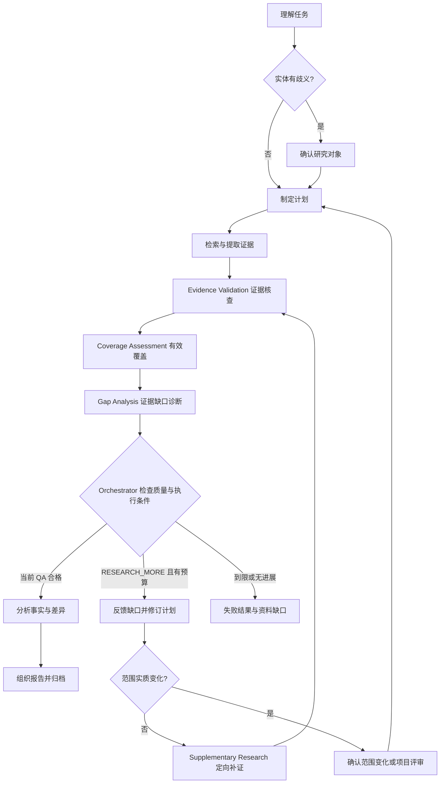

# Steal Her Heart — TASK_SPEC

版本：0.30.0；任务持久化 schema_version：1；采集对象 schema_version：2；Battlecard schema_version：1；日期：2026-11-04。

本轮明确通用引擎与可插拔行业包，以及字段分级、访谈、多标签、读者决策、简报和范围修订协议；多轮修订、分析、证据管理及 Research QA 基线保留，运行代码、状态机和 Schema 版本未变。**生产研究执行链路未就绪，不能自动生成完整竞品报告。** 已有本地范围锁不认证 Codex 聊天回复来源。默认 [单对象入口](../../commands/analyze.md)、独立工具、SaaS 配置、guidance 和离线验收沿用；优先级见 [路线图](../../docs/roadmap.md)，模块设计见 [模块契约](../../docs/module-contracts.md)、[竞品发现设计](../../docs/competitor-discovery.md)、[资料采集设计](../../docs/data-collection.md)、[证据管理设计](../../docs/evidence-management.md)、[分析引擎设计](../../docs/analysis-engine.md)、[多轮研究设计](../../docs/incremental-research.md) 和 [报告质量设计](../../docs/report-qa.md)。

## 1. 基线与决策来源

用户材料最初指定产品名称、Python CLI、六个能力模块、Pydantic、状态机、Evidence／Analysis分离与分阶段开发；后续新增 Research QA 机制与 Competitor Discovery Agent。默认使用方式已修正为只输入想分析的竞品名称，无须知道我方项目。早期“所有分析必须先访谈和两道初始化确认”不再适用于默认单对象；发现后的多对象名单仍须用户选定，项目模式保留其完整评审约束。

原文架构图及两处工具／交互表格缺失，状态图混入渲染 CSS；本规范依据文字恢复可实现设计，不宣称复原原图。原文“2天／3天”是用户材料中的建议，未评估工期，不作为交付承诺。

相对通用0.1草案：研究工具由本地文件改为后续网络取证；改用用户指定研究状态集；采用六阶段路线；首阶段只交工程骨架，停止在 UNDERSTANDING；通用草案不再作为该产品验收依据。

### 产品规则与行业包（0.30，待实现）

八项修订及当前代码差异见 [产品设计](../../docs/product-design.md)，字段与规则样例见 [行业包目录](../../docs/industry-pack-examples.yaml)。目标接口包括 IndustryPack、ResolvedDimensionSelection、ReaderDecisionSpec 和版本化 ScopeManifest；这些是设计类型，当前没有对应生产加载器。优先实现纯配置／维度解析模块并保留旧 API，再分别迁移访谈、候选关系、读者分析与命令语义。不能仅追加 Schema 宣布新流程完成。

## 2. 模块与契约

下表描述目标职责；当前可调用协议及实现边界仍以代码和后文说明为准。新增的范围／计划／证据版本绑定、逐格采集结果、验证收据与报告质量结果均需后续实现和迁移验收。

| 模块 | 输入 → 输出 | 禁止职责 |
|---|---|---|
| Orchestrator | 请求＋当前计划＋执行记录 → 调度、检查点、恢复或终止决策及 TaskResult | 自行拆业务任务、解析网页、生成研究结论 |
| Planner | 研究目的＋范围＋预算＋验证缺口 → 带依赖、优先级和版本的初始／修订计划 | 越过主控执行工具、自批新范围、抢先分析 |
| Competitor Discovery Agent | 种子身份／画像＋发现目的／范围＋来源与用户修订 → 有身份依据、分类、匹配分项及缺口的候选提案 | 默认扩大单对象范围、将同名直接合并、用排名替代证据、自批名单或把候选核查当研究PASS |
| Research Engine | 当前计划与单元任务 → 经统一采集接口取得来源、待验证主张、逐格结果和调用链 | 改计划范围、内置站点选择器、给自己发 PASS、输出策略建议 |
| Validator / Research QA | 同版本计划＋单元验收条件＋采集结果＋原文 → 证据核查、有效覆盖、缺口诊断及补证要求 | 以填表率代替充分性、只凭结构或模型自评发 PASS、把转载算独立交叉证据 |
| Analysis Engine | 当前目的／计划／QA 绑定的 Evidence、比较规则与可选背景版本 → 比较结果、Claim、威胁／机会、决策建议及验证计划 | 增造事实、直接联网、无背景编我方决策、将差异自动认作优势、以资料汇总代替分析 |
| Report Generator | 已核对 Analysis＋来源／读者需求／修复票据 → 版本化草稿、片段映射及更新说明 | 新分析、新事实、自批交付、修稿后跳过 Report QA |
| Report QA（待实现） | 当前目的／维度／草稿／映射／版本化资产与核查 → 九项检查、缺陷及返工依据 | 自行修范围、联网或改状态；以平均分、未执行检查或模型自评放行 |
| Memory | StateContext＋ResearchMemory ↔ SQLite | 将历史结论默认为当前事实 |
| 证据管理数据服务（待实现） | Source／Evidence／Claim 版本、关系及判定记录 ↔ 独立存储、正反向追溯和影响查询 | 自行联网、替代 Validator、用存储成功赋予 verified、静默覆盖历史 |

通用 Pydantic 定义以 [schemas.py](../../src/steal_her_heart/schemas.py) 为字段源；识别结果及别名提示契约在 [brief_recognition.py](../../src/steal_her_heart/brief_recognition.py)；模块端口在 [interfaces.py](../../src/steal_her_heart/interfaces.py)。字段变更须同步版本与测试。

ResearchPlan 含 version、brief、tasks。brief 含 topic/industry/objective/competitors/dimensions/assumptions；task 含 id/competitor/dimension/action/query/depends_on，依赖先于使用、不允许重复 ID 或越界竞品／维度。

StateContext 包括 task_id/current_state/revision/completed_tasks/pending_tasks/search_count/llm_count/research_round/current_competitor/current_dimension/memory_reference/confirmation/error_code。只用明确允许的迁移函数改变状态；持久化 Schema 不接受额外字段。

ValidationResult 为 PASS／RESEARCH_MORE、coverage、gaps、conflicts。首阶段只提供结构 guard，Phase 3 加入来源、时效与覆盖的实质校验。Analysis 至少有一条 Evidence，claims 均引用已有 evidence_ids；语义与摘录支持性仍需后续验证。

Research Engine 跨模块返回 EvidenceBundle，Report Generator 返回 ReportDraft（Markdown 内容与来源 ID），不以裸 tuple／自由文本绕开 Schema。TaskResult 的 outcome 必须对应真实 state，未完成时不能给最终 report_path。

当前 `EvidenceBundle` 仅含 Evidence 元组，不能表达每个对象×维度的执行结果；`ValidationResult` 不绑定计划／证据版本，也不保存逐条语义依据；`Analysis` 的引用合法不证明其输入已通过验证；`ReportDraft` 的来源 ID 合法不证明全文没有新增主张。[模块契约](../../docs/module-contracts.md) 列出这些待实现字段的语义和正反例，不把它们写成已有 Python API。

闭环职责为 Validator 给具体缺口、Planner 修订计划、Orchestrator 决定继续及调度 Research。全局预算、无进展判断和恢复决策在 Orchestrator 落地；源去重、采集状态和摘录属于 Research，语义支持和冲突结论属于 Validator。Reporter 的格式修复可在模块内有界进行；Report QA 另给返工依据。既有设计定义报告阶段受控回边，启用前须实现状态／存储迁移和恢复验收，当前语义缺陷仍遵循现有失败出口。

### 状态机 v2 契约（待实现）

[状态机 v2](../../docs/state-machine-v2.md) 及 [迁移目录](../../docs/state-machine-v2.yaml) 是新目标单源，精确采用用户要求的 15 个任务状态，另有 14 个采集子任务状态、单次调用结果和执行处置。它替代此前 VALIDATING 内部缺口分析、REPORTING 内部 QA 及三条报告回边方案；下文当前 ResearchState／StateContext／TaskResult 仍描述未变更的 v1 实现。

目标 TransitionEvent 包含 command/event ID、expected_revision、from/to、触发主体、guard依据、state_model_version、研究／计划／策略指纹及确认／票据。WAITING_FOR_SCOPE 与 WAITING_FOR_APPROVAL 分别绑定范围答复和具体计划批准；默认明确请求不强制进入等待。完整证据核查后由 GAP_ANALYSIS 签发当前 Research QA，补研经 PLANNING→SUPPLEMENTING，报告经 GENERATING_REPORT→REPORT_QA 后联合交付守卫。

子任务独立状态与父任务、工作版本、dispatch／attempt／lease_epoch 关联；COLLECTED 表示结果接纳，validation_status 另存。失败尝试可等待恢复，FAILED 是不可重开的终态。CANCELLED 需真实用户事件，撤销派发／发布资格，取消与完成依当前 revision 原子竞争，远端未决费用不伪称清零。

旧快照迁移保留原记录，WAIT_CONFIRM 按真实 reason/plan 绑定拆分，REPORTING 映射生成阶段并新增独立 QA；旧结构 PASS 和已完成历史不追认为 v2 验证。TaskResultVNext 按新阶段及处置表达等待／运行／延后／取消，不能继续把所有非终态默认为 pending_module。Schema 与数据库升级号在实现时明确，本轮保持当前版本。

### 独立任务调度契约（待实现）

[任务调度设计](../../docs/task-scheduling.md) 定义 Orchestrator→Research Task→Worker→Result→Validator；Planner 负责产生任务，Worker 是 ResearchAgent 的执行实例，不新添第九角色。每项任务围绕一个有界问题，可同对象多任务，也可复用 Worker 处理不同对象。

目标 ResearchTaskSpec 绑定 research_task_id/version、研究／计划／scope／policy、对象及问题、输入、允许操作、依赖就绪条件、优先级与理由、能力／预算和验收。WorkerAssignment 另含 dispatch／worker／lease_epoch、权限交集、预占预算和产物范围；ResearchTaskResult 保存逐项执行／发现状态、来源、候选、缺口及调用；TaskAcceptanceRecord 只证明结构与版本接纳，不签发事实 PASS。

现有 ResearchWorkItem 是 search／fetch／extract 动作级契约，没有上述队列、问题级结果或租约；prepare_collection_jobs 仅对象锁快照。未来由 Planner 拆任务，Worker 不负责填满整个项目模板；汇总器保留各问题状态再组织完整对象数据。重点不同不能删已确认比较维度。

v2 按 RESEARCHING／SUPPLEMENTING→VALIDATING→GAP_ANALYSIS 屏障处理，本轮结果接纳后再完整 QA；需语义验证的后续采集依赖放合法后续批次，不能逐任务切研究顶层状态。结果版本、租约、父预算、故障恢复与依赖闭包一并验收，任务全部返回不等于研究充分。

### Agent 标准定义（待实现）

八个 Agent 的十项定义维护在 [agent-contracts.yaml](../../docs/agent-contracts.yaml)，语义见 [Agent 契约](../../docs/agent-contracts.md)。Orchestrator、Planner、Discovery、Research、Validator、Analysis、Reporter、Report QA 各有目标、命名且有类型的输入／输出、工具、规则、自主决策、限制、失败处置和可观察完成条件。服务层不另变自主 Agent，Research 子代理使用同一契约。

目标 AgentInvocationVNext／AgentResultVNext 绑定角色及契约版本、当前任务／研究／计划／策略、输入指纹、能力与预算、实际调用及工件。首次理解允许尚无计划，后续按角色要求强制输入与上游收据；默认单对象不伪造项目、完整竞品画像或首次确认。模型自报身份、权限、预算或 PASS 不可信，接纳由可信代码及消费者守卫判断。

目录 type 名为目标数据契约，尚未提供生产 Pydantic 或完整 JSON Schema。旧 ResearchEngine.collect 返回 EvidenceBundle，目标 Research 输出 SourceDocumentRef、unvalidated EvidenceCandidate 和逐项 CollectionSummary，必须显式迁移端口与消费端，不将未验证候选塞成已验证 Evidence。

工具／服务按白名单及实际授权交集执行。Registry 现有能力检查尚不包含 Agent 级权限，上线须补拒绝越权测试。模块调用成功与下游准入分开；核查的 RESEARCH_MORE／REVISE 不等于执行失败，也不等于研究完成。YAML 解析成功仅是文档验证，不代表模式、恢复或 Agent 执行器已上线。

### 证据管理契约（待实现）

采用三个独立核心对象：Source 是原始资料及获取观察，Evidence 是引用单一来源版本的原子事实主张，Claim 是有范围、条件和限制的分析结论。稳定身份与不可变版本分开，关系指向精确版本。Source Manager 将原文及处理链写入统一来源数据，证据服务管理版本、关系、评级、核验、冲突与报告索引；不建立第二份来源权威或新增控制 Agent。

Evidence 至少包含用户要求的以下字段，语义、空值和迁移规则以证据管理设计为准：

```text
evidence_id, competitor_id, dimension, content, source_id, source_type,
published_at, collected_at, valid_until, confidence, verification_status
```

此外保留 quote、结构化 locator、source_version、维度定义／对象口径、提取器版本与任务／范围引用。published_at、collected_at 从所引用的来源观察导出或强制一致，不将导入时间当获取日期；valid_until 区分来源期限与刷新策略，未知不等于永久有效。核验、时效、生命周期和冲突各自记录；支持判定绑定输入与策略版本、as_of、理由和判定者。confidence 不是正确率，来源类型也不等于可信度评级。

当前 `Evidence` 为 id、嵌套 Source、competitor 文本、dimension、fact、quote、字符串 locator、confidence／reason；日期在 Source 内。`AnalysisClaim.evidence_ids` 已容许多对多引用形状，但没有持久关系、版本绑定、反向索引或语义支持；`Analysis` 只检查事实 ID 唯一和引用存在。`ReportDraft` 仅有 Markdown 与 source_ids，没有来源目录存在检查或段落映射。MemoryStore 最新任务快照与事件也无法重建证据历史。

目标新增 ClaimEvidenceLink 表达具体版本间的支持、反驳、背景及限制；ConflictRecord 保留可比条件、分歧和解决依据；来源评级说明身份、第一手性、方法、独立性及问题适配；ReportSegment 覆盖段落、列表项、表格单元，保存报告版本、片段 ID、文本摘要、位置与 Claim 版本映射。正向可追到原文，反向可查来源／证据影响的结论和报告片段。过期／撤回触发当前使用复核，历史报告保持可重现。

优先用 SQLite 规范化关系、外键、唯一约束和双向索引；事务拒绝悬空、歧义或范围不兼容的关联。迁移保留旧 ID、快照、日期与原始记录，不能自动把 competitor 文本变成已消歧实体、把 confidence 变成 verified 或补造有效期。具体 Schema 版本和兼容层须随实现独立验收，本轮不改持久化版本。

Research QA 只验证输入；新 Claim 及报告转述的支持关系仍需单独核查。Validator 提供语义判断，Analysis／Reporter 保存相应版本与结果，由 Orchestrator 安排有界检查。分析／报告阶段出现未解语义缺口仍按现有状态机 FAILED，不能隐式回到 VALIDATING 或把旧 PASS 沿用。当前任务数据基础先行，跨任务自动复用仍在 Phase 6。

### 分析引擎契约（待实现）

Analysis 能力包括产品定位、功能对比、定价、客户、商业模式、竞争优势、竞争劣势、市场机会、威胁和差异化建议。按用户目的及当前计划选择必需／可选能力，记录适用性与完成条件，不要求所有行业或单对象请求填满十项。Planner 先把所需输入转成研究单元，QA 检查相应证据；分析不可自行改范围或联网补证。

以下为未来概念契约，不是当前 Python 类型或参数：

| 边界 | 需要表达的内容 |
|---|---|
| 分析输入 | scope／plan／决策问题与时间范围、必需产物及标准、当前 QA 收据、Evidence 精确版本、比较口径、可选我方背景及来源／版本、as_of |
| 比较结果 | 对象／版本／场景、维度定义、观测值和未知／不适用／不可比原因、价格计算公式与输入引用、结论依据及反证 |
| 决策建议 | 决策问题、支持 Claim、前提、作用机制、目标客群／场景、候选行动与取舍、价值假设、成本／风险／依赖、优先级理由、验证指标／阈值来源、触发与反转条件 |
| 输出与追溯 | analysis_version、比较单元与计算记录、Claim 及支持关系、决策建议／限制、背景与方法版本、逐项完成检查；Reporter 只组织已核对内容 |

威胁分析明确“什么竞争动作通过什么机制影响谁”，保留时间窗、触发信号与反证；差异化建议把比较结论联系到目标与约束，可提出暂不行动或先做验证。未满足需求、实际客户分布、收入构成不能仅凭功能空白、案例名单或价格页推出。建议的证据和推断边界可以核查，未来收益与市场反应仍是假设，不填写虚构概率或确定收益。

默认名称入口无需我方背景；可给对象画像、条件性影响和待验证问题。用户要求“我们该怎么做”时先复用已有目标、能力与约束，按需少量补问，保存 user_provided、日期和 context_version；可作为条件性建议的前提，不自动成为核验事实或强制创建项目。必要背景缺失不能冒充完成个性化建议；背景变化只重评受影响结论，但已有项目锁的变更规则不能绕过。

当前 AnalysisEngine.analyze 只接 EvidenceBundle；Analysis 仅 facts／claims，允许空 claims；AnalysisClaim.kind 只有 comparison／swot／difference／opportunity。现有测试替身只生成合成句子，ReaderViewSpec 栏目和 Battlecard 结构 guard 不实现分析；Battlecard.ready 的我方背景条件不推广到所有分析入口。扩展输入／产物时显式迁移 Protocol、旧快照及消费端，不把十类能力名直接塞进旧 kind，也不将旧结论升级为已核验的威胁或建议。

比较计算与语义推理分开：确定性计算保存条件、单位、公式、原值与派生值；模型在给定证据和方法内提出解释／假设；Validator 核查新 Claim 支持，Reporter 核对转述，均受预算与现有状态约束。必需缺口在 QA 阶段补证；未升级 v1 的晚期未解语义缺口仍 FAILED；v2 可按缺陷票据从 ANALYZING 回 VALIDATING，不开放任意回退。详细十能力矩阵、合成案例及验收见分析引擎设计。

### 失败与恢复契约（待实现）

[失败恢复设计](../../docs/failure-recovery.md) 为搜索／Fetch／API／模型／解析／子代理统一分类，operation 执行状态与 discovery 结果分开。failed／deferred／cancelled／unknown 的操作不得标 empty；partial 保留成功子项及缺口，真正 no-results 只限成功且覆盖明确的查找。业务单元的证据充分性由 QA 另判。

目标引入 AttemptRecord、OperationResult、FailureRecord、RecoveryDecision 和 ExecutionCheckpoint，绑定 operation／attempt、工作项、研究／计划／策略版本、参数指纹、工具版本、时间、额度和工件。决策为 retry／fallback／skip_optional／defer／request_input／stop，由主控校验；Adapter 提供诊断，不独自重试或改计划。

当前 ToolResult 仅 ok／error，error 不能携带 data；ToolError 仅 code／message。未来部分成功须显式迁移。TaskResult 尚无 deferred／needs_input，StateContext 尚无执行处置／恢复检查点；目标保留阶段状态并另存执行处置，不能复用 WAIT_CONFIRM 处理 API 或模型故障。终态不重开，pending_module 保持能力未实现语义。恢复入口与对外结果、Memory、事件、预算及租约必须一起验收。

当前公开工具仍单次尝试，验证码／限流／访问受限停止。其他服务有界重试先查结果确定性及幂等性，所有真实尝试、结构修复和子调用记共享账本，不能换 ID 清零。替代保留问题与证据标准，必需单元不可跳过；人工事项有具体动作及版本绑定。子任务失败保留已有合格成果，失联调用先对账，迟到结果不能覆盖新版。

验收需覆盖确定失败、合法空结果、动态壳、结果不明、持久化失败与恢复后的全量 QA；当前工具超时／账本测试不证明生产研究可恢复。本轮仅设计，不新增运行枚举、参数或能力。

### 研究模式契约（待实现）

完整策略与数值初始配置见 [研究模式设计](../../docs/research-modes.md)。Quick Scan 面向快速画像，Standard Research 面向系统比较并作为默认，Deep Research 面向深度专项／市场战略。全部行业适用，模式不决定对象数量或报告格式；显式要求优先，默认入口不增加模式选择门槛。

目标新增 ModeSelection、ResearchPolicySnapshot、ResearchBudgetAllocation，分别记录选择来源、最终问题与证据策略、共享预算与预留／已用／在途预占。ResearchBrief／Plan、工作项、QA、Analysis 与报告输入需显式绑定 policy_hash、修订和版本，不以 assumptions 自由文本替代结构化控制。未知模式／版本拒绝，历史无模式数据保持未记录，不追认合格。

Planner 按七个影响面拆任务，Orchestrator 检查可行性及统一账本。参考维度数不截断明确要求；Quick 不降低真实性，Standard／Deep 的交叉验证看来源独立性与问题适用性，Deep 关键判断增加反证及替代解释。补研预留属于总额，所有对象、发现、嵌套工具与返工共享约束。明确的资源上限不足时不擅自升级或减问题。

切换模式是策略修订，按新标准计算受影响单元并采用／重核／补采，原资产及报告不覆盖；新完整 QA 和 Report QA 绑定当前策略。只换输出格式则按纯呈现更新处理。TaskRequest 当前只有 user_input，Brief／Plan 无 mode 字段；实际接入须同步端口、持久化迁移、预算守卫与真实入口验收，不能只加枚举宣布完成。

### Report QA 与返工契约（待实现）

Report QA 在 v2 的 REPORT_QA 独立阶段执行，可复用 Validator 语义能力，不新增主控。九项为有效维度覆盖、重要事实证据、事实／推断区分、重复内容、前后矛盾、数据时效、数字依据、用户目的回应、确定性措辞。检查初始目的及有效授权修订，覆盖整份正文／摘要／表格／脚注与未登记的重要主张；不能仅对已有 Claim 做引用存在检查。

以下是未来契约名称及语义，不是当前 API／枚举：

| 契约 | 必需信息与约束 |
|---|---|
| ReportQARequest | 初始要求／有效修订／当前问题及维度、research_revision／scope／plan、草稿 ID／版本／散列、片段映射、Analysis／Claim／Evidence／Source 版本、上游核查、读者／格式要求、policy 与 as_of |
| ReportIssue | 稳定 issue_id、规则／需求、具体片段和资产、实际／期望、理由、责任模块、严重度、建议修复、验收条件、受影响依赖及状态历史 |
| ReportQAResult | 绑定请求的逐项检查、完整性／适用性依据、缺陷集合、PASS／REVISE／STOP 及原因；代码核对检查完整和未解决违规，不信任模型填的总体 PASS |
| ReworkTicket | 来源 QA／草稿、缺陷 ID 集合、根因路由、允许修改范围、输入版本及失效依赖、完成条件、剩余预算／返工轮、幂等标识、预期当前版与恢复检查点 |
| 交付收据 | 当前完整 Report QA、精确输出及映射散列、文件实际读回、资产和范围仍匹配、发布基线并发检查；报告生成成功与可交付分开 |

每项真实违规都阻断交付，严重度用于排序；非违规的改进建议另存，不能作为质量豁免。必要摘要的忠实重述不机械判重；事实数字须有支持，派生数字保留输入及公式，实验目标／假设明确标注，条目编号不误当无源数据。历史问题按既定 as_of 判断时效。缺必需事实不能以“未找到”或更弱问题凑覆盖，建议不确定性不能被转述抹掉。

| Report QA 根因 | 未来执行路由 | 最小守卫与后续检查 |
|---|---|---|
| 合格内容漏写、重复、转述／引用标记错误 | REPORT_QA→GENERATING_REPORT 有界修复 | 原 Claim／事实未变，生成新稿与映射，完整 Report QA |
| 材料足够，计算／推理／Claim 或建议错误 | REPORT_QA→ANALYZING | 当前 Research QA 仍有效、修复范围明确；新 Analysis／Claim 支持核查，再渲染及 Report QA |
| 已有原文需重核支持、时效或冲突 | REPORT_QA→VALIDATING | 绑定具体材料及失效关系；重新完整 Research QA，必要时沿已有补证路径，重分析、渲染及 Report QA |
| 缺证据、需要刷新或计划遗漏必需目的 | REPORT_QA→PLANNING | Planner 修订任务，Orchestrator 调度 Research；新 Research QA、Analysis／Claim、渲染及 Report QA 不可省略 |

多个缺陷按最前置依赖修复，其他问题继续开放；不得修完格式就关掉缺证据问题。返工产生不可变新版本，旧收据对被改输入失效，修改后必须重新完整 Report QA。v2 不直接从 REPORT_QA 跳采集，不用状态自循环掩盖修稿，也不允许 ANALYZING 任意回退；实质扩范围走有效授权／项目新锁，终态不重开。票据与边迁移须原子持久化，幂等恢复不能重复派发或重置预算。

当前 ReportDraft 仅 markdown／非空 source_ids，ReportGenerator 只有 render(Analysis) Protocol；REPORTING 只可转 COMPLETED 或 FAILED，且完成边没有报告 QA 或工件守卫。TaskResult 只约束路径与状态，不保证路径存在。测试协调器只核来源集合与 SIMULATION 标记，其写文件和事后夹具断言不是生产语义 QA，也没有在完成前读回正文的守卫。

上线前须同步 Protocol、StateContext／Memory、返工事件、v2 根因回边、完成守卫、版本迁移与恢复测试；不能只加 ALLOWED 或给旧快照补默认 PASS。完整 Report QA 合格、当前依赖未变、工件读回及发布检查通过才允许报告任务 COMPLETED。返工轮与研究轮分开，共用预算、受限和无进展记录；不可修复或到限时 FAILED，不给最终 report_path，也不覆盖旧报告。本节是扩展设计，其余章节的现有晚期失败限制在升级前继续有效。

### Research QA 准入契约（待实现）

Research 返回后，Validator 必须执行 Evidence Validation → Coverage Assessment → Gap Analysis。证据核查判断具体主张是否被当前原文支持；覆盖评估按预先版本化的必需且适用单元与验收条件判断问题是否回答充分；缺口诊断说明欠缺内容、类型、已尝试来源、补证方向、优先级与完成条件。v2 中证据核查位于 VALIDATING，覆盖与缺口评估位于 GAP_ANALYSIS，能力仍属 Validator，不调用竞争 Analysis。

覆盖分母不能从已有 Evidence、抓取页数或 ResearchPlan.tasks 倒推；当前 Plan 尚未保证每格都有任务，也没有必需性、适用性或证据标准字段。采集状态、逐条支持结果、单元充分性、完整 QA 结果与版本绑定都需后续实现，不是现有参数。计数及 PASS 准入由代码根据可核对的逐格结果计算，不能信任模型直接返回的百分比或自评分数。

四维验收例：价格、部署、功能均已满足各自条件，目标客户仅有第三方推测，则有材料4/4但合格证据3/4；必须 RESEARCH_MORE。原范围内有预算及可行来源时，Planner 仅为目标客户修订计划，Orchestrator 调度补证；新材料合并后重新完整 QA，全部必需单元合格、gaps/conflicts 为空且当前版本绑定有效才准入 Analysis。首次已充分则无需补搜；无法继续则保留诊断并 FAILED，不输出最终 report_path。源选择与适用性边界、详细正反例以模块契约为准。

### Competitor Discovery 契约（待实现）

用户请求发现竞品、替代方案或市场格局时，Planner 确定目标与范围，Orchestrator 调度 Discovery。后者从当前来源构建种子画像，按定位／客群／场景／功能发现候选，经身份核对、去重、分类、匹配解释与候选依据核查，生成供用户增删修正和选定的名单。发现中的有界页面核验用于决定是否纳入，不提前开展完整维度采集；默认单对象直接研究不强制走此分支。

现有 `DiscoveryCandidate` 仅含 id、name、tier、solution_type、rationale、basis、sources；只支持单一类别，没有实体身份、别名、匹配分项或评分字段。`DiscoveryProposal` 检查候选ID唯一，并强制项目及背景摘要、非空 search_call_ids 与 candidates；四类各有候选或 TierGap，status_quo 只能是 alternative。它没有发现端口或执行器，不能直接表达无项目发现、零候选或未搜索的纯用户候选。新增请求、空结果、身份关系、评分策略、版本与修订记录均为未来契约，不能用虚构项目／来源／调用记录适配旧模型。

匹配分依据版本化的类别与研究目的指标计算，未知保留为未知，不因来源多或品牌知名而得高分；评分与来源质量、准入状态及用户选择分开。候选纳入理由必须回答“相对于种子、在什么客群或任务下构成哪种竞争／学习关系”，附来源、日期、反证和限制。类别间不简单混排；非品牌替代不能被功能相似度过滤。完整输入输出、评分边界和编辑规则以竞品发现设计为准。

现有 `confirm_competitors` 只能从提案选择非空、唯一且存在的ID，`review-project` 不支持现场编辑；修改提案内容或选择后旧批准与后续维度锁不能复用，已有文件也拒绝覆盖。未来修订须保留历史、核查受影响字段、呈现当前差异并绑定真实用户选择；删除所有候选是空选择／停止，不制造批准。非项目发现也要绑定当前实体、提案、范围及选择，但不要求 profile。候选依据核查结果不得作为完整 `ValidationResult.PASS` 消费；正式研究继续执行三步 QA。新增分支需独立验证状态、预算与消息来源绑定，不暗加技术状态或模型批准工具。

## 3. 工具的目标契约

| 工具 | 输入 | 输出 | 阶段 |
|---|---|---|---|
| hello | name（默认 Agent） | message | Phase 1，无网络 |
| web_search | query、max_results（1～10）、request_id | SearchResponse：调用标识、来源时间与散列、title/url/snippet 线索 | 当前独立诊断；未接入研究调度 |
| web_fetch | url、request_id | 来源快照收据、原文及正文散列、行数、有界正文预览 | 当前独立诊断；未接入研究调度 |
| extract_features | snapshot_ref、text_sha256、竞品、维度、显式spans | support_status=unvalidated的精确摘录候选及locator | 当前独立只读诊断；未接入研究调度 |

搜索契约以 [web_search.py](../../src/steal_her_heart/web_search.py) 和 [search_html.py](../../src/steal_her_heart/search_html.py) 为准，暂不支持地区、语言、域名过滤或分页参数。抓取与快照契约见 [web_fetch.py](../../src/steal_her_heart/web_fetch.py) 和 [source_snapshots.py](../../src/steal_her_heart/source_snapshots.py)。显式候选契约见 [evidence_extraction.py](../../src/steal_her_heart/evidence_extraction.py) 和 [evidence_candidates.py](../../src/steal_her_heart/evidence_candidates.py)。其他工具细化 Schema 在其模块对接后实现，不能假定现成服务可用。统一注册、schema 校验和权限适用于全部工具。候选 Evidence 未经 Validator 通过不能进入 Analysis。

### 统一采集与 Adapter 契约（待实现）

八类能力的职责和目标输出见资料采集设计。统一信封保留 task／request／parent 调用标识、scope／plan／cell 绑定、能力、Adapter 版本和预算引用；输入按查询、URL、已取得文档等分型，结果分别承载搜索线索、来源／文档、新闻／评论记录或未验证候选。不要用无约束字典或全部可选字段绕过 Schema，也不能把这些概念传给当前只接受 SearchRequest／FetchRequest 的工具。

可信应用注册能力与实现，Registry 继续校验权限、输入输出和超时。现有 SearchProvider／FetchProvider 可作为首批适配基础；统一入口、跨能力路由、全局父子调用链和能力声明仍未实现。Registry 的 call_id 与工具持久 request_id 需要关联，不可互换；爬取、分页、下载及模型子调用均受同一任务的适用预算约束，不能把整个批次算一次外部请求。

Search 命中不等于 Source，取得原文不等于结构化候选，候选不等于已核验 Evidence。当前 Fetch 仅支持静态 HTML／XHTML／纯文本，不支持 PDF、JS 或链接遍历；现有摘录只机械绑定显式 spans。未来解析器处理已经取得的材料，远程下载另走受控能力；自动提取必须保留原文、定位、对象与比较条件，并实际接入模型。新闻事件时间与发布日期分开，评价尺度及采样局限保留；现有采样检查不是 Review Collector。

Source Manager 的最小交付是当前任务调用→原文→解析工件→候选／验证结果的版本关联，并与证据服务共享同一来源数据。SnapshotStore 的引用来自含 URL、获取时间等字段的 manifest 散列，不代表跨 URL 内容去重或来源独立性识别。原文与正文散列、Adapter／解析器版本和原获取日期分别保存；同 URL 内容变化生成新版，回放不重贴日期。当前任务的版本与时效记录按证据契约实现；跨任务检索、自动刷新与增量复用仍属于 Phase 6。

逐项区分成功、明确无结果、部分完成、不支持、受限和失败；保留原文及实际诊断，不将版式改变或空解析当成功无数据。部分采集可留给 QA 识别缺口，但不新增 TaskResult 的 partial 成功或失败报告路径。缺少能力在调用前拒绝；访问受限按既有策略停止，不自动切 Adapter／Provider 绕过。现有 CLI、账本和输出含义由兼容测试保留；本轮不新增工具注册、可执行命令或真实采集器。

### 当前独立模块：公开搜索

`SearchRequest` 严格校验 query（1～512字符、单行无控制字符）、max_results（整数1～10，默认5）与 request_id（UUID，未指定时生成）；额外字段拒绝。`WebSearchTool` 通过 Registry 要求 web_search 能力，默认使用 DuckDuckGoSearchProvider，也允许可信应用注入 SearchProvider 测试或后续适配；模型不能传提供方实现路径。未授权或无效输入零网络执行。

提供方只请求固定公开 HTTPS 搜索入口，单次请求、不跟随重定向、不执行脚本、不自动翻页。响应最多1 MiB，CLI 总超时15秒；外部网络工作器随取消或超时终止回收，DNS／连接／TLS／读取不能无限继续。目标需为允许的公网地址，错误不回显原始网页、异常或敏感字符串。验证码、HTTP 403／429和访问限制返回 SEARCH_ACCESS_RESTRICTED；重定向、网络、超时、协议与页面格式错误有独立安全代码。未知页面不当作空结果，仅明确的无结果标记才产生成功空列表。

`SearchResponse` 包含 provider、search_url、fetched_at（带时区）、response_sha256、task_id、request_id、query、去重且连续排名的 results，以及固定 `evidence_eligible=false` 和限制说明。结果中的 id/title/url/snippet 是未核验的发现线索，不是落地页内容、Source 快照、Evidence 或采集字段。未查到正式内容、访问失败与不适用不得混写为“未找到”。

[SearchLedger](../../src/steal_her_heart/search_ledger.py) 使用独立 SQLite 文件记录任务搜索额度及调用状态，默认每任务30次。联网前事务预留，错误也占额度，并发或重启不复位；请求标识绑定 task_id 与提供方／query／max_results 摘要。相同请求已成功或失败可重放本地安全结果，改参或换任务被拒绝；已预留但未完成的调用不自动重发。搜索与抓取分别计数，不替代任务 MemoryStore，不声称分布式 exactly-once 或跨工具／LLM／研究轮次／活动时间的全局预算已实现。

`search "查询"` 直接进入该工具，不读取项目配置、不创建研究任务或迁移状态。`--task-id` 复用任务额度，`--request-id` 支持同调用重放，`--search-ledger` 覆盖默认 `.steal-her-heart/search-calls.sqlite3`。CLI 先生成未指定的任务与请求标识再传给 Registry；stdout 是完整 ToolResult，stderr 始终输出 search_task_id 和 search_request_id，失败时也可获取标识供本地重放。成功退出0，参数错误2，执行或访问受限1。非 search 命令不初始化此账本。详细语法见 [命令规范](references/commands.md)。

此前公开搜索仅真实探测一次并收到 HTTP 202 验证页，随后停止该提供方请求；未绕验证、换入口或重试。确定性测试覆盖命中解析、明确无结果、限制与失败、预算、重启及重放，但不能据此宣称真实命中验收完成。

### 当前独立模块：静态抓取与来源快照

`FetchRequest` 包含公开 HTTP(S) URL 与 request_id，拒绝凭据、非标准端口、控制字符、越界长度及本地／非公网字面地址；DNS解析后全部候选也须为公网并绑定连接目标，TLS验证与原域名SNI保持开启。`WebFetchTool` 经 Registry 要求 web_fetch 能力，不读取项目、不跟进搜索结果、不迁移研究状态。仅获取静态 HTML、XHTML、纯文本，原文最多1MiB、CLI请求超时15秒；不执行脚本、不跟随重定向、不自动重试。访问限制、代理认证挑战、网络、编码、大小和结构错误分别安全报告，不回显原始异常、代理或页面内容。

`SnapshotStore.save` 原子发布不可变 raw bytes、规范化 UTF-8 正文及 manifest；`SnapshotDocument` 包含现有 `Source`、标题（可空）、media_type、charset、正文散列、稳定行数与 parser_version。Source.content_sha256 对应原始下载 bytes，source_name 采用hostname，不自动赋予“官方”身份；fetched_at 带时区，published_at=null。snapshot_ref 是内容寻址引用，不含绝对文件路径；已有 Source 和任务持久化 schema 不变。

正文是静态源文本的规范化视图，不是浏览器渲染结果；去掉脚本、样式、模板及显式隐藏内容，不执行网页指令。行号从1开始，定位须绑定具体正文散列与解析器版本。快照 load 重新核对 manifest、原文、正文散列及行数，拒绝缺失、篡改、路径越界、symlink或未知版本。只含JS壳或无可用正文时不是成功 Source；结构验证码停止。这里不提取 fact/quote/locator，也不证明任何语义主张。

`FetchResponse` 包含 task_id、request_id、document、最多12000字符的text_preview、text_truncated及固定facts_validated=false。完整原文和正文留在快照中，有界预览保留精确空白；不得把抓取成功替换为Evidence或Validator PASS。

FetchLedger复用持久意图原语，但使用独立数据库标识及默认文件 `.steal-her-heart/fetch-calls.sqlite3`，与搜索账本不能混用。每任务默认最多60次，联网前预留、错误计数；已完成请求本地重放，未完成不重发。成功重放还要重新核验快照，坏缓存停止，不自动补抓。工具计数未接入研究全局预算、轮次、模型额度或无进展终止。

`fetch URL` 使用默认 `.steal-her-heart/sources`，可通过 `--fetch-ledger`、`--sources-root` 覆盖；`--task-id`／`--request-id` 绑定额度与重放。stdout仅JSON ToolResult，stderr始终输出fetch_task_id和fetch_request_id，失败时也保留。成功退出0，参数无效2，其他执行错误1。静态抓取受控测试与真实网络验收独立记录，不能用离线fixture宣布真实页面取证或整个分析已完成。

快照当前支持具备POSIX目录能力的macOS／Linux；能力缺失须在预留额度和联网前以FETCH_SNAPSHOT_UNAVAILABLE停止。此前实际通过CLI单次GET `https://example.com/`，保存577 bytes原文，重开核对散列并用同ID重放本地data，账本仍为1/60；没有再次请求DuckDuckGo。该实例不证明任意站点、搜索命中、竞品证据、语义核查或完整研究链已验收。

### 当前独立模块：显式摘录候选绑定

`ExtractionRequest` 接收 snapshot_ref、text_sha256、competitor、dimension 与1～20个TextSpan。调用者明确选择规范正文的Unicode码点，start从0包含、end不包含，每段最多4000字符；行号从1起。工具 `extract_features` 经Registry要求evidence_extraction能力，CLI超时5秒。先读取并校验快照与预期正文版本，再对精确片段建立候选；纯空白、重复、越界、过长、坏引用和不匹配版本明确失败，不能截断或产生部分成功。

`EvidenceCandidate` 与既有 `Evidence` 分开：source保留原始Source，quote精确保留空白，fact固定等于quote，不改写、不增加confidence，support_status固定unvalidated。QuoteLocator绑定snapshot_ref、text_sha256、parser_version、字符范围和起止行号；候选ID根据绑定内容确定，重复调用同一选择得到同一候选ID。机械verify检查Source、散列、范围、摘录、行号和ID；不能据此判断该片段与用户对象／维度相关或语义支持主张。

输出ExtractionResponse.status=candidates_only、facts_validated=false，不构造EvidenceBundle或Validator PASS。工具只读，不调用网络／模型、不创建账本、不写任务／ResearchMemory或文件、不推进状态。`extract-candidates REF --text-sha256 SHA --competitor NAME --dimension DIM --span START:END` 可重复--span，--sources-root默认.steal-her-heart/sources。stdout为ToolResult JSON，stderr输出extraction_task_id；成功0，参数错误2，其他执行错误1。输入选择针对完整正文，不能误将截断预览视作全文。

读取旧快照保留原fetched_at，不代表本次重新采集、时效核查或跨任务资产选择。原文网页指令仍是不可信数据。自动挑选、改写事实的语义提取和实质Validator仍待模型与对应评测接入；本轮无需联网或运行时Prompt。

### 跨任务资产复用：后续契约

当前MemoryStore只保存同任务最新snapshot与状态events；commit覆盖该snapshot，revision用于并发检查。events只有task/revision/state/time，无法回放出旧Evidence版本；active/archived和memory_reference只是字段，ResearchMemory.sources/evidence也未接成资产目录。按显式ref重读Source与按同任务请求重放调用，都不实现跨任务检索、有效性判断或增量更新。

Phase 6后续须按实体、维度、地区、产品／版本、适用时间、价格单位等比较口径检索资产，核对来源原文／正文／提取器／Schema版本及原fetched_at。TTL内也不自动表示本次检索已核验，必须保留原日期，另记revalidated_at、核验动作与依据。过期、源内容变化或口径不兼容时刷新；变化产生新Source/Evidence版本并建立supersedes，保留origin_task、旧证据与更新链，旧报告继续引用旧版。

刷新受限、失败或预算不足时保留旧版并明确未更新／待核验，不能给旧Evidence重贴当前日期、复制旧PASS或静默覆盖历史。资产读写与比较范围按项目隔离；新对象／实质范围变化沿用现有确认规则，刷新调用纳入统一预算及停止条件。跨任务资产目录、时效策略执行和增量更新本轮都未实现。

### 多轮研究与增量修订契约（待实现）

逻辑研究聚合多轮成果，业务修订保存不可变基线及变更，执行任务负责运行。现有 TaskRequest 只有 user_input；run_task 新建独立 UUID，resume(task_id) 不接新要求并要求原 project_context 一致；Memory revision 是提交 CAS 号，plan.version 只有正整数约束，completed_tasks 的 ID 不绑定成果输入版本。report_refs 是字符串列表，无研究修订或报告版本链，不能把这些结构当增量管理实现。

以下名称仅为未来概念，实际类型、持久化版本与迁移须另验收：

| 契约 | 必须表达的内容 |
|---|---|
| 研究会话与修订 | research_id、revision_id、base_revision、工作中修订与已发布报告引用、起源 task_id；范围／计划／资产／QA／分析／报告的确切版本清单 |
| 变更请求 | 幂等 request_id、可信用户消息、期望基线、对象增删修正、维度定义／适用对象／重点、时间／市场／背景／呈现差异、授权与未知项 |
| 影响计划 | 研究单元及依赖闭包；复用／复核／重提取／刷新／新采集／重算／重排的动作和理由；跨对象比较、全局排名、冲突与建议的受影响关系 |
| 采用记录 | 原任务与证据／来源／核查版本、原获取时间、兼容性／时效检查、当前修订采用理由、再核查动作与时间；不复制旧全局 PASS |
| 执行协调 | 任务／修订／工作项／调用归属、安全边界、迟到结果、预期当前版、预算起源与有限调整；不能通过换 ID 绕限制 |
| 报告版本与更新说明 | base_report、新路径和散列、资产清单、分析／QA 绑定、新增／变化／移除／复用／未更新项及原因、读回结果、并发检查与发布引用 |

例：已有 A／B，新增 C 并重点研究其私有化部署。先核对 C 身份和部署问题定义，区分共享基础维度与仅 C 的深入子问题；原有效 A／B 材料复核后复用，C 研究当前要求的字段。要求全体部署横比才补其他对象该维度的缺口，不重跑所有字段。新增 C 可能改变全局比较和建议，仍须按依赖更新。当前项目 CollectionJob 的同模板约束保留，局部问题范围不能偷偷改成不同模板或标 A／B 不适用。

用户完整、明确且来自可信消息的变更可绑定该指令作为授权；未指明竞品、身份或范围有歧义时只补必要澄清。项目新范围仍须新版名单及最终维度锁；当前 project_review 对既有提案／锁／非初稿返回 REVIEW_EXISTING_ARTIFACT，无修订换锁能力。未来须追加版本并重新绑定，不删除旧文件绕过；非项目研究不伪造项目或锁，聊天来源认证也不因写入变更 JSON 而成立。

范围变更先暂存，在安全边界采用。当前 v1 的 UNDERSTANDING 不能伪装 scope_change 确认，RESEARCHING 不能直回 PLANNING／WAIT_CONFIRM，ANALYZING／REPORTING 无回边；v2 则按显式范围等待／票据迁移并隔离旧在途。两版本终态均不可重开。新关联任务和停止协议仍需实现，不伪造研究完成／RESEARCH_MORE，不自动清空旧预算或忽略访问限制。迟到结果归档原修订，不能混入新版或覆盖当前发布。

当前完整范围的必需单元及全局冲突仍要 QA，局部结果兼容且仍适用才可通过采用检查复用；新版全局收据绑定当前输入。新分析核查 Claim 后再生成新报告、更新说明并回读，检查当前基线成功才切发布引用；失败保留旧版时点与诊断，不新增 partial 成功或失败 report_path。纯呈现更新只生成新报告版本，保留原研究修订、分析及事实 as_of；用户要求当前事实或新增问题时才建立研究修订并按策略刷新，不能用报告日期替代取证时间。

### 当前入口：能力披露与未就绪指引

首次调用Codex技能先简短说明开发预览与所用路径，再复用已有名称继续；没有名称才问名称，不额外要求“是否继续”、项目档案或我方背景。Skill描述和UI展示名称／短描述均标明Python研究链未就绪。宿主无联网能力时给缺口或待取证提纲，不用训练记忆生成事实报告。

Codex聊天分批访谈可用实际工具辅助维度建议和候选发现；Python逐字段访谈只保存profile，ready／退出0不表示维度、名单、最终锁或研究已完成，也不会自动触发后续步骤。Codex聊天确认不自动调用Python批准／锁API；两边完成状态分别陈述。

CommandResponse和TaskResult新增默认None的guidance，包含reason、research_ready=false、summary、missing_modules（id／description对象列表）、next_steps及适用时的codex_prompt。pending producer填入确定性、可执行的指引：analyze可转Codex宿主辅助查证；battlecard说明双方材料与我方回应边界；brief说明对象、起止日期和来源资产需求。不能把重复调用、重新初始化或不存在的命令当作继续生成的方法。

guidance只扩展输出，不进入TaskSnapshot，SQLite schema_version保持1。新模型能读取没有guidance的旧payload；旧版extra=forbid客户端需要升级后才能接收新字段，不能称为双向完全兼容。人类反馈写stderr，stdout保持单份JSON；execution／outcome、状态、退出码、空产物与重复恢复行为保留，提示不能生成报告、批准或迁移研究状态。

### 当前独立模块：本地项目评审桥接

[project_review.py](../../src/steal_her_heart/project_review.py) 的 `ProjectReviewRequest` 接收 `discovery`、`selected_ids`、`library`、`core_field_ids`、`extension_ids`、`selection_rationale` 与可选 `readers`。输入是显式提案，不是模型自动发现或维度推荐；严格 JSON 解析拒绝重复键、未知字段和无效结构，不接受批准、回复或自填批准时间。当前项目背景取自 `ProjectWorkspace.read_required()`，包含 profile 全文摘要；不能用旧访谈快照替代当前配置。

`run_project_review(workspace, request, confirmer)` 通过可信应用回调接收原始确认文本。`ReviewQuestion` 包含阶段、当次 token 和实际审阅 Markdown；token 绑定新评审标识、当前项目、发现提案与选择，最终阶段还绑定维度和 Markdown。顺序为展示名单 → 真实回复 → `confirm_competitors` → 持久化名单提案及批准 → `design_dimensions`／`write_dimensions` → 展示最终维度 → 真实回复 → `confirm_dimensions` → 从持久化材料调用 `prepare_collection_jobs` 回读。回复后重读当前背景与文件，内容变化和旧 token 失效，不能靠复制批准记录续签。

CLI `--project-name NAME review-project --review-file FILE` 要求显式项目及 stdin、stderr 都为交互终端；提案从有界普通文件读取，审阅提示写 stderr，stdout 保持单份 JSON。只接受本次展示的精确确认 token，其余输入、EOF 或中断均不能变成同意；不提供 `--yes`、管道式批准或 Registry 批准工具。模型与脚本不得使用 PTY 替用户确认。TTY 是本地交互边界，不能认证人类或 Codex 聊天消息来源，核心回调同样只适用于可信调用方；宿主消息认证与聊天自动衔接仍未实现。

结果 `ProjectReviewResult` 为 locked／rejected／failed，附 `review_id`、`record_path`、`scope_locked`、`jobs` 及适用错误码。只有持久化名单、批准、维度提案、Markdown 与锁完全匹配且回读成功时，才返回 locked／scope_locked=true；`research_ready` 固定 false。jobs 仅是后续采集准备，命令不迁移任务、不启动 subagent、不联网、不生成 Evidence 或报告。写入／回读失败须返回未锁定，不能以存在 lock 文件作成功判据。

审计材料保存在项目 `.state/reviews/<review_id>/`；同项目评审序列化，既有维度评审／锁不覆盖，当前只允许替换初始化原始占位稿。分阶段文件落盘不是跨资源原子事务，审计也不提供任意中断恢复；已有文件不静默覆盖，拒绝或失败在存储可写时保存诊断，不自动重开确认。存储失败时 record_path 只是预期位置，不能证明文件已存在。验收记录见 [project-review.json](../../validation/project-review.json)。

### 当前独立模块：可选 SaaS 推荐与评价采样检查

[research_presets.py](../../src/steal_her_heart/research_presets.py) 的 `load_research_preset("saas") → ResearchPreset` 通过包资源读取可信名称对应的推荐JSON，不接受任意文件路径；`preset saas` 只输出推荐配置。定义包含id/version/title、现有CollectionTemplate、每字段DimensionRecipe、SourceHint列表及ReviewSamplingPolicy，执行标记为configuration_only、research_ready=false。所选字段仍由原CollectionTemplate校验，核心定义不弱化，源码中的全行业BASE_FIELDS默认不变。

包内 [saas.json](../../src/steal_her_heart/presets/saas.json) 为维护单源；运行技能携带 [同字节副本](../../codex-skills/steal-her-heart/references/saas.json)，与 [采集指南](../../codex-skills/steal-her-heart/references/saas.md) 一同保持自包含。Python显式读预设不等于自动加载dimensions.md或识别某个产品为SaaS；只有用户选择或实际资料确认适用时推荐，不要求先建项目。

当前预设选择15个核心字段并加10个专项字段，共25份recipe；P0为11项、P1为12项、P2为2项。每个字段恰一份采集定义，包含priority、questions、required_source_ids、comparison_conditions和minimum_evidence；源ID唯一且引用必须存在。15份SourceHint给出来源类型、入口（可空，产品URL待发现）、查找方向、access_mode和说明。API／免费版／认证并非所有SaaS必有能力；优先级是可调整的采集建议，不是可信度或自动执行顺序。

专项覆盖功能广度／任务深度、API与集成生态、免费与升级路径、数据可携带性与迁移成本、迭代窗口和评价样本上下文；事实、用户评价和推断保留区分。G2／Capterra只作为公开评价／人工或授权导出线索，没有自动采集器；G2合作伙伴API需要专用密钥。具体产品页与仓库地址必须实际确认，不能猜slug。预设不会创建项目、生成名单或维度锁；附加采集元信息和预设散列尚未自动绑定进现有锁，项目采纳仍走正式提案与评审。

[review_sampling.py](../../src/steal_her_heart/review_sampling.py) 对调用者提供的 `ReviewSampleBatch` 做有限检查；外层为records、platform_attempts和固定rating_scale="1_to_5"。评论逐条保留链接、发布日期、获取日期、评分、公开角色／公司规模、激励／验证标记及原文；不可得可为null，显式未知文本也列为缺口。false表示已知为否，不等于null。日期／窗口、缺字段、链接或文本疑似重复、平台与评分分层覆盖会影响机械覆盖结果；这些数据尚未和真实平台页面／工具调用对账。

默认建议近365天、每个平台每个评分段目标3条，平台为g2和capterra；低分≤2，中分>2且<4，高分≥4。该策略仅为有限研究的覆盖起点，不能据分层主动选样的均值、比例或少量重复抱怨推断总体。平台访问结果分别保存，受限不能当零评价，只有完成查找才能填未找到；相同文本跨站出现不自动算独立体验。

CLI `preset saas --review-sample FILE --as-of YYYY-MM-DD` 要求两个评估参数同时给出。读取配置成功退出0；样本机械覆盖完整退出0、有缺口3、参数／JSON无效2。无联网、登录、采集、模型、项目／任务写入或状态推进；结果保持facts_validated=false，不发出ValidationResult.PASS。source／quote／locator真正对应、主张支持、按维度时效和冲突仍需后续Research／实质Validator，不能以本轮配置或样本检查代替。

### 当前验收层：受控参考工作流与边界矩阵

此前新增的 [tests/acceptance](../../tests/acceptance/) 测试专用参考工作流，从brief串联已实现的工具Registry、搜索／抓取提供方及解析器、真实Source快照和显式摘录候选，只在HTTP I/O边界注入合成HTML。计划、quote到Evidence的语义适配、Validator、Analysis和Reporter均为明确测试替身或夹具；适配器confidence固定为0，场景oracle预先声明。参考协调器与报告交付检查也仅属测试；生产Orchestrator不调用此harness，也不因测试结果推进实际任务。

参考报告醒目标SIMULATION／合成场景，只写pytest的tmp_path，并检查来源及引用等契约。替身的PASS与预期输出只用于验证所选分支和数据传递，不证明自动语义提取、引文支持、时效判断、冲突识别、分析质量或Reporter已经实现。生产/analyze、/battlecard、/brief仍pending_module，run/resume仍UNDERSTANDING；这条能力回归与模拟成功分开验收。

边界矩阵直接调用真实CollectionTemplate／CollectedField／CompetitorCollection、ValidationResult和状态guard：pending与访问失败不能冒充查找后未找到；not_found须有完成查找记录与范围说明；not_applicable须由字段允许且附理由；显式冲突、缺口或不完整coverage不能伪装PASS或推进分析。测试使用给定冲突，不声称存在自动语义冲突检测器；理由和查找记录结构合法也不证明其业务真实性。

执行方式、真实组件／替身清单、场景矩阵与剩余范围见 [验收说明](../../docs/acceptance.md)，实际检查结果见 [workflow-acceptance.json](../../validation/workflow-acceptance.json)。确定性测试禁用真实联网，不需要密钥；本轮不重试此前受限搜索服务、不调用真实模型，不向业务research/projects写模拟产物。

## 4. 计划—执行—反思



该图描述模块流程，不表示 Python 已实现。v2 的补研路径为 VALIDATING→GAP_ANALYSIS→PLANNING→SUPPLEMENTING→VALIDATING，当前完整 QA 合格才分析；旧代码的 PASS 仍要求 coverage=1 且 gaps/conflicts 为空。默认单对象不强制首次批准。v2 的两类等待与项目锁分别核对具体绑定；当前代码仍用 WAIT_CONFIRM，须先完成显式迁移再启用新边，不能把宿主聊天研究当作 Python 已执行。

## 5. 开发交付批次（不是产品运行阶段）

| 阶段 | 交付 | 当前实现状态 |
|---|---|---|
| 可选项目访谈 | 主动选择项目时保存背景与快照 | 已实现逐题访谈与显式项目闸门；默认单对象不依赖 |
| Phase 1 骨架 | Schema、State Machine、Registry、Memory基础、Orchestrator、CLI | 已实现并验收基础行为，主控未接研究调度 |
| Phase 2 Planner 与 Discovery | 意图／行业／实体识别、四路发现、消歧去重、分类评分、名单修订及维度确认 | 已有本地终端评审与最终锁回读；离线识别与显式SaaS推荐沿用；发现执行器、编辑器、非项目发现协议及Codex回复认证仍缺 |
| Phase 3 Research | 统一采集及 Adapter、来源关联、自动提取与按需扩展工具、三步 QA 和补证调度 | 独立搜索／抓取／摘录及样本检查沿用；统一采集、自动提取、扩展工具和实质 QA 未接入 |
| Phase 4 Analysis | 十类分析、可比计算、威胁机制、差异化决策与验证建议、Claim 支持核查 | 新增目标设计；仍只有生产契约，既有测试替身不计实装 |
| Phase 5 Report 与 Report QA | 通用／读者视图、片段映射、九项质量检查、定向返工、完成守卫及工件验证 | 仅有生成契约；Report QA、返工迁移和生产交付未实现，SIMULATION 不计实装 |
| Phase 6 Memory 与多轮修订 | 研究会话／基线变更、依赖影响、资产准入、差量执行、增量分析、报告版本与更新说明 | 未实现；当前 CAS／resume 不接新需求，项目修订锁、在途协调与发布协议均待验收 |

上述开发批次中每个模块先完成及测试再推进，不用一次性生成全部产品。最新优先级按 [P0／P1／P2 路线图](../../docs/roadmap.md) 管理；沿用范围桥接，按统一采集契约及已有工具适配 → 最小 Source／Evidence／Claim 对象、版本及关系存储 → 最小模型提供方 → 动态 Planner → 自动结构化提取与 Research 执行器 → Research QA 及补证闭环 → Analysis 与 Claim 支持核查 → Reporter／Report QA、报告追溯与受控交付实施。Orchestrator 随模块接入调度，另验恢复和终止；有限官网遍历、文档、新闻与评论按需求逐个扩展，不要求先完成所有爬虫。模型虽在 P2 清单，但自动提取依赖它，不能用显式 spans 或测试适配器代替。当前任务证据库与任务恢复不等于 Phase 6 的跨任务研究资产复用。

Discovery 是显式发现需求的前置分支，复用共享检索、提取和候选依据核查后，将当前选定名单交给正式研究；按发现、身份归一、分类评分、修订评审依次实现，不使默认单对象依赖项目模式。开发批次编号不代表可以跳过实际依赖或一次实现整个分支。

多轮增量按“修订与变更基线 → 依赖影响集 → 复用准入与差量计划 → 在途任务／预算协调 → 增量分析和报告发布”拆模块验收。前置模块应保留稳定对象／维度／成果依赖标识，运行复用仍依赖证据版本、真实研究、QA 与分析／报告能力；本轮不以追加 Schema 或旧测试替身宣布已完成 Phase 6。

Report QA 按“契约与确定性规则 → 语义评估及参考案例 → 返工票据／状态与恢复迁移 → 修复重检与交付完成守卫”单模块推进。受控报告返工在 Phase 5 验收，不必等跨任务 Phase 6 才具备；其基线／依赖标识与多轮设计兼容。所有路径最终生成当前草稿并通过完整 Report QA，不能用局部修复替代整份报告准入。

## 6. Phase 1 实际行为

项目包为 src/steal_her_heart；下列为 Phase 1 基础命令的实际行为，不连接模型、不执行搜索或抓取。独立 search／fetch 诊断见上文，不改变这些命令的边界。

- `hello`：经 Registry 调用诊断工具，输出 ToolResult，成功退出0，不写研究数据库。
- `run "分析 Cursor"`：无项目也可验证输入、创建Task＋Memory并迁移至UNDERSTANDING；project_context=None，返回pending_module、退出3。默认库为.steal-her-heart/memory.sqlite3或--db；显式项目使用其已校验背景。
- `status task_id`：读取任务，返回实际状态；读取成功退出0。
- `resume task_id`：检查当前可选上下文与快照一致，None只与None匹配，绑定项目不能丢弃或套给无项目任务。CREATED可推进UNDERSTANDING，已有状态不重迁移；返回pending_module、退出3，不新增搜索或模型调用。
- 非法输入／未知任务退出2；存储或竞争错误退出1。研究完成的真实出口留待后续模块，不伪造 report.md。

SQLite 同时保存快照与有序状态事件，用 revision 拒绝过期提交；不声称首阶段具有分布式租约、研究工具重放控制或长期知识检索。

### Phase 2 当前子模块：ResearchBrief

`BriefRecognizer.understand(TaskRequest) → BriefRecognition`。Planner 端口继承该识别端口，后续另行实现 plan。结果为互斥的两种状态：ready 必须带 brief 且 questions 为空；needs_clarification 必须带 questions 且 brief=null。所有对象拒绝未知字段。原 understand 返回裸 ResearchBrief 的协议更新为能表达阻塞信息的结果对象，当前没有依赖旧返回值的已实现调用方。

`RuleBasedBriefRecognizer` 支持以分析／研究／比较／对比／compare／analyze／research 开头的明确请求，提取顿号／逗号／and 等分隔的对象，识别显式行业前缀和“的价格／重点看服务体验／on pricing”等维度子句。产品名含分隔词时用双引号、中文引号或书名号保护。自定义维度保留；常见维度别名归一；每次最多20个对象和20个维度，不静默截断。

未知产品按用户命名保留，不自动增加竞品或凭空赋予行业。Cursor／Claude 的本地歧义提示须有明确上下文，否则提问。本地词表可替换，仅是启发式；无法覆盖所有同名实体。未知统一行业保留为“待研究确认”；默认四维度是计划建议而非已批准范围。原 user_input 完整保留为 objective。

`BriefRecognitionTool` 以 recognize_brief 注册，要求 brief_recognition 能力。`brief "..."` 输出 ToolResult：ready 退出0，needs_clarification 退出3，无效输入退出2，其余工具错误退出1。工具协议成功不等于识别已就绪，调用方必须查看 data.status。

本子模块没有状态、记忆或网络副作用。不提供确认回复命令，不连接模型，不把规则理解称为全行业通用语义识别。否定约束等不支持语法需要用户改写；后续模型适配不能取消不确定性和 schema 校验。

### 全行业采集模板契约

框架见 [collection-template.md](references/collection-template.md)，代码源为 [collection_template.py](../../src/steal_her_heart/collection_template.py)。CollectionTemplate 包含 id/version/industry/system_category/fields；两个分类轴都是开放文本。build_collection_template 将通用 BASE_FIELDS 与 extra_fields 组合，既不按行业白名单分支，也不默认为任何垂直功能集。

共享骨架覆盖基本盘、产品与服务、价格与商业模式、竞争与市场表现、口碑和动态，专项字段数量可变。模板字段ID唯一；core_field_ids 可选择核心库子集，所选核心定义及证据约束不可削弱；不强制每项目全部通用字段。CollectionField 以 requires_time_window、requires_own_product、allow_not_applicable 声明语义要求，不靠模块标题猜测。

CompetitorCollection schema_version=2，保存完整 template 快照及 competitor/as_of/own_product/recent_window_start/fields。每个选中模板字段恰一次，不能漏项或混入其他模板。旧垂直模板的顶层 template_id/template_version 明确拒绝，需人工或后续迁移工具映射，不能静默改名升级。当前没有此类对象的任务库集成，数据库版本保持1。

CollectedField 的 pending/found/not_found/not_applicable 互斥。未找到显示原文“未找到”，需查找记录及范围说明；不适用显示“不适用”，仅在字段允许且有理由时接受。CollectedInformation 对每条内容保留来源、日期、置信度与依据、evidence_ids；事实、口碑和推断保持区分。适用性理由与来源真实性在后续实质 Validator 验证。

默认模板不包含我方赢输，也不要求未给出我方背景的用户补这些信息；确有对照目标再扩展字段。未来 Planner 按行业、系统品类和任务目标提出专项维度、解释可比口径并获得计划批准，再生成“竞品×字段ID”任务。本次仅配置与契约支持，不声称已实现自动行业研究。

### 四类读者与 Battlecard 契约

用户内容见 [audience-views.md](references/audience-views.md)，代码为 [audience_views.py](../../src/steal_her_heart/audience_views.py)。Audience 的四个值仅标识已有预设，ReaderViewSpec.audience、Battlecard.audience 和 ReaderProfile.id 均为开放标识。读者可省略，默认通用报告；显式配置时读取其readers，未解析原答保留缺口，不能默认四类或要求建项目。

产品经理的“有／没有”和“领先／落后”是独立判断，须保留未知／不适用；销售领导的价格空间、赢输归因需我方价格及真实样本；运营增长建议须区分可观察事实与实验假设。详细输出字段与未来语义验收见读者规范，本次只定义内容契约，不实现这三类完整数据生成。

Battlecard 包含 competitor、own_product、as_of、analysis、opponent_points、our_advantages、discovery_questions、do_not_say、gaps。引用从共享 Analysis 的事实和结论中解析，不复制生成另一套事实。对方卖点最多3项且匹配竞品；我方优势最多3项且有双方证据；引用ID不得重复凑数；实际客户表达必须关联记录，假设表达明确标记；已证伪的禁说事项必须有矛盾证据。

status=draft 必须披露缺口，可没有 Analysis；status=ready 要有我方背景、共享 Analysis、两侧各3项、探测问题和禁说事项，且没有未决缺口。ready 仅是结构／引用门槛，不能替代事实支持性、真实成交归因或打印版式检查。没有证据时宁可缺项，不能为了完整卡虚构。

当前 Battlecard 一页是 layout_target，不输出页数，也不生成 Markdown／PDF。Phase 5 须在确定的可读版式中证明正文一页，详细证据移附件。未指定读者时保留通用报告；选择多个读者应复用资产。加入视图若增加资料需求，由后续 Planner 处理，不改变当前模块阶段。

### 统一意图入口

规范见 [commands.md](references/commands.md)，实现 [command_router.py](../../src/steal_her_heart/command_router.py)。CommandIntent 含 original_input/status/action/competitor/period/audiences/question；action 为 analyze/battlecard/brief，period 为 weekly/monthly。单竞品任务必须有名称，brief 必须有周期；读者ID从结构化项目配置读取，未解析时为空并保留 reader_requirements 原答，不能默认四类。Battlecard 是格式要求，不强制读者ID为 sales_rep。保留原文，实体识别与研究范围仍由后续理解模块处理。

CommandResponse对无项目完整意图直接返回pending_module，缺参数则澄清；只有显式选择的项目未完成才initialization_required。Battlecard我方信息和brief资产范围由后续执行补齐，路由不创建没有提交接口的循环；产物路径不可伪造。CLI request 接受原文，直接 /analyze、/battlecard、/brief 也可用；recognize-brief 为识别器入口，旧 brief 保留兼容。所有路由调用经 Registry，不创建库或产物。周报／月报起止日期和档案范围在后续计划明确，不创建调度器。

### 默认单对象入口

可直接安装的运行包在 [codex-skills/steal-her-heart](../../codex-skills/steal-her-heart/SKILL.md)，包内提供维度库，不依赖源码目录或 Python。技能名为 steal-her-heart，当前文件对应的开发技能另名 steal-her-heart-dev，避免同名发现。运行时采用“调用技能 → 产品名 → 按需问答”；名称已给不重问，未给只问名称，重点问题可跳过。安装与 UI 刷新按宿主实际行为验证，不把文件创建说成当前聊天已加载。

[competitor-research](../competitor-research/SKILL.md) 默认执行 [commands/analyze.md](../../commands/analyze.md)。名称足够明确时直接检索确认对象、选择适合维度、取证核查与分析；不前置我方产品、行业、市场、目的、读者或项目配置，不自动扩大其他对象，也不要求两次初始化确认。必要实体歧义和实质范围变化才询问。

默认报告为竞品画像、研究结论、适用边界与建议验证的问题。没有我方背景不输出我方优势、领先落后或赢输；用户主动要求对照时仅补必要信息。Codex可按上下文处理裸名称；Python依然只解析明确命令与支持句式，不猜任意字符串。

实际Codex产物可存 research/<安全对象标识>/<运行标识>/，Python暂不生成报告。宿主工具执行和Python执行链明确区分；不能把指令存在、parsed或pending_module标成研究完成。

### 可选项目初始化

只有用户主动选择长期项目、固定读者／维度或我方对照配置时，才执行 [init-project](../../commands/init-project.md)，使用 [profile模板](../../templates/profile.md) 和 [维度库](../../library/dimensions.md)。聊天每轮2～3题，Python单题保存；名单／维度预确认与正式锁的兼容边界见运行规范，不放宽现有项目guard。

### 阶段0 项目上下文

规范见 [project-initialization.md](references/project-initialization.md)，实现 [project_initialization.py](../../src/steal_her_heart/project_initialization.py)。这是显式选择的可选项目访谈，与默认单对象入口和开发交付批次分开。ProjectInterview 保存 project_id、访谈版本与答案；InterviewStatus 表达 interviewing／ready、下一问题及完整上下文。新版本按用户模板逐问11项，完成时转为 ProjectContext，标 user_provided。industry 原文和 industries 多选列表并存；price_range 和 special_notes 可空，明确未知进 uncertainties；读者要求角色／关注点／期望格式，映射到开放 ReaderProfile 与 output_style；已知竞品可空。

CLI 提供 init-project（可 --interactive）、answer-project question_id answer、project-status；全局 --project 指定项目 SQLite 路径。事务保存，每次回答必须对应当前问题，已完成不重问，中断可继续。核心字段显式未知保持未就绪；读者缺列继续提问，不能自动填格式。非空及未知标记校验不是无限制语义理解。

CommandResponse保留initialization_required与initialization_question供显式未完成项目使用，不用于默认单对象。ResearchMemory.project_context可空；无项目run可创建基础任务，恢复要求None或绑定背景保持完全一致。无背景旧快照不能自动套入某个项目。原文不能携带或替换受信项目上下文，状态集合与数据库schema不变。

### 新产品运行链与锁定契约

以 [research-workflow.md](references/research-workflow.md) 为运行规范源：默认单对象只需名称，范围内按对象设计维度并继续；下面的DiscoveryProposal、名单和维度锁属于可选项目／批量研究API，不能反过来要求所有单对象先建项目。

[research_workflow.py](../../src/steal_her_heart/research_workflow.py) 的 DiscoveryProposal 保存背景摘要、搜索调用引用、四类候选及明确层级缺口；现状／不换为 alternative，不强制虚构候选。来源引用需要实际对账，导入不能证明联网已发生。confirm_competitors 校验用户审阅摘要和选择ID，产生名单批准；本地终端桥接负责真实交互、持久化和回读，批准函数不暴露给模型。Codex 聊天来源认证另行接入。

DimensionLibrary 保存扩展字段和版本，核心库沿用 BASE_FIELDS；design_dimensions 仍在有效名单批准后，按配置的核心子集、扩展ID和 readers 构建最终项目提案。write_dimensions 生成 dimensions.md 和同源 dimensions.proposal.json，不覆盖既有版本。confirm_dimensions 核对审阅摘要、文件和配置后保存 dimensions.lock.json。聊天预确认暂不具备到这些 API 的自动迁移，不能将预览稿或聊天确认直接冒充其锁文件；候选引起维度变化时重新审阅变化。

prepare_collection_jobs 必须匹配当前背景、名单批准、提案、锁记录和 Markdown，为每个选中对象返回一个带相同模板的 CollectionJob。任何范围／文件变更使准备失败。任务只有准备契约，尚不启动 subagent；队列、全局预算、重试、取消、恢复与业务状态和工具账本的协调需要后续执行器。

Python 的独立搜索／抓取尚未接到联网竞品发现、行业维度自动推荐或业务状态协调器；本地终端确认只消费显式准备的提案，不自动创建发现结果。证据提取、实质核查、分析和输出仍未接入，现有 run/resume 仍只到 UNDERSTANDING。聊天宿主工具的实际执行须单独记录，不能把指令、离线构造提案、搜索线索、来源快照或确认夹具当作已完成真实研究。

### 产品项目文件工作区

根目录AGENTS.md是仓库规则。[project_workspace.py](../../src/steal_her_heart/project_workspace.py) 仅在显式选择项目时使用projects/<project-name>/；CLI通过--project-name和可选--projects-root选择。初始化生成 profile.md、未锁定的 dimensions.md 及 .state/project.sqlite3；任务数据库默认 .state/memory.sqlite3，各产品独立。

新 profile.md 以 [模板资产](../../src/steal_her_heart/templates/profile.md) 的 Markdown 产品字段、分析目的、三列读者表、竞品名单及特别说明为唯一业务源，不再另存隐藏业务 JSON。空字段和注释示例不构成用户答案；核心内容未完成时不就绪。旧单 JSON 配置块 profile 继续兼容读取、不覆盖，原始旧空稿允许访谈完成升级，既有手工修改保留。整个文件摘要注入 ProjectContext.profile_sha256，正文修改仍使旧任务／发现批准失效。读取前检查路径、文件、编码、大小和结构，不能以结构正确证明语义完整。

手工产品字段支持续行，特别说明保留二级子标题与代码块原文。半填手工档案在初始化、状态及研究入口提示补全原文件，不另开无法落盘的访谈，也不自动合并访谈答案；读者角色或关注点明确未知仍不就绪。

旧--project SQLite路径保留显式兼容，旧数据不自动迁移。无项目默认任务使用.steal-her-heart/，不读写projects/default；只有项目模式使用上述布局。阶段2写维度时只允许替换初始化的原始占位稿，不能覆盖已有评审或锁文件。/init-project 是项目 CLI 别名，尚非宿主注册快捷命令。

输出要求：本次检索事实逐项链接与日期；官方、第三方和反馈分开；有依据的推断明确标记；有用户目的时回应目的，无额外背景时给研究结论、边界与待验证问题；我方意义／优势仅在有相关背景时输出；多视图复用事实。源码尚无真正研究或语义输出 Validator，不能把本次项目布局测试宣称为这些质量条款已自动验证。

## 7. 验收

| ID | 阶段／场景 | 可观察标准 |
|---|---|---|
| PDT-01 | 后续：行业组合 | 软件／消费品使用同一引擎与 QA，选择不同字段和规则；未知行业可走通用问题，不强制填写行业 |
| PDT-02 | 后续：包与权限 | 版本、命名空间、字段类型及引用校验；包不能执行代码、注册任意工具或放宽权限；未知能力显式不支持 |
| PDT-03 | 后续：组合冲突 | 相同语义去重，不同语义隔离；类型／单位冲突在锁定前解决，禁止后加载覆盖 |
| PDT-04 | 后续：字段分级 | 21 字段／15 模块不全量加入；推荐级别与任务要求、优先级分开，选择及不选原因可解释 |
| PDT-05 | 后续：目的与预算 | 用户点名字段和必要决策事实成为必选；Quick 或预算不足不默删要求，不强填不相关模块 |
| PDT-06 | 后续：覆盖与状态 | 所有选中字段恰有状态；未知／失败不变不适用，难找不降必选；非必选重要 Claim 同样核证 |
| PDT-07 | 后续：渐进访谈 | 名称入口不问完整问卷；只问影响当前问题的缺口，每轮最多 2～3 问；旧答案复用，选项不自动存事实 |
| PDT-08 | 后续：项目兼容 | 请求可规划／背景草稿／完整档案与锁定分开；旧 9／11 题记录兼容，部分档案不冒充旧 ready |
| PDT-09 | 后续：多标签 | 同实体 direct＋benchmark 仅一个对象，两标签有独立情境和依据；四类覆盖按标签并集，现状保留 alternative |
| PDT-10 | 后续：分类修订 | 旧 tier 只迁移为已知一标签；用户增删修正产生新提案摘要，不沿用旧批准或重复派发 |
| PDT-11 | 后续：读者决策 | 所选读者改变分析问题／方法／产物，共用事实；无我方背景不编我方优势，不强制四视图 |
| PDT-12 | 后续：读者影响 | 排版变更仅新报告 QA；新决策用旧事实须新分析及 Claim 核查；需要新事实才差量采集，不复用陈旧 QA |
| PDT-13 | 后续：简报与监测 | 目标即时简报可无周期；周报内容窗口不创建定时任务；上下文缺对象仅问必要项，不虚称已更新 |
| PDT-14 | 后续：命令兼容 | 迁移前周期必填行为保持；迁移后旧周／月请求仍为本次输出，裸 brief 识别器含义与 recognize-brief 保留 |
| PDT-15 | 后续：范围影响 | 行业包／字段语义／读者决策变化有版本和影响集；旧锁报告不覆盖，仅排版不重采，迟到旧结果不混写 |
| PDT-16 | 后续：真实完成 | 通过配置与链接检查只算规范验证；实际解析、交互、任务消费及多行业正反例分别验收，不标研究链完成 |
| WS-01 | 项目隔离 | 独立产品目录与 .state/；两个文件生成，缺失／越界／编辑检查有效 |
| WS-02 | 项目内容 | 新 Markdown 配置与完整摘要读取；旧 JSON 不覆盖、旧空稿可升级；维度仅替换原始占位稿 |
| INIT-01 | 访谈覆盖 | 新11项逐问，多行业／读者开放；竞品、价格和特别说明可空；未知核心及读者缺列继续澄清 |
| INIT-02 | 保存复用 | 错题／重复回答拒绝；中断续接；完整项目不重问；未知版本不覆盖 |
| PROFILE-01 | 模板字段 | 可读模板保留用户字段；多行业原文及拆分值、价格、特别说明、读者格式不丢失 |
| PROFILE-02 | 空稿与兼容 | 空模板／示例不就绪；旧9题及旧 JSON 保留缺口，不假装新增字段已回答 |
| PROFILE-03 | 配置效力 | 不把文本约束保存说成已完成来源过滤、监管判定或实际输出 |
| INIT-03 | 显式项目闸门 | 显式选择项目未完成时提示补齐；默认单对象不拦截；任务快照保持可选上下文一致 |
| P1-01 | Schema | 未知字段、空输入、非法计数、循环依赖、范围外任务拒绝 |
| P1-02 | State Machine | 10×10 状态对测试；非法跳转与终态继续拒绝；未 PASS 不能分析 |
| P1-03 | 确认基础 | WAIT_CONFIRM 必须有待确认记录；恢复状态与确认 ID 绑定，伪造回复拒绝 |
| P1-04 | Registry | 重复注册、未知工具、未授权、错误输入／输出拒绝；hello 正常 |
| P1-05 | Memory | 新实例恢复相同状态；竞争提交拒绝；事件失败回滚整个快照；未知版本拒绝 |
| P1-06 | Orchestrator | 输入保存于短期记忆；停止 UNDERSTANDING、pending_module；零搜索／LLM，零假报告 |
| P1-07 | CLI | hello=0、run/resume=3、status=0、非法输入=2；重复恢复无新事件 |
| P1-08 | 工具异常 | 超时有界；原始异常不暴露假密钥；坏输出不能成为成功 data |
| ACCEPT-01 | 当前：参考流程 | tests/acceptance从brief连接真实组件与显式替身，受控页面不出网，数据与来源引用可对账 |
| ACCEPT-02 | 当前：缺失状态矩阵 | 未采集、完成查找未找到、访问受限、字段允许／不允许的不适用分别验证，不能静默互换 |
| ACCEPT-03 | 当前：显式冲突闸门 | 已给冲突／缺口／不完整coverage不能PASS或越过分析闸门；不称自动冲突识别 |
| ACCEPT-04 | 当前：模拟工件 | 报告标SIMULATION／合成场景，仅写tmp_path；临时写入后独占发布，拒绝覆盖；部分写入或最终Memory提交失败时清理本次工件／引用，不提前COMPLETED；不提交假业务报告、不写research/projects |
| ACCEPT-05 | 当前：生产边界 | 模拟成功后生产命令仍pending／UNDERSTANDING，无实际报告；测试替身不进入src执行路径 |
| ACCEPT-06 | 后续：生产完整E2E | 经真实生产入口完成研究／语义核查／报告，并记录真实服务、来源支持、失败恢复与报告质量；当前未具备 |
| ORCH-02 | 后续：执行决策 | 按当前计划依赖调度；恢复保留任务／调用标识和累计预算；耗尽或无新有效证据停止，不能通过重启重置计数 |
| PLAN-02 | 后续：动态计划 | 不同目的生成不同研究单元和优先级；缺口只补相关单元；改对象／重要范围走有效确认，保留计划版本 |
| RES-02 | 后续：逐格执行 | 工具结果到来源及候选可对账；成功、无结果、受限、失败、不适用分开，不丢失失败对象 |
| VAL-04 | 后续：语义与交叉源 | 引文存在但不支持主张须拒绝；同源转载不增加独立支持；过期 PASS 不适用于新计划或证据 |
| QA-01 | 后续：四维质量关卡 | 四维有材料、目标客户仅推测时合格覆盖3/4，RESEARCH_MORE且Analysis未被调用；按缺口补证后重新完整QA，达标才可分析 |
| QA-02 | 后续：充分性与来源 | 官方空泛宣传不能回答具体问题；可靠第三方证据按主张标准评估；重复转载、confidence或链接数量不增加合格单元 |
| QA-03 | 后续：分母与适用性 | 必需格不得因没生成任务、未找到、受限、预算耗尽或冲突被删；不适用核对依据与版本，全不适用不得自动PASS |
| QA-04 | 后续：停止与版本 | 首轮全部合格不强制补搜；预算耗尽、访问受限或无进展保留缺口停止；新计划或证据必须新QA，旧PASS不能准入 |
| DISC-01 | 后续：四路发现与关系 | 定位／客群／场景／功能各有查询及来源记录或明确缺口；每个纳入理由说明具体关系；默认单对象不自动发现或扩范围 |
| DISC-02 | 后续：实体识别与去重 | 同名不同主体保留独立候选，同实体别名有依据合并；同域不同产品线不误合并；种子自身排除，未决歧义不进入确定名单 |
| DISC-03 | 后续：类别与非品牌替代 | 功能相似但任务／客群不同不自动判直接竞品；人工、自建、不买不换等有依据或标假设；潜在进入者有动作证据，标杆有学习问题 |
| DISC-04 | 后续：可解释匹配评分 | 分项和权重版本可复算，未知不置零或重新归一抬分；类别及目的影响评分，低功能相似不抹掉替代；分数不代替QA或批准 |
| DISC-05 | 后续：用户增删修正 | 增加、删除、纠正身份／分类生成新提案与变更记录，核查受影响信息；删除不被悄悄重加，旧批准／维度锁失效且历史不覆盖 |
| DISC-06 | 后续：空结果与两级核查 | 零候选、全部删除、未搜索用户输入和受限如实表达；不伪造project／调用／候选，非项目可发现；候选核查不等于完整研究PASS |
| ACQ-01 | 后续：统一接口与替换 | 两个受控 Adapter 输出相同契约，切换不改主控；未知能力／参数零外部调用；旧 Search／Fetch 命令及来源含义不被改写 |
| ACQ-02 | 后续：错误与部分结果 | 页面结构变化、空解析、不支持、受限、明确无结果分别判定；逐项失败不能变整批成功或完整查找，限制不触发绕过式fallback |
| ACQ-03 | 后续：有限遍历 | 循环链接去重、外链不扩范围、页数深度时间有界；每页关联父子调用并计入原任务预算，重开实例不重置或重发未知调用 |
| ACQ-04 | 后续：自动结构化提取 | 实际模型选择相关材料并提取价格／功能等候选，原文定位和条件可回查；缺失单位不补造，不能只复制显式quote冒充自动语义提取 |
| ACQ-05 | 后续：文档解析 | PDF原始散列与页／块／表格定位一致；扫描件无OCR能力明确不支持，缺页／空正文不当完整成功，解析不发QA PASS |
| ACQ-06 | 后续：新闻日期 | 事件时间、发布日期和获取时间区分；日期未知不称近期，转载不增加独立来源，查询含日期不当时间过滤已生效 |
| ACQ-07 | 后续：评价采集 | 实际原文、产品身份、日期、评分尺度和样本范围可对账；受限不称零评论，样本元信息完整不代替实质核查 |
| ACQ-08 | 后续：来源与QA | 调用至候选的处理链可回读，URL内容变化保留新旧版，回放保留原日期；来源管理和解析成功不代替有效证据覆盖或跨任务复用 |
| ANL-02 | 后续：比较口径 | 数值与评价比较有口径和样本依据；无背景不生成我方优劣；每条机会引用依据并标待验证 |
| REPORT-02 | 后续：质量与交付 | 输出摘要／对比表／机会建议；核对逐条引用、数字、日期及落盘工件；新增事实或写入失败不能 COMPLETED |
| P2-01 | Planner | 单对象按名称规划；可选批量模式另验发现、名单、维度与锁；当前仅识别、入口与文件API |
| P2-B01 | 当前：实体提取 | 中英文多对象、别名去重、带引号的对象完整保留，不凭空增补竞品 |
| P2-B02 | 当前：范围提取 | 显式行业与维度保留，非软件维度不强填 AI，词表推断／默认值标假设 |
| P2-B03 | 当前：缺口 | 歧义、缺对象、不支持否定、空维度子句返回结构化问题，brief=null |
| P2-B04 | 当前：接口与边界 | ready／阻塞结果互斥；未知字段、超长输入拒绝；Registry 能力校验；CLI 不创建数据库 |
| TPL-01 | 模板完整性 | 每个选定模板字段恰一次；共享约束保留、专项ID无冲突；初始全 pending |
| TPL-02 | 每条元信息 | 多条信息分别保存链接、日期、置信度与证据ID；缺少必需元信息拒绝 |
| TPL-03 | 未找到 | 无完整查找记录或仅访问失败不能标 not_found；显示严格为“未找到”，不承载事实值 |
| TPL-04 | 分析与窗口 | 口碑／推断不冒充事实；选用我方对照才需背景；声明时间要求的字段需窗口 |
| TPL-05 | 全行业扩展 | ERP、WMS、HR、餐饮、硬件及未预置品类均用同一契约扩展，无垂直字段泄漏 |
| TPL-06 | 适用性及兼容 | 不适用需允许及理由，不能替代未找到；拒绝旧垂直协议 |
| SAAS-01 | 当前：推荐完整性 | 显式预设可读，所选核心不弱化；每模板字段恰一recipe，优先级、问题、源引用和比较条件完整且唯一 |
| SAAS-02 | 当前：领域重点 | 广度／深度、API／生态、免费升级、可携带／迁移、迭代窗口和评价上下文有独立采集口径；不默认所有产品具备能力 |
| SAAS-03 | 当前：资源与范围 | 包资源与运行技能同字节、自包含；全行业默认不变，不创建项目或批准，不绕旧名单／维度锁 |
| SAAS-04 | 当前：采样元信息 | 未知字段、日期／窗口、链接或文本疑似重复、平台／评分分层不足可检测；false不当未知，受限不当零评价 |
| SAAS-05 | 当前：执行边界 | 只读配置和提供的数据，不联网／采集／模型／状态推进；facts_validated=false，覆盖完整也不发Validator PASS |
| SAAS-06 | 后续：实际质量执行 | 来源及工具结果对账、逐条引文与语义、按维度时效、覆盖和冲突须独立验收，不以配置或元信息合法替代 |
| P3-01 | 取证 | 真实来源可追溯；snippet 不充当终证；价格维度完整；去重与冲突保留 |
| P3-02 | 闭环 | 缺用户评价／价格触发精确补证；预算及无进展终止；范围变化回确认 |
| P3-03 | 工具边界 | SSRF、重定向、超大网页、提示注入、超时／重启／并发不绕约束 |
| SEARCH-01 | 当前：工具与参数 | 必须经 Registry 且有 web_search 能力；非法或未知参数零网络执行；CLI与项目配置独立 |
| SEARCH-02 | 当前：页面解释 | 去重连续排名、过滤不可用URL；仅明确无结果页可成功为空；验证码、未知结构不冒充空结果 |
| SEARCH-03 | 当前：执行边界 | 固定公开入口、有限字节与总超时；不跟随跳转、不自动重试；工作器取消后回收 |
| SEARCH-04 | 当前：搜索额度 | 联网前持久预留；失败计数；并发和重启不突破每任务上限；坏库不联网 |
| SEARCH-05 | 当前：调用恢复 | 相同请求本地重放成功／安全错误；改参或换任务拒绝；未完成请求不自动重发 |
| SEARCH-06 | 当前：输出诚实 | 搜索线索 evidence_eligible=false；不写 Evidence、字段或报告；/analyze 与 run 不接假研究链 |
| SEARCH-07 | 待验：真实命中 | 此前仅一次真实探测，HTTP202验证后停止；受控命中测试不能代替公开服务真实命中验收 |
| FETCH-01 | 当前：输入与权限 | Registry要求web_fetch能力，非法URL／未知参数零网络；独立CLI不读项目、不自动抓搜索结果 |
| FETCH-02 | 当前：网络限制 | 公网DNS检查与pin、TLS原域名验证；只支持有界静态文本，不跟跳转、不重试；受限明确停止 |
| FETCH-03 | 当前：快照 | 原始bytes与规范正文分别散列，manifest原子发布、稳定行数及版本可重读；缺失／篡改／越界拒绝 |
| FETCH-04 | 当前：调用恢复 | 每任务60次联网前预留、失败计数；重启及并发不复位；同请求重放并核验快照，不自动补抓坏缓存 |
| FETCH-05 | 当前：输出诚实 | 来源收据、最多12000字符预览、facts_validated=false；不产生Evidence、PASS、报告或状态推进 |
| FETCH-06 | 独立：真实页面 | 离线成功和实际公网抓取分别记录；公开搜索受限不改记为已通过，不把示例页当竞品研究 |
| EXT-01 | 当前：只读入口 | Registry要求evidence_extraction能力；非法参数零快照读取；CLI独立且不联网、不写文件／Memory、不迁移状态 |
| EXT-02 | 当前：定位绑定 | Unicode码点start包含/end不含，精确空白、正文版本、原Source和行号绑定；越界、重复、纯空白全批失败 |
| EXT-03 | 当前：一致性 | 候选ID稳定；源／文本散列、quote/fact、locator或ID被改动均拒绝；不复制来源新日期 |
| EXT-04 | 当前：诚实输出 | candidates_only、unvalidated、facts_validated=false；无confidence、现有Evidence、PASS、语义提取或自动资产复用 |
| EVM-01 | 后续：对象与来源版本 | 三对象独立、稳定身份与版本分开；同源新版不覆盖旧记录，quote／locator／日期与具体快照一致；实体歧义不能靠名称散列消除 |
| EVM-02 | 后续：多对多与完整性 | 多证据支持一结论、一证据关联多结论均可正反查询；支持／反驳／背景有区别；不存在、跨范围或歧义引用事务拒绝 |
| EVM-03 | 后续：关系语义 | 引用存在仍可能不支持；专业版年付不证明全部仅订阅，转载不增加独立性；Research QA 不能自动证明后生成的 Claim |
| EVM-04 | 后续：时效与核验 | 旧核验可保留但当前使用已过期；valid_until 未知不当永久有效，刷新策略与来源期限分开；原日期不重贴，不假设后台已刷新 |
| EVM-05 | 后续：冲突与评级 | 同口径矛盾留冲突，月付／年付或时点变化不误判；评级有依据、范围、策略和时点，不自动选高分一方或发 PASS |
| EVM-06 | 后续：失效影响 | 撤回／过期沿关系标当前 Claim 待复核并定位报告片段，保留历史版本；剩余一条引用不自动保证结论仍有效 |
| EVM-07 | 后续：报告双向追溯 | 段落／表格单元／列表项可追到 Claim／Evidence／Source 精确版本并反查；改写或片段映射失配拒绝交付，页脚来源不冒充逐段支持 |
| EVM-08 | 后续：显式迁移 | 保留旧 ID／快照／日期及原始记录；未知来源类型、实体和有效期不补造，confidence 或机械 verify 不升级 verified；旧新引用不静默混用 |
| VAL-01 | 后续：来源支持 | 快照／原文／摘录／locator可对账；即使引文存在，不能支持主张也须返回缺口，不仅做子串命中 |
| VAL-02 | 后续：时效与覆盖 | 按维度策略和as_of检查日期及适用窗口，逐个必需对象×维度核算可用覆盖，未知／失败不冒充找到 |
| VAL-03 | 后续：冲突 | 先对齐对象、地区、版本、单位和时间，再识别矛盾及来源依赖；冲突不能静默选边或重复算独立证据 |
| ANL-01 | 后续：实质分析 | 同口径横向比较、差异、机会／威胁逐条引用已验证Evidence；未知不当没有，推断披露依据和限制 |
| ANL-03 | 后续：目标与输入绑定 | 按当前问题选择必需能力，旧 QA／证据／计划不匹配拒绝；空 claims 或十章模板齐全不代表完成，缺必需产物不静默降级 |
| ANL-04 | 后续：可比计算 | 地区、版本、周期、单位、税费／折扣不齐保留不可比；条件齐全时公式和输入可复算，年付月均不改写为月付报价，区间不外推全产品 |
| ANL-05 | 后续：定位与样本 | 官方定位、案例样本、总体分布分开；公开收费不证明收入比例，少量评价不证明全体需求，来源合规不等于代表性 |
| ANL-06 | 后续：机会与威胁 | 功能缺失不自动变机会，竞争动作需机制／暴露范围／时点／触发／反证；融资或知名度不能单独证明严重威胁，不编概率或流失预测 |
| ANL-07 | 后续：差异化决策 | 每项建议有问题、证据／反证、前提、行动备选、取舍、验证和反转条件；无依据资源、ROI与优先级不补造，允许暂不行动 |
| ANL-08 | 后续：可选背景 | 仅名称不强制项目或我方档案；我方建议依明确前提，用户自述不冒充核验事实；背景变化重评受影响建议，项目锁约束保留 |
| ANL-09 | 后续：全行业与单对象 | 非软件收费／交付模式适用，十能力不等于固定 SaaS 字段；单对象不虚构双方比较、额外竞品或必须填写的 SWOT |
| ANL-10 | 后续：决策质量与迁移 | 新 Claim 核查支持与推断边界，Reporter 不增建议；旧 kind／引用显式迁移，晚期缺口按现有 FAILED，不将固定测试句子当分析质量验收 |
| REPORT-01 | 后续：可读产物 | 实际生成通用、Battlecard、周／月及选定读者视图；来源可对账，一页卡片验证可读版式，缺背景不编我方赢输 |
| STM-01 | 后续：分层状态机 | 15 个研究状态与子任务状态分层，所有显式边均有触发／guard；未列边拒绝，终态无出边 |
| STM-02 | 后续：分层状态机 | 名称默认入口可跳过两个等待阶段；需要确认时分别绑定实体／范围和具体计划，沉默／旧 token／跨任务答复不准入 |
| STM-03 | 后续：分层状态机 | 计划区分 initial／supplement，补研必须绑定缺口及资源；GAP_ANALYSIS 不直接绕过 Planner 派发 |
| STM-04 | 后续：分层状态机 | VALIDATING 核查与 GAP_ANALYSIS 充分性判定分开，当前完整 PASS 才能分析；空结果、失败或采集数量不凑覆盖 |
| STM-05 | 后续：分层状态机 | GENERATING_REPORT→REPORT_QA 必经，四类根因返工有票据和有限预算；新稿不能沿用旧 QA |
| STM-06 | 后续：分层状态机 | 分析／生成阶段输入缺陷按显式边退核查／分析，无假草稿或隐式跳转；范围变更先安全隔离在途 |
| STM-07 | 后续：分层状态机 | 子任务认领、依赖、租约、结果接纳独立持久化，COLLECTED 与 validation_status 分开，不由单个 Worker 推进整个研究 |
| STM-08 | 后续：分层状态机 | 技术尝试可恢复时进入等待／对账，不先写 FAILED 再重开；确认等待不自动重试回复，终态只允许关联新执行 |
| STM-09 | 后续：分层状态机 | 重复命令、进程中断、未知远端结果和旧 epoch 不重复发工具／费用／证据；预算及限制持续累计 |
| STM-10 | 后续：分层状态机 | 可信用户取消单独 CANCELLED，停止派发与发布；远端未结束如实记录，晚到结果不得重开或发布 |
| STM-11 | 后续：分层状态机 | 取消与完成并发仅一个持久决定生效，失败提交不留下假成功产物；旧报告保留时点和本次未完成说明 |
| STM-12 | 后续：分层状态机 | WAIT_CONFIRM／REPORTING 等旧快照显式迁移、缺绑定拒绝自动继续；旧 PASS／终态不追认 v2 质量，失败可回滚 |
| STM-13 | 后续：分层状态机 | 暂不可用保存原阶段加处置，不当范围确认、取消或无结果；无调度服务不承诺自动恢复 |
| STM-14 | 后续：分层状态机 | CLI／API 结果匹配新阶段和处置，旧客户端拒绝未知版本；图／YAML 校验或模拟结果不算生产状态机已上线 |
| SCH-01 | 后续：任务调度 | A价格／B部署／C功能生成不同输入、来源策略和完成条件；禁止仅传名称启动无界研究 |
| SCH-02 | 后续：任务调度 | 同一 Worker 可按新上下文处理不同对象，同一对象可拆给多个 Worker；不串资料或继承旧权限 |
| SCH-03 | 后续：任务调度 | 任务、执行 task_id、worker_id、dispatch／attempt／epoch 分开；重复认领及旧租约结果不覆盖当前版 |
| SCH-04 | 后续：任务调度 | 能力、授权、依赖、截止时间及预算准入后才派发；不可用能力不由模型自称，环和缺依赖明确拒绝 |
| SCH-05 | 后续：任务调度 | 就绪队列有稳定且可解释顺序，槽位与提供方限制同时生效，可选深挖不饿死必需任务 |
| SCH-06 | 后续：任务调度 | 每任务／子操作结果与调用可对账，失败、无结果、延后和 unknown 不混用，不隐藏部分失败 |
| SCH-07 | 后续：任务调度 | 兼容原件可共享获取，不混合问题、时点或项目权限；每个问题独立核查，转载不算交叉来源 |
| SCH-08 | 后续：任务调度 | 多 Worker 对同对象结果追加汇总，不互覆总档案；项目部分任务不伪装完整 CompetitorCollection |
| SCH-09 | 后续：任务调度 | 重点不同不取消原有必需横比；仅专项请求明确非对称范围，未研究不能写成不适用 |
| SCH-10 | 后续：任务调度 | v2 按 RESEARCHING／SUPPLEMENTING→VALIDATING→GAP_ANALYSIS 屏障执行，无逐任务状态乱跳或核验依赖死锁；局部 PASS 不准入全局分析 |
| SCH-11 | 后续：任务调度 | Worker 失联先核远端记录再安全重派，兄弟成果保留；新 Worker／attempt 不重置预算或绕受限 |
| SCH-12 | 后续：任务调度 | 补研只针对缺口／变更依赖，保留旧资产但重新完整 QA；任务都返回不等于研究充分，真实入口需独立集成验收 |
| AGC-01 | 后续：Agent契约 | 八个角色均有十项定义，稳定名称／类型／工具可解析；未知契约和类型版本拒绝，目录不能自行注册能力 |
| AGC-02 | 后续：Agent契约 | 首次理解允许尚无计划，Research 则拒绝缺范围／依赖／权限的输入；默认单对象不强制项目或完整画像 |
| AGC-03 | 后续：Agent契约 | Agent／工作项／宿主权限交集真实执行；Planner 搜索、Research 发布、Reporter 迁移状态等越权零执行 |
| AGC-04 | 后续：Agent契约 | 新模型输出伪造身份、工具权限、预算或 PASS 不获信任；真实调用与引用可对账，外部资料不改规则 |
| AGC-05 | 后续：Agent契约 | Research 成功返回候选和采集状态，但不能签发 verified；全部工作项恰有结果，空候选与失败／延后正确区分 |
| AGC-06 | 后续：Agent契约 | Validator 正常 RESEARCH_MORE 与执行错误分开；覆盖完整、语义支持及时效合格才允许分析 |
| AGC-07 | 后续：Agent契约 | Analysis 新 Claim 独立核查；Reporter 不添加事实／建议，Report QA 不自行修改草稿或发布 |
| AGC-08 | 后续：Agent契约 | 草稿成功不等于报告完成；九项质量、确切工件读回和发布基线全部通过才 COMPLETED |
| AGC-09 | 后续：Agent契约 | 输入指纹、计划／策略／资产或草稿变化使旧结果不可直接接纳；迟到、重复与跨修订结果不覆盖当前版 |
| AGC-10 | 后续：Agent契约 | partial、deferred、unknown 和人工事项按统一协议处理；仅主控恢复，次数与预算不按 Agent 重置 |
| AGC-11 | 后续：Agent契约 | Quick／Deep、可选项目与多轮变更均保持相同权限和版本边界；子代理仅获分配任务权限 |
| AGC-12 | 后续：Agent契约 | 契约映射、错误路径及真实消费者做集成验收；YAML 校验、空 Protocol 或固定替身不宣称 Agent 可用 |
| REC-01 | 后续：故障恢复 | 真正零命中、格式变化、服务失败与延后分别返回正确层级；未知异常不转空结果 |
| REC-02 | 后续：故障恢复 | HTTP 200 空壳、动态内容不足、404 与业务未找到区分；不假称渲染能力已存在 |
| REC-03 | 后续：故障恢复 | 当前公开搜索／抓取不自动重试；403／429／验证码停止，换入口、轮询与半开探测均被阻止 |
| REC-04 | 后续：故障恢复 | 允许重试的服务受次数、退避、总期限、Retry-After 及全局预算约束；Adapter／SDK／父子代理不叠加重试 |
| REC-05 | 后续：故障恢复 | 超时结果不明先对账，reserved／旧失败重放不重复执行；新尝试可追溯且额度不清零 |
| REC-06 | 后续：故障恢复 | 模型超时、输出格式错误、语义不合格及拒绝走不同处置；修复不造事实，替换提供方不绕授权 |
| REC-07 | 后续：故障恢复 | 解析替代绑定完整原工件与版本；不丢失败页，不用摘要代全文，不静默修坏缓存 |
| REC-08 | 后续：故障恢复 | 只有可选工作可跳过，失败来源可由充分的其他证据替代但保留记录；必需缺口不删分母 |
| REC-09 | 后续：故障恢复 | 人工事项绑定具体缺口／修订，沉默与超时不批准；用户资料仍经过核验，秘密不进入输出 |
| REC-10 | 后续：故障恢复 | deferred／needs_input 显式迁移后可持久恢复，不滥用 WAIT_CONFIRM／pending_module，未实现时不承诺自动唤醒 |
| REC-11 | 后续：故障恢复 | 子 Agent 失败保留兄弟成果、依赖阻塞正确；重派前对账，迟到结果不覆盖新版，不重复收费记账或计证据 |
| REC-12 | 后续：故障恢复 | 故障冷却、全局预算和权限故障停止适用范围；无关工作可继续，但不能为部分成功发布伪完整报告 |
| REC-13 | 后续：故障恢复 | 恢复跨进程检查策略、锁、预算、工件和租约；检查点写入失败明确不可保证恢复，终态不重开 |
| REC-14 | 后续：故障恢复 | 生产入口故障注入验证分类、重试／降级／跳过／人工／恢复与 QA／交付；结构夹具通过不算真实链路完成 |
| MODE-01 | 后续：研究模式 | 只给名称默认 Standard，不新增模式问答；显式 Quick／Deep 与自然语言否定、冲突正确处理，未知值不静默回落 |
| MODE-02 | 后续：研究模式 | 三模式对七个配置面生成可比较的具体策略；少维度深研究、多对象快扫及非软件行业均成立 |
| MODE-03 | 后续：研究模式 | 显式 12 个必需问题不被 Quick 截断；单个专项不被 Deep 填入无关维度；Deep 不自动扩大对象或付费权限 |
| MODE-04 | 后续：研究模式 | 总搜索／抓取、预留、补研轮数和模型／时间上限一致；多代理、嵌套调用、恢复与返工不重复发放额度 |
| MODE-05 | 后续：研究模式 | 原文、日期、归属、时效和重要 Claim 支持在 Quick 仍必检；模式不能放宽完整 QA 或关闭 Report QA |
| MODE-06 | 后续：研究模式 | 两个转载不算独立验证；官方公开价格与实际效果用不同证据标准；不足不能事后改为豁免 |
| MODE-07 | 后续：研究模式 | Deep 的关键结论有反证尝试与替代解释，不因未发现反证或报告变长就判深度合格 |
| MODE-08 | 后续：研究模式 | 升级保留旧资产，只补新策略影响单元；旧全局 PASS 失效，新完整核查通过才发布，旧报告不覆盖 |
| MODE-09 | 后续：研究模式 | 降级不自动删除用户要求或重置历史消耗；不可行／受限／无进展明确停止，不交付假成功 |
| MODE-10 | 后续：研究模式 | 预设变化不改旧任务，恢复绑定策略散列；旧数据不被追认模式或 QA；未知版本拒绝 |
| MODE-11 | 后续：研究模式 | 报告展示实际模式、范围、时点与限制；同一底稿转一页纸只改呈现，仍新 Report QA，不重贴获取日期 |
| MODE-12 | 后续：研究模式 | 生产入口识别、规划、执行、Research QA、分析、Report QA 与实际工件绑定同一策略；配置加载或模拟替身通过不算模式已上线 |
| RQA-01 | 后续：维度与目的 | 原始目的＋有效修订映射到问题／Claim／片段，缺必需维度、答非所问或仅空标题均不通过；读者投影不默删必需回答 |
| RQA-02 | 后续：全文证据 | 正文／摘要／表格／脚注的重要事实有精确支持，Reporter 新增未映射主张可被发现，source_ids 非空不算合格 |
| RQA-03 | 后续：归因与语气 | 宣称、反馈、自述、推断和假设区分；“未找到→不支持”“案例→全部”“可能→必然”须阻断，降语气不掩盖必需证据缺口 |
| RQA-04 | 后续：重复与矛盾 | 冗余按规则修复，必要摘要重述有明确用途；同口径正文／表格矛盾阻断，不能删除反证或把不同周期误判冲突 |
| RQA-05 | 后续：时效与数字 | 按问题 as_of 核时效，旧事实不重贴日期；事实数字有来源、派生值可复算、实验目标有标签，编号不误报 |
| RQA-06 | 后续：问题与判定 | 九项检查完成且实际违规全部解决才 PASS；未运行／不确定／旧输入／自报高分不能放行，模型“已修复”不能关闭问题 |
| RQA-07 | 后续：定向返工 | Reporter／Analysis／Validator／Planner 路由符合根因，多问题先修上游，票据绑定当前报告／缺陷／范围／版本／预算 |
| RQA-08 | 后续：状态与迁移 | 仅通过已实现守卫进入 v2 的报告根因回边，无票据或陈旧票据拒绝；旧快照不补 PASS，不增捷径／任意回边，不重开终态 |
| RQA-09 | 后续：依赖与复检 | 补证重做 Research QA、新 Claim 核查，所有修复后完整新 Report QA；改报告／映射／资产或策略不能消费旧收据 |
| RQA-10 | 后续：预算与恢复 | 返工计数与研究轮分开，预算和限制连续；同票据幂等、迟到结果隔离，无进展／到限停止而非降标准 |
| RQA-11 | 后续：实际交付 | 质量 PASS 后仍须精确文件回读与发布基线检查；错字节、映射失配、旧 head、写入失败不得 COMPLETED 或覆盖旧报告 |
| RQA-12 | 后续：语义评测 | 合成与多行业正反例有独立参考判断及抽核，记录错误放行／误拒／不确定；固定报告字符串或换一个模型自评不证明质量正确 |
| LOCK-01 | 当前：本地确认桥接 | 显式项目与提案；本地两次当次token确认，持久化名单批准及最终提案，回读整条链后才scope_locked；research_ready=false，不启动研究 |
| LOCK-02 | 当前：失败与范围绑定 | 非交互、旧／跨评审token、改项目／名单／维度、已有评审、写入或回读失败不能宣称锁定成功；不接受JSON批准字段 |
| LOCK-03 | 后续：Codex聊天自动衔接 | 验证可信用户消息来源并绑定本次提案；TTY／PTY、内容散列或role=user字符串不能替代宿主来源认证 |
| LLM-01 | 后续：真实接入 | 实际提供方、非空运行时Prompt、结构化输出解析、超时／预算／错误处理、多行业歧义否定与注入评测均有可运行证据 |
| P4-01 | Analysis | 无 Evidence 拒绝；引用匹配；事实与机会分开；不支持的 SWOT 不强填 |
| P5-01 | Report | 通用底稿及所选角色结构、来源；无新增事实；发布可对账；产物后才 COMPLETED |
| VIEW-01 | 当前：读者规范 | 四类常用预设与自定义角色可配置，共用资产，不自动填四角色 |
| VIEW-02 | 当前：卡片引用 | 未知引用、混入他方卖点、重复凑数、单边证据优势均拒绝 |
| VIEW-03 | 当前：缺口与话术 | 草稿披露缺口；无我方背景不填优势；实际引语有引用；禁说项注明依据 |
| VIEW-04 | 后续：语义与版式 | 矩阵可比性、价格空间、样本归因、趋势相关性及一页可读版式验收 |
| CMD-01 | 当前：路由归一 | 命令与自然语言得到同一意图，任意行业名称不受名单限制 |
| CMD-02 | 当前：参数边界 | 缺目标／周期澄清，未知或复杂请求拒绝，不静默扩范围 |
| CMD-03 | 当前：CLI | 新入口经 Registry、无库／产物副作用，旧 brief 兼容 |
| CMD-04 | 后续：执行 | 真实档案版本更新、Battlecard一页、配置读者的周期报告须独立验收 |
| FLOW-01 | 当前：发现与名单 | 四层有候选或缺口，现状替代合法，过期摘要和非法选择拒绝 |
| FLOW-02 | 当前：Python最终锁定 | 核心子集＋库扩展选择；名单批准在先；文件及提案确认后才产锁，聊天预确认不能绕过 |
| FLOW-03 | 当前：任务准备 | 每对象一任务、同模板；背景、配置、文件或锁变化拒绝准备 |
| FLOW-04 | 后续：执行 | 实际搜索／批准通道／子代理并行／核查分析输出须独立验收 |
| CHAT-INIT-01 | 可选项目：聊天指令 | 实际项目名、每轮2～3题与可选建议；先维度预确认、再联网四类候选确认；没有用户确认不能继续 |
| CHAT-INIT-02 | 可选项目：能力边界 | 指令和资源可读取；不伪造宿主注册、Python联网或最终锁；已有项目不被自动覆盖 |
| ENTRY-01 | 默认入口 | 仅名称解析，无我方背景或profile仍pending_module；不伪造研究完成 |
| ENTRY-02 | 无项目任务 | run保存None上下文，不创建default项目；正确db位置与无状态重复迁移 |
| ENTRY-03 | 恢复边界 | None与绑定项目双向不可混用，绑定背景变化拒绝 |
| ENTRY-04 | 显式配置 | 选择项目才读取档案；默认入口不受损坏default档案影响 |
| ENTRY-05 | Codex指令 | 只必要消歧，自动常规维度、不强制初始化；无我方背景不编对照 |
| ENTRY-UX01 | 当前：入口披露 | 顶层／研究子命令帮助和Skill描述标开发预览及Python研究链未就绪；首次告知后采用既有名称，不加泛泛确认 |
| ENTRY-UX02 | 当前：两路径完成边界 | Codex宿主辅助与Python初始化／工程诊断分别说明；Python档案ready不触发维度推荐／发现／锁定或研究 |
| ENTRY-UX03 | 当前：pending指引 | 保留未完成状态和空产物，同时给具体缺失能力与请求对应下一步；不要求反复初始化、不指向未实现的执行命令 |
| ENTRY-UX04 | 当前：输出与恢复 | stdout一份JSON、stderr人类提示；新输出模型兼容旧payload，状态／退出码／项目guard／重复resume不变，不声称旧严格客户端可直接接受新增字段 |
| P6-01 | 后续：资产检索 | 追问关联新任务；按实体、维度、地区／版本、时间与比较条件选择，项目隔离；旧快照或同任务重放不算复用实现 |
| P6-02 | 后续：版本链 | 保留origin_task、原证据和来源／正文／提取器／Schema版本；更新建supersedes，旧报告仍引用旧版，revision不替代资产历史 |
| P6-03 | 后续：时效核验 | 按维度策略判断过期；TTL内也不伪装本次核验，保留fetched_at并记录revalidated_at及依据；来源变化需刷新和重新核查 |
| P6-04 | 后续：失败与预算 | 刷新受限／失败／预算到限保留旧版和未更新缺口，不能复制旧PASS、重贴日期或覆盖历史，新增调用受预算与停止策略约束 |
| REV-01 | 后续：变更识别与授权 | 新对象消歧、维度语义和局部／全体范围明确；可信完整指令不重复泛泛确认，未指名／含糊指代须澄清，不把网页或模型输出当授权 |
| REV-02 | 后续：影响任务集 | 新 C＋C 部署细化只采实际新增／过期／不足单元；全体新维度只补该维度缺口，原有效价格／功能不重采；同模板约束和对象范围不漂移 |
| REV-03 | 后续：分析依赖 | 新增／删除对象更新受影响的比较、全局排名、Claim、决策和片段；移除不删历史，未知依赖须扩大核查并说明，不偷偷扩大联网范围 |
| REV-04 | 后续：复用与时效 | 原文可满足新问题时重提取／核查，过期才按策略刷新；保留原日期和本轮采用依据；旧 not_found 不当永久不存在，TTL 不当 PASS |
| REV-05 | 后续：完整准入 | 差量任务通过仍检查当前全体必需单元、冲突和版本绑定；兼容逐条结果可复用，旧全局 PASS、仅新增单元100%均不能放行 |
| REV-06 | 后续：在途与终态 | 不原地改运行计划；迟到结果归属旧修订，新版采用需核查；无非法状态回边或终态重开，无法衔接按实际停止结果建关联任务 |
| REV-07 | 后续：并发与幂等 | 相同请求不重复派发，改参拒绝；两次变更核对业务基线／当前版，陈旧者不得覆盖新变更或发布报告，Memory CAS 不能代替业务检查 |
| REV-08 | 后续：项目修订锁 | 新范围追加提案和绑定批准／锁，旧版保留；旧 token、旧锁、删除已有文件或伪造 Codex 消息不得批准新版 |
| REV-09 | 后续：预算连续性 | 新修订／task_id 不重置原费用、尝试、限制或无进展；新增工作预算有明确有限依据，受限不靠换对象别名或任务重试 |
| REV-10 | 后续：报告与变更说明 | v2引用精确资产并列增删改／复用／未更新；v1不可变，回读或并发发布失败不切指针；旧报告显示原时点和更新失败，失败任务无最终报告 |
| REV-11 | 后续：呈现与背景 | 只改读者／格式不重采并保留事实 as_of；只改我方目标重评相关建议，必要新证据按影响范围补，项目摘要变更仍重评锁 |

Phase 1、参考工作流及已有项目桥接均采用离线验收；桥接使用隔离的合成项目与受控终端输入，不替用户批准真实业务范围。已有单个公开页面抓取和受限搜索探测保持独立历史记录，不改记为完整真实E2E通过。后续语义夹具还须覆盖不同产业、资料缺失、真实冲突、价格条件、时效、同源转载和提示注入；结构和受控场景通过不能证明“全行业有效”。

## 8. 测试与完成定义

安装及命令见项目 README。第一阶段交付需提供源文件、已解析依赖快照、上述离线验收、架构说明、运行示例与明确的未实现范围。完整 MVP 需 Phase 2–6 逐项验收，当前不能称已完成。

本轮仅检查规范一致性、文档链接及 Skill 格式，不新增运行测试或更改历史结果。已有项目桥接及 CLI 交互验收记录在 [project-review.json](../../validation/project-review.json)，完整回归仍为 `.venv/bin/python -m pytest -q`。此前参考工作流可单独运行 `.venv/bin/python -m pytest tests/acceptance -q`，历史结果见 [workflow-acceptance.json](../../validation/workflow-acceptance.json)，替身和剩余范围见 [验收说明](../../docs/acceptance.md)。本地范围锁、模拟状态推进、替身PASS或临时报告均不表示生产研究端到端通过。

ResearchBrief、无项目入口、可选访谈、入口披露、SaaS推荐及独立工具沿用基线；[SaaS验收](../../validation/saas-preset.json) 与 [入口验收](../../validation/entry-readiness.json) 对应各自历史改动。搜索真实命中仍因访问限制未验收；后续须按路线图分别实现自动语义提取与模型提供方、实际Research、实质Validator、Analysis、可读Reporter、Planner调度、Codex可信聊天确认桥接和资产复用，再经生产入口完成真实E2E。不得用配置、样本覆盖、结构通过、测试替身或模型自评代替主张支持和实际执行；P2-01整体未完成。
