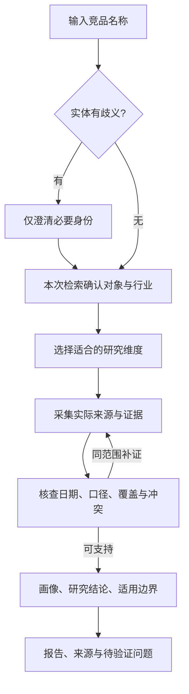

# 单对象默认研究与可选项目流程

版本：4；日期：2026-11-03。默认入口以 [commands/analyze.md](../../../commands/analyze.md) 为准，只需竞品名。**Python当前仅支持初始化与工程验证，研究执行链路未就绪。** 下图是目标工作方式，也可用于宿主工具可用时的Codex辅助研究试验，不是Python已经接通的流程。项目模式由用户主动选择，与源码开发Phase 1–6分开。

Codex路径须实际读取来源并逐条核查，证据不足时交付有限结果或提纲，不保证完整报告。Python默认入口目前只路由请求并给缺口／下一步指引，run/resume保存任务并停在UNDERSTANDING。宿主对话与产物不会自动导入Python任务或最终锁。

## 默认单对象范围

不要求用户介绍我方产品、命名项目、填写 profile、选择市场／目的／读者，或先确认候选名单。用户附带条件直接采用；未附带时声明通用概览与实际覆盖口径，常规维度由 Agent 根据对象选择。用户点名即限定本次对象范围，不再增加泛泛的“是否继续”。

只有名字缺失或实体歧义妨碍研究时才澄清。未指定市场不等于可以混合地区价格；价格、版本、规模与动态逐条注明来源条件。无读者配置时使用通用报告，无我方背景时不输出我方优势／赢输或伪造“对我们意味着什么”。

## 维度设计与来源采集

读取 [library/dimensions.md](../../../library/dimensions.md)，按目标产品／服务的行业、交付方式和已给出的关注点选核心子集及适用扩展。软件、硬件、品牌和服务使用同一证据契约，不固定垂直功能清单。设计范围简述后继续，不把维度设计变成强制初始化确认。

使用实际搜索和页面读取工具，保留本次查询、来源、获取日期与适用条件。模型记忆和搜索摘要只能提供线索；官方宣称、第三方报道、用户反馈分开。访问失败、未查、查找后未找到、不适用分别标记。只有工具确实执行、来源支持主张，才写成研究结果。

其他品牌可作为有来源的背景提及，不能未经请求扩成多对象采集。新增研究对象、实质改变地区或目标等范围变化先询问；同一对象同范围的查证与补证直接继续，仍受实际工具权限与预算约束。

## 核查、分析与输出

核查来源能否支持主张、信息时效、口径一致性、同源转载和冲突。无法补齐时披露有限结果，不能靠状态填满或置信度较高宣称核验通过。子代理或模型自评不能代替实质核查。

分析区分事实、样本反馈、推断与待验证假设。默认内容是对象画像、差异化特点、适用边界、研究结论和建议验证的问题。客户真实赢输、我方价格空间和优势对照都需要相关背景及双方依据；缺少时不编造，也不阻断其余画像研究。

未指定读者时提供通用报告。用户选择读者时共用证据和已有分析，Reporter 不新增事实。报告实际生成后可保存到 research/<安全对象标识>/<运行标识>/report.md 与 sources.md，不覆盖历史。Python 当前不会创建这些产物。

## 可选项目模式

用户主动要求长期跟踪、发现一组竞品、固定读者或我方对照配置时，可读取 [commands/init-project.md](../../../commands/init-project.md)：Codex每轮2～3题访谈 → 保存profile → 以可用宿主工具推荐维度／发现候选并确认草案。Python项目访谈仍一次一题，ready只表示档案保存，不会自动执行后面几步；聊天完成也不等最终锁或报告完成。此模式不影响无项目默认请求。

仅在用户选择的项目模式或明确要求市场格局／竞品发现时，分层检查：

| 层级 | 判定依据 |
|---|---|
| 直接竞品 direct | 同一客群和核心任务争夺选择或预算 |
| 替代品 alternative | 人工、自建、外包、不同解决路径，以及客户不买／不换 |
| 潜在进入者 potential_entrant | 实际进入动作与预测假设分开 |
| 标杆 benchmark | 有学习价值，不因规模大就判为直接竞争 |

各层有候选或明确缺口，不为了凑数编造证据。用户未请求竞品发现时，单对象研究不自动增加四层名单。

## 项目评审 API 保留的绑定约束

[research_workflow.py](../../../src/steal_her_heart/research_workflow.py) 的现有 API 是项目模式的离线契约，不是默认单对象入口的前置条件。DiscoveryProposal 绑定 ProjectContext 摘要、实际搜索引用和候选范围；confirm_competitors 校验用户审阅摘要与选择。不能把 approved_by=user、模型判断或用户沉默当作授权。

现有 design_dimensions 在名单批准后构造最终提案，write_dimensions 生成 dimensions.md 与同源 dimensions.proposal.json，confirm_dimensions 核对背景、名单、提案与文件摘要后写 dimensions.lock.json。write_dimensions 不覆盖聊天预览或已有评审稿；聊天预确认到这些 API 的自动迁移仍未接入，不得删除预览、伪造背景／批准或放宽 guard。

prepare_collection_jobs 只为该项目已批准对象准备带同一模板的任务快照，仍需有效锁。它没有启动子代理、调度队列、重试、预算或持久执行器。未来批量研究按实际可用槽位一对象一代理、父级统一核查；默认单对象分析不会为了调用这套 API 而虚构项目。

项目背景、名单、维度或口径变化重审相应范围，不续签旧批准。绑定任务恢复必须保持背景一致；无项目快照也必须继续以无项目方式恢复，不能默认套入某个项目。

## 实现边界

底层ResearchState、Registry、SQLite快照与事件已经存在；单对象入口没有强制项目访谈。独立搜索／抓取／显式摘录诊断可用，但未接入研究路由、分析或报告。项目评审的数据散列只检测内容变化，不是用户身份认证，搜索引用仍需与实际账本核验。帮助与guidance改善可理解性，不改变这些执行边界。

当前 run/resume 仅到 UNDERSTANDING，不能从技术状态名、任务数量、离线确认夹具或指令文件推导真实研究已完成。后续 Python Planner 与执行器需为单对象范围和可选项目范围分别落地契约，不复用旧 initial_plan 标记跳过有约束的项目锁检查。
