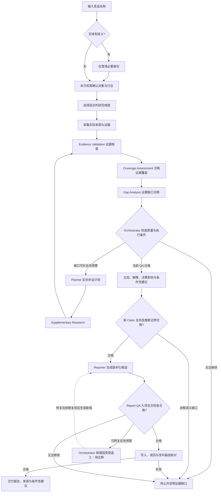

# 单对象默认研究与可选项目流程

版本：16；日期：2026-11-04。默认入口以 [commands/analyze.md](../../../commands/analyze.md) 为准，只需竞品名。**Python当前仅支持初始化、工程验证及独立工具诊断，研究执行链路未就绪。** 下图是目标工作方式，也可用于宿主工具可用时的Codex辅助研究试验，不是Python已经接通的流程。显式竞品发现是独立可选分支；项目模式由用户主动选择，与源码开发Phase 1–6分开。

0.30 产品规则补充见 [通用引擎与行业扩展](../../../docs/product-design.md)：行业包选择业务字段和分析方法，读者决策在规划时进入问题集，默认只追问必要信息；多标签按实体去重，范围变更先评估影响，即时简报不启动监测。当前 Python 默认模板、11 题项目访谈、单 tier 及周期路由未迁移。

Codex路径须实际读取来源并逐条核查，证据不足时仅说明已核实材料与缺口，不伪装完整研究报告。Python默认入口目前只路由请求并给缺口／下一步指引，run/resume保存任务并停在UNDERSTANDING。宿主对话与产物不会自动导入Python任务或最终锁。图中核查能力由 Validator 承担；当前 v1 的合法补证回路仍为 VALIDATING→PLANNING→RESEARCHING→VALIDATING。目标 [状态机 v2](../../../docs/state-machine-v2.md) 将 VALIDATING→GAP_ANALYSIS、PLANNING→SUPPLEMENTING 明确分阶段，待迁移后启用。

## 模块交接契约（目标，待实现）

流程中八个角色遵守 [Agent 十项契约](../../../docs/agent-contracts.md) 及其 YAML 目录。输入输出绑定当前调用、范围、计划、策略、资产和权限预算；理解阶段不伪造尚不存在的计划。Research 交接原件、未验证候选及所有工作项状态，Validator 决定证据准入，Analysis 的新 Claim 单独核查；Reporter 只交草稿，Report QA 和工件检查通过后才交付。模块自报成功不能跳过这些接纳条件，目录本身尚不是可执行框架。

## 默认单对象范围

不要求用户介绍我方产品、命名项目、填写 profile、选择市场／目的／读者，或先确认候选名单。用户附带条件直接采用；未附带时声明通用概览与实际覆盖口径，常规维度由 Agent 根据对象选择。用户点名即限定本次对象范围，不再增加泛泛的“是否继续”。

只有名字缺失或实体歧义妨碍研究时才澄清。未指定市场不等于可以混合地区价格；价格、版本、规模与动态逐条注明来源条件。无读者配置时使用通用报告，无我方背景时不输出我方优势／赢输或伪造“对我们意味着什么”。

## 模式与研究深度（目标，待实现）

依据 [研究模式设计](../../../docs/research-modes.md) 选择 Quick／Standard／Deep：无指定采用 Standard，快速或深度明确要求优先，无需先问模式。先简述有效模式、对象与问题，再按版本化策略规划来源、证据要求、总预算与补研预留。模式不自动扩大对象或改变项目评审要求。

Quick 可少选常规维度，但不删用户明确要求；Deep 可深入少数问题，不凑维度数。三种模式均经过完整 Research QA、Claim 支持和 Report QA。额度不足不静默升级／降级，模式切换按新策略的依赖影响补研，不覆盖旧报告或重置消耗。当前 Python 尚无结构化模式或执行链；图中步骤均须在未来绑定同一策略。

## 维度设计与来源采集

读取 [library/dimensions.md](../../../library/dimensions.md)，按目标产品／服务的行业、交付方式和已给出的关注点选核心子集及适用扩展。软件、硬件、品牌和服务使用同一证据契约，不固定垂直功能清单。设计范围简述后继续，不把维度设计变成强制初始化确认。

使用实际搜索和页面读取工具，保留本次查询、来源、获取日期与适用条件。模型记忆和搜索摘要只能提供线索；官方宣称、第三方报道、用户反馈分开。访问失败、未查、查找后未找到、不适用分别标记。只有工具确实执行、来源支持主张，才写成研究结果。

目标实现由统一采集接口选择已声明能力的 Adapter，Research 与 Discovery 复用。先用搜索／抓取／来源关联打通可访问的静态材料，再按实际缺口加入有限官网遍历、文档解析、新闻与评论；来源管理贯穿整个处理链，自动提取返回待验证候选。网站改版、动态内容或不支持格式要报告明确缺口，不当作没有相关信息。范围、父子调用及预算约束、八类能力和实际未实现部分见 [资料采集设计](../../../docs/data-collection.md)。

目标证据服务独立保存 Source（原始资料）、Evidence（有摘录与定位的原子事实主张）、Claim（分析结论），与采集层共享来源数据。关系绑定具体版本，一条结论可关联多个证据，证据可复用于多条结论；支持、反驳和背景分别表达。核验、时效、来源评级及冲突有各自依据，未知有效期不表示永久有效，过期不改写历史。字段与迁移见 [证据管理设计](../../../docs/evidence-management.md)，当前尚无这套独立存储。

其他品牌可作为有来源的背景提及，不能未经请求扩成多对象采集。新增对象或实质范围变化须有真实用户授权；用户已明确完整指定的变更不重复泛泛确认，含糊指代或推断扩展先澄清。同一对象同范围的查证与补证直接继续，仍受实际工具权限与预算约束；项目范围变更仍按正式评审绑定新版锁。

## 按独立任务派发（目标，待实现）

按 [Worker 调度设计](../../../docs/task-scheduling.md) 将 A价格、B部署、C功能等任务分别绑定问题、输入、来源限制、依赖、预算和完成条件。Worker 是 ResearchAgent 执行实例，不只接竞品名；同对象可拆任务，空闲 Worker 可接另一对象，每次隔离上下文和权限。

任务结果先校验分配／版本／工件并逐项汇总，v2 在 RESEARCHING／SUPPLEMENTING 收集本轮状态后进入 VALIDATING→GAP_ANALYSIS。局部成功不等于完整 QA，已确认共同比较维度不能因重点不同删掉；失败只影响相关任务和依赖，重派先核账本，不丢其他成果或重置预算。

## 外部工具失败与恢复（目标，待实现）

[统一恢复设计](../../../docs/failure-recovery.md) 要求分别展示调用失败、成功查找但未命中、暂时无法执行和结果不明。页面不可达、动态壳、模型／解析错误和子代理失联不得写成“未找到”；保留原工件、子项状态与错误，已完成研究不丢失。

主控检查可信错误分类、授权、预算、期限和远端记录后，选择重试、可用替代、跳可选、延后、具体人工协助或停止。当前公开搜索／抓取无自动重试，受限不切入口绕过。必需问题仍留在 QA 分母，降级方法不降证据标准，部分成果不冒充完整报告。

未来延后／人工事项另有持久化处置与恢复入口，不当作范围确认或模块未实现；当前没有自动唤醒。恢复核对版本、锁、预算、调用与租约，只继续安全且受影响的工作，超时不明不盲目重发，终态不重开。

## 核查、分析与输出

Research QA 是分析前的强制关卡。先核查来源能否支持主张、信息时效、口径一致性、同源转载和冲突，再按当前版本的必需且适用单元及各自证据标准评估覆盖，最后诊断缺口。不能靠状态填满或置信度较高宣称核验通过；子代理或模型自评不能代替实质核查。

例如用户要求价格、部署、功能、目标客户四维，前三维已经核查充分，目标客户只有第三方推测：有材料4/4不等于合格证据4/4，当前为3/4。Planner 应针对目标客户给补证计划，优先找可支持具体问题的定位、解决方案、客户案例或可靠调查等材料；这不限定所有行业只用官方来源，也不把单个案例推广为总体客群。补证后重做 QA，不能直接生成看似完整的分析。

同范围补证无需再询问，但仍须由 Orchestrator 检查实际预算、访问限制和有效进展。首次已经充分则直接分析；无法补齐则保留缺口停止。Python 当前结果协议不支持以失败任务交付最终报告；未来 QA 逐格结果、版本绑定和验收细节见 [模块契约](../../../docs/module-contracts.md)。

分析区分事实、样本反馈、推断与待验证假设。默认内容是对象画像、差异化特点、适用边界、研究结论和建议验证的问题。客户真实赢输、我方价格空间和优势对照都需要相关背景及双方依据；缺少时不编造，也不阻断其余画像研究。

[分析引擎](../../../docs/analysis-engine.md) 按本次问题选用定位、功能、定价、客户、商业模式、优劣势、机会、威胁与差异化能力。分析需说明证据为何影响某类客户或产品决策；威胁有作用机制、时间窗、触发与反证，建议有前提、行动备选、取舍、验证及反转条件，不能停留在功能清单。功能空白不直接证明需求，客户案例不证明总体分布，未知仍保留。

默认不问我方产品；用户希望得到我方具体建议时才复用或少量补充目标、现状和约束，每轮 2～3 题即可，不强制建项目。用户自述保留来源与背景版本，条件性建议写明依赖这些前提，不能冒充已核验的我方优势。缺必需背景时明确当前无法支持的建议；若用户将其列为必需目标，不能用通用画像冒充任务完成。

Research QA 通过后，新生成的每条 Claim 仍需核查支持关系，不能继承输入证据的 PASS。Reporter 将段落、表格单元和列表项映射到 Claim 版本，既可向前追到 Evidence 与原文快照／定位，也可从来源或证据反查受影响的报告片段。转述改变语义要重核，证据失效标记当前使用风险并保留旧报告；当前 Python 的分析／报告语义缺口沿 FAILED 出口，不隐式增加回退迁移。

未指定读者时提供通用报告。用户选择读者时共用证据和已有分析，Reporter 不新增事实。报告实际生成后可保存到 research/<安全对象标识>/<运行标识>/report.md 与 sources.md，不覆盖历史。Python 当前不会创建这些产物。

## 报告质量与返工（目标，待实现）

[Report QA](../../../docs/report-qa.md) 在交付前独立检查九项：有效维度覆盖、重要事实证据、事实与推断区分、重复、矛盾、时效、数字依据、研究目的回应、确定性措辞。核查遍历正文、摘要、表格、脚注和更新说明，发现未登记的重要主张；不能只验证既有 Claim 引用非空。所有必检项完成且通过才放行，无法判断不能按 PASS 计算。

按根因返工：合格内容漏写或转述错误交 Reporter；材料充分但推理错误交 Analysis；已有材料需重新核验交 Validator；缺证据或计划漏项交 Planner 安排 Research。修复保留旧版本，失效的依赖重新核查，新草稿须完整 Report QA，随后核对确切工件和发布基线。只改格式也不能沿用旧报告的质量批准。

图中的返工是目标协议：当前 REPORTING 尚无上游回边，完成边也没有报告质量／读回守卫。v2 须实现独立 GENERATING_REPORT→REPORT_QA，按票据回生成／分析／核查／规划，以及完成守卫；分析和生成的上游输入缺陷也仅走 v2 显式允许边，不任意回退或直接跳采集。升级前仍遵守现有失败出口；升级后可修复问题按上述路线返回，轮次耗尽、无进展或无法核查则停止，保留诊断而不交付失败稿。

## 多轮追加与增量修订（目标，待实现）

用户追加“增加 C，重点研究它的私有化部署”时，先定位原研究与修订基线，核对 C 身份和部署问题含义，保存变更及授权；用户只说“再加一个”而未指名时只补必要澄清。逻辑研究可无业务项目，当前 resume 不接这种新要求。

Planner 区分共享维度、C 专项深入问题与全体扩维，按依赖给出保留、复核、重提取、刷新、新采集、重算分析或重排报告的动作。A、B 原有且仍适用的价格／功能事实保留；需要部署横比才补该维度缺口。新增 C 可能改变总体排序、摘要和建议，不能仅追加一行而漏改结论。

原获取日期和证据版本保留，当前修订另记采用与核验依据。新版完整 QA 检查所有必需单元、跨新旧材料冲突与版本绑定；有效局部依据可复用，旧全局 PASS 不能复制。相关分析的新 Claim 核查后生成新版报告及更新说明，列新增、变化、移除、复用与未更新项；旧报告保持可读，失败显示旧时点和本次未完成状态。

在途变更先暂存，合法规划边界才采用，不原地改旧计划；旧调用迟到不能混入当前修订。终态不重开，无合法回退时按停止协议处理旧执行并关联新任务，预算与限制继续累计。项目新版名单与维度须重新绑定批准和锁，现有 API 无换锁协议，不覆盖旧文件。

纯读者／格式变更保留原研究修订、分析、QA 依据和事实 as_of，只生成新报告版本并重新完整 Report QA；新增问题或要求当前事实时才进入研究修订。详细基线、并发、依赖、例子及验收见 [多轮研究设计](../../../docs/incremental-research.md)，目前尚未实现差量执行或报告版本发布。

## Competitor Discovery 分支（目标，待实现）

用户明确请求发现竞品、替代方案或市场格局，或选择含发现的项目流程时，由 Orchestrator 调用 Competitor Discovery。只给产品名称的普通分析不自动启动发现；请求发现也不强制介绍我方背景或创建项目。

先从当前来源核对种子身份与定位、客群、核心场景和功能，再按四路检索建立候选池；记录每路查询、候选及缺口。候选页面核验限于身份和竞争关系依据，名单选定前不深采完整分析维度。通过实体消歧、别名去重、四类归属、可解释匹配及候选依据核查后，展示候选、为什么纳入、来源日期、不确定性和评分分项，供用户增删修正及选定。完整设计见 [竞品发现机制](../../../docs/competitor-discovery.md)。

分类按相对种子的具体关系判断：

| 层级 | 判定依据 |
|---|---|
| 直接竞品 direct | 同一客群和核心任务争夺选择或预算 |
| 替代品 alternative | 人工、自建、外包、不同解决路径，以及客户不买／不换 |
| 潜在进入者 potential_entrant | 实际进入动作与预测假设分开 |
| 标杆 benchmark | 有学习价值，不因规模大就判为直接竞争 |

各层有候选或明确缺口，不为了凑数编造证据。用户未请求竞品发现时，单对象研究不自动增加四层名单。

同名产品不直接合并，同域的套件和子产品按本次粒度区分；改名和别名需要身份依据。未知指标不当零分或丢权重重算，跨类别不混用同一个总榜。用户纠正保留原始输入来源，不自动升级为事实；修改后的当前提案重新核查和绑定选择，删除记录保留，旧名单批准及维度锁不可沿用。全部删除或确实没有候选时如实停止，不凑对象。

候选纳入核查只说明身份和关系依据是否足以进入名单审阅，不能发出完整研究 PASS。用户选定名单后才生成正式多对象研究计划，仍执行 Research QA；项目模式另需有效最终维度锁。Python 当前只有项目提案与选择契约，无发现执行器或编辑器；非项目及空结果协议待实现，不能伪造项目或搜索调用来适配旧 API。

## 可选项目模式

用户主动选择长期项目、持久读者或我方对照配置时，可读取 [commands/init-project.md](../../../commands/init-project.md)：Codex每轮2～3题访谈 → 保存profile → 以可用宿主工具推荐维度／发现候选并确认草案。仅要求发现一组竞品不意味着必须建立项目。Python项目访谈仍一次一题，ready只表示档案保存，不会自动执行后面几步；聊天完成也不等最终锁或报告完成。

## 项目评审 API 保留的绑定约束

[research_workflow.py](../../../src/steal_her_heart/research_workflow.py) 的现有 API 是项目模式的离线契约，不是默认单对象入口的前置条件。DiscoveryProposal 绑定 ProjectContext 摘要、实际搜索引用和候选范围；confirm_competitors 校验用户审阅摘要与选择。不能把 approved_by=user、模型判断或用户沉默当作授权。

现有 design_dimensions 在名单批准后构造最终提案，write_dimensions 生成 dimensions.md 与同源 dimensions.proposal.json，confirm_dimensions 核对背景、名单、提案与文件摘要后写 dimensions.lock.json。write_dimensions 不覆盖聊天预览或已有评审稿；聊天预确认到这些 API 的自动迁移仍未接入，不得删除预览、伪造背景／批准或放宽 guard。

prepare_collection_jobs 只为该项目已批准对象准备带同一模板的任务快照，仍需有效锁。它没有启动子代理、调度队列、重试、预算或持久执行器。未来 Planner 按对象内的具体问题拆 Research Tasks，主控按槽位和能力分配可复用 Worker，父级接纳汇总后统一核查；默认单对象分析不会为了调用这套 API 而虚构项目。

项目背景、名单、维度或口径变化重审相应范围，不续签旧批准。绑定任务恢复必须保持背景一致；无项目快照也必须继续以无项目方式恢复，不能默认套入某个项目。

## 实现边界

底层ResearchState、Registry、SQLite快照与事件已经存在；单对象入口没有强制项目访谈。独立搜索／抓取／显式摘录诊断可用，但未接入研究路由、分析或报告。项目评审的数据散列只检测内容变化，不是用户身份认证，搜索引用仍需与实际账本核验。帮助与guidance改善可理解性，不改变这些执行边界。

当前 run/resume 仅到 UNDERSTANDING，不能从技术状态名、任务数量、离线确认夹具或指令文件推导真实研究已完成。后续 Python Planner 与执行器需为单对象范围和可选项目范围分别落地契约，不复用旧 initial_plan 标记跳过有约束的项目锁检查。
