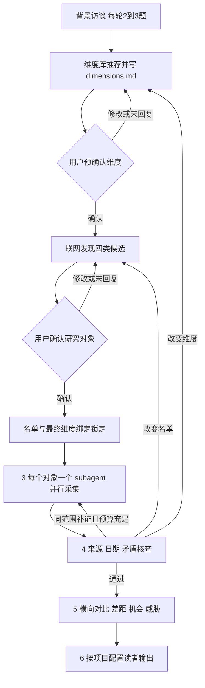

# 初始化与产品运行流程

版本：2；日期：2026-11-03。聊天初始化细节以 [commands/init-project.md](../../../commands/init-project.md) 为准：维度先预确认，再联网发现和确认候选。本页说明后续采集闸门及现有 Python API 的兼容边界，与源码开发的 Phase 1–6 分开。

图中最终绑定尚无从聊天预确认到 Python API 的自动桥接，不能因绘有连线便声称已实现。名单变化重新确认名单，若影响维度则重审变化；仅维度变化回维度评审。用户沉默、模型自评、已填 approved_by=user 均不是批准证据。

## 维度推荐与预确认（聊天初始化）

补齐 profile 后读取 [library/dimensions.md](../../../library/dimensions.md)，根据行业／业态、目的、市场和读者推荐核心字段与扩展组合，解释适用原因。生成 projects/<项目名>/dimensions.md，先向用户展示并等待明确确认，再执行候选发现搜索；不会选择时提供可选组合，不自动把推荐当作批准。

此时只确认字段设计，尚未绑定后续实际候选，不生成或冒充 dimensions.lock.json。既有完整项目复用已确认内容，不覆盖旧稿或要求重复泛泛确认。候选引入新的比较对象类型、字段或口径时，展示变化并重新审阅受影响部分。

## 竞品发现与确认

使用已初始化的产品、客群、市场和目标调用联网搜索，保留实际查询／调用记录、来源快照及日期。用户已知竞品是线索，不是全部候选。

| 层级 | 判定依据 |
|---|---|
| 直接竞品 direct | 同一目标客群、同一核心任务中争夺选择或预算 |
| 替代品 alternative | 用不同产品、服务、流程解决同一问题，包括人工、自建、外包、表格、客户不买或不换 |
| 潜在进入者 potential_entrant | 有进入相关场景可能性，区分已发生动作与预测假设 |
| 标杆 benchmark | 对当前决策有可学习价值，不因规模大就冒称直接竞争 |

每项说明分类理由、与客户任务的关系、来源及待验证假设。四层都要检查，未找到某层时写范围和缺口，不强行造候选。特别检查现状／不行动；它可以是分析假设，但不能虚构为联网证实的行为事实。

展示分层清单后等待用户选择／增删。批准绑定项目背景、提案版本、内容摘要和选定ID。名单变化使批准失效。未知实体在此澄清，不用一次泛泛的“继续”绕过完整名单评审。

## 最终维度绑定与锁定（现有 Python API）

这部分记录现有 API 的调用前提，不能反过来改变聊天“先维度预确认、再候选确认”的用户顺序。最终锁必须覆盖当前背景、已确认名单和实际采集字段；未经锁定不得大规模采集。

从有版本的 DimensionLibrary 选择核心字段与品类扩展，解释为何适合本项目目标、行业、市场和读者。核心字段也可按项目选择，不要求每次采集全部通用字段；所选字段的证据和适用性约束不可削弱。所有信息仍具备统一元信息。

现有 design_dimensions 在名单批准后才能构造最终提案，write_dimensions 生成本项目专属 dimensions.md 和同源 dimensions.proposal.json，列项目范围、已确认对象、维度库版本、选择理由、统一字段ID／定义、配置读者及关注点。write_dimensions 只允许替换初始化原始占位稿，不能覆盖聊天已生成的维度预览或已有评审稿。当前没有自动迁移桥接，须报告缺口，不可删除预览、伪造名单批准或放宽 guard 来宣称初始化已产生程序锁。

程序最终确认入口核对提案、Markdown 和名单批准的摘要后才保存 dimensions.lock.json，必须来自受信用户界面。未来桥接可复用确实覆盖相同字段和口径的预确认，不另加泛泛的继续确认；发生变化则须审阅变化。所有对象使用同一锁定模板；文件、背景、名单、字段或读者变化需版本化重审。旧批准不能继续使用，不能让不同子代理自行增加字段。字段单位、比较规则、时间范围等语义口径需由后续 Planner 进一步细化和核验，当前字段列表不冒充完整语义设计。

## 阶段3：并行采集

每个已确认研究对象一个 collection subagent，包含选中的替代方案／现状路径，不只处理软件厂商。主控传入只读背景、唯一对象ID、锁定字段、来源策略和预算；各代理负责独立任务目录和 Evidence，不写父级批准文件、不分析结论、不修改其他对象资料。

主控按运行环境实际可用槽位和预算并行调度，超出槽位分批，不共用无边界聊天。每个对象有 queued/running/completed/failed 状态、检查点和错误；单项失败保留局部结果，不把批次整体写成完成。父级统一校验合并，去重同源证据；补证优先续接该对象的代理。

当前 prepare_collection_jobs 只准备“一对象一代理”的任务快照，尚无 subagent 启动、队列调度、重试／取消和持久化执行器。不能把任务数量或异步函数数当作真实子代理已运行。

## 阶段4：核查

来源可访问且支持主张；获取时间与事件／发布日期分开；价格和版本符合市场／周期；记录冲突证据与适用范围；未找到、不适用、尚未采集分开。子代理自评不能代替父级 Validator。

同名单同维度范围内补证直接回采集，但受累计预算和无进展停止约束。新增对象、维度、市场或读者等改变范围时重走相应确认。无法核实时披露并保留草稿，不伪造通过。

## 阶段5：分析

先统一横向口径，再做对比、差距、机会和威胁。事实、用户评价、分析推断分开；观察客户为何不买／不换及替代方式的成本和迁移阻力。机会与威胁是有依据的判断，不伪装为已验证需求。不得仅因未提及功能判定短板。

## 阶段6：配置读者输出

实际角色来自项目配置中的 ReaderProfile（开放 id、label、priorities、output_style）。四类已有角色只是预设，可以选其中部分，也可配置投资人、董事会或其他角色；不能在 /brief 中无条件填入固定四类。

阶段0的原始读者答复若尚未转为结构化配置，最终维度提案须给出可审阅映射并由用户确认。未解析时保留原答和缺口，不默认四类。Battlecard 的 audience 同样可用配置ID，销售一页纸是输出类型，不是角色白名单。

各视图共用已核查证据和已完成分析，Reporter 不新增事实。一页纸、价格空间、样本归因等既有门槛保留；某种自定义版式没有实现时说明能力缺口，不能假称生成成功。

## 实现及授权边界

[research_workflow.py](../../../src/steal_her_heart/research_workflow.py) 已提供分层提案与缺口契约、名单确认函数、维度库选择、dimensions.md／提案文件写入、锁定记录和采集任务准备；[schemas.py](../../../src/steal_her_heart/schemas.py) 提供开放读者配置。上述函数必须由受信用户界面驱动，不能作为模型可调用的批准工具。

内容散列用于检测范围变化，不是用户身份认证或签名；search_call_ids 也须与真实执行账本核验。Python 当前未接聊天／CLI 的确认交互、联网发现或代理调度，未实现持久业务状态协调器。Codex 聊天指令可组织宿主工具，但每次实际调用、用户回复和产物必须真实发生；指令存在和纯函数测试通过都不能证明研究跑通。

已有 ResearchState 是底层技术状态，不能代替本页业务闸门。现有 run/resume 仍停在 UNDERSTANDING；将来接入真实执行时必须统一通过两道评审及锁定检查，不能沿用旧 initial_plan 标记跳过名单与维度确认。阶段0及任务数据库保持既有协议。
